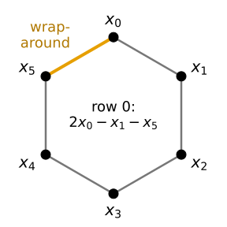
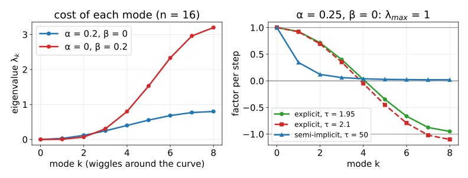
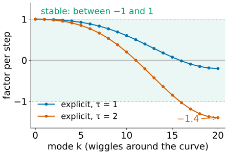
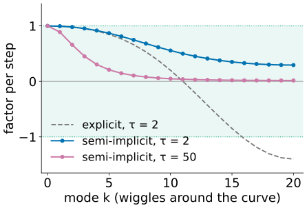
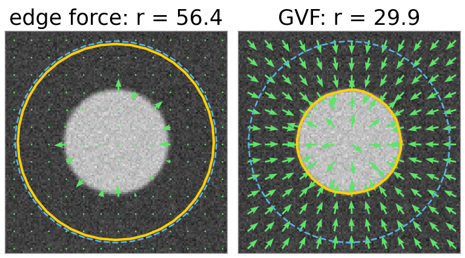
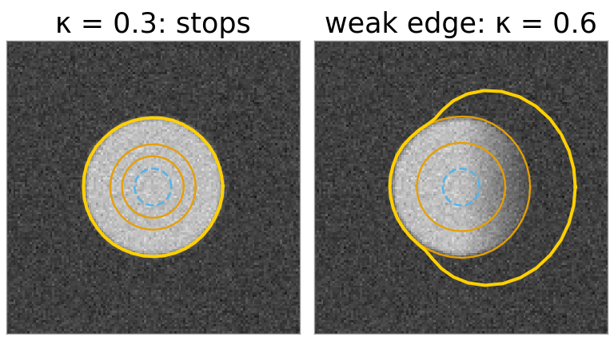
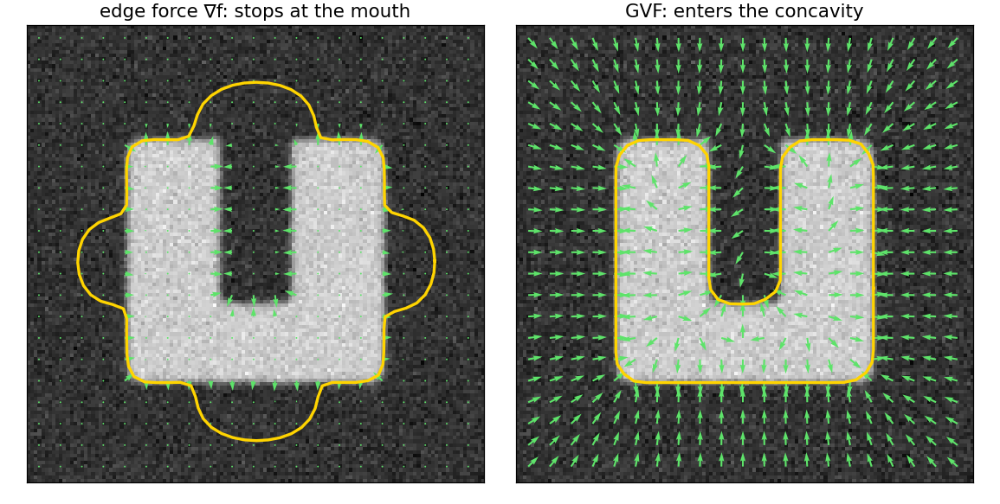
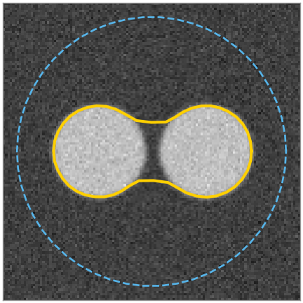

## About this lecture

[Last unit](../snakes/lec.qmd): a snake moves its beads downhill on an energy, and explodes when the step is too large. Today we look at the update as **linear algebra**, and give the snake a longer reach.

- The internal forces of all beads at once: **one matrix** $A$, the same for $x$ and $y$.
- $A$ is a circular convolution, so its eigenvectors are **waves around the curve**: wiggles are expensive, the overall shape is cheap.
- Why the plain step explodes, and the **semi-implicit** step that never does.
- The **capture range**: larger $\sigma$, a **balloon** force, **gradient vector flow**.
- What snakes cannot do, and where that leads.

*Slides titled **The math** give the formulas and proofs; the ideas are complete without them.*

## All beads at once: a matrix

Put the $x$ coordinates of the $n$ beads in one vector $\mathbf x = (x_0, \dots, x_{n-1})$ (and the $y$'s in another). The internal force on every bead is a fixed weighted sum of its neighbours: **force $= -A\,\mathbf x$**, the same $A$ for $\mathbf y$.

:::: {.columns}
::: {.column width="64%"}
With $\alpha = 1$, $\beta = 0$ and $n = 6$:

$$A = \begin{pmatrix} 2 & -1 & 0 & 0 & 0 & -1 \\ -1 & 2 & -1 & 0 & 0 & 0 \\ 0 & -1 & 2 & -1 & 0 & 0 \\ 0 & 0 & -1 & 2 & -1 & 0 \\ 0 & 0 & 0 & -1 & 2 & -1 \\ -1 & 0 & 0 & 0 & -1 & 2 \end{pmatrix}$$

- Row $i$: $2x_i - x_{i-1} - x_{i+1}$, minus the elastic force. The corner entries are the **wrap-around**: bead 0 and bead 5 are neighbours.
- With $\beta > 0$ every row is $[\beta,\; -\alpha - 4\beta,\; 2\alpha + 6\beta,\; -\alpha - 4\beta,\; \beta]$ around the diagonal: **cyclic pentadiagonal**.
:::
::: {.column width="36%"}
{width="95%" fig-alt="Six beads x0 to x5 on a hexagon, joined by springs; the spring from x5 back to x0 is highlighted as the wrap-around. In the centre: row 0 equals 2 x0 minus x1 minus x5."}
:::
::::

## What the matrix tells us

- **Rows sum to 0**: $A\mathbf 1 = 0$. Moving the whole snake (all $x_i$ by the same amount) costs nothing.
- **Symmetric**, and the energy $\tfrac12\mathbf x^\top A\mathbf x \ge 0$: $A$ is positive semidefinite.
- Each row is the **same stencil, shifted**: $A\mathbf x$ is a circular convolution of $\mathbf x$ with $[-1, 2, -1]$ (*Filtering & convolution*).
- So, as in *Images in frequency space*: the **waves** around the curve are its eigenvectors. The alternating pattern $(1, -1, 1, -1, 1, -1)$: $A$ maps it to $(4, -4, 4, -4, 4, -4)$, four times itself.

## Waves around the curve

Wave number $k$ = how many times the pattern goes up and down around the curve. $k = 0$: a shift; $k = 1$: once around, the round shape itself (its size and how elongated it is); high $k$: **wiggles**.

{width="88%" fig-alt="Left: the eigenvalue of each mode k for n = 16, near zero for low k and largest for the wiggles at k = 8; with β = 0.2 it rises to 3.2, much more steeply than with α = 0.2 (0.8). Right: the factor per step for α = 0.25: explicit with τ = 1.95 ends at −0.95, with τ = 2.1 below −1; semi-implicit with τ = 50 stays between 0 and 1."}

- Left: the eigenvalue $\lambda_k$ is the **cost** of mode $k$. Low modes are almost free, wiggles are expensive. $\beta$ (red) penalises wiggles much more steeply than $\alpha$ (blue).
- Under the internal forces alone, every mode shrinks independently, the expensive ones fastest: the snake first **smooths**, then slowly **shrinks**.

## The math: the eigenvalues of a circulant matrix {.math}

Try $v_j = e^{2\pi i kj/n}$ (indices mod $n$, so the wrap-around is automatic). Row $j$ of $A\mathbf v$ for the elastic part:

$$\alpha(2v_j - v_{j-1} - v_{j+1}) = \alpha\big(2 - e^{-2\pi ik/n} - e^{2\pi ik/n}\big)v_j = \alpha\big(2 - 2\cos\tfrac{2\pi k}{n}\big)v_j = 4\alpha\sin^2\!\tfrac{\pi k}{n}\;v_j.$$

The rigid stencil is the elastic one applied twice, so its eigenvalue is the square:

$$\lambda_k = 4\alpha\sin^2\frac{\pi k}{n} + 16\beta\sin^4\frac{\pi k}{n}, \qquad k = 0, \dots, n - 1.$$

- Real eigenvectors: $\cos(2\pi kj/n)$ and $\sin(2\pi kj/n)$ (same $\lambda_k = \lambda_{n-k}$). The DFT diagonalises every circulant matrix.
- $\lambda_0 = 0$ (translation). Largest at $k = n/2$ (alternating signs, $n$ even): $\lambda_\text{max} = 4\alpha + 16\beta$.
- Low modes: $\lambda_k \approx \alpha(2\pi k/n)^2 + \beta(2\pi k/n)^4$, the continuous $\alpha$ and $\beta$ terms.
- $n = 6$, $\alpha = 1$, $\beta = 0$: $\lambda_k = 0, 1, 3, 4, 3, 1$.

## Why the explicit step explodes

:::: {.columns}
::: {.column width="52%"}
One step with the internal force: new $\mathbf x$ = $\mathbf x - \tau A\mathbf x$. Mode $k$ is simply **multiplied by $1 - \tau\lambda_k$**.

- Small $\tau$: every factor lies between 0 and 1. Every mode shrinks.
- The stiffest mode (the alternating zig-zag, $\lambda_\text{max} = 4\alpha + 16\beta$) gets the most negative factor. Once $\tau\lambda_\text{max} > 2$ its factor is below $-1$: the zig-zag **flips sign and grows** every step.
- Unit 1's snake: $\alpha = 0.1$, $\beta = 0.05$, $\lambda_\text{max} = 1.2$: stable for $\tau < 1.67$, and $\tau = 2$ (factor $-1.4$) exploded.
- A large $\beta$ makes it much worse: $\beta = 2$ gives $\lambda_\text{max} = 32.4$, so $\tau < 0.06$: thousands of tiny steps.
:::
::: {.column width="48%"}
{width="100%" fig-alt="Factor per step against mode k from 0 to 20 for unit 1's snake. With tau 1 (blue) the factors fall from 1 to −0.2, all inside the green band between −1 and 1. With tau 2 (red) they fall from 1 to −1.4; the modes above about k = 15 leave the band."}
:::
::::

## The semi-implicit step

:::: {.columns}
::: {.column width="55%"}
Kass et al.: evaluate the internal force at the **new** position, the image force at the old one.

$$(A + \gamma I)\,\mathbf x_\text{new} = \gamma\,\mathbf x + \mathbf f(\mathbf x), \qquad \gamma = 1/\tau.$$

- Each step solves a linear system instead of a multiplication. Mode $k$ is now multiplied by $\frac{\gamma}{\gamma + \lambda_k} = \frac{1}{1 + \tau\lambda_k}$: always between 0 and 1. **No $\tau$ makes it explode**.
- With huge $\tau$ the internal part jumps straight to its smoothest state in one step: stable, but the image force then dominates each step.
- $A + \gamma I$ does not change while $\alpha$, $\beta$, $\tau$, $n$ stay fixed: **factor it once**, reuse it every step. It is banded (plus two corners), so solving costs a few operations per bead.
:::
::: {.column width="45%"}
{width="100%" fig-alt="Factor per step against mode k for the semi-implicit step: with tau 2 (blue) it falls from 1 to 0.29, with tau 50 (purple) it is 0.89 at k = 1 and falls to 0.02; both stay between 0 and 1. The explicit step with tau 2 is shown dashed for comparison, ending at −1.4."}
:::
::::

## The math: the semi-implicit step {.math}

Gradient descent $\mathbf x_{t+1} = \mathbf x_t - \tau(A\mathbf x_t - \mathbf f_t)$ is an explicit Euler step of $\dot{\mathbf x} = -A\mathbf x + \mathbf f$. Taking the stiff linear part at $t + 1$:

$$\mathbf x_{t+1} = \mathbf x_t - \tau(A\mathbf x_{t+1} - \mathbf f_t) \;\Longleftrightarrow\; (I + \tau A)\mathbf x_{t+1} = \mathbf x_t + \tau\mathbf f_t \;\Longleftrightarrow\; (A + \gamma I)\mathbf x_{t+1} = \gamma\mathbf x_t + \mathbf f_t.$$

- $A + \gamma I$ has eigenvalues $\lambda_k + \gamma \ge \gamma > 0$: always invertible.
- Without $\mathbf f$: $\mathbf x_{t+1} = (I + \tau A)^{-1}\mathbf x_t$, and in the eigenbasis mode $k$ gets $1/(1 + \tau\lambda_k) \in (0, 1]$. Explicit: $1 - \tau\lambda_k$, inside $[-1, 1]$ only for $\tau\lambda_k \le 2$.
- A fixed point satisfies $A\mathbf x = \mathbf f(\mathbf x)$ for either step: the same balance, only the path differs.
- The same explicit-versus-implicit choice for smoothing a whole image: the [heat equation](../heat-equation/lec.qmd) (day 10).

## Try it: the modes of a snake

```{=html}
<link rel="stylesheet" href="../demos/dist/demo.css">
<div data-demo="snakespectrum" data-preset="alpha"></div>
<script src="../demos/dist/snakespectrum.js"></script>
```

::: notes
No image: internal forces only, n = 16, noisy circle. Top plot: λ_k; middle: the factor per step (green inside ±1, red outside); bottom: the size of each mode in the current contour (grey bars: at the start). Tour: "α only" (α = 0.2, semi-implicit τ = 1): the wiggles (modes 4–8, factors 0.71–0.56) disappear in a few steps, mode 1 (factor 0.970) shrinks the circle with a half-life of 23 steps. "β only" (β = 0.2): wiggles go even faster (mode 8: 0.24) but mode 1 has factor 0.995, half-life 150 steps. "explicit at the limit" (α = 0.25, τ = 1.95): mode 8 factor −0.95, the zig-zag flips sign every step and fades slowly. "just beyond" (τ = 2.1): factor −1.1, it grows and explodes. "semi-implicit, huge τ" (τ = 50): mode 8 factor 0.02, mode 1 0.34: stable, the circle collapses in a few steps. "n = 6": the matrix by hand (show matrix A).
:::

## Capture range

:::: {.columns}
::: {.column width="52%"}
The edge force $w\nabla f$ is only non-zero within a few $\sigma$ of an edge. A snake that starts further away feels nothing. Three remedies:

1. **Larger $\sigma$**, then smaller: a coarse-to-fine schedule. Wide pull first, accurate edge later.
2. **Balloon force** (Cohen, 1991): push every bead along its outward **normal** with strength $\kappa$. The snake inflates through flat regions until an edge stops it ($\kappa < 0$ deflates).
3. **Gradient vector flow** (Xu & Prince, 1998): spread the edge force out into the flat regions, so that every pixel points towards some edge.
:::
::: {.column width="48%"}
{width="100%" fig-alt="A disk with a snake started on a large circle around it, after 100 steps. Left, edge force: the arrows are near zero away from the disk's rim and the snake has barely moved (radius 56.4). Right, gradient vector flow: arrows everywhere point towards the disk and the snake sits on its edge (radius 29.9)."}

Far start (radius 58); $r$: mean radius after 100 steps; the field in green.
:::
::::

::: notes
Figure: the demo's "too far" and "far start: GVF captures it" presets (α = 0.01, start radius 58, disk of radius 30): after 100 steps the mean radius is 56.4 with the edge force and 29.85 with GVF.
:::

## The balloon force

:::: {.columns}
::: {.column width="52%"}
- A bead's normal: perpendicular to the line through its two neighbours, pointing out of the curve.
- Start a small circle **inside** the object: the balloon inflates it until the edge force at the boundary is stronger than $\kappa$.
- $\kappa$ too small: stops on noise inside. $\kappa$ too large: **pushes through** weak parts of the edge and keeps going.
- The balloon cancels part of the shrinking by $\alpha$, so the snake's size is no longer biased towards small.

Demo (unit 1's disk, $w = 2$, $\sigma = 2$): $\kappa = 0.3$ stops at radius 30.3; $\kappa = 1$ escapes. On a disk whose right edge fades out, $\kappa = 0.3$ already leaks through the weak side.
:::
::: {.column width="48%"}
{width="100%" fig-alt="Left: a small circle inside a disk inflates in steps (orange) and stops on the disk's edge (yellow). Right: a disk whose right edge fades out; the same kind of balloon with kappa 0.6 inflates to the edge, then bulges out through the faint right side."}

Start dashed; after 20 and 40 steps (orange); after 300 (left) and 80 steps (right).
:::
::::

## Gradient vector flow

Make a force field $\mathbf v$ that equals the edge force near edges and **varies smoothly** everywhere else. Start from $\mathbf v = \nabla f$ and repeat:

$$\mathbf v \leftarrow \mathbf v + \Delta t\,\big[\,\underbrace{\mu\,\nabla^2\mathbf v}_{\text{smooth it}} - \underbrace{|\nabla f|^2(\mathbf v - \nabla f)}_{\text{stay at }\nabla f\text{ near edges}}\,\big]$$

- $\nabla^2$ is the Laplacian kernel of *Filtering & convolution*: each step diffuses the field a little, like heat. Where $|\nabla f|$ is large, the second term keeps $\mathbf v \approx \nabla f$.
- After many steps, flat regions are filled with arrows pointing **towards** edges, also **into concavities**, where the plain edge force points sideways.

{width="68%" fig-alt="A U-shaped object. Left: the edge force arrows exist only near the edges, and a snake bridges the mouth of the U. Right: the GVF field fills the whole image with arrows pointing towards edges, also down into the slot, and the snake follows the U into its concavity."}

## The math: GVF as an energy {.math}

GVF minimises, over vector fields $\mathbf v = (u, v)$,

$$\mathcal E(\mathbf v) = \iint \mu\big(|\nabla u|^2 + |\nabla v|^2\big) + |\nabla f|^2\,|\mathbf v - \nabla f|^2 \;dx\,dy.$$

- Its Euler–Lagrange equations: $\mu\nabla^2 u - |\nabla f|^2(u - f_x) = 0$, the same for $v$. The update above is gradient descent on $\mathcal E$ (a diffusion equation run to steady state).
- Explicit diffusion with the 5-point Laplacian is stable for $\Delta t \le 1/(4\mu)$. The field spreads about $\sqrt{4\mu t}$ pixels in $t$ steps: a far reach needs many steps (the demo first iterates on a half-size grid).
- The snake itself is unchanged: $\mathbf v$ simply replaces $\nabla f$ as the image force.

## Try it: balloon and GVF

```{=html}
<link rel="stylesheet" href="../demos/dist/demo.css">
<div data-demo="snake" data-forces="all" data-matrix="on" data-preset="ugvf"></div>
<script src="../demos/dist/snake.js"></script>
```

::: notes
Same snake demo with GVF and the balloon enabled, and the matrix A + γI on the right (n = 100 is too large to read: lower n to 8 to see the band and the orange wrap-around corners). Tour: "U: GVF enters the concavity" (n = 100, α = 0.03, β = 0.01, resample every 10): tick field to see the GVF arrows pointing down into the slot; after 800 steps the snake reaches the bottom of the slot (y = 77.5); "concavity" with the edge force stays at y = 15.6. Without resampling the GVF snake also stops early (y = 38): the beads in the slot are pulled apart and need re-spacing. "balloon from inside": κ = 0.3 from radius 8, stops at radius 30.3. "leaks": the weak-edge disk with κ = 0.6 escapes to the right; even κ = 0.3 leaks (beads up to x = 129). "far start: GVF captures it": α = 0.01 from radius 58: radius 29.85 after 100 steps (with the edge force: 56.4).
:::

## What snakes cannot do

:::: {.columns}
::: {.column width="68%"}
- **Initialisation**: a snake is a local method; it refines a curve you give it.
- **Topology is fixed**: one snake = one closed curve. It cannot split around two objects, nor merge two snakes. Two objects need two snakes.
- **Self-intersection**: nothing prevents the curve from crossing itself.
- **Parameters**: $\alpha$, $\beta$, $\sigma$, $w$, $\kappa$ depend on the image and the number of beads.
- **No idea of shape**: any smooth curve is allowed. A missing piece of edge is bridged by a straight line, not by what the object should look like.
:::
::: {.column width="32%"}
{width="100%" fig-alt="Two nearby disks; a snake started on a large circle around both ends up as one outline that wraps both disks and bridges the gap between them."}

Two blobs, one snake: one outline.
:::
::::

Representing the curve **implicitly**, as the zero level of a function on the image grid, removes the topology problem (and gives edge- and region-based versions of the snake): the [level set day](../implicit/lec.qmd). Learning which shapes are plausible: the next two units ([shape models](../shape-models/lec.qmd), [active shape models](../asm/lec.qmd)).

## Summary

- Internal forces of all beads: $-A\mathbf x$ with the **cyclic pentadiagonal** $A$; $A\mathbf 1 = 0$, symmetric, positive semidefinite, circulant.
- Its eigenvectors are **waves around the curve**; $\lambda_k = 4\alpha\sin^2(\pi k/n) + 16\beta\sin^4(\pi k/n)$: wiggles expensive, shape cheap.
- Explicit step: mode $k$ times $1 - \tau\lambda_k$; **explodes** for $\tau(4\alpha + 16\beta) > 2$.
- Semi-implicit step $(A + \gamma I)\mathbf x_\text{new} = \gamma\mathbf x + \mathbf f$: mode $k$ times $1/(1 + \tau\lambda_k)$, **always stable**; factor once.
- Capture range: coarse-to-fine $\sigma$, **balloon** $\kappa\mathbf n$, **GVF** (diffused edge force, enters concavities).
- Fixed topology and no shape knowledge: level sets, and shape models.
