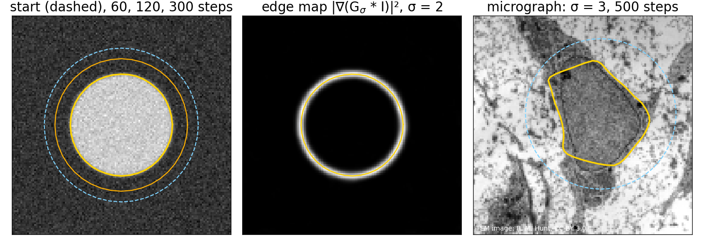
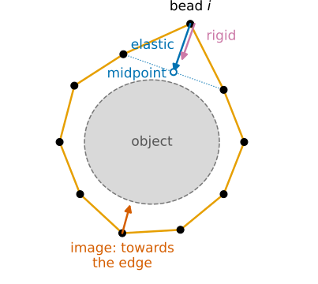
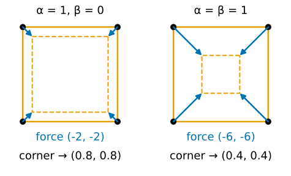
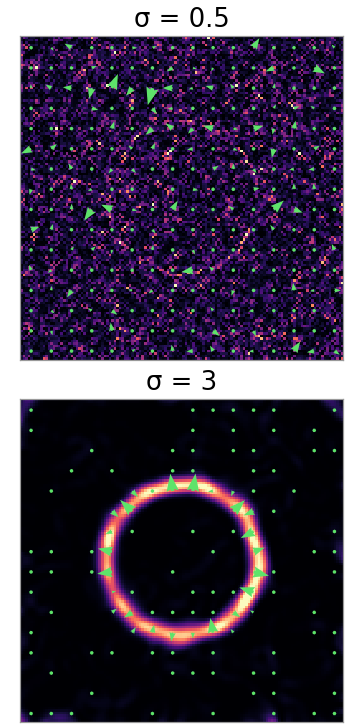
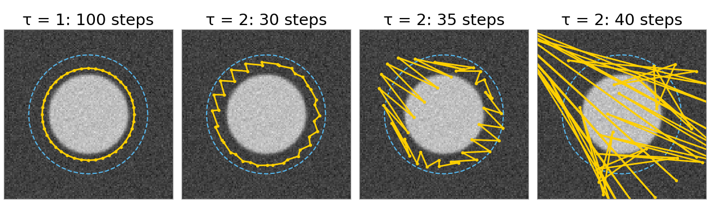
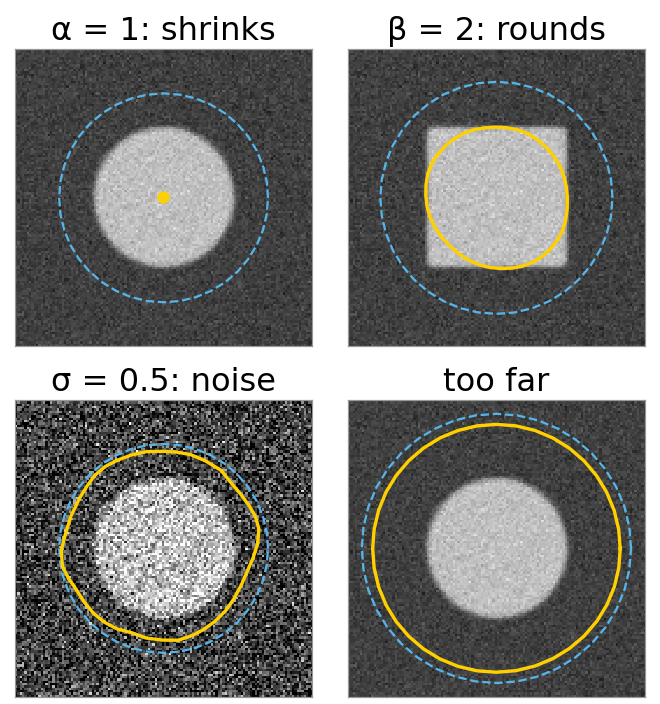

## About this lecture

A threshold gives a ragged, leaky outline. Often we want something else: **one smooth closed curve** that sits on the edges of the object. An active contour, or **snake** (Kass, Witkin & Terzopoulos, 1988), is such a curve that moves by itself until it settles there.

- A **closed chain of beads**: springs between neighbours, plus a pull towards edges.
- The beads move downhill on an **energy**: internal (smooth, short) plus image (on edges).
- The **force** on one bead, by hand: the neighbours' midpoint, and a straightening term.
- What the knobs do: elasticity $\alpha$, rigidity $\beta$, smoothing $\sigma$, step $\tau$.
- What goes wrong: shrinking away, cut corners, stuck on noise, too far away, explosion.

*Slides titled **The math** give the formulas and proofs; the ideas are complete without them.*

## Find the boundary of this nucleus

{width="100%" fig-alt="Left: a noisy bright disk, a dashed start circle around it and the snake at 60, 120 and 300 steps, ending on the disk edge. Middle: the edge map, a bright ring, with the final snake on it. Right: a micrograph of a cell with the snake on the outline of the nucleus."}

- Left: a snake starts as a circle (dashed) around a noisy disk and shrinks onto its edge. Middle: the **edge map**, bright where the image changes. Right: the same on a micrograph.
- A threshold would label pixels; the snake gives a **curve**: a list of points, smooth, closed, one object. Perimeter, curvature and shape come for free.

::: notes
Right panel: the nucleus of the course micrograph (128 × 128), start circle centre (74, 57), radius 44, σ = 3, 500 steps: the outline runs along the dark nuclear envelope, with a short cut across at the lower left. The disk: radius 30, start radius 45; after 300 steps the mean radius is 29.79.
:::

## Recall: segmentation as energy minimisation

On the graph cuts day ([segmentation as energy minimisation](../seg-energy/lec.qmd)) a segmentation was the labelling with the lowest **energy**: a data term (fit the image) plus $\lambda$ times a smoothness term (short boundaries).

A snake uses the same recipe with a different unknown:

| | graph cut | snake |
|---|---|---|
| unknown | a label per pixel | the positions of $n$ points on a closed curve |
| image term | grey level fits the label | the curve lies on **edges** |
| smoothness | boundary length, weight $\lambda$ | stretching ($\alpha$) and bending ($\beta$) |
| minimised by | one max-flow, exact | **moving the points downhill**, step by step, locally |

The snake finds a **local** minimum near where it starts. That is both its weakness (it needs a start) and its strength (it follows what you point it at).

## A closed chain of beads

:::: {.columns}
::: {.column width="60%"}
The curve is a polygon of $n$ points $\mathbf x_0, \dots, \mathbf x_{n-1}$; after the last comes the first again.

- **Elastic springs** between neighbours (weight $\alpha$): stretching costs energy. Each bead is pulled towards the **midpoint of its two neighbours**. A chain with springs alone contracts to a point.
- **Stiffness** (weight $\beta$): bending costs energy. Each bead is pushed to make the chain locally **straight**; corners are expensive.
- **The image**: low energy on edges. Each bead is pulled **uphill on the edge map**, towards the nearest strong edge, if there is one nearby.

The snake stops where the three forces balance at every bead.
:::
::: {.column width="40%"}
{width="100%" fig-alt="A closed polygon of ten beads around a grey object. At one bead that sticks out, a blue arrow (elastic) points to the midpoint of its two neighbours and a purple arrow (rigid) points inward to straighten the chain; at another bead a red arrow (image) points to the object's edge."}
:::
::::

::: notes
The arrows in the figure are computed from the force formula of the math slide with α = 1, β = 0.2 (bead i sticks out to radius 3.5, its neighbours sit at about 2.5).
:::

## Try it: a snake on a disk

```{=html}
<link rel="stylesheet" href="../demos/dist/demo.css">
<div data-demo="snake" data-preset="disk"></div>
<script src="../demos/dist/snake.js"></script>
```

::: notes
Disk of radius 30 (noise 0.05), start circle radius 45, n = 40, α = 0.1, β = 0.05, σ = 2, w = 2, semi-implicit τ = 1. Press play: the circle shrinks slowly (the elastic force is weak on a smooth circle): mean radius 39.7 after 50 steps, 34.9 after 100; then the edge catches it, and after 200 steps it sits at 29.78 and stays. The energy plot: the internal energy falls from 100.95 to 44.27, the image energy drops from about 0 to −70.9 when the snake reaches the edge. Switch the forces on (default) and the "edge map" view. Drag on the image to place a new circle. Then the presets: "α too large" (α = 1: the springs win, radius 0.2 after 500 steps), "β too large" (square, β = 2: rounded corners), "σ too small" (noise 0.25, σ = 0.5: stuck at radius 37–44), "too far" (α = 0.01: after 300 steps still at radius 53.4), "τ too large" (explicit step, explodes after 55 steps).
:::

## The forces on a square, by hand

:::: {.columns}
::: {.column width="57%"}
Four beads at $(1, 1)$, $(-1, 1)$, $(-1, -1)$, $(1, -1)$, no image.

- **Elastic** ($\alpha = 1$): bead $(1, 1)$ has neighbours $(-1, 1)$ and $(1, -1)$, midpoint $(0, 0)$. The force is $\alpha \times$ (sum of the neighbours $-\,2\times$ the bead) $= (-1,1) + (1,-1) - 2(1,1) = (-2, -2)$: twice the way to the midpoint.
- One step of size $\tau = 0.1$: $(1, 1) + 0.1\,(-2, -2) = (0.8, 0.8)$. All four beads do the same: the square **shrinks to 0.8** and stays a square.
- **Rigid** ($\beta = 1$): the straightening force at the corner is $(-4, -4)$ (math slide). With $\alpha = \beta = 1$: $(-6, -6)$, and the step lands at $(0.4, 0.4)$.

On a fine polygon, the elastic force at a bead is **the difference with its neighbours**: the same $[1, -2, 1]$ as the second-derivative kernel of *Filtering & convolution*.
:::
::: {.column width="43%"}
{width="100%" fig-alt="Two copies of the square with corners at plus and minus one. Left, alpha 1 and beta 0: each corner has a blue arrow of 0.1 times (−2, −2), and the dashed square after one step has its corner at (0.8, 0.8). Right, alpha and beta 1: arrows of 0.1 times (−6, −6), the new corner at (0.4, 0.4)."}

Arrows: $\tau\times$ force, the step each bead takes; dashed: the square after one step.
:::
::::

## The math: the snake energy and its force {.math}

$$E = \sum_{i=0}^{n-1} \Big[\tfrac12\alpha\,|\mathbf x_{i+1} - \mathbf x_i|^2 + \tfrac12\beta\,|\mathbf x_{i-1} - 2\mathbf x_i + \mathbf x_{i+1}|^2 + E_\text{ext}(\mathbf x_i)\Big], \qquad \text{indices mod } n.$$

$E$ is an ordinary function of $2n$ numbers. The force on bead $i$ is $-\partial E/\partial \mathbf x_i$. Point $\mathbf x_i$ appears in two elastic terms and three rigid terms:

$$-\frac{\partial E}{\partial \mathbf x_i} = \underbrace{\alpha(\mathbf x_{i-1} - 2\mathbf x_i + \mathbf x_{i+1})}_{\text{elastic}} \;\underbrace{-\,\beta(\mathbf x_{i-2} - 4\mathbf x_{i-1} + 6\mathbf x_i - 4\mathbf x_{i+1} + \mathbf x_{i+2})}_{\text{rigid}} \;-\, \nabla E_\text{ext}(\mathbf x_i).$$

- $[1, -2, 1]$ is the discrete second derivative; $[1, -4, 6, -4, 1] = [1, -2, 1] * [1, -2, 1]$ is the fourth.
- Square, $\beta = 1$, corner $(1, 1)$: $\mathbf x_{i\pm2}$ is the opposite corner $(-1,-1)$, so $-\big[(-1,-1) - 4(1,-1) + 6(1,1) - 4(-1,1) + (-1,-1)\big] = (-4, -4)$.
- The internal forces sum to zero over all beads: moving the whole snake costs nothing.

## The image term

:::: {.columns}
::: {.column width="70%"}
The snake should sit where the image changes most. Smooth the image with a Gaussian of size $\sigma$, take the gradient (*Filtering & convolution*), and square its length: the **edge map**

$$f = |\nabla (G_\sigma * I)|^2, \qquad E_\text{ext} = -w\,f \quad (\text{low on edges}).$$

- The image force on a bead is $w\,\nabla f$: it points **uphill on the edge map**, towards the ridge of the nearest edge.
- Far from any edge $f$ is flat and the force is **zero**: the snake does not feel the object. How far the pull reaches, the **capture range**, is a few $\sigma$.
- Small $\sigma$: sharp, accurate edges, but noise makes its own little edges. Large $\sigma$: a wide pull, but blurred and slightly shifted edges.
:::
::: {.column width="30%"}
{width="80%" fig-alt="Edge map of a noisy disk at two scales, with the force arrows in green. At sigma 0.5 the map is speckled with noise and the arrows point in random directions; at sigma 3 the map is a clean bright ring and the arrows point onto the ring, with none far from it."}
:::
::::

::: notes
Figure: the "σ too small" disk of the demo (noise 0.25), edge map and force arrows ∇f on an 8-pixel grid, at σ = 0.5 and σ = 3. 1D check (exercise B5): an edge map f(x) = exp(−(x − 10)²/8) (edge at x = 10, width 2). Its slope f′ is +0.30 at x = 8 (push right, towards the edge), −0.30 at x = 12, and −0.00001 at x = 20: a bead 10 pixels away feels nothing. In the demo the largest inward image force on the disk is 0.69 (w = 2, σ = 2), at radius 31.5.
:::

## The math: the continuous snake (Euler–Lagrange) {.math}

Let the number of beads grow: a curve $\mathbf x(s)$, $s \in [0, L)$, closed. The sums become integrals:

$$E[\mathbf x] = \int_0^L \tfrac12\alpha\,|\mathbf x'(s)|^2 + \tfrac12\beta\,|\mathbf x''(s)|^2 + E_\text{ext}(\mathbf x(s))\;ds.$$

Change the curve a little, $\mathbf x + \varepsilon\mathbf h$. For the elastic term, integrate by parts (the curve is closed, so the boundary terms cancel):

$$\frac{d}{d\varepsilon}\int \tfrac12\alpha|\mathbf x' + \varepsilon\mathbf h'|^2 ds\Big|_{\varepsilon = 0} = \int \alpha\,\mathbf x'\cdot\mathbf h'\,ds = -\int \alpha\,\mathbf x''\cdot\mathbf h\,ds.$$

The rigid term, integrated by parts twice, gives $+\beta\mathbf x''''$. A minimum needs the change to vanish for every $\mathbf h$: the **Euler–Lagrange equation**

$$-\alpha\,\mathbf x'' + \beta\,\mathbf x'''' + \nabla E_\text{ext}(\mathbf x) = 0:\qquad \text{internal force} + \text{image force} = 0.$$

- The discrete stencils are exactly these derivatives with spacing 1. Circle $\mathbf x(s) = r(\cos s, \sin s)$: $\alpha\mathbf x'' = -\alpha\mathbf x$, a force of size $\alpha r$ towards the centre.

## Moving the snake: one step at a time

Start from a curve near the object and repeat: compute the force on every bead, move every bead a little along it.

$$\text{new position} = \text{position} + \tau \times \text{force}$$

- $\tau$ (the step) small: the snake creeps downhill on the energy and stops where the forces balance.
- $\tau$ slightly too large: beads overshoot, the next force overshoots back, and a **zig-zag** grows until the snake explodes. With $\alpha = 0.1$, $\beta = 0.05$ this happens above $\tau \approx 1.67$.
- The image force is read at each bead's (non-integer) position by **bilinear interpolation**.

{width="72%" fig-align="center" fig-alt="Four snapshots of a snake on a disk. With tau 1, after 100 steps the snake is a smooth circle shrinking onto the disk. With tau 2, after 30 steps a small zig-zag is visible, after 35 it is large, and after 40 steps the polygon has shot far off the image."}

Why exactly 1.67, and a step that never explodes: the [next unit](../snake-matrix/lec.qmd).

::: notes
Figure: the disk preset with the explicit step (start radius 45, α = 0.1, β = 0.05). τ = 1: mean radius 34.8 after 100 steps, no zig-zag. τ = 2 (the "τ too large" preset): the zig-zag (alternating mode) has amplitude 0.9 px after 30 steps, 5 px after 35, 26 px after 40; the demo stops at 55 steps.
:::

## The math: gradient descent {.math}

Stack all bead positions into one vector $\mathbf x \in \mathbb R^{2n}$. The update is gradient descent on $E$:

$$\mathbf x_{t+1} = \mathbf x_t - \tau\,\nabla E(\mathbf x_t) = \mathbf x_t + \tau\,\mathbf F(\mathbf x_t).$$

- For small enough $\tau$, $E(\mathbf x_{t+1}) < E(\mathbf x_t)$ unless $\nabla E = 0$ (Taylor: $E(\mathbf x - \tau\nabla E) = E - \tau|\nabla E|^2 + O(\tau^2)$).
- "Small enough" depends on how curved $E$ is: the internal part has curvature up to $\lambda_\text{max} = 4\alpha + 16\beta$, and the step is stable while $\tau\lambda_\text{max} < 2$. For $\alpha = 0.1$, $\beta = 0.05$: $\lambda_\text{max} = 1.2$, $\tau < 1.67$.
- A fixed point is a solution of the discrete Euler–Lagrange equation: internal + image force $= 0$ at every bead.

## Reading the knobs

:::: {.columns}
::: {.column width="60%"}
| knob | too small | too large |
|---|---|---|
| $\alpha$ elasticity | points drift apart; slow to move in flat regions | shrinks **off** the edge (disk: from $\alpha \approx 0.85$) |
| $\beta$ rigidity | follows every corner and noise wiggle | **cuts corners**: the square comes out rounded |
| $\sigma$ smoothing | **stuck on noise** edges | blurred, slightly **shifted** edges |
| $w$ image weight | snake ignores the image | stuck on the first weak edge |
| $\tau$ step | slow | **explodes** (explicit step) |

And independent of the knobs: a snake whose beads are all far from any edge feels **no image force at all**.
:::
::: {.column width="40%"}
{width="100%" fig-alt="Four snake runs from the demo presets, start dashed, result solid. Alpha 1: the snake has shrunk to a point inside the disk. Beta 2: a circle inside a square, its corners cut. Sigma 0.5 on a very noisy disk: a lumpy curve stuck between start and edge. Too far: a circle that has barely moved from its start."}
:::
::::

::: notes
Figure: the demo presets, start dashed. α = 1 after 500 steps: shrunk to a point. β = 2 (square, start radius 50) after 500 steps: mean radius 30.7, the corners cut. σ = 0.5, w = 4, noise 0.25 after 500 steps: mean radius 41.0, still between start (45) and edge (30). Too far (α = 0.01, start 58) after 300 steps: 53.4.
:::

## Try it: what goes wrong

```{=html}
<link rel="stylesheet" href="../demos/dist/demo.css">
<div data-demo="snake" data-preset="u"></div>
<script src="../demos/dist/snake.js"></script>
```

::: notes
"concavity: cannot enter the U": n = 100, α = 0.03, β = 0.01, resample every 10. The snake wraps the outside of the U and bridges the slot: after 800 steps its deepest point in the slot is at y = 15.6 (the slot ends at y = 77.5). The edge force inside the slot points sideways, at the slot walls, never down into it. Unit 2 fixes this with GVF. "two blobs": one snake wraps both blobs and bridges the gap (half-height of the bridge 12.6 pixels at the centre): a snake has one outline, whatever the number of objects. "micrograph": σ = 3, n = 60.
:::

## Not covered here, but close

- **Point spacing**: the beads slide along the curve and bunch up in some places. The demo can **resample** the curve to equal spacing every $k$ steps. A smooth alternative: a few control points of a [B-spline](../bsplines/lec.qmd) (spline snakes).
- **Searching instead of sliding**: the *greedy snake* (Williams & Shah) tries a few positions around each bead and keeps the best. The **dynamic-programming snake** (Amini et al.) finds the exact best positions within a window for all beads at once: on the dynamic programming day ([closed boundaries](../polar-boundary/lec.qmd)).
- **Curves that split and merge**: an explicit chain of beads cannot. Level sets represent the curve implicitly and can: on the [level set day](../implicit/lec.qmd).

## Summary

- A snake is a **closed polygon** that moves downhill on an energy: **elastic** (short), **rigid** (straight) and **image** (on edges) terms.
- Force on a bead: $\alpha$ pulls it towards its neighbours' midpoint, $\beta$ straightens, the image pulls it uphill on the edge map $|\nabla(G_\sigma * I)|^2$.
- Balance at every bead = a local minimum = the Euler–Lagrange equation $-\alpha\mathbf x'' + \beta\mathbf x'''' + \nabla E_\text{ext} = 0$.
- Failure modes: **shrinks** ($\alpha$), **cuts corners** ($\beta$), **noise** (small $\sigma$), **capture range** (too far), **explodes** (large $\tau$), **concavities**, **one outline only**.
