## About this lecture

On the wavelets day, denoising was easy: in an **orthonormal** basis every coefficient can be thresholded on its own. Today we ask what "sparse" means in general, and which penalty gives it.

- **Sparse** (few nonzeros) and **compressible** (sorted magnitudes fall fast) signals; the right basis depends on the signal.
- Three ways to say "simple": count the nonzeros (**ℓ0**), sum their sizes (**ℓ1**), sum their squares (**ℓ2**).
- **Why ℓ1 makes exact zeros**: a diamond touches an ellipse at a corner.
- The **lasso** with a general matrix: coefficients enter one at a time; above **λ_max** everything is zero.
- The price (**shrinkage bias**), a probabilistic reading (**Laplace prior**), and sparsity of differences (**total variation**).

*Slides titled **The math** give the formulas and proofs; the ideas are complete without them.*

::: notes
First unit of the sparse representations elective (group Transforms). Needs the wavelets day (haar, dwt2d, shrinkage) and the deconvolution day's regularisation unit. This unit owns the ℓ0/ℓ1/ℓ2 comparison, the lasso geometry and the lasso path; the next unit owns the solvers (ISTA, FISTA, OMP). Convention for the whole day: ℓ1 penalty λ|x|, ℓ2 penalty (λ/2)x², ℓ0 penalty (λ²/2) per nonzero, so that with an orthonormal basis all three have their threshold (or slope change) at the same λ.
:::

## Recall: images are sparse in a wavelet basis

:::: {.columns}
::: {.column width="48%"}
From [Wavelet transforms of images](../dwt2d/lec.html): keep only the largest coefficients, set the rest to 0, transform back.

- With **1 %** of the coefficients the micrograph is still recognisable; with 5 % most of the structure is back.
- The coefficient histogram is **peaked at 0 with heavy tails**: many tiny coefficients, a few large ones along edges.

Also the DCT of [JPEG](../dct/lec.html) works because 8 × 8 blocks are sparse in cosines.

Today: what is "sparse" in general, and how do we **ask** for it in a reconstruction?
:::
::: {.column width="52%"}
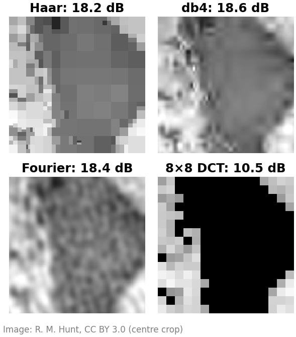{width="100%" fig-alt="Centre crops of the micrograph rebuilt from the largest 1 % of the coefficients: Haar shows square blocks, db4 a smooth blur, Fourier ripples, the 8 by 8 DCT many black blocks."}
:::
::::

## Sparse or compressible

:::: {.columns}
::: {.column width="55%"}
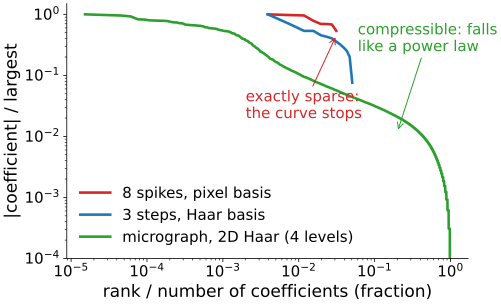{width="100%" fig-alt="Sorted coefficient magnitudes on log-log axes. Eight spikes in the pixel basis: eight nonzero values, then the curve stops. Three steps in the Haar basis: 13 nonzero values. The micrograph in a 2D Haar basis: a curve that falls steadily over five decades, like a power law."}
:::
::: {.column width="45%"}
Sort the coefficients by size and plot them (log–log):

- **Exactly sparse**: $K$ nonzeros, then nothing. Eight spikes in the pixel basis; three steps in the Haar basis (13 nonzero of 256).
- **Compressible**: no exact zeros, but the sorted magnitudes **fall like a power law**. Real images. Keeping the $K$ largest gives a small error that shrinks as $K$ grows.

Everything today works for both; for compressible signals we recover "as well as the best $K$ terms allow".
:::
::::

::: notes
The micrograph needs many coefficients for 99 % of the energy (43 % of them in the 2D Haar basis after removing the mean), because its fine texture is incompressible; but the sorted curve falls by four decades before the last 10 %. Numbers from tools/figs/sparsity/figs.py.
:::

## The right basis depends on the signal

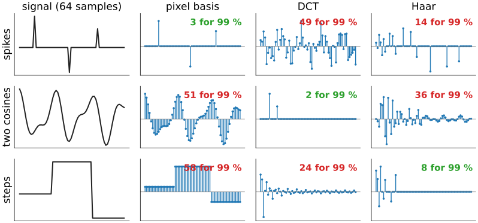{width="88%" fig-align="center" fig-alt="A 3 by 4 grid. Rows: spikes, two cosines, steps (64 samples). Columns: the signal, its coefficients in the pixel basis, the DCT and the Haar basis, with the number of coefficients that carry 99 % of the energy. Spikes: 3 in the pixel basis, 49 in the DCT, 14 in Haar. Two cosines: 51, 2, 36. Steps: 58, 24, 8."}

Spikes are sparse in the **pixel** basis, cosines in the **DCT**, steps in **Haar**. **Nothing is sparse in every basis**: choosing the basis is choosing what you believe about the image.

## Where sparsity appears in the course

- **Compression**: JPEG keeps few DCT coefficients per block ([JPEG](../jpeg/lec.html)); JPEG 2000 few wavelet coefficients.
- **Denoising**: wavelet shrinkage keeps the few large coefficients and kills the many small ones ([shrinkage](../shrinkage/lec.html)).
- **Tomography**: few-view CT with a total-variation prior ([iterative reconstruction](../algebraic-recon/lec.html)): the image has few edges.
- **Spot images**: a few bright pixels on a dark background ([spot filters](../spot-filters/lec.html)).
- **Spectral unmixing**: each pixel contains only a few of the fluorophores ([endmembers](../endmembers/lec.html)).

Today and in the next units: sparsity as a **prior** that lets us solve problems that have too few or too noisy data.

## Denoising as a question about a penalty

:::: {.columns}
::: {.column width="50%"}
Noisy coefficients $w$ (orthonormal basis, so each one can be treated alone). Find $c$ **close to $w$** that is **simple**:

$$\min_c\ \tfrac12(c - w)^2 + \text{penalty}(c).$$

Three ways to say "simple":

- **ℓ2**, (λ/2)c²: small squares. Result: a **line** $c = w/(1 + λ)$: every coefficient shrinks, none becomes 0.
- **ℓ1**, λ|c|: small sizes. Result: **soft threshold** at λ.
- **ℓ0**, a fixed cost per nonzero: few nonzeros. Result: **hard threshold**.
:::
::: {.column width="50%"}
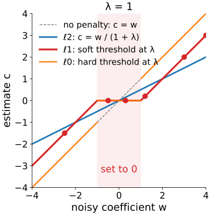{width="92%" fig-alt="Three transfer curves c(w) at λ = 1: the ℓ2 line of slope one half through the origin; the ℓ1 soft threshold, zero between −1 and 1 and parallel to the diagonal outside; the ℓ0 hard threshold, zero between −1 and 1 and on the diagonal outside. The six example values are marked on the soft-threshold curve."}
:::
::::

::: notes
Soft and hard thresholding are recalled from the shrinkage unit, where they were introduced as rules; here they come out of penalties. The example values on the curve are those of the next slide.
:::

## By hand: three penalties, six coefficients

$w = (4,\ -0.5,\ 1.2,\ -2.5,\ 0.3,\ 3)$, λ = 1:

| penalty | estimate $c$ | zeros |
|---|---|---|
| ℓ2: $c = w/2$ | (2, −0.25, 0.6, −1.25, 0.15, 1.5) | 0 |
| ℓ1: soft at 1 | (3, 0, 0.2, −1.5, 0, 2) | **2** |
| ℓ0: hard at 1 | (4, 0, 1.2, −2.5, 0, 3) | **2** |

- ℓ2 shrinks the **large** coefficients most (4 loses 2, 0.3 loses 0.15) and never reaches 0.
- ℓ1 takes the **same amount** (λ = 1) off every coefficient and sets the small ones exactly to 0.
- ℓ0 keeps or kills, unchanged: no shrinkage, but a jump (a tiny change in $w$ near 1 flips the decision).

## The math: the three scalar problems {.math}

Minimise $f(c) = \tfrac12(c - w)^2 + p(c)$ for one coefficient.

- **ℓ2**, $p = \frac{λ}{2}c^2$: $f'(c) = c - w + λc = 0 \Rightarrow c = \dfrac{w}{1 + λ}$. Zero only if $w = 0$.
- **ℓ1**, $p = λ|c|$: for $c \ne 0$, $c - w + λ\,\mathrm{sign}(c) = 0$, so $c = w - λ\,\mathrm{sign}(w)$ if $|w| > λ$; at $c = 0$ the slope of $|c|$ can be anything in $[-1, 1]$, so $c = 0$ is optimal when $|w| \le λ$. This is the soft threshold (derived on the [shrinkage](../shrinkage/lec.html) slide "soft thresholding minimises an ℓ1 energy").
- **ℓ0**, $p = μ\,[c \ne 0]$: either $c = 0$ (cost $\tfrac12 w^2$) or $c = w$ (cost μ). Keep $w$ iff $\tfrac12 w^2 > μ$, i.e. $|w| > \sqrt{2μ}$: the hard threshold. With μ = λ²/2 the threshold is λ.

## Why ℓ1 makes zeros: the geometry

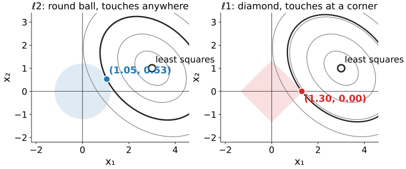{width="80%" fig-align="center" fig-alt="Two coefficient planes with the same elliptical misfit contours around the least-squares point (3, 1). Left, ℓ2: a round ball grows until it touches an ellipse at (1.05, 0.53), off both axes. Right, ℓ1: a diamond grows until it touches an ellipse at its corner (1.30, 0), on the x1 axis."}

Two unknowns. The data misfit is a bowl: **ellipses** around the least-squares point. The penalty is a **ball** around 0. The answer is where the smallest ellipse **touches** the ball. The ℓ2 ball is round: it touches anywhere, generically off the axes. The ℓ1 ball is a **diamond with corners on the axes**: it usually touches at a corner, where a coordinate is **exactly 0**.

::: notes
Same misfit (correlation 0.3 between the two columns, least-squares point (3, 1)) and same λ = 2 in both panels: ℓ1 gives (1.30, 0), ℓ2 gives (1.05, 0.53). In more dimensions the ℓ1 ball has even more corners and edges (on which several coordinates are 0), so touching at a low-dimensional face is the rule.
:::

## By hand in the picture

:::: {.columns}
::: {.column width="50%"}
Round contours (an orthonormal $A$), least-squares point (3, 1). Instead of a penalty weight, give a **budget**: ‖x‖ ≤ 2.

- ℓ2 ball of radius 2: the closest point to (3, 1) is along the line to the origin: $2 \cdot (3, 1)/\sqrt{10} = (1.90,\ 0.63)$.
- ℓ1 ball ("diamond") of radius 2: the closest point is the **corner (2, 0)**.

Same budget, same data: ℓ2 spreads it over both coefficients, ℓ1 spends it on one.
:::
::: {.column width="50%"}
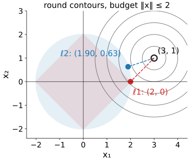{width="95%" fig-alt="Round contours around (3, 1), the ℓ2 disc and the ℓ1 diamond of radius 2. The closest point of the disc is (1.90, 0.63); the closest point of the diamond is its corner (2, 0)."}
:::
::::

::: notes
A budget (constraint form) and a penalty weight are two parametrisations of the same family of solutions: every budget corresponds to some λ (here λ = 1 gives the same ℓ1 answer (2, 0), the soft threshold of (3, 1) at 1).
:::

## Try it: the lasso picture

```{=html}
<link rel="stylesheet" href="../demos/dist/demo.css">
<div data-demo="lassogeom" data-preset="corner"></div>
<script src="../demos/dist/lassogeom.js"></script>
```

::: notes
Left: the coefficient plane, the misfit ellipses around the draggable least-squares point, the penalty ball through the solution, the touching ellipse in black, the dashed path of the solution as λ grows. Tour: "round contours: ℓ1 = soft threshold": (3, 1) at λ = 1 gives (2, 0), the soft threshold of each coordinate. "The corner wins" (ρ = 0.3, λ = 2): (1.30, 0); switch to ℓ2: (1.05, 0.53). "Correlated columns: ℓ1 picks one" (ρ = 0.9, least squares (2.6, −0.6)): ℓ1 gives (1.06, 0), ℓ2 spreads the weight over both. "λ ≥ λ_max: all zero": λ = 3.2 > λ_max = 3. "p < 1": the ℓ½ ball is a star; drag the point and watch the solution jump from one axis to the other (two valleys). Right: the scalar transfer curves at the current λ; tab "path": coefficients against λ for a 6-coefficient problem.
:::

## ℓ0, and why not just count?

:::: {.columns}
::: {.column width="52%"}
"Sparse" means **few nonzeros**, so why not minimise the count (ℓ0)?

- With a general matrix, the count can only be minimised by **trying supports**: 8 nonzeros among 256 unknowns is $\binom{256}{8} \approx 4 \cdot 10^{14}$ supports, almost five days at a billion least-squares fits per second. And it grows explosively with the size.
- **ℓ1** is the closest **convex** penalty: one valley, no local minima, solved by simple iterations (next unit).
- **ℓp with p < 1** is even pointier, and sparser, but not convex: several valleys; the answer depends on where the solver starts.
:::
::: {.column width="48%"}
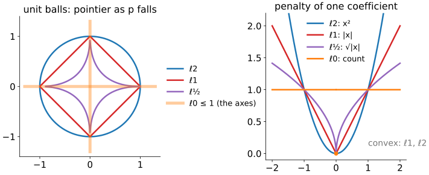{width="100%" fig-alt="Left: unit balls of ℓ2 (circle), ℓ1 (diamond) and ℓ½ (a four-pointed star), and the ℓ0 set (the two axes). Right: the penalty of one coefficient: x², |x|, the square root of |x|, and the count (0 at zero, 1 elsewhere)."}
:::
::::

## The lasso and its path

:::: {.columns}
::: {.column width="45%"}
With a general matrix $A$ (columns not orthogonal), minimise
$$\tfrac12\|A\mathbf x - \mathbf y\|^2 + λ\|\mathbf x\|_1.$$
Statisticians call this the **lasso**; we will just say "ℓ1 regularisation".

- Start at large λ: **all zero**. That happens for every λ above **λ_max**, the largest correlation $|\mathbf a_j^\top\mathbf y|$ of a column with the data.
- Lower λ: coefficients **enter one at a time**.
- ℓ2 (ridge, the Tikhonov of [regularisation](../regularise/lec.html)): all enter at once and only reach 0 at λ = ∞.
:::
::: {.column width="55%"}
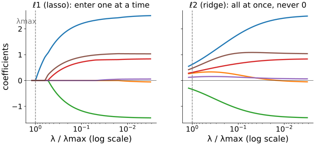{width="100%" fig-alt="Coefficients of a 6-coefficient problem against λ divided by λmax, on a log axis running from large λ on the left to small on the right. Lasso: all zero above λmax, then the coefficients become nonzero one or two at a time. Ridge: all six are nonzero for every λ and shrink smoothly towards zero."}
:::
::::

::: notes
The problem: 24 measurements, 6 unknowns with two correlated pairs of columns, true coefficients (2.5, 0, −1.5, 1, 0, 0.5) plus noise. In the lasso panel the first coefficient enters just below λmax (at 0.985 λmax), the next ones at about half of λmax; the two true zeros enter only at λ below 5 % of λmax. The demo's path tab shows a problem of the same kind.
:::

## The math: lasso optimality conditions {.math}

$f(\mathbf x) = \tfrac12\|A\mathbf x - \mathbf y\|^2 + λ\|\mathbf x\|_1$ is convex. At a minimum, 0 is in the **subgradient**: the gradient of the smooth part plus λ times any slope of $|x_j|$ ($\mathrm{sign}(x_j)$ if $x_j \ne 0$, anything in $[-1, 1]$ if $x_j = 0$). With the residual $\mathbf r = \mathbf y - A\mathbf x^\star$:

$$\mathbf a_j^\top\mathbf r = λ\,\mathrm{sign}(x_j^\star)\ \text{ if } x_j^\star \ne 0, \qquad |\mathbf a_j^\top\mathbf r| \le λ\ \text{ if } x_j^\star = 0.$$

- Every active column has the **same** correlation λ with the residual; inactive ones have less.
- $\mathbf x^\star = 0$ means $\mathbf r = \mathbf y$, so it is optimal iff $|\mathbf a_j^\top\mathbf y| \le λ$ for all $j$: $\quad λ \ge λ_{\max} = \|A^\top\mathbf y\|_\infty$.
- With $A = I$ the conditions give the soft threshold again: $x_j = y_j - λ\,\mathrm{sign}(x_j)$ or $|y_j| \le λ$.

## The math: ℓ1 is the best convex stand-in for ℓ0 {.math}

- On the box $|x_j| \le 1$, the largest convex function below $\|\mathbf x\|_0$ (its **convex envelope**) is $\|\mathbf x\|_1$. In 1D: the count is 0 at 0 and 1 elsewhere; the largest convex function below it on $[-1, 1]$ is $|x|$.
- **Ridge** has the closed form $\mathbf x = (A^\top A + λI)^{-1}A^\top\mathbf y$: a smooth (rational) function of the data. A component is 0 only if that formula happens to vanish exactly, which for data with noise happens with probability 0.
- ℓ1's exact zeros come from the **kink** of $|x|$ at 0: the slope can be anything in $[-1, 1]$ there, so a whole interval of data maps to $x_j = 0$.

## Shrinkage bias

:::: {.columns}
::: {.column width="50%"}
ℓ1 pays for its zeros: it pulls **every surviving coefficient towards 0 by λ** (the soft threshold).

- Peaks lose height; edges **lose contrast** (as in [shrinkage](../shrinkage/lec.html): "soft loses contrast").
- Fix 1, **debiasing**: let ℓ1 choose the support, then **refit** those coefficients by least squares.
- Fix 2, **reweighted ℓ1**: repeat with smaller weights on large coefficients (closer to ℓ0).

Example: four spikes (3, −2.5, 2, 1.2) with noise σ = 0.3, λ = 1: soft gives (2.01, −1.32, 0.82, 0.65); after the refit (3.01, −2.32, 1.82, 1.65).
:::
::: {.column width="50%"}
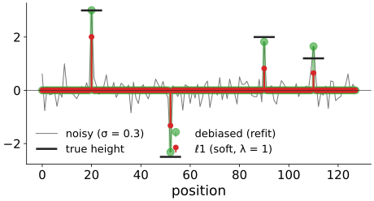{width="100%" fig-alt="A noisy signal with four spikes. Red stems: the soft-thresholded estimate, about one unit below each true height. Green stems: the refitted estimate on the same support, close to the true heights. Black bars mark the true heights."}
:::
::::

::: notes
The refit equals the noisy values on the support here (A = I), so the debiased heights carry the noise of each sample (1.65 for a true 1.2). Debiasing removes bias, not noise; with a blur or a mask it is a least-squares fit on the chosen columns.
:::

## A probabilistic reading

:::: {.columns}
::: {.column width="48%"}
Recall [regularisation](../regularise/lec.html): data + λ·penalty is the most probable image when the penalty is −log of a **prior**.

- ℓ2 penalty = **Gaussian** prior: values near 0 likely, large values very unlikely.
- ℓ1 penalty = **Laplace** prior: a sharp **peak at 0** and **heavy tails**: most coefficients tiny, a few large ones allowed.

That is exactly the shape of the wavelet coefficient histogram of a real image (right: Haar details of the micrograph, log scale). The Gaussian with the same spread puts almost no probability on the large coefficients that carry the edges.
:::
::: {.column width="52%"}
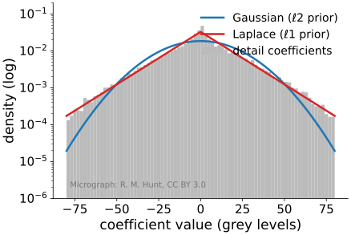{width="100%" fig-alt="Histogram of the level-1 Haar detail coefficients of the micrograph on a log density axis, peaked at 0 with straight-line (exponential) tails. A Gaussian with the same standard deviation (21.6) falls far below the tails beyond about 60; a Laplace density with the same mean absolute value (15.3) follows the tails much better."}
:::
::::

## The math: MAP with a Laplace prior {.math}

Model: $\mathbf y = A\mathbf x + \mathbf n$, Gaussian noise of standard deviation σ; independent Laplace prior $p(x_j) = \frac{1}{2b}e^{-|x_j|/b}$.

$$-\log p(\mathbf x \mid \mathbf y) = \frac{1}{2σ^2}\|A\mathbf x - \mathbf y\|^2 + \frac1b\|\mathbf x\|_1 + \text{const}.$$

Multiply by σ²: the maximiser is the lasso with
$$λ = \frac{σ^2}{b}.$$

- More noise (σ up) or a narrower prior (b down): larger λ.
- With a Gaussian prior of variance $s^2$ the same steps give ridge with λ = σ²/s² (the [regularisation](../regularise/lec.html) MAP slide).
- The MAP estimate of a Laplace prior is sparse; samples from that prior are not (a Laplace sample is never exactly 0). Sparsity comes from the optimisation, not from the prior alone.

## Analysis or synthesis?

:::: {.columns}
::: {.column width="52%"}
Two ways to say "this image is sparse":

- **Synthesis**: the image **is** a few atoms, $\mathbf x = W\mathbf c$ with $\mathbf c$ sparse (wavelets, DCT, a dictionary). Penalise $\|\mathbf c\|_1$.
- **Analysis**: some transform **of** the image is sparse. The commonest: its **differences** (gradient). ℓ1 of the gradient is **total variation** (TV), owned by the [Ising and MRF day](../gmrf/lec.html).

A step has **one** nonzero difference; a ramp has many small ones. So TV keeps steps and turns ramps into staircases: sparsity of differences makes piecewise-constant images.

For an orthonormal $W$ the two views are the same; for redundant transforms they differ.
:::
::: {.column width="48%"}
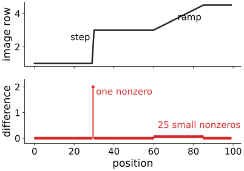{width="100%" fig-alt="Top: an image row with a step at position 30 and a ramp from 60 to 85. Bottom: its differences: one nonzero value at the step, and 25 small equal nonzero values along the ramp."}
:::
::::

## Summary

- A signal is **sparse** in a basis if few coefficients are nonzero, **compressible** if its sorted magnitudes fall fast. The basis must fit the signal.
- Three penalties: **ℓ2** shrinks everything and never reaches 0; **ℓ1** subtracts λ and sets small coefficients **exactly** to 0; **ℓ0** keeps or kills.
- **Geometry**: the ℓ1 ball has corners on the axes, so the misfit ellipse usually touches it where coordinates are 0.
- **ℓ0** needs a search over supports; **ℓ1** is convex and solvable, and it is the best convex stand-in.
- The **lasso** path: everything 0 above λ_max; coefficients enter one at a time.
- Price: **shrinkage bias** (fix: refit the support). Reading: a **Laplace prior**. Differences instead of coefficients: **TV**.
- Next: how to solve ℓ1 problems when $A$ blurs, masks or undersamples.
