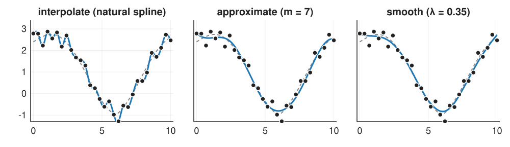
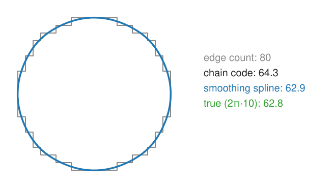

## Goal

By the end of this exercise you should be able to:

- tell **interpolating**, **approximating** and **smoothing** splines apart and predict what each does with noisy data,
- compute a small natural spline and a three-point smoothing by hand,
- predict what λ does, and choose it by **leave-one-out cross-validation**,
- measure the **length** and **curvature** of an outline from a fitted closed spline, and explain why counting boundary pixels is biased,
- *(math)* set up the natural spline system and the penalised normal equations, prove the minimum-bending property and derive the smoother's frequency response.

Do the pen-and-paper part first, then the two demos.

## Background

| Idea | What it means |
|---|---|
| Interpolating spline | through every point; natural: zero curvature at the ends; least bending $\int f''^2$ of all interpolants |
| Approximating spline | $m < n$ control points, least squares; $m$ sets the smoothness |
| Smoothing spline | minimise $\sum_i (y_i - f(x_i))^2 + \lambda\int f''^2$; λ = 0 interpolates, λ → ∞ is the least-squares line |
| Discrete smoothing | $\min \sum_i (y_i - f_i)^2 + \lambda\sum_i (f_{i-1} - 2f_i + f_{i+1})^2$, i.e. $(I + \lambda D^\top D)\mathbf{f} = \mathbf{y}$ |
| Hat matrix | $\hat{\mathbf{f}} = H\mathbf{y}$; effective parameters $\operatorname{tr}H$ ($n$ … 2) |
| Leave-one-out CV | $\frac1n\sum_i\big(\frac{y_i - \hat f_i}{1 - H_{ii}}\big)^2$ |
| Outline length | $\oint\|\mathbf{C}'(t)\|\,dt$ of the fitted closed curve; total curvature $\oint\kappa\,ds = 2\pi$ |

::: {.callout-note collapse="true" title="The math: the natural spline in terms of second derivatives"}
With $M_i = s''(x_i)$ and uniform spacing $h$, the piece on $[x_i, x_{i+1}]$ is $s(x) = a\,y_i + b\,y_{i+1} + \frac{h^2}{6}\big[(a^3 - a)M_i + (b^3 - b)M_{i+1}\big]$ with $a = (x_{i+1} - x)/h$, $b = 1 - a$. Matching slopes at the interior nodes gives $M_{i-1} + 4M_i + M_{i+1} = \frac{6}{h^2}(y_{i-1} - 2y_i + y_{i+1})$, and the natural spline has $M_0 = M_{n-1} = 0$.
:::

## By hand

**B1.** **Three-point smoothing.** Data $\mathbf{y} = (0, 3, 0)$; minimise $\sum_i (y_i - f_i)^2 + \lambda(f_0 - 2f_1 + f_2)^2$.
(a) By symmetry $f_0 = f_2 = a$, $f_1 = b$. Write the objective in $a$ and $b$ and set the derivatives to zero. Solve for λ = 1.
(b) Repeat for λ = 0.1 and λ = 10. What happens as λ → ∞?
(c) Check that $f_0 + f_1 + f_2 = 3$ for every λ. Why must it be so?

**B2.** **The smoothest interpolant.** Points $(0, 0), (1, 1), (2, 0)$.
(a) The natural spline is $s(x) = 1.5x - 0.5x^3$ on $[0, 1]$ and its mirror image on $[1, 2]$. Check that $s(1) = 1$, $s'(1) = 0$ and $s''(0) = 0$.
(b) Compute $s(0.5)$ and compare with the parabola $2x - x^2$ through the same points.
(c) Compute the bending energy $\int_0^2 f''^2$ of both. Which bends less?

**B3.** **Predict λ.** You smooth 30 samples of a curve with cross-validation.
(a) The noise doubles. Does the chosen λ go up or down? The effective number of parameters?
(b) The true curve has a sharp step. What will the smoothing spline do at the step, and how will CV react?
(c) One sample is an outlier. What does the smoothing spline do near it?

**B4.** **Perimeter of a digital disc.** A disc of radius 10 pixels is segmented.
(a) Explain why the boundary-edge count is exactly $8r = 80$. How much too long is that?
(b) The 8-chain code through the boundary pixel centres gives 64.3. Is it biased up or down, and why?
(c) A closed smoothing spline through the midpoints of the boundary edges has length 62.9. The true perimeter?
(d) For a disc of radius 3, edge count 24, chain code 17.7, and a spline with the same smoothing as in (c) gives 17.9. What went wrong with the spline, and what would you change?

**B5.** **Fourier descriptors or a spline?** A square outline is smoothed (a) by keeping the first 8 Fourier descriptors, (b) by a smoothing spline. Where does each one change the outline? Which one would you use to measure the curvature along the sides?

**B6.** **Effective number of parameters.** For 30 data points: what is $\operatorname{tr}H$ for (a) the interpolating spline, (b) the least-squares line, (c) a least-squares fit with $m = 7$ B-spline coefficients, (d) a smoothing spline at the CV minimum of the demo (λ ≈ 0.35)?

::: {.callout-note collapse="true" title="Solutions"}
**B1.** (a) $E = 2a^2 + (3 - b)^2 + \lambda(2a - 2b)^2$. $\partial_a E = 4a + 8\lambda(a - b) = 0$ and $\partial_b E = -2(3 - b) - 8\lambda(a - b) = 0$. Adding them: $4a - 6 + 2b = 0$, so $b = 3 - 2a$. Substituting: $4a + 8\lambda(3a - 3) = 0$, so $a = \frac{6\lambda}{1 + 6\lambda}$. λ = 1: $a = \tfrac67 = 0.857$, $b = \tfrac97 = 1.286$. (b) λ = 0.1: $a = 0.375$, $b = 2.25$. λ = 10: $a = 0.984$, $b = 1.033$. λ → ∞: $(1, 1, 1)$, the mean. (c) $2a + b = 3$ always (the sum of the two equations). The penalty is blind to constants and lines (their second difference is 0), so it cannot shift the level: the gradient of the penalty is orthogonal to $(1, 1, 1)$.

**B2.** (a) $s(1) = 1.5 - 0.5 = 1$; $s'(x) = 1.5 - 1.5x^2$, $s'(1) = 0$; $s''(x) = -3x$, $s''(0) = 0$ (and at $x = 2$ by symmetry). (b) $s(0.5) = 0.75 - 0.0625 = 0.6875$; the parabola gives $1 - 0.25 = 0.75$. (c) Spline: $2\int_0^1 9x^2\,dx = 6$. Parabola: $f'' = -2$, $\int_0^2 4\,dx = 8$. The spline bends less (and no interpolant bends less than 6).

**B3.** (a) Up; fewer effective parameters (in the demo: λ from 0.35 to 1.0, df from 7.2 to 5.8). (b) It rounds the step into a smooth ramp, with small overshoots; CV picks a small λ (0.035 in the demo, df 12) to follow the jump better, and lets more noise through elsewhere: a single λ cannot be right on both. (c) The curve is pulled towards the outlier over a few samples (in the demo by 0.33 at the outlier, with CV choosing a larger λ, 0.63 instead of 0.35). Squared errors give outliers a large influence.

**B4.** (a) Walking around the staircase, the horizontal edges cover the width twice and the vertical edges the height twice: $2 \cdot 2r + 2 \cdot 2r = 8r$ for a digital disc (the staircase is monotone in each quadrant). $80 / 62.83 = 1.27$: 27 % too long. (b) Down: the chain runs through the pixel centres, which lie on average half a pixel inside the true outline (and diagonal steps of $\sqrt2$ still overestimate slightly); here 64.3 is 2 % too long. (c) $2\pi \cdot 10 = 62.83$: the spline is 0.2 % off. (d) True length $6\pi = 18.85$. The spline is 5 % short: the same λ is relatively much stronger on a small, tightly curved object, so the spline shrinks it (bending is expensive when the radius is small). Use less smoothing for small objects (log λ = −1 gives 20.0, log λ = 0 gives 19.3 in the demo), i.e. choose λ relative to the object size.

**B5.** (a) Fourier: everywhere; the sides ripple (ringing) because the corners need high frequencies that were cut. (b) Spline: mainly at the corners, which get rounded; the sides stay straight. To measure curvature along the sides: the spline (zero curvature on straight sides, peaks at the corners).

**B6.** (a) 30. (b) 2. (c) 7. (d) About 7.2 (the demo's readout: 7.15).
:::

### Math questions

**B7.** *(math)* Set up and solve the natural spline system $M_{i-1} + 4M_i + M_{i+1} = \frac{6}{h^2}(y_{i-1} - 2y_i + y_{i+1})$ for the points of B2, and build the piece on $[0, 1]$ from $M_0, M_1$.

**B8.** *(math)* Derive the normal equations $(B^\top B + \lambda P)\mathbf{c} = B^\top\mathbf{y}$ of penalised least squares. For the discrete smoother ($B = I$, $P = D^\top D$) show that the hat matrix is $H = (I + \lambda D^\top D)^{-1}$ and that $\operatorname{tr}H \to 2$ as λ → ∞.

**B9.** *(math)* (a) For the example of B2, let $e = g - s$ with $g$ the parabola. Compute $\int e''^2$ and check $\int g''^2 = \int s''^2 + \int e''^2$. (b) Prove the identity in general for the natural spline (integration by parts).

**B10.** *(math)* Show that the discrete smoother $(I + \lambda D^\top D)\mathbf{f} = \mathbf{y}$ on an infinite uniform grid has frequency response $1/(1 + \lambda(2 - 2\cos\omega)^2)$. At which ω is the response $\tfrac12$ for λ = 1? How does this frequency scale with λ for large λ?

**B11.** *(math)* Show that $\oint\kappa\,ds = 2\pi$ for a circle of radius $r$, and that the arc length of $\mathbf{C}(t) = (r\cos t, r\sin t)$ over $[0, 2\pi]$ is $2\pi r$.

::: {.callout-note collapse="true" title="Solutions (math)"}
**B7.** $h = 1$, one interior node: $M_0 + 4M_1 + M_2 = 6(0 - 2 + 0) = -12$ with $M_0 = M_2 = 0$: $M_1 = -3$. On $[0, 1]$ with $a = 1 - x$, $b = x$: $s = a\cdot 0 + b\cdot 1 + \frac16[(a^3 - a)\cdot 0 + (b^3 - b)(-3)] = x - \tfrac12(x^3 - x) = 1.5x - 0.5x^3$.

**B8.** $E(\mathbf{c}) = (\mathbf{y} - B\mathbf{c})^\top(\mathbf{y} - B\mathbf{c}) + \lambda\mathbf{c}^\top P\mathbf{c}$; $\nabla E = -2B^\top(\mathbf{y} - B\mathbf{c}) + 2\lambda P\mathbf{c} = 0$. With $B = I$: $\mathbf{f} = (I + \lambda D^\top D)^{-1}\mathbf{y}$, so $H = (I + \lambda D^\top D)^{-1}$. $D^\top D$ is symmetric with eigenvalues $\mu_k \ge 0$; exactly two are 0 (eigenvectors: constants and lines, which $D$ maps to 0). $\operatorname{tr}H = \sum_k \frac{1}{1 + \lambda\mu_k} \to 2$ as λ → ∞ (and $= n$ at λ = 0).

**B9.** (a) $e'' = g'' - s'' = -2 + 3x$ on $[0, 1]$ (mirror on $[1, 2]$): $\int_0^2 e''^2 = 2\int_0^1 (3x - 2)^2\,dx = 2(3 - 6 + 4) = 2$. $8 = 6 + 2$. ✓ (b) $\int g''^2 = \int s''^2 + 2\int s''e'' + \int e''^2$. On each interval integrate by parts twice: $\int_{x_i}^{x_{i+1}} s''e'' = [s''e']_{x_i}^{x_{i+1}} - \int s'''e' = [s''e'] - s'''_i[e]_{x_i}^{x_{i+1}}$, and $e = 0$ at the nodes, so only $[s''e']$ remains. Summing over intervals, interior terms cancel ($s''$ and $e'$ are continuous), leaving $s''(x_{n-1})e'(x_{n-1}) - s''(x_0)e'(x_0) = 0$ since $s'' = 0$ at the ends (natural). So the cross term vanishes and $\int g''^2 = \int s''^2 + \int e''^2 \ge \int s''^2$.

**B10.** With $f_k = \hat f e^{i\omega k}$, $y_k = \hat y e^{i\omega k}$: $(D\mathbf{f})_k = (e^{-i\omega} - 2 + e^{i\omega})f_k = -(2 - 2\cos\omega)f_k$, and $D^\top D$ (on an infinite grid, the fourth difference $[1, -4, 6, -4, 1]$) multiplies by $(2 - 2\cos\omega)^2$. So $\hat f(1 + \lambda(2 - 2\cos\omega)^2) = \hat y$. Response $\tfrac12$: $2 - 2\cos\omega = 1$, $\cos\omega = \tfrac12$, $\omega = \pi/3 = 1.047$ for λ = 1. For large λ the frequency is small, $2 - 2\cos\omega \approx \omega^2$, so $\lambda\omega^4 = 1$: $\omega_{1/2} \approx \lambda^{-1/4}$ (λ = 16: 0.505; λ = 256: 0.251).

**B11.** $\mathbf{C}' = (-r\sin t, r\cos t)$, speed $r$: length $\int_0^{2\pi} r\,dt = 2\pi r$. $\mathbf{C}'' = (-r\cos t, -r\sin t)$, $x'y'' - y'x'' = r^2\sin^2 t + r^2\cos^2 t = r^2$, $\kappa = r^2/r^3 = 1/r$. $\oint\kappa\,ds = \frac1r\cdot 2\pi r = 2\pi$.
:::

## Explore: interpolate, approximate, smooth {#explore-splinefit}

{width="90%" fig-align="center"}

Thirty noisy samples (fixed seed) of a known curve on $[0, 10]$ (bump, sine with a kink at $x = 6$, step) or of a profile across the micrograph. Modes: **interpolate**, **approximate** with $m$ control points (orange: knots), **smooth** with λ. Red sticks: residuals. Lower plots: leave-one-out error and effective number of parameters against λ (or $m$); blue: the current value, green: the minimum. Drag data points up and down; "outlier" moves one point far off.

```{=html}
<link rel="stylesheet" href="../demos/dist/demo.css">
<div data-demo="splinefit" data-preset="interp"></div>
<script src="../demos/dist/splinefit.js"></script>
```

**D1.** Preset **λ = 0 interpolates the noise**. Read the RMS distance to the true curve. Now the presets **λ huge** and **the CV minimum**: RMS to truth, df and LOO error in each.

**D2.** Switch to **approximate** and move $m$ from 4 to 30. Where is the LOO minimum? What happens above about $m = 20$, and why?

**D3.** Move the noise slider to 0.5 and press **go to the CV minimum**. Compare λ and df with noise 0.25 (B3a).

**D4.** Preset **an outlier**. How far is the fit pulled at the outlier? Drag the outlier further up: does the CV choice of λ change?

**D5.** Preset **a step**. Describe the fit at the step and in the flat parts. Try the approximate mode: is any $m$ better?

**D6.** Choose **cell profile** (data: a row of the micrograph, coarsely sampled, plus noise). Go to the CV minimum. Is the fit closer to the dashed curve than the interpolating spline? Why (not)?

::: {.callout-note collapse="true" title="Solutions"}
**D1.** λ = 0: RMS to truth 0.23 (as large as the noise, 0.25: nothing gained), df 30. λ huge: 1.20 (a straight line), df 2. CV minimum: λ ≈ 0.35, df 7.15, LOO 0.094, RMS to truth 0.110: about half the noise.

**D2.** The minimum is at $m = 7$ (LOO 0.085, RMS to truth 0.125). $m = 5$: LOO 0.22 (underfit, the kink is missed); $m = 10$: 0.17. Above about $m = 20$ the LOO error explodes (230 at $m = 20$, above $10^6$ at $m = 26$): with clamped knots spaced about as closely as the data, some spans hold only one or two samples and the fit swings wildly between them (points with $H_{ii}$ close to 1).

**D3.** With noise 0.5: λ ≈ 1.0, df 5.8 (LOO 0.33, RMS to truth 0.20). More noise: more smoothing, fewer effective parameters.

**D4.** The outlier (at $x = 6.9$, raised by 2.2) pulls the fit to $-0.003$ where the truth is $-0.335$: about 0.33. CV picks λ ≈ 0.63 instead of 0.35: the outlier makes the whole curve stiffer. Dragging it further increases both effects. (Robust penalties, as in the regularisation unit, would treat it better.)

**D5.** The fit is a smooth ramp across the step with small overshoots on both sides; CV picks λ ≈ 0.035 (df 12), so the flat parts keep visible noise. Approximate: CV picks $m = 8$ (LOO 0.195, worse than the smoothing spline's 0.180). No smooth fit represents a jump well; edge-preserving penalties (total variation, [Ising day](../gmrf/lec.qmd)) do.

**D6.** Here the dashed "truth" is the micrograph row smoothed over 2 pixels, sampled every 6.9 pixels, plus the same noise. CV picks log λ ≈ 0.6 (df 4.4), but its curve is almost flat between λ = 1 and 10 (LOO 0.137 and 0.136), and the RMS distance to the truth (0.25) is no better than interpolating (0.23): the profile has detail (the nuclear envelope, the cell edges) on the scale of the sample spacing, and smoothing removes it together with the noise. CV cannot fix undersampling; with real data, report the λ and check by eye that the features you measure survive.
:::

## Explore: smooth outlines from pixels {#explore}

{width="65%" fig-align="center"}

A synthetic object on a 64 × 64 grid; grey: its boundary staircase; green dashed: the true outline. A closed cubic smoothing spline with $m$ control points and penalty λ is fitted to the midpoints of the boundary edges, coloured by curvature (red convex, blue concave) or with a comb. Readout: length by edge count, 8-chain code, spline and the truth; the total curvature. Below: curvature against arc length. "Fourier descriptors" overlays the outline from the first $K$ Fourier terms.

```{=html}
<link rel="stylesheet" href="../demos/dist/demo.css">
<div data-demo="splineoutline" data-preset="disc"></div>
<script src="../demos/dist/splineoutline.js"></script>
```

**E1.** Preset **disc: three perimeters**. Check B4 with the readout. Then vary log λ from −3 to 3. When is the spline length closest to the truth? What happens at both ends of the range?

**E2.** Still on the disc: read the curvature plot. What should it be? Why does it wiggle, and how does λ change the wiggles?

**E3.** Preset **small disc (r = 3)**. Compare the four lengths. Find a λ that gives the right length. Does the same λ work for the large disc?

**E4.** Preset **star: corners vs λ**. Compare the lengths, and look at the curvature peaks at the tips. What happens to the length and the peaks as λ goes down?

**E5.** Preset **neck between two cells**. Where is the curvature most negative, and what could you use that for?

**E6.** Preset **Fourier rings at a corner**. Compare the spline and the Fourier outline on the sides of the square. Increase $K$ to 40: what changes? Read both lengths.

**E7.** Preset **too little smoothing**. Describe the curvature plot. Why is it useless for measuring curvature?

::: {.callout-note collapse="true" title="Solutions"}
**E1.** Edge count 80, chain code 64.3, spline 62.9, true 62.8. With 40 control points: log λ = −3 gives 63.8 (follows the staircase a little), 0 gives 63.0, 0.5 gives 62.9, 1 gives 62.8, 2 gives 61.1, 3 gives 48.2. Too little smoothing keeps the staircase (too long); too much shrinks the curve (a stiff closed curve contracts, too short).

**E2.** $1/r = 0.1$ everywhere. At log λ = 0.5 it wiggles between 0.080 and 0.125, with a period set by the staircase pattern; less smoothing makes the wiggles larger (log λ = −1: −0.04 to 0.26), more makes them smaller (log λ = 1: 0.093 to 0.111) until the curve shrinks (log λ = 3: 0.13, the radius has fallen to about 7.7).

**E3.** Edge count 24, chain 17.7, spline 17.9, true 18.85. Less smoothing lengthens the spline: log λ = 0.2 gives 18.9, log λ = 0 gives 19.3. On the large disc log λ = 0.2 also works (63.0, curvature 0.06 to 0.14). But the λ that is best for the large disc in E1 (log λ = 1, 62.8) shrinks the small disc to 14.4: a stiff curve contracts more, relative to its size, the smaller and more curved the object is. Choose λ relative to the object size, or check it on a test object of similar size.

**E4.** Edge count 212, chain 171.7, spline 154.1, true 168.4. The spline cuts the tips (curvature peaks of about 2.3). As λ goes down the tips sharpen: log λ = −1 gives 161.7 with peaks of 5.5, log λ = −3 gives 166.3 with peaks of 8.9, approaching the true length but also the staircase.

**E5.** At the two necks (curvature about −0.58, concave). Curvature minima are where touching objects are joined: a classic rule for splitting them (cut between the two deepest concavities).

**E6.** At $K = 8$ the Fourier outline ripples along every side (length 138.3) while the spline's sides are straight (141.7; true 144). At $K = 40$ the ripples are smaller and faster but still there (Gibbs); the corners get sharper. The spline smooths only where the curve bends.

**E7.** The curvature jumps between about −1.6 and +2.8: the spline follows every step of the staircase. It measures the pixel grid, not the object; some smoothing (over a few pixels) is needed before curvature means anything.
:::

## Where this leads

The [next unit](../spline-images/lec.qmd) applies the same spline machinery to **images**: the interpolation system of this unit along every row and column (cubic B-spline interpolation), and a tensor-product spline of displacements to deform an image smoothly (free-form deformation). Smoothing splines with few control points also become contours that move ([spline snakes](../snakes/lec.qmd)).
