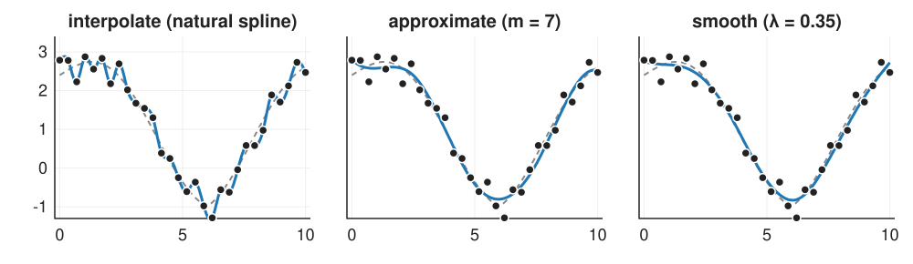
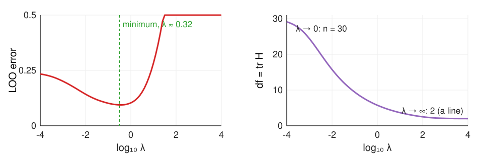
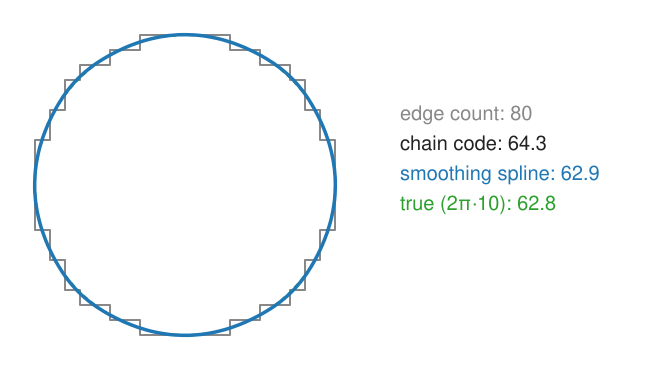

## About this lecture

Units 1 and 2 placed control points by hand. Now the points are **data**, often noisy, and the spline must be fitted.

- **Interpolate**: through every point; a banded linear system; the **natural** spline bends least.
- **Approximate**: fewer control points than data, **least squares**.
- **Smooth**: one parameter per datum, but penalise **bending**: data + λ·penalty, the [regularisation](../regularise/lec.qmd) pattern for curves.
- **Choosing λ** by leave-one-out cross-validation; the smoothing spline as a **low-pass filter**.
- **Outlines**: fit a closed spline to boundary pixels; read **length** and **curvature** from it.

*Slides titled **The math** give the formulas and proofs; the ideas are complete without them.*

::: notes
Data in the demo: 30 samples on [0, 10] of a known curve plus Gaussian noise with a fixed seed (sd 0.25 by default). The smoothing spline is the exact one (data + λ∫f''², Reinsch); the outline fit is a closed cubic B-spline with a second-difference penalty on its control points (a P-spline). λ values of the two are not comparable.
:::

## Three ways to fit the same data

{width="100%" fig-align="center"}

- **Interpolate**: passes through every point, so it follows the noise too.
- **Approximate** with 7 control points: smooth, but the number of control points sets the smoothness in steps.
- **Smooth**: a control value per point, but bending costs; λ sets the smoothness continuously.

Dashed: the true curve the samples came from.

## Interpolating splines

Through $n$ points with a cubic spline that is C² at every point:

- Each point gives one equation, and each equation involves only the point and its **two neighbours**: a **tridiagonal** (banded) linear system, solved in $O(n)$ operations.
- Two conditions are missing at the ends. The **natural** spline sets the curvature to zero at both ends (the curve continues as a straight line).
- In B-spline form on uniform knots: control values $c_i$ with $\tfrac16(c_{i-1} + 4c_i + c_{i+1}) = y_i$, the same tridiagonal shape (unit 4 uses it on images).

By hand: through $(0, 0), (1, 1), (2, 0)$ the natural spline is $s(x) = 1.5x - 0.5x^3$ on $[0, 1]$ (and mirrored): $s(0.5) = 0.6875$.

## The math: the natural cubic spline system {.math}

Unknowns: the second derivatives $M_i = s''(x_i)$ at the nodes. On each interval $s''$ is linear between $M_i$ and $M_{i+1}$; integrating twice and matching the values gives the piece. C¹ at the interior nodes gives, for uniform spacing $h$,
$$M_{i-1} + 4M_i + M_{i+1} = \frac{6}{h^2}\big(y_{i-1} - 2y_i + y_{i+1}\big),\qquad M_0 = M_{n-1} = 0.$$

- Worked example ($h = 1$, $y = 0, 1, 0$): $4M_1 = 6(0 - 2 + 0)$, $M_1 = -3$.
- On $[0, 1]$: $s(x) = \frac{M_1}{6}x^3 + \big(y_1 - \frac{M_1}{6}\big)x = -0.5x^3 + 1.5x$.
- Diagonally dominant (4 > 1 + 1): the Thomas algorithm (Gaussian elimination without pivoting) solves it in $O(n)$.

## The smoothest curve through the points

A **spline** was a thin wooden strip that draftsmen held in place with lead weights at the points: it takes the shape of least bending energy.

- The natural cubic spline is exactly that: among **all** smooth curves through the points it has the smallest bending $\int s''(x)^2\,dx$ (Holladay, 1957).
- By hand through $(0, 0), (1, 1), (2, 0)$: the spline has $s'' = -3x$ on $[0, 1]$, bending $2\int_0^1 9x^2\,dx = 6$. The parabola $2x - x^2$ through the same points has $s'' = -2$: bending $\int_0^2 4\,dx = 8$.
- At $x = 0.5$: spline 0.6875, parabola 0.75.

So "interpolating spline" is not an arbitrary choice: it is the answer to "bend as little as possible".

## The math: minimum bending {.math}

Let $g$ be any C² function through the same points, $s$ the natural spline, $e = g - s$ (zero at every node). Then
$$\int g''^2 = \int s''^2 + \int e''^2 + 2\int s''e''.$$

Integrate the cross term by parts on each interval $[x_i, x_{i+1}]$:
$$\int s''e'' = \big[s''e'\big] - \int s'''e' = \big[s''e'\big] - s'''\big|_{(x_i, x_{i+1})}\big[e\big]_{x_i}^{x_{i+1}} = \big[s''e'\big].$$
($s'''$ is constant on each interval and $e$ vanishes at the nodes.) Summed over the intervals the boundary terms telescope to $s''(x_{n-1})e'(x_{n-1}) - s''(x_0)e'(x_0) = 0$ by the natural end conditions. Hence $\int g''^2 = \int s''^2 + \int e''^2 \ge \int s''^2$, with equality only for $g = s$. Example: $8 = 6 + 2$.

## Approximating splines: fewer control points

Noisy data should not be interpolated. First fix: use **fewer** control points than data, $m < n$, and fit by **least squares**.

- The curve is $f(x) = \sum_j c_j N_j(x)$; each datum gives one equation $f(x_i) \approx y_i$. More equations than unknowns: minimise $\sum_i (y_i - f(x_i))^2$ (the normal equations of linear algebra, $B^\top B\mathbf{c} = B^\top\mathbf{y}$).
- $m$ controls the smoothness **in steps**: too few control points cannot follow the curve (underfit); too many follow the noise and, where knots crowd the data, become unstable.
- Where the knots go matters: a kink between two knots cannot be followed.

## Smoothing splines: data + λ · bending

Second fix: keep one value per datum, but **charge for bending**:
$$\text{minimise}\quad \sum_i \big(y_i - f(x_i)\big)^2 + \lambda\int f''(x)^2\,dx.$$

This is the pattern of the [regularisation unit](../regularise/lec.qmd): data misfit + λ·penalty, with the bending energy as the penalty.

- **λ = 0**: the interpolating (natural) spline; it follows the noise.
- **λ → ∞**: no bending allowed: the least-squares **straight line** (bending 0 costs nothing).
- In between: a smooth curve; λ moves continuously between the two.

Discrete version by hand: three data $(0, 3, 0)$, penalty λ·(second difference)²: λ = 0 gives $(0, 3, 0)$, λ = 1 gives $(0.857, 1.286, 0.857)$, λ → ∞ gives $(1, 1, 1)$. The **mean** (1) is kept.

## The math: penalised least squares {.math}

Write the fit in a basis, $\mathbf{f} = B\mathbf{c}$ (values at the data), and the penalty as a quadratic form $\mathbf{c}^\top P\mathbf{c}$ ($P$ = the bending Gram matrix $\int N_j''N_k''$, or $D^\top D$ with $D$ the second-difference matrix: **P-splines**). Minimising
$$\|\mathbf{y} - B\mathbf{c}\|^2 + \lambda\,\mathbf{c}^\top P\mathbf{c}\quad\Rightarrow\quad (B^\top B + \lambda P)\,\mathbf{c} = B^\top\mathbf{y}.$$

- Banded matrices: solved in $O(n)$.
- Discrete example ($B = I$, $D = [1\;{-2}\;1]$): $(I + \lambda D^\top D)\mathbf{f} = \mathbf{y}$; with λ = 1 and $\mathbf{y} = (0, 3, 0)$: $\mathbf{f} = (\tfrac67, \tfrac97, \tfrac67)$. $D\mathbf{1} = 0$ and the rows of $D^\top D$ sum to 0, so the sum of $\mathbf{f}$ equals the sum of $\mathbf{y}$.
- The fit is linear in the data: $\hat{\mathbf{f}} = H(\lambda)\,\mathbf{y}$, the **hat matrix**. Its trace is the **effective number of parameters**: $n$ at λ = 0, 2 as λ → ∞.

## Try it: interpolate, approximate, smooth

```{=html}
<link rel="stylesheet" href="../demos/dist/demo.css">
<div data-demo="splinefit" data-preset="cvmin"></div>
<script src="../demos/dist/splinefit.js"></script>
```

::: notes
30 noisy samples (sd 0.25, fixed seed) of a sine with a kink at x = 6; dashed: the truth; red sticks: residuals. Lower plots: the leave-one-out error and df = tr H against λ (log), with the current λ (blue) and the minimum (green). "The CV minimum": λ ≈ 0.35, df 7.15, LOO 0.094, RMS distance to the truth 0.110. "λ = 0 interpolates the noise": RMS to truth 0.23 (the noise level itself). "λ huge": a straight line, df 2, RMS 1.2. "too few control points" (m = 5): 0.22; m = 7 is the CV minimum among m (LOO 0.085); "too many" (m = 26): LOO above 10⁶ (knots crowd the data, wild swings between samples). "an outlier": the point at x = 6.9 moved up by 2.2; the CV picks a larger λ (0.63) and the fit is still pulled up by about 0.33 there. "a step": every smoother rounds it; CV picks λ ≈ 0.035 (df 12) to follow the jump and lets noise through elsewhere. Drag points to see the influence of one datum.
:::

## Choosing λ

- **By eye**: fine for a figure, not for a measurement.
- **By the noise level** (the [discrepancy principle](../regularise/lec.qmd)): choose λ so that the residuals are as large as the noise.
- **Leave-one-out cross-validation**: hide each point in turn, fit without it, predict it; average the squared prediction errors. Too small λ: the fit chases noise and predicts badly; too large: it misses the shape. A U-shaped curve with a minimum.

{width="80%" fig-align="center"}

The effective number of parameters goes from 30 (interpolation) to 2 (a line); at the minimum about 7.

## The math: leave-one-out without refitting {.math}

For any linear smoother $\hat{\mathbf{f}} = H\mathbf{y}$ whose leave-one-out fit is the full fit with $y_i$ replaced by its own prediction (true for smoothing splines and least-squares fits),
$$y_i - \hat f^{(-i)}(x_i) = \frac{y_i - \hat f_i}{1 - H_{ii}},\qquad \text{LOO}(\lambda) = \frac1n\sum_i\left(\frac{y_i - \hat f_i}{1 - H_{ii}}\right)^2.$$

- One fit per λ instead of $n$, and exact, not an approximation.
- **GCV** replaces each $H_{ii}$ by the average $\operatorname{tr}H/n$: $\text{GCV} = \frac{n\sum_i(y_i - \hat f_i)^2}{(n - \operatorname{tr}H)^2}$.
- $H_{ii}$ near 1 (a point that the fit must follow, e.g. an isolated sample far from others) makes the denominator small: such points dominate the score.

## A smoothing spline is a low-pass filter

On equally spaced data far from the ends, a smoothing spline acts like a **convolution with a fixed bell-shaped kernel** ([Fourier unit](../fourier/lec.qmd): smoothing = keeping low frequencies).

- Slow waves pass almost unchanged; fast ones (noise) are damped.
- The cut-off frequency falls as $\lambda^{1/4}$: 16 times more λ halves the cut-off (the kernel gets twice as wide).
- First differences instead of second ([quadratic smoothing on a grid](../gmrf/lec.qmd)) penalise **slope**, not bending: they pull towards a constant, not towards a line.

## The math: the equivalent filter {.math}

Discrete smoother on an infinite uniform grid: $(I + \lambda D^\top D)\mathbf{f} = \mathbf{y}$. A wave $y_k = e^{i\omega k}$ is an eigenvector of the second difference: $(D\mathbf{y})_k = (e^{i\omega} - 2 + e^{-i\omega})y_k = -(2 - 2\cos\omega)\,y_k$. Hence
$$\hat f = \frac{1}{1 + \lambda(2 - 2\cos\omega)^2}\;\hat y.$$

- λ = 1: 0.74 at $\omega = \pi/4$, 0.20 at $\pi/2$, 0.06 at $\pi$.
- Half power where $\lambda(2 - 2\cos\omega)^2 = 1$; for small $\omega$, $2 - 2\cos\omega \approx \omega^2$, so $\omega_{1/2} \approx \lambda^{-1/4}$ (λ = 1, 16, 256: 1.05, 0.51, 0.25).
- The first-difference version (`gmrf/`) has $1/(1 + \lambda(2 - 2\cos\omega))$: cut-off $\propto \lambda^{-1/2}$.

## Smooth outlines from pixels

A segmented object's boundary is a **staircase** of pixel edges. Its length is not the object's perimeter:

- **Edge count**: a digital disc of radius $r$ has exactly $8r$ edges whatever its resolution (the staircase's horizontal and vertical runs add up to the bounding box): $8r / 2\pi r = 4/\pi$, **27 % too long** for every disc (recall the perimeter bias in [shape features](../shape-features/lec.qmd)).
- Fit a **closed smoothing spline** through the midpoints of the boundary edges. Its **length** is an integral of its speed, its **curvature** a formula of its derivatives: exact for the curve, no counting.

:::: {.columns}
::: {.column width="55%"}
Disc of radius 10: edge count 80, chain code 64.3, smoothing spline 62.9, true $2\pi \cdot 10 = 62.8$.
:::
::: {.column width="45%"}
{width="100%"}
:::
::::

## The math: length and curvature of the fitted curve {.math}

For the closed fit $\mathbf{C}(t) = \sum_j \mathbf{c}_j\beta^3(t - j)$ (indices modulo $m$):

- **Length** $L = \oint\|\mathbf{C}'(t)\|\,dt$, computed per span with Gauss–Legendre quadrature (5 points per half span: exact enough for a smooth integrand).
- **Curvature** $\kappa = \frac{x'y'' - y'x''}{(x'^2 + y'^2)^{3/2}}$ from the derivatives of the B-spline (unit 1 and 2).
- **Check**: a simple closed curve turns exactly once, $\oint\kappa\,ds = \oint\frac{x'y'' - y'x''}{x'^2 + y'^2}\,dt = 2\pi$; for a circle of radius $r$: $\kappa = 1/r$ times length $2\pi r$.
- The fit: data points $\mathbf{p}_i$ at parameters $t_i$ (chord length), minimise $\sum_i\|\mathbf{p}_i - \mathbf{C}(t_i)\|^2 + \lambda\sum_j\|\mathbf{c}_{j-1} - 2\mathbf{c}_j + \mathbf{c}_{j+1}\|^2$: the penalised normal equations, once for $x$ and once for $y$.

## Try it: outlines, length and curvature

```{=html}
<link rel="stylesheet" href="../demos/dist/demo.css">
<div data-demo="splineoutline" data-preset="disc"></div>
<script src="../demos/dist/splineoutline.js"></script>
```

::: notes
64 × 64 pixel objects; grey: the staircase; green dashed: the true outline; the spline is coloured by curvature (red convex, blue concave). Readout: length by edge count, chain code, spline, true; ∮κds/2π (always 1.000). "disc": 80 / 64.3 / 62.9 / 62.8; the curvature plot wiggles around 1/r = 0.1 (from 0.080 to 0.125). "small disc (r = 3)": 24 / 17.7 / 17.9 / 18.8: the default smoothing shrinks a small object (log λ = −1 gives 20.0, log λ = 0 gives 19.3): λ must be chosen relative to the object size. "star": 212 / 171.7 / 154.1 / 168.4: smoothing cuts the tips (log λ = −1: 161.7). "neck": the curvature dips to −0.58 at the two necks; minima of curvature mark where to split touching cells. "Fourier rings": square, 8 Fourier terms ring along the sides; the spline is flat on the sides and bends only at the corners. "too little smoothing": log λ = −3 with as many control points as edges: length 67.8, curvature from −1.6 to 2.8: the staircase itself.
:::

## Spline or Fourier descriptors?

[Shape features](../shape-features/lec.qmd) smooth an outline by keeping only its lowest **Fourier descriptors** (the first $K$ frequencies of $x(t) + iy(t)$).

- Fourier terms are **global**: each is a wave around the whole outline. A sharp corner needs high frequencies; truncating them makes the outline **ring** along all sides (the Gibbs effect), and smoothing more changes the shape everywhere.
- Spline bumps are **local**: smoothing rounds the corner and leaves straight sides straight.
- Square of side 36: true 144, spline 141.7 (corners rounded), Fourier with $K = 8$: 138.3, with visible ripples.

Use Fourier descriptors to **describe** shapes (rotation and start-point invariance are easy); use splines to **measure** an outline locally (length, curvature, a neck).

## Where this leads

- **Spline snakes** ([snakes elective](../snakes/lec.qmd)): a snake whose unknowns are a few B-spline control points instead of 100 beads. Smoothness is built in, so the elasticity and rigidity terms can be reduced; curvature and normals are exact (unit 4).
- **Kymographs and growth curves**: smooth a boundary position over time with a smoothing spline, then differentiate it: velocity and acceleration without amplified noise.
- **Images** (unit 4): the interpolation system of this unit, applied to every row and column of an image.

## Summary

- **Interpolating** spline: through every point, a tridiagonal system; the **natural** spline is the curve of least bending through the points.
- **Approximating** spline: $m < n$ control points, least squares; $m$ sets smoothness in steps, knot placement matters.
- **Smoothing** spline: minimise misfit + λ·bending; λ = 0 interpolates, λ → ∞ gives the least-squares line; effective parameters from $n$ to 2.
- Choose λ by **leave-one-out cross-validation** (one fit per λ with the hat-matrix shortcut); the smoothing spline is a **low-pass filter** whose cut-off moves as $\lambda^{-1/4}$.
- **Outlines**: fit a closed spline to the boundary edges; length and curvature come from the curve, not from counting pixels (edge count: 27 % too long for a disc). Splines are local, Fourier descriptors global.
