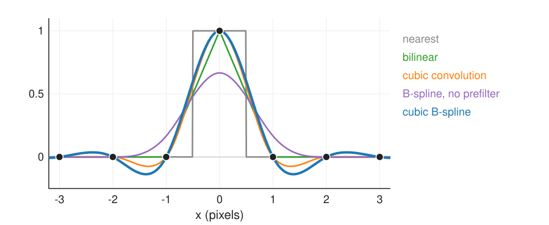
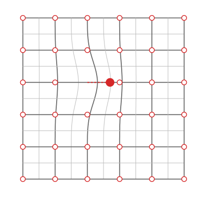

## Goal

By the end of this exercise you should be able to:

- explain why the cubic B-spline needs a **prefilter** to interpolate, and what the prefilter does to an impulse,
- compare nearest, bilinear, cubic convolution and the cubic B-spline by their values, overshoot and frequency response,
- choose the right interpolator for grey images and for label images,
- compute the displacements of a **free-form deformation** by hand and recognise **folding**,
- *(math)* verify the prefilter's impulse response, its frequency response, and the folding bound of a 1D FFD.

Do the pen-and-paper part first, then the two demos.

## Background

| Idea | What it means |
|---|---|
| Tensor-product spline | $f(x, y) = \sum_{k,l}c_{kl}\beta^p(x - k)\beta^p(y - l)$; $p = 0$ nearest, $p = 1$ bilinear |
| Cubic B-spline values | $\beta^3(0) = \tfrac23$, $\beta^3(\pm\tfrac12) = \tfrac{23}{48}$, $\beta^3(\pm1) = \tfrac16$, $\beta^3(\pm\tfrac32) = \tfrac1{48}$ |
| Prefilter | coefficients with $\tfrac16(c_{k-1} + 4c_k + c_{k+1}) = f_k$ along rows and columns; two recursive passes, pole $z_1 = \sqrt3 - 2$ |
| Cubic convolution | interpolating 4-tap kernel; at offsets $\pm\tfrac12$: 0.5625, at $\pm\tfrac32$: −0.0625 |
| Frequency responses | nearest sinc, linear sinc², B-spline sinc⁴ / ((2 + cos ω)/3) |
| FFD | $\mathbf{u}(\mathbf{x}) = \sum_{kl}\mathbf{d}_{kl}\beta^3(x/h - k)\beta^3(y/h - l)$; folding when $\det(I + \nabla\mathbf{u}) \le 0$ |

## By hand

**B1.** **The impulse.** A row of pixels $0, 0, 1, 0, 0$ (the 1 at $k = 0$).
(a) Use the pixel values directly as cubic B-spline coefficients. What is the interpolated value at $x = -1, 0, 1$ and at $x = \tfrac12$? Why is this a blur?
(b) With the prefilter the coefficients are $c_k = \sqrt3\,z_1^{|k|}$, $z_1 = \sqrt3 - 2$. Compute $c_0, c_1, c_2$ and check that $\tfrac16(c_{-1} + 4c_0 + c_1) = 1$ and $\tfrac16(c_0 + 4c_1 + c_2) = 0$.
(c) Bilinear and cubic convolution at $x = \tfrac12$?

**B2.** **Overshoot.** A long step $\dots, 0, 0, 100, 100, \dots$ (the jump between $k = 1$ and $k = 2$).
(a) Bilinear and cubic convolution at $x = 1.5$ (halfway across the jump).
(b) Cubic convolution at $x = 0.5$ and $x = 2.5$. Which values are below 0 or above 100?
(c) What would you do with such values in an 8-bit image, and when does it matter for measurements?

**B3.** **FFD by hand.** Control grid spacing $h = 32$ pixels; one control point at $(128, 128)$ moves by $(9, 0)$, all others stay.
(a) How far do the pixels at $(128, 128)$, $(160, 128)$, $(160, 160)$ and $(192, 128)$ move?
(b) The pixel at $(144, 128)$ (half a spacing to the right)? Use $\beta^3(\tfrac12) = \tfrac{23}{48}$.
(c) Now every control point moves by $(9, 0)$. How far does every pixel move? Which property of the B-spline basis is this?

**B4.** **Labels.** A segmentation (labels 0, 1, 2, 3) must be registered to a second image with the FFD found for the grey images. What goes wrong with a cubic B-spline lookup in the warp? What do you use instead, and does the deformation itself change?

**B5.** **Choosing an interpolator.** For each task, choose nearest, bilinear, cubic convolution or cubic B-spline, and say why:
(a) showing a zoomed image on screen; (b) rotating an image several times in a processing chain; (c) a registration that needs image gradients at sub-pixel positions; (d) a mask; (e) a few hundred values sampled along a line profile.

**B6.** **Predict.** Rank nearest, bilinear, cubic convolution and cubic B-spline (with and without prefilter) by the error after rotating an image 10 times by 36°.

::: {.callout-note collapse="true" title="Solutions"}
**B1.** (a) $f(0) = \tfrac46 = 0.667$, $f(\pm1) = \tfrac16$, $f(\tfrac12) = 1\cdot\beta^3(\tfrac12) = \tfrac{23}{48} = 0.479$ (only the bump of the pixel at 0 has a non-zero coefficient). The peak drops from 1 to 0.67 and spreads to the neighbours: a $\tfrac16[1\;4\;1]$ blur. (b) $z_1 = -0.2679$: $c_0 = 1.732$, $c_{\pm1} = -0.464$, $c_{\pm2} = 0.124$. $\tfrac16(-0.464 + 4 \cdot 1.732 - 0.464) = \tfrac16 \cdot 6.000 = 1.000$; $\tfrac16(1.732 + 4(-0.464) + 0.124) = \tfrac16(1.732 - 1.856 + 0.124) = 0.000$. The interpolated value at $x = \tfrac12$ is 0.600. (c) Bilinear 0.5; cubic convolution 0.5625.

**B2.** (a) Both 50 (symmetric). (b) Cubic convolution at $x = 0.5$: the pixels at $-1, 0, 1, 2$ with weights $-0.0625, 0.5625, 0.5625, -0.0625$: $-0.0625 \cdot 100 = -6.25$. At $x = 2.5$: pixels 1, 2, 3, 4: $-0.0625 \cdot 0 + 0.5625 \cdot 100 + 0.5625 \cdot 100 - 0.0625 \cdot 100 = 106.25$. The cubic B-spline overshoots a little more (about −10 and 110 on a long step). (c) Clip to 0–255 for storage and display, and say so; near edges the interpolated values are not measurements (an intensity profile across an edge shows a ripple that is not in the object).

**B3.** (a) $9 \cdot \tfrac49 = 4$, $9 \cdot \tfrac19 = 1$, $9 \cdot \tfrac1{36} = 0.25$, and 0 at $(192, 128)$ (two spacings away, $\beta^3(2) = 0$). (b) $9\,\beta^3(\tfrac12)\beta^3(0) = 9 \cdot \tfrac{23}{48} \cdot \tfrac23 = 2.875$ pixels. (c) Every pixel moves by exactly $(9, 0)$: the basis functions sum to 1 (partition of unity), so equal displacements give a translation.

**B4.** The cubic lookup averages neighbouring labels and overshoots, inventing labels (and fractions) at every boundary. Use nearest neighbour for the lookup; the deformation (where each pixel looks) stays the same: only the sampling of the label image changes.

**B5.** (a) Bilinear (or cubic convolution): one resampling, for the eye. (b) Cubic B-spline: errors accumulate least. (c) Cubic B-spline: C², its gradient is exact and smooth. (d) Nearest. (e) Cubic convolution: local, no prefilter of the whole image needed for a few values (or the B-spline if coefficients exist anyway).

**B6.** Least change: cubic B-spline (11.3 grey levels RMS on the micrograph), cubic convolution (14.8), bilinear (21.6), B-spline without prefilter (25.2: it blurs every time), nearest (28.1). Numbers from the splinezoom demo.
:::

### Math questions

**B7.** *(math)* Show that $c_k = \sqrt3\,z_1^{|k|}$ with $z_1 = \sqrt3 - 2$ satisfies $\tfrac16(c_{k-1} + 4c_k + c_{k+1}) = \delta_k$ for all $k$. (Use $z_1^2 + 4z_1 + 1 = 0$.)

**B8.** *(math)* Derive the frequency response of $\tfrac16[1\;4\;1]$ and of its inverse. By how much does the prefilter amplify the highest frequency? Combine with $\operatorname{sinc}^4$ to get the response of the cubic B-spline interpolator, and evaluate it at $\omega = \pi$.

**B9.** *(math)* A 1D FFD $x \mapsto x + d\,\beta^3(x/h)$ with one control point. (a) Compute the derivative of the map. (b) $\beta^{3\prime}$ has its minimum $-\tfrac23$ at $x = \tfrac23$. For which $d$ does the map stop being one-to-one? (c) In 2D, one control point moves by $(d, 0)$: show that $\det(I + \nabla\mathbf{u}) = 1 + \tfrac{d}{h}\beta^{3\prime}(x/h)\beta^3(y/h)$ and find the largest $d$ without folding.

**B10.** *(math)* Show that the FFD displacement is linear in the control displacements, and write the derivative $\partial\mathbf{u}(\mathbf{x})/\partial\mathbf{d}_{kl}$. Why does this matter for registration?

::: {.callout-note collapse="true" title="Solutions (math)"}
**B7.** For $k \ne 0$ (say $k \ge 1$): $c_{k-1} + 4c_k + c_{k+1} = \sqrt3 z_1^{k-1}(1 + 4z_1 + z_1^2) = 0$, since $z_1 = \sqrt3 - 2$ is a root of $z^2 + 4z + 1$ ($(\sqrt3 - 2)^2 = 7 - 4\sqrt3$, $4(\sqrt3 - 2) = 4\sqrt3 - 8$, sum with 1: 0). For $k = 0$: $\tfrac{\sqrt3}{6}(z_1 + 4 + z_1) = \tfrac{\sqrt3}{6}(4 + 2\sqrt3 - 4) = \tfrac{\sqrt3 \cdot 2\sqrt3}{6} = 1$.

**B8.** $\tfrac16(e^{-i\omega} + 4 + e^{i\omega}) = \tfrac{2 + \cos\omega}{3}$, between $\tfrac13$ ($\omega = \pi$) and 1 ($\omega = 0$). Inverse: $\tfrac{3}{2 + \cos\omega}$, amplification 3 at $\omega = \pi$. Interpolator: $H(\omega) = \operatorname{sinc}^4(\omega/2\pi)\cdot\frac{3}{2 + \cos\omega}$; at $\omega = \pi$: $(2/\pi)^4 \cdot 3 = 0.164 \cdot 3 = 0.493$ (the ideal is $\tfrac12$ exactly at the band edge).

**B9.** (a) $1 + \tfrac{d}{h}\beta^{3\prime}(x/h)$. (b) The smallest value is $1 - \tfrac23\tfrac{|d|}{h}$ (at $x = \tfrac23 h$ for $d > 0$); the map folds when it reaches 0: $|d| \ge 1.5h$. (c) $\mathbf{u} = (d\,\beta^3(x/h)\beta^3(y/h), 0)$; $\nabla\mathbf{u}$ has only the first row non-zero, so $\det(I + \nabla\mathbf{u}) = 1 + \partial_x u_1 = 1 + \tfrac{d}{h}\beta^{3\prime}(x/h)\beta^3(y/h)$. Minimum at $y = 0$ ($\beta^3(0) = \tfrac23$) and $x/h = \tfrac23$: $1 - \tfrac49\tfrac{d}{h}$, so no folding for $d < 2.25h$. Several control points moving against each other fold much earlier (two neighbours at $\pm d$: about $1.2h$), hence the general bound of about $0.49h$.

**B10.** $\mathbf{u}(\mathbf{x}) = \sum_{kl}\mathbf{d}_{kl}B_{kl}(\mathbf{x})$ with fixed $B_{kl}(\mathbf{x}) = \beta^3(x/h - k)\beta^3(y/h - l)$: a linear combination of the $\mathbf{d}_{kl}$. $\partial\mathbf{u}(\mathbf{x})/\partial\mathbf{d}_{kl} = B_{kl}(\mathbf{x})\,I$. In registration the similarity of the warped image depends on $\mathbf{d}$ through $\mathbf{u}$; by the chain rule its gradient needs only the image gradient at $\mathbf{x} + \mathbf{u}(\mathbf{x})$ times these basis values, which are non-zero for 16 control points per pixel: cheap and local.
:::

## Explore: image interpolation {#explore-splinezoom}

{width="75%" fig-align="center"}

A 128 × 128 image (the micrograph, a zone plate, a Siemens star, a step edge, an impulse or a label image) and an interpolator. **Zoom ×8** shows a 16 × 16 patch (click the original to move it) and a profile through its middle row (dots: the samples). **Rotate 36° n times** resamples the previous result each time and shows the difference to the original (n = 10) or to one rotation by n · 36°. Lower right: the frequency responses (the chosen interpolator thick; colour key on the buttons).

```{=html}
<link rel="stylesheet" href="../demos/dist/demo.css">
<div data-demo="splinezoom" data-preset="impulse"></div>
<script src="../demos/dist/splinezoom.js"></script>
```

**D1.** Preset **impulse: who interpolates?** For each interpolator read the value at the sample, the value halfway, and the range of the result. Which ones interpolate? Which overshoot?

**D2.** Preset **prefilter off: blur**. Why is the peak 113, not 170 (= 255 · ⅔)?

**D3.** Preset **rotate 10 × 36°**. Read the RMS difference for all five interpolators. Look at the difference image: where are the errors?

**D4.** Preset **zone plate: aliasing**. Compare nearest and cubic B-spline in the zoom. Which frequency response explains what you see?

**D5.** Preset **edge: overshoot of the cubics**. Read the range of the result for each interpolator. (The edge goes from 50 to 200.)

**D6.** Preset **label image: why nearest**. What fraction of the zoomed pixels have a value that is not one of the labels (0, 80, 160, 240), for each interpolator?

::: {.callout-note collapse="true" title="Solutions"}
**D1.** At the sample: 255 for all except the B-spline without prefilter (113). Halfway (along a row): nearest 255 (it rounds to the bright pixel), bilinear 127.5, cubic convolution 143.4, cubic B-spline 153.1, no prefilter 81.5. Ranges: nearest and bilinear 0 to 255 (no overshoot); cubic convolution −18.7 to 250; cubic B-spline −34.0 to 251 (negative lobes). Nearest, bilinear, cubic convolution and the prefiltered B-spline interpolate.

**D2.** The blur acts in both directions: the 2D value at the pixel is $255 \cdot \tfrac23 \cdot \tfrac23 = 113.3$.

**D3.** Nearest 28.1, bilinear 21.6, B-spline without prefilter 25.2, cubic convolution 14.8, cubic B-spline 11.3. The errors concentrate on edges and fine texture (the nuclear envelope, the fibres); flat regions hardly change.

**D4.** With nearest, the fine rings near the edge of the zone plate turn into blocky patterns with wrong orientations: frequencies above Nyquist pass (nearest's response is still 0.64 at π and 0.30 at 1.5π: aliases). The cubic B-spline (0.49 at π, 0.01 at 1.5π) gives smooth rings without spurious patterns (the sampled image itself is already aliased there; the interpolator just does not add more).

**D5.** Nearest, bilinear and the unfiltered B-spline stay in 50–200; cubic convolution 29.7 to 220.3; cubic B-spline 19.4 to 230.6. The sharper (more ideal) interpolators ring more at a sharp edge.

**D6.** Nearest 0.0 %, bilinear 1.5 %, cubic convolution 3.1 %, cubic B-spline 7.1 % (with values down to −14.5 and up to 96.3 between the background and the label 80): every averaging interpolator invents labels along the boundaries.
:::

## Explore: free-form deformation {#explore}

{width="38%" fig-align="center"}

A 256 × 256 checkerboard (or the micrograph) with a control grid (spacing 16, 32 or 64 pixels). Handles sit at control point + displacement; the yellow lines show where the pixel grid goes. Right: the Jacobian determinant (blue: compressed, red: stretched, black: folded). The readout gives the displacement of the selected control point and of the pixels at it, at the next control point and diagonally; the smallest Jacobian determinant and the number of folded pixels.

```{=html}
<link rel="stylesheet" href="../demos/dist/demo.css">
<div data-demo="ffd" data-preset="one"></div>
<script src="../demos/dist/ffd.js"></script>
```

**E1.** Preset **one point, 9 px**. Check B3(a) with the readout. Where is the image compressed and where stretched? What is the smallest Jacobian determinant?

**E2.** Drag the same point further right and watch the smallest determinant. At which displacement does the first fold appear? Compare with B9(c).

**E3.** Preset **too far: the grid folds**. Read the smallest determinant and the number of folded pixels. Drag the two points back towards each other: at roughly which displacement do the folds disappear?

**E4.** Preset **all the same vector: a translation**. What is the Jacobian determinant everywhere? Why?

**E5.** Preset **degree 1 vs 3**. How far does the pixel at the control point move now? Look at the deformed grid: where are the kinks? Switch to cubic.

**E6.** Change the spacing to 64 and to 16 pixels and drag one point by about 10 pixels each time. How does the size of the deformed region change? Which spacing would you use to model a local bulge of 20 pixels?

::: {.callout-note collapse="true" title="Solutions"}
**E1.** 4.00, 1.00 and 0.25 px. Compressed (blue) just to the right of the control point, where pixels behind it move further than pixels in front; stretched (red) to the left. Smallest determinant 0.875 ($= 1 - \tfrac49\cdot\tfrac{9}{32}$).

**E2.** The first fold appears at about $2.25h = 72$ pixels (the smallest determinant is $1 - \tfrac49\,d/32$: 0.5 at 36 px, 0 at 72 px), as in B9(c).

**E3.** With ±44 px (1.4 spacings): smallest determinant −0.146, 239 folded pixels, the checkerboard overlaps itself. Folds disappear at about ±38 px (smallest determinant 0.01; ±26 px gives 0.32).

**E4.** 1 everywhere: all displacements equal means $\mathbf{u}$ is constant (partition of unity), so $\nabla\mathbf{u} = 0$.

**E5.** The pixel at the control point moves the full displacement (the hat is 1 there, a linear FFD interpolates its control points), and the deformation is spread only over one spacing on each side. The deformed grid bends with kinks along the lines through the neighbouring control points (C⁰). The cubic version is smooth (C²) but moves the pixel at the control point less (4/9 of the displacement) and spreads further (two spacings).

**E6.** The deformed region is about 4 spacings wide (±2h): 256 px at h = 64, 64 px at h = 16. A 20-pixel bulge needs spacing 16 or less (with 32 or 64 the smallest possible deformation is wider than the bulge).
:::

## Where this leads

**Non-rigid registration** ([optical flow day](../nonrigid-reg/lec.qmd)) searches for the control displacements of an FFD that make two images agree, with a smoothness penalty. **Spline snakes** ([snakes day](../snakes/lec.qmd)) use the closed B-splines of [unit 3](../spline-fit/lec.qmd) as contours and the B-spline interpolated image for exact forces.
