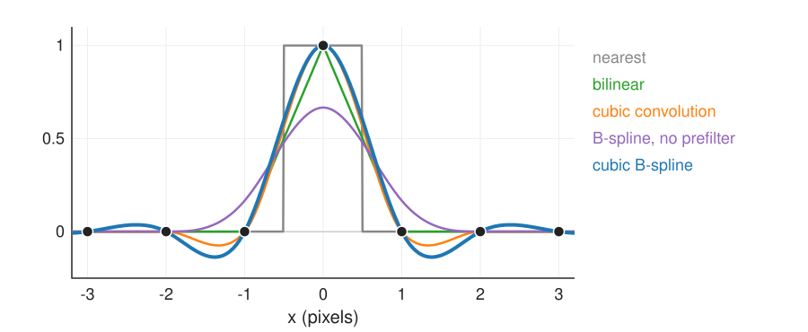
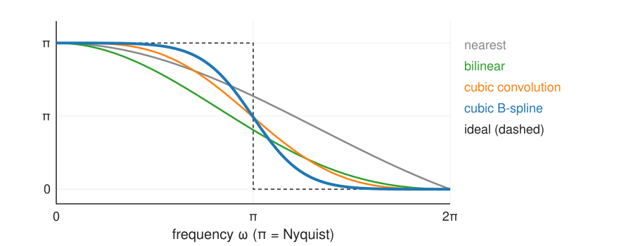

## About this lecture

An image is a grid of samples of a surface. Interpolating it means choosing a surface through the samples; deforming it means moving that surface smoothly. Both are tensor-product splines.

- Beyond bilinear: **cubic convolution** and the **cubic B-spline** with its **prefilter**.
- Interpolators as **low-pass filters**; the repeated-rotation test.
- Where cubics overshoot, and why **labels** still need nearest neighbour.
- **Free-form deformation**: a coarse grid of control points moves every pixel smoothly; **folding** and the Jacobian.
- Pointers: non-rigid registration, spline snakes.

*Slides titled **The math** give the formulas and proofs; the ideas are complete without them.*

::: notes
Convention: pixel centres at integers, x to the right, y down. β³ is the centred cubic B-spline of unit 2 (values 1/6, 4/6, 1/6 at −1, 0, 1). The FFD numbers use a control grid of spacing h = 32 pixels; the optical flow day's non-rigid registration unit uses the same convention.
:::

## Recall: nearest and bilinear

From the [images unit](../images/lec.qmd): resampling (rotate, zoom, warp) looks up the input at non-integer positions.

- **Nearest neighbour** = the degree-0 B-spline (box): blocky, jumps.
- **Bilinear** = the degree-1 B-spline in $x$ times in $y$ (a **tensor product**, unit 2): continuous, but with **kinks** along every pixel row and column (the slope jumps), and it **blurs**: halfway between pixels it averages.

Both are fine for display. They hurt when the result is resampled again, when sub-pixel positions matter (registration), or when derivatives of the interpolated image are needed (gradients for snakes and registration).

## Two cubic ideas

**(a) Cubic convolution.** A fixed kernel of width 4 with small negative lobes, chosen so that it **interpolates** (1 at its own pixel, 0 at the others) and is smooth (C¹). 16 pixels per output value. Image libraries call this "bicubic" (one-line pointer).

**(b) Cubic B-spline.** The smooth bell of unit 2 (C²), but it does **not** interpolate: its values $\tfrac16, \tfrac46, \tfrac16$ average neighbouring pixels. So first compute **coefficients** $c_k$ such that the spline passes through the samples:
$$\tfrac16\big(c_{k-1} + 4c_k + c_{k+1}\big) = f_k\qquad\text{along every row, then every column.}$$
This is the interpolation system of [unit 3](../spline-fit/lec.qmd). Solving it is a cheap **sharpening filter** (the **prefilter**: two passes per row). After it the B-spline interpolates exactly, is C², and its derivatives are free.

## The impulse test

{width="74%" fig-align="center"}

One bright pixel $0, 0, 1, 0, 0$:

- B-spline **without** prefilter: $\tfrac16, \tfrac46, \tfrac16$ at the samples: peak 0.67, a blur.
- **With** prefilter: through 1 at the sample and 0 at the others, with small negative lobes (down to −0.14).
- Halfway between the bright pixel and its neighbour: nearest 1 or 0, bilinear 0.50, cubic convolution 0.56, cubic B-spline 0.60.

## The math: tensor product and prefilter {.math}

**Tensor product.** $f(x, y) = \sum_{k,l} c_{kl}\,\beta^3(x - k)\,\beta^3(y - l)$: separable, 16 terms per point.

**Prefilter.** The condition $\tfrac16(c_{k-1} + 4c_k + c_{k+1}) = f_k$ is the convolution $c * \tfrac16[1\;4\;1] = f$. Its inverse factors into two first-order recursive filters (Unser, Aldroubi & Eden 1991), with the pole $z_1 = \sqrt3 - 2 \approx -0.268$:
$$c^+_k = f_k + z_1c^+_{k-1}\ \ (\text{left to right}),\qquad c_k = z_1\big(c_{k+1} - c^+_k\big)\ \ (\text{right to left}),$$
with a gain of 6 and mirror boundary conditions for the start values. The impulse's coefficients are $c_k = \sqrt3\,z_1^{|k|}$: $1.732, -0.464, 0.124, -0.033, \dots$

- Cost: 2 multiply-adds per pixel per pass, $O(n)$, no matrix.
- Check: $\tfrac16\sqrt3(z_1 + 4 + z_1) = \tfrac{\sqrt3}{6}(4 + 2\sqrt3 - 4) = 1$.

## Try it: zoom and the impulse

```{=html}
<link rel="stylesheet" href="../demos/dist/demo.css">
<div data-demo="splinezoom" data-preset="impulse"></div>
<script src="../demos/dist/splinezoom.js"></script>
```

::: notes
Left: the 128 × 128 image with the zoom patch (red, click to move); middle: the 16 × 16 patch zoomed ×8 with the chosen interpolator; below: the profile through the middle row of the patch (dots: the samples) and the frequency responses (the chosen one thick). "impulse": cubic B-spline, range −34 … 251 (overshoot), 255 at the sample, 153 halfway (0.60). Switch interpolators: nearest blocks, bilinear a pyramid with straight sides (128 halfway), cubic convolution 143 halfway, B-spline without prefilter peaks at 113 (255 · (2/3)², the 1D factor in both directions) and never reaches 255 ("prefilter off: blur"). "zone plate": with nearest, the fine rings show jagged blocks; the B-spline is smooth. "edge": cubic convolution overshoots the step; the profile shows the ripple.
:::

## Interpolation quality in frequency

{width="70%" fig-align="center"}

Every interpolator is a continuous kernel: a **low-pass filter** ([Fourier unit](../fourier/lec.qmd)). The ideal passes everything below the Nyquist frequency and nothing above (dashed); it is the sinc, infinitely wide, and rings.

- **Nearest** passes much above Nyquist: **aliases** (copies of the spectrum) leak in.
- **Bilinear** damps high frequencies below Nyquist: **blur**.
- **Cubic B-spline** (with prefilter) is flattest in the pass band and steepest at Nyquist: closest to ideal.

## The math: frequency responses {.math}

Kernels in the frequency domain ($\omega$ in radians per pixel, sinc$(u) = \sin(\pi u)/(\pi u)$):

- nearest: $\operatorname{sinc}(\omega/2\pi)$; linear: $\operatorname{sinc}^2(\omega/2\pi)$; B-spline without prefilter: $\operatorname{sinc}^4(\omega/2\pi)$.
- B-spline with prefilter (the **cardinal** cubic spline):
$$H(\omega) = \frac{\operatorname{sinc}^4(\omega/2\pi)}{(2 + \cos\omega)/3}.$$
The denominator is the response of $\tfrac16[1\;4\;1]$, at least $\tfrac13$ (at $\omega = \pi$), so the prefilter exists and boosts high frequencies by up to 3.
- At $\omega = \pi/2$: nearest 0.90, linear 0.81, cubic convolution 0.94, cubic B-spline 0.99. At $1.5\pi$ (an alias): 0.30, 0.09, 0.06, 0.01.
- As the degree grows, the cardinal spline tends to the ideal sinc.

## Resampling again and again

Rotate an image by 36° ten times: it is back where it started, but each rotation interpolated the previous result.

| Interpolator | RMS change after 10 × 36° (micrograph, 128 × 128) |
|---|---|
| nearest | 28.1 |
| bilinear | 21.6 |
| B-spline, no prefilter | 25.2 |
| cubic convolution | 14.8 |
| cubic B-spline | 11.3 |

Nearest shreds edges, bilinear and the unfiltered B-spline blur visibly; the cubic B-spline loses about half of what bilinear loses. The same applies to sub-pixel shifts in registration, smooth zooming, and gradients at sub-pixel positions (exact derivatives of the spline).

## Try it: rotate ten times

```{=html}
<link rel="stylesheet" href="../demos/dist/demo.css">
<div data-demo="splinezoom" data-preset="rotate"></div>
<script src="../demos/dist/splinezoom.js"></script>
```

::: notes
"rotate 10 × 36°" with bilinear: RMS difference 21.6 grey levels inside the central disc; the result is visibly blurred. Switch to cubic B-spline: 11.3; nearest: 28.1 (jagged); B-spline without prefilter: 25.2 (smoothing accumulates); cubic convolution: 14.8. The difference image (right) shows where the errors are: on edges and texture. For n not a multiple of 10 the reference is one rotation of the original by n·36° (cubic B-spline). The rotations are recomputed when the slider stops moving.
:::

## Overshoot, and when to use nearest

- Cubic interpolators have **negative lobes**: near an edge they **overshoot**. A step from 0 to 100 gives values down to −7 and up to 107 (cubic convolution) or −11 and 111 (cubic B-spline). For 8-bit images, **clip** to 0–255 (and say so); for measurements, know that the values near edges are not data.
- **Label images** (object numbers, masks): any interpolator that averages invents labels that do not exist (recall the [images quiz](../images/quiz.qmd), Q6). Use **nearest neighbour**, whatever is used for the grey image.
- Cubic convolution is local (4 × 4 pixels, no prefilter): useful when only a few output values are needed; the B-spline needs the prefilter over whole rows and columns first, then it is cheaper per value of quality.

## Free-form deformation

A smooth, flexible deformation of a whole image with few numbers:

- A coarse **grid of control points** (every 16 to 64 pixels), each with a **displacement vector**.
- The displacement of every pixel is the **tensor-product cubic B-spline** of the control displacements; the image is warped with it (inverse mapping, recall the [images unit](../images/lec.qmd)).
- From unit 2, for free: **smooth** (C²), **local** (a control point moves only a 4 × 4-cell neighbourhood), **partition of unity** (all control points moved by the same vector = a translation).

Drag one control point by 9 pixels (grid spacing $h$): the pixel at that control point moves **4** pixels, a pixel at the next control point **1** pixel, diagonally **0.25** pixel. Control points are not on the deformed grid: they **steer** it, like the control polygon of a curve.

## The math: the FFD displacement field {.math}

$$\mathbf{u}(\mathbf{x}) = \sum_{k,l}\mathbf{d}_{kl}\,\beta^3\!\big(\tfrac{x}{h} - k\big)\,\beta^3\!\big(\tfrac{y}{h} - l\big),\qquad \mathbf{x} \mapsto \mathbf{x} + \mathbf{u}(\mathbf{x}).$$

- One control point with $\mathbf{d} = (9, 0)$: at the control point $9\,\beta^3(0)^2 = 9\cdot\tfrac49 = 4$; one spacing away $9\,\beta^3(1)\beta^3(0) = 9\cdot\tfrac19 = 1$; diagonally $9\cdot\tfrac1{36} = 0.25$.
- $\mathbf{u}$ is **linear in the $\mathbf{d}_{kl}$**: its derivative with respect to a control displacement is just the basis value. This is what makes registration (finding the $\mathbf{d}_{kl}$) a smooth optimisation problem.
- No folding as long as the Jacobian determinant $\det(I + \nabla\mathbf{u}) > 0$ everywhere. In 1D, $x + d\,\beta^3(x/h)$ has derivative $1 + \tfrac{d}{h}\beta^{3\prime}(x/h) \ge 1 - \tfrac23\tfrac{d}{h}$: one control point can move up to $1.5h$ before the map folds.

## Folding

If neighbouring control points move too far towards or past each other, the map stops being one-to-one: parts of the image fold over others, and the **Jacobian determinant** (local area change) becomes **negative**.

- It is shown as a colour map: blue = compressed, red = stretched, black = folded.
- One control point alone can move far (in 2D up to $2.25h$ in one direction); two neighbours moved in opposite directions fold at about $1.2h$ each.
- A safe rule for any pattern: keep every displacement below about **0.49 of the spacing** in 2D (0.40 in 3D; Choi & Lee 2000). Registration methods enforce this, or penalise bending.

## Try it: free-form deformation

```{=html}
<link rel="stylesheet" href="../demos/dist/demo.css">
<div data-demo="ffd" data-preset="one"></div>
<script src="../demos/dist/ffd.js"></script>
```

::: notes
Checkerboard 256 × 256, control grid every 32 pixels (handles at control point + displacement; yellow lines: the deformed grid). "one point, 9 px": readout 4.00, 1.00, 0.25 px; min det J 0.875 (a 12.5 % compression just to the right of the point). "a smooth bend": one row of control points moved by a sine. "a local bulge": 8 points pushed outwards by 12 px: red (stretch) inside, blue around. "too far: the grid folds": two neighbours moved ±44 px (1.4 h): min det J −0.146, 239 folded pixels (black), the checkerboard overlaps itself. With ±26 px: min det J 0.32, no folds. "all the same vector": a pure translation (det J = 1 everywhere). "degree 1 vs 3": linear FFD, the pixel at the control point moves the full displacement, but the grid shows kinks along the cell boundaries. Drag any handle; switch the spacing (16/32/64 px).
:::

## Where splines on images lead

- **Non-rigid registration** ([optical flow day](../nonrigid-reg/lec.qmd)): find the control displacements $\mathbf{d}_{kl}$ that make two images agree, with a smoothness penalty; coarse to fine by refining the control grid. The **representation** is this unit's; the **energy and its optimisation** are there.
- **Spline snakes** ([snakes elective](../snakes/lec.qmd)): the contour is a closed B-spline with a few control points (unit 3), driven by image forces sampled from the B-spline-interpolated image with exact gradients.
- **3D**: the same tensor product in three directions gives smooth volume interpolation and 3D free-form deformations. B-spline image pyramids exist too (the course uses the Gaussian one, [scale space](../scale-space/lec.qmd)).

## The splines day in one table

| Spline | Degree | Through the data? | Smoothness | Local? | Used for |
|---|---|---|---|---|---|
| nearest | 0 | yes | jumps | yes | labels, masks |
| bilinear | 1 | yes | C⁰ (kinks) | yes | display, quick warps |
| cubic convolution | 3 | yes | C¹ | yes (4 × 4) | general resampling |
| cubic B-spline + prefilter | 3 | yes | C² | yes (after prefilter) | precise resampling, gradients, registration |
| smoothing spline | 3 | no (near) | C² | yes | noisy data, outlines |
| NURBS | any | no (controlled) | by knots | yes | exact circles and conics, design |

## Summary

- Interpolating an image = choosing a surface through its samples; nearest and bilinear are B-splines of degree 0 and 1.
- **Cubic convolution**: a fixed interpolating 4 × 4 kernel. **Cubic B-spline**: smoother (C²), but needs the **prefilter** $\tfrac16(c_{k-1} + 4c_k + c_{k+1}) = f_k$ (two recursive passes per row and column) to interpolate.
- In frequency, the cubic B-spline is closest to the ideal low-pass; after 10 rotations it changes the image half as much as bilinear.
- Cubics **overshoot** at edges; **labels** need nearest neighbour.
- **Free-form deformation**: displacements on a coarse control grid, spread by the tensor-product cubic B-spline: smooth, local, a translation when all move together (4, 1, 0.25 px for a 9-px drag). Too large displacements **fold** the image (negative Jacobian determinant).
