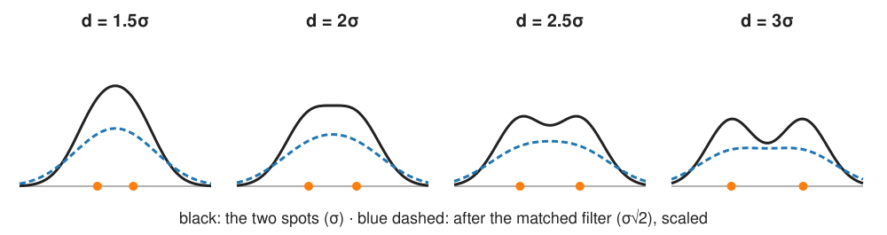
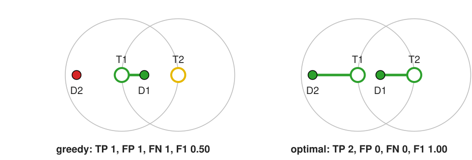

## About this lecture

Two hard cases, and how to know whether a detector works.

- **When do two spots become one?** The $2\sigma$ rule, and why the detection filter makes it worse.
- **Splitting** a merged spot by fitting two, and why an extra spot must pay a **penalty**.
- **Evaluating** a detector: one-to-one **matching within a gate radius**, TP/FP/FN, precision, recall, F1.
- **Greedy vs optimal** matching.
- Two kinds of error, reported separately: **detection** and **localisation**.
- The **threshold sweep**: the precision–recall curve.

*Slides titled **The math** give the formulas and proofs; the ideas are complete without them.*

## When do two spots become one?

The sum of two equal Gaussian spots of width σ has **two maxima only if their distance $d > 2\sigma$** (recall the Sparrow criterion of the [resolution unit](../resolution/lec.qmd)).

{width="85%" fig-align="center"}

- The detection filter **widens** the spots: after a Gaussian of width $\sigma_f$ they have width $\sqrt{\sigma^2 + \sigma_f^2}$. The matched filter ($\sigma_f = \sigma$) merges pairs closer than $2\sqrt2\,\sigma$: **4.2 px** for σ = 1.5.
- **The central trade-off of the day**: more smoothing → fewer false spots (unit 2) but more merged neighbours.

## The math: merging {.math}

$f(x) = g(x - d/2) + g(x + d/2)$ with $g(x) = e^{-x^2/2\sigma^2}$. By symmetry $f'(0) = 0$; the centre is a maximum (one spot) or a minimum (a dip between two) depending on the sign of

$$f''(0) = 2g''(d/2) = \frac{2}{\sigma^2}\Big(\frac{d^2}{4\sigma^2} - 1\Big)e^{-d^2/8\sigma^2}.$$

- $f''(0) < 0 \iff d < 2\sigma$: one maximum. At $d > 2\sigma$ the centre is a dip and there are two maxima.
- Filtering with a Gaussian of width $\sigma_f$: Gaussians convolve with **variances adding**, $\sigma_\text{eff}^2 = \sigma^2 + \sigma_f^2$; the rule becomes $d > 2\sigma_\text{eff}$.
- In 2D the same holds along the line through both spots.

## Density

As spots get denser, problems start long before the image "looks crowded":

- **Recall drops**: pairs closer than ~4 px (after the filter) give one candidate.
- **Localisation error rises**: a neighbour's tail adds light on one side of a spot and biases its fit.
- **False merges**: one candidate halfway between two spots, matching neither.

Rule of thumb, to check with the demo: when the typical spacing falls below about $4\sigma$, accuracy suffers. With σ = 1.5 px in a 256 × 256 image, 1 000 spots (mean spacing about 8 px) already lose half of them.

## Splitting by fitting

Fit **one** spot. If the residual is much larger than the noise (an elongated ring of leftover light), fit **two**:

- Put the second spot where the residual is **largest**, the first one mirrored about the one-spot fit; fit both (positions, amplitudes, one background).
- An extra spot **always** reduces the residual sum of squares: it can fit noise too. So keep it only if it improves the fit by more than a **penalty**: $\mathrm{RSS}_1 - \mathrm{RSS}_2 > 3\,c\,\sigma_n^2$ (3 new parameters).
- $c = 0$: every single spot is split (in the demo 35 % of isolated spots get a phantom partner); $c = 2$: 5 %; larger $c$: fewer splits, and close pairs stay merged.
- "Add a spot where the residual is largest, refit, test, repeat" handles groups of 3, 4, … spots.

The penalty is a **choice**, like the regularisation weight elsewhere in the course.

## The math: one spot or two? {.math}

With $n$ spots (3 parameters each: $x$, $y$, amplitude) plus a background, and Gaussian noise of known variance $\sigma_n^2$:

$$-2\ln L_n = \mathrm{RSS}_n/\sigma_n^2 + \text{const}.$$

An information criterion adds a penalty per parameter, $c$ for each:

$$\text{keep } n + 1 \text{ spots if } \frac{\mathrm{RSS}_n - \mathrm{RSS}_{n+1}}{\sigma_n^2} > 3c, \qquad c = 2 \text{ (AIC)}, \quad c = \ln(\#\text{pixels}) \text{ (BIC)}.$$

- AIC targets prediction, BIC is more conservative (fewer splits) for large windows.
- Under "one spot" and with the second spot's position free, the improvement is not $\chi^2_3$ (the position is searched): the penalties are guides, calibrate them on simulations.

## Try it: two spots

```{=html}
<link rel="stylesheet" href="../demos/dist/demo.css">
<div data-demo="crowdfit" data-preset="filter" data-presets="three,two,filter,split,unequal,penalty"></div>
<script src="../demos/dist/crowdfit.js"></script>
```

::: notes
Two spots of σ = 1.5 px (yellow dots = truth), amplitude 60 on background 20, noise sd 6, in a 31 × 19 patch. Candidates (blue rings) are maxima of the matched-filtered image above 4 noise sd; green crosses are the fitted spots. Profile: raw (grey), noise-free (dashed) and matched-filtered (blue). Bar: RSS₁ − RSS₂ against the penalty 3·c·σn² (216 for c = 2). Plot: fraction of 20 seeded pairs that end with two spots against d/σ; blue = maxima only, green = with two-spot fitting; lines at 2σ and 2√2σ. Tour: "the filter merges them earlier" (d = 2.6σ): the noise-free raw profile has 2 maxima, the filtered one only 1; the fit splits them (gain 12 746 ≫ 216). "d = 2σ": one candidate; the fit still splits. Curves: maxima only find both in 5 % of the pairs at 3σ and in all from 3.5σ; with fitting 55 % at 1σ, 90 % at 1.5σ, all from 2σ. "Unequal pair" (q = 0.3, 2.5σ): one candidate; the fit recovers the dim one (gain 1 171). "Penalty too small" (d = 0, c = 0): a single spot gets a phantom partner (gain 59 > 0); with c = 2 it stays one.
:::

## Other routes for crowded spots

- **Deconvolve first** (sharper spots, recall [deconvolution](../deconv/lec.qmd)); it also amplifies noise.
- Spots as a **sparse sum of PSFs**: a regularised inverse problem with a sparsity penalty ([deconvolution](../deconv/lec.qmd), [wavelet shrinkage](../shrinkage/lec.qmd)).
- **Learned detectors** that output a heat map of spot centres ([deep learning detection](../detection/lec.qmd)).
- **Avoid the problem physically**: localisation microscopy switches on only a few molecules per frame, so the spots in each frame are sparse.

## Evaluating a detector: matching points

Compare the detected points with the **ground truth** (a simulation, or an annotated image).

- **One-to-one matching within a gate radius** $r_g$ (e.g. 2 px, about σ_PSF): each true spot claims at most one detection and vice versa.
- Matched = **TP**; unmatched detections = **FP**; unmatched true spots = **FN**.
- **Precision** TP/(TP + FP), **recall** TP/(TP + FN), **F1** = 2TP/(2TP + FP + FN): the same formulas as for pixels and objects (recall [object evaluation](../object-eval/lec.qmd)).
- Points have no area, so there is no IoU: the **distance** is the matching criterion.

Localisation-microscopy challenges report the **Jaccard index** TP/(TP + FP + FN); the evaluation day calls it the matching accuracy.

## Greedy vs optimal matching

{width="70%" fig-align="center"}

- Truths $T_1 = (0, 0)$, $T_2 = (2.5, 0)$; detections $D_1 = (1, 0)$, $D_2 = (-2, 0)$; gate 2.5.
- **Greedy** (closest pair first): $D_1$–$T_1$ (distance 1); then $D_2$ is 4.5 from $T_2$: TP 1, FP 1, FN 1, **F1 0.5**.
- **Optimal** (most matches, then smallest total distance): $D_1$–$T_2$ (1.5), $D_2$–$T_1$ (2.0): TP 2, **F1 1.0**, RMSE $\sqrt{(1.5^2 + 2^2)/2} = 1.77$.

Image libraries call the solver the "Hungarian algorithm"; the math is in [object evaluation](../object-eval/lec.qmd).

## The math: matching as an assignment problem {.math}

Distance matrix $D_{ij}$ between truth $i$ and detection $j$; pairs beyond the gate are forbidden. With the indicator $x_{ij} \in \{0, 1\}$, each row and column used at most once:

$$\max_x \sum_{ij} x_{ij}\,w_{ij}, \qquad w_{ij} = \begin{cases} 1 + \varepsilon\,(r_g - D_{ij})/r_g & D_{ij} \le r_g\\ 0 & \text{otherwise}\end{cases}$$

- With $\varepsilon < 1/n$ ($n$ = the larger set size), one extra match always outweighs any distance savings: the solution has the **most matches**, and among those the **smallest total distance**.
- Solved as a linear assignment problem (padding to a square matrix); the gate splits the problem into small independent groups of nearby points, so it is fast even for thousands of spots.

## Two kinds of error, reported separately

- **Detection**: F1 (or Jaccard) at the gate.
- **Localisation**: the **RMSE** of the matched pairs' distances, and the **mean offset** (bias: a detector that is systematically 0.5 px off).
- The gate **couples** them: too large a gate turns bad localisations into TPs (and can match the wrong spot), too small a gate turns a slightly-off detection into an FP **and** an FN.
- Plot F1 against the gate radius and choose the gate in the **flat part**.

## The math: the gate truncates the RMSE {.math}

2D localisation errors with sd $\sigma_\text{loc}$ per axis have a distance $r$ following the Rayleigh distribution, $p(r) = \frac{r}{\sigma_\text{loc}^2}e^{-r^2/2\sigma_\text{loc}^2}$:

- mean distance $\sigma_\text{loc}\sqrt{\pi/2} = 1.25\,\sigma_\text{loc}$; RMS distance $\sqrt2\,\sigma_\text{loc}$;
- fraction within the gate: $P(r \le r_g) = 1 - e^{-r_g^2/2\sigma_\text{loc}^2}$.

Only pairs within the gate are matched, so the RMSE is computed on a truncated distribution: it **underestimates** the true error when $r_g$ is within about 3 × σ_loc. With $\sigma_\text{loc} = 1$ px: gate 1 px → 39 % matched, RMSE 0.68; gate 2 px → 86 %, 1.17; gate 3 px → 99 %, 1.38 (true $\sqrt2 = 1.41$).

## The threshold sweep

Rank detections by their score (filter response in noise units, or fitted amplitude). Lower the threshold step by step:

- recall rises (more true spots found), precision falls (more false ones): the **precision–recall curve**, summarised by **AP** (recall [object evaluation](../object-eval/lec.qmd)).
- Choose the threshold at the **F1 maximum**, or at a required precision.
- Report **F1 against density** too: a method is "good" only up to a density.

## Try it: matching spots

```{=html}
<link rel="stylesheet" href="../demos/dist/demo.css">
<div data-demo="spotmatch" data-preset="pr" data-presets="greedy,small,large,pr,density,fit,bias"></div>
<script src="../demos/dist/spotmatch.js"></script>
```

::: notes
A synthetic 256 × 256 image with 80 spots (σ = 1.5, amplitude 8–80, noise 10); detector: zero-mean Gaussian, maxima in 5 × 5 windows, threshold k = 3 noise sd; gate 2 px, optimal matching. Rings = truth (white = matched, yellow = missed), dots = detections (green = matched, red = false), lines coloured by distance. Plots: F1 against the gate, the PR curve (dot = current k), F1 and RMSE against density. "PR curve": TP 73, FP 30, FN 7, F1 0.80; AP 0.93, best F1 0.93 at k ≈ 3.6. "Greedy loses a match": the by-hand tab with the example of the slide; drag the points. "Gate too small" (0.5 px): TP 40, FP 30, FN 40: good detections counted twice wrong. "Gate too large" (5 px, 200 spots, k = 3): F1 0.87, RMSE 0.65 px: matches far apart count. "Density" (1 000 spots): recall 0.49, F1 0.66; the F1 curve falls with density. "Fitting" (300 spots): RMSE 0.44 px against 0.61 without fitting, but about the same missed spots (84, against 83 without fitting): fitting improves localisation, not merges. "Biased detector" (+0.5 px in x and y, with fitting): F1 unchanged (0.92), RMSE 0.73 px instead of 0.31, mean offset (0.43, 0.51).
:::

## Honest evaluation

- **Simulated truth** is exact, but may not look like real data (PSF model, noise, background, density).
- **Annotated real data** look real, but annotators miss dim spots and disagree near each other (recall [agreement](../agreement/lec.qmd)).
- Do not tune $k$, the filter width and the gate on the images you report: that is **leakage** ([evaluation day](../leakage/lec.qmd)).
- Report the gate, F1 (or Jaccard), RMSE and the density together.

## Summary

- Two spots give two maxima only if $d > 2\sigma$; after the matched filter only if $d > 2\sqrt2\,\sigma$. Smoothing trades false spots for merges.
- A merged pair can be **split by fitting two spots**; an extra spot must improve the fit by more than a **penalty**, or noise gets spots too.
- Evaluate by **one-to-one matching within a gate radius**; optimal matching (most matches, then smallest distance) beats greedy.
- Report **detection** (F1 / Jaccard) and **localisation** (RMSE, mean offset) separately; the gate couples them.
- The **precision–recall curve** over the threshold; F1 against **density**.
