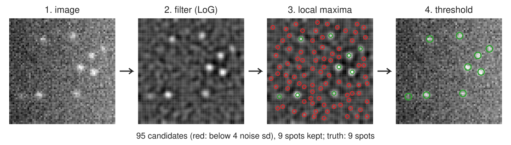
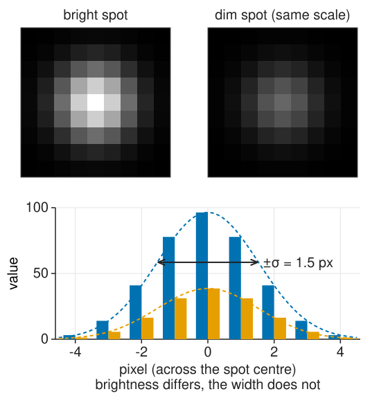
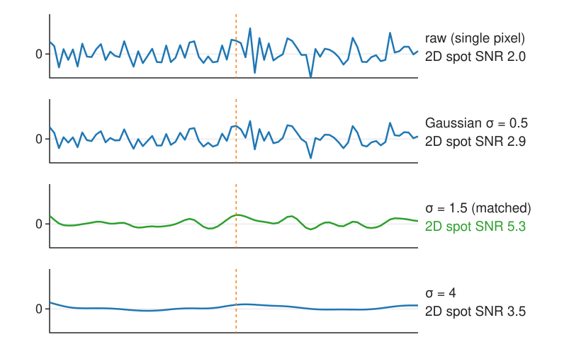
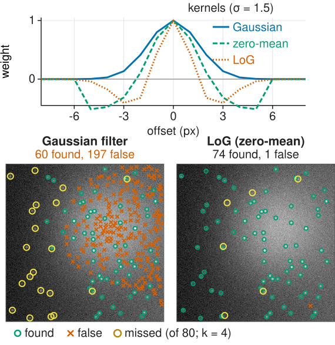
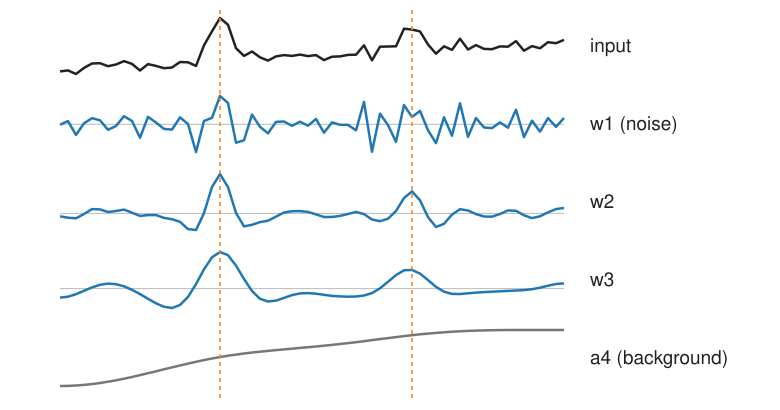
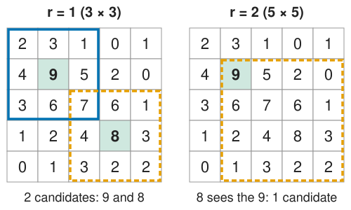
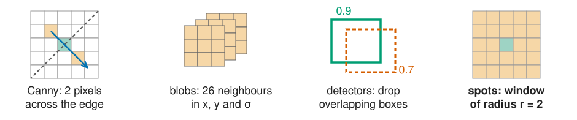

## About this lecture

Spots, particles, points of light: mRNA molecules, vesicles, beads, single fluorophores, stars. The output of spot detection is a **list of points**, not a mask.

- A spot is a **copy of the PSF**: one known size.
- **Filter**: the best linear filter for a known spot in noise is the spot itself (the **matched filter**).
- **Background**: make the filter zero-mean. That is a centre–surround filter, close to LoG/DoG.
- The **à trous** detector: spots persist across scales, noise does not.
- **Local maxima**: one candidate per spot, and how to choose the window.
- Next units: which candidates are real (thresholds), where exactly they are (sub-pixel fitting), crowded spots and evaluation.

*Slides titled **The math** give the formulas and proofs; the ideas are complete without them.*

::: notes
This day owns spot detection as a task: the pipeline filter → maxima → threshold → refine, the matched-filter argument, thresholds from noise statistics, sub-pixel localisation and the evaluation of point detections. LoG/DoG and scale space belong to the edges day ([scale space](../scale-space/lec.qmd)) and are only recalled here. Naming: the day says "points", the units say "spots".
:::

## The task: a list of points

{width="100%" fig-align="center"}

1. **Filter**: make each spot stand out from noise and background.
2. **Local maxima**: one candidate per spot (and many in the noise).
3. **Threshold**: keep the candidates that are unlikely to be noise ([next unit](../spot-threshold/lec.qmd)).
4. **Refine**: measure each position to a fraction of a pixel ([unit 3](../spot-fit/lec.qmd)).

Each detection: position $(x, y)$, brightness, a score. That list is the input for counting, tracking, colocalisation of spots.

::: notes
The figure is a synthetic 64 × 64 image with 9 spots of σ = 1.5 px on a sloped background with noise 10. The LoG response has 95 local maxima in a 5 × 5 window; only the 9 above 4 noise standard deviations survive, one per true spot. Most candidates are noise: thresholding is not a detail.
:::

## A spot is a copy of the PSF

:::: {.columns}
::: {.column width="56%"}
Recall from the image formation day ([the PSF unit](../psf/lec.qmd)): a point of light is imaged as the **PSF**, close to a Gaussian of width $\sigma \approx 0.21\,\lambda/\mathrm{NA}$ (78 nm at NA 1.4 and λ = 520 nm).

- In pixels: typically **σ ≈ 1 to 2 pixels** (the camera samples the PSF at about Nyquist).
- So unlike the blobs of the [edges day](../scale-space/lec.qmd), spots have **one known size**. No search over scales is needed: we know which σ to use.
- Brightness differs from spot to spot; the shape does not.

If you have not taken the [image formation day](../psf/lec.qmd): simply take "a spot is a small Gaussian of known width σ" as the model.
:::
::: {.column width="44%"}
{width="100%" fig-alt="Two 9 × 9 pixel spots of width σ = 1.5 px shown on the same grey scale, one bright (peak 96) and one dim (peak 39). Below, the pixel values along the row through the centre as bars: both profiles have the same width (±σ marked), only the height differs."}
:::
::::

## Why filter: collect the spot's signal

A single pixel is noisy. A spot spreads its light over about $\pi\sigma^2$ pixels, so a weighted average over the spot collects its signal while the noise averages out.

{width="60%" fig-align="center"}

- Spot of amplitude 20 (peak), noise sd 10, σ = 1.5: a single pixel has SNR **2**.
- Weighting the pixels with the spot's own shape: SNR $20\sqrt{\pi \cdot 1.5^2}/10 \approx$ **5.3**.
- Narrower (σ = 0.5): 2.9, noise left. Wider (σ = 4): 3.5, it averages in pure noise.

**Matched filter**: to find a known shape in white noise, correlate the image with that shape.

::: notes
The SNR numbers are for the 2D spot (the 1D curves only illustrate the smoothing): signal = filter response at the spot centre, noise = standard deviation of the filtered noise. They are computed with the course library (filterKernel, spotGain, filterResponseNoise). The 2.9 and 3.5 show that the optimum is broad: anything from σ ≈ 1 to 2 is nearly as good.
:::

## The math: the matched filter {.math}

Response of a filter $\mathbf w$ at a spot $A\mathbf p$ (shape $\mathbf p$, amplitude $A$) in white noise $\mathbf n$ of variance $\sigma_n^2$:

$$r = \sum_k w_k (A p_k + n_k), \qquad \text{signal } A\,\mathbf w^\top\mathbf p, \qquad \text{noise sd } \sigma_n\|\mathbf w\|.$$

$$\mathrm{SNR}(\mathbf w) = \frac{A\,\mathbf w^\top\mathbf p}{\sigma_n\|\mathbf w\|} \;\le\; \frac{A\,\|\mathbf p\|}{\sigma_n} \quad\text{(Cauchy–Schwarz), with equality iff } \mathbf w \propto \mathbf p.$$

- For a Gaussian spot of peak 1: $\|\mathbf p\|^2 = \sum_k e^{-r_k^2/\sigma^2} \approx \int e^{-r^2/\sigma^2}\,dA = \pi\sigma^2$, so $\mathrm{SNR}_\text{max} = A\sqrt{\pi\sigma^2}/\sigma_n$.
- Coloured (correlated) noise: whiten first, then match (the filter becomes $\Sigma^{-1}\mathbf p$).

## The math: noise after filtering {.math}

White noise of variance $\sigma_n^2$ through a kernel $\mathbf w$ has variance $\sigma_n^2\sum_k w_k^2$ (recall the [Canny unit](../canny/lec.qmd)).

For a normalised 2D Gaussian of width $\sigma_f$, $w(\mathbf x) = \frac{1}{2\pi\sigma_f^2}e^{-|\mathbf x|^2/2\sigma_f^2}$:

$$\sum_k w_k^2 \approx \int \frac{1}{4\pi^2\sigma_f^4}e^{-|\mathbf x|^2/\sigma_f^2}\,d\mathbf x = \frac{1}{4\pi\sigma_f^2}, \qquad \text{noise sd} \approx \frac{\sigma_n}{2\sqrt\pi\,\sigma_f}.$$

At $\sigma_f = 1.5$: $0.188\,\sigma_n$. The next unit thresholds the filtered image in units of exactly this number.

## Try it: spots in 1D

```{=html}
<link rel="stylesheet" href="../demos/dist/demo.css">
<div data-demo="peaks1d" data-preset="matched" data-presets="raw,matched,wide,small,large,ramp"></div>
<script src="../demos/dist/peaks1d.js"></script>
```

::: notes
A 256-sample profile with eight spots of σ = 1.5 (green ticks): a pair 7 px apart (27, 34), a spot at a half-pixel position, a bright spot with a dim neighbour 7 px away, a dim isolated spot, two spots on a ramp; noise 5. Tour: "raw maxima": 47 candidates for 8 spots, one per noise wiggle. "Matched filter" (σ = 1.5, r = 3): 13. "Filter too wide" (σ = 4): the pair merges, 6 candidates. "Window too small" (σ = 0.6, r = 1, noise 8): 38, several on one spot. "Window too large" (r = 8): 7, the dim neighbour at 112 is suppressed by the bright spot at 105 (and the left spot of the pair by its slightly brighter partner). "Ramp": with the plain Gaussian every bump of the ramp is above zero; the zero-mean filter removes the ramp (switch filters to compare). Click a spot to read its single-pixel and filtered SNR.
:::

## Background: make the filter zero-mean

:::: {.columns}
::: {.column width="54%"}
Real images have a smooth **background**: uneven illumination, autofluorescence. A Gaussian filter passes it unchanged, so "bright after filtering" also means "on a bright background".

- Subtract the local mean from the template: **spot shape minus its average** over a small window. The kernel sums to zero, so a constant background gives **zero** response.
- That is a **centre–surround** filter: positive centre, negative ring. It is (almost) the **LoG/DoG** of the edges day at σ ≈ spot σ.
- Recall ([scale space](../scale-space/lec.qmd)): a Gaussian spot of width $s$ gives the strongest normalised LoG response at σ = $s$. Spots of one size need **one** σ.
- Alternatives: subtract a heavily blurred copy of the image, or a **white top-hat** ([morphology day](../morph-grey/lec.qmd)) before the Gaussian.
- Fast approximation: a **box** centre minus a box surround ([integral images](../integral-image/lec.qmd)).
:::
::: {.column width="46%"}
{width="100%" fig-alt="Top: the Gaussian kernel is positive everywhere; the zero-mean Gaussian and the LoG have a positive centre and a negative ring. Bottom: the demo's 256 × 256 image with 80 spots on a slope and a broad bright patch. Gaussian filter, threshold 4 noise sd: 60 spots found and 197 false detections, all on the bright patch. LoG: 74 found, 1 false."}
:::
::::

## The math: the matched filter with unknown background {.math}

Model: $I_k = A p_k + B + n_k$ with an unknown constant $B$ in the window. A filter that ignores $B$ must satisfy $\sum_k w_k = 0$. Maximise

$$\frac{\mathbf w^\top\mathbf p}{\|\mathbf w\|} \quad\text{subject to}\quad \mathbf 1^\top\mathbf w = 0.$$

Write $\mathbf p = \bar p\,\mathbf 1 + (\mathbf p - \bar p\,\mathbf 1)$. For $\mathbf w \perp \mathbf 1$ only the second part counts: $\mathbf w^\top\mathbf p = \mathbf w^\top(\mathbf p - \bar p\mathbf 1)$, and Cauchy–Schwarz gives

$$\mathbf w \propto \mathbf p - \bar p\,\mathbf 1 \qquad\text{(projection onto the zero-sum subspace)}.$$

The price: $\|\mathbf p - \bar p\mathbf 1\| < \|\mathbf p\|$, a slightly lower SNR (2.33 instead of 2.66 per unit amplitude and noise for σ = 1.5 in a 11 × 11 window).

## The à trous detector

Blur repeatedly with the small kernel $(1, 4, 6, 4, 1)/16$, each time with the taps spread **twice as far apart** ("with holes"; no downsampling, every level keeps the full image size). Differences of consecutive blurs are band-pass images $w_1, w_2, \dots$: a DoG stack.

{width="52%" fig-align="center"}

- Noise lives mainly in $w_1$; spots of 1–2 px in $w_2$–$w_3$; the background in the last blur.
- Keep each $w_j$ only where it exceeds $k\hat\sigma_j$ (its own noise level, $k \approx 3$), then **multiply** the kept levels: a spot survives only if it is present at **every** chosen scale.
- Robust to uneven background by construction. The wavelet view of this transform belongs to the [wavelets day](../dwt2d/lec.qmd).

## The math: à trous {.math}

With $h_j$ = the B3 kernel $\tfrac1{16}(1, 4, 6, 4, 1)$ dilated by $2^{j-1}$ (taps at $0, \pm 2^{j-1}, \pm 2^j$), applied along rows and columns:

$$a_0 = I, \qquad a_j = h_j * a_{j-1}, \qquad w_j = a_{j-1} - a_j \quad (j = 1, \dots, J).$$

- Telescoping: $I = a_J + \sum_{j=1}^J w_j$ exactly (as the Laplacian pyramid of the [edges day](../scale-space/lec.qmd), without downsampling).
- Noise per level: $\hat\sigma_j = \mathrm{MAD}(w_j)/0.6745$ (next unit).
- Multiscale product: $P(\mathbf x) = \prod_{j \in S} \tilde w_j(\mathbf x)$, $\tilde w_j = w_j\,[w_j > k\hat\sigma_j]$; candidates are local maxima of $P > 0$.

## Local maxima: one candidate per spot

A pixel is a candidate if it is **the largest in its window** of radius $r$ (a $(2r+1) \times (2r+1)$ square).

:::: {.columns}
::: {.column width="44%"}
{width="100%" fig-alt="The same 5 × 5 grid of values twice (rows 2 3 1 0 1; 4 9 5 2 0; 3 6 7 6 1; 1 2 4 8 3; 0 1 3 2 2). Left, r = 1: the 3 × 3 windows around the 9 and around the 8 contain nothing larger, so both are candidates. Right, r = 2: the 5 × 5 window around the 8 contains the 9, so only the 9 is a candidate."}
:::
::: {.column width="56%"}
- $r = 1$ (3 × 3): the 9 and the 8 are candidates.
- $r = 2$ (5 × 5): the 8 sees the 9 in its window: one candidate.
- As a picture: compute the **maximum filter** (grey dilation, [morphology day](../morph-grey/lec.qmd)) and keep the pixels where image = maximum filter.
- **Plateaus** (equal neighbours, e.g. after rounding to integers): keep one pixel per plateau.
:::
::::

**Choosing r**: about the smallest distance you expect between two real spots. Too small: several candidates on one noisy spot. Too large: a dim spot next to a bright one is lost. Alternative: **h-maxima** ([morphological reconstruction](../morph-reconstruct/lec.qmd)) keep peaks by their **height above the saddle** to a higher peak, whatever the distance.

## The math: local maxima {.math}

With $B_r$ the $(2r+1)^2$ square (or a disk) and $\oplus$ grey dilation, $(f \oplus B_r)(\mathbf p) = \max_{\mathbf q \in B_r} f(\mathbf p + \mathbf q)$:

$$M_r = \{\mathbf p : f(\mathbf p) = (f \oplus B_r)(\mathbf p)\} \quad\text{plus a tie rule (keep the first pixel of a plateau, in raster order).}$$

- $M_r$ shrinks as $r$ grows: $M_{r+1} \subseteq M_r$.
- **h-maxima**: the *dynamic* (prominence) of a maximum is its height minus the highest saddle on any path to a higher maximum; h-maxima keep maxima with dynamic $\ge h$. Computed by reconstruction: $f - \mathrm{R}_f(f - h)$.

## The same operation everywhere

"Keep the local maximum, suppress its neighbours" is one of the course's recurring operations. Only the neighbourhood and the score change:

| Where | Score | Neighbourhood |
|---|---|---|
| Canny ([edges day](../canny/lec.qmd)) | gradient magnitude | 2 pixels across the edge |
| Blobs ([scale space](../scale-space/lec.qmd)) | normalised LoG | 26 neighbours in $(x, y, \sigma)$ |
| Hough ([lines](../hough-lines/lec.qmd)) | votes | a window in parameter space |
| Phase correlation ([FFT registration](../phasecorr/lec.qmd)) | correlation | the surface around the peak |
| Detectors in [deep learning](../detection/lec.qmd) | box score | boxes that overlap |
| **Spots** (today) | filter response | a window of radius $r$ |

{.nostretch width="78%" fig-align="center" fig-alt="Four neighbourhoods, one operation. Canny: the pixel and its two neighbours across the edge, along the gradient. Blobs: a 3 × 3 × 3 block in x, y and σ (26 neighbours). Detectors: of two overlapping boxes with scores 0.9 and 0.7 the lower one is dropped. Spots: a 5 × 5 window of radius r = 2 around the pixel."}

A network can learn the filter (a heat map), but the maxima, the threshold and the matching remain this day's.

## Try it: spot detection

```{=html}
<link rel="stylesheet" href="../demos/dist/demo.css">
<div data-demo="spotdetect" data-preset="uneven" data-presets="flat,uneven,unevenlog,atrous,w1,window"></div>
<script src="../demos/dist/spotdetect.js"></script>
```

::: notes
A synthetic 256 × 256 image: 80 spots (σ = 1.5, amplitude 20–100), a slope and a broad bright patch, noise 10; green = detection matched to a true spot (within 2 px), red = false, yellow ring = missed. Threshold: k = 4 noise standard deviations of the filtered image (noise estimated from the image, 10.1). Tour: "Gaussian, flat background": 76 kept, TP 76, FP 0, FN 4, F1 0.97. "Uneven background: Gaussian fails": 257 kept, 197 false, all on the bright patch, F1 0.36. "LoG does not": TP 74, FP 1, FN 6, F1 0.95. "À trous product" (levels 2–3, k = 3 per level): 74 kept, all true, F1 0.96. "Only w1": noise-dominated, 77 false and 42 missed. "No filter: window too small" (r = 1): 1730 detections, 1668 false; raise r to 3 and most of them go (without a filter the window is the only smoothing). Click a spot for its 9 × 9 neighbourhood.
:::

## Failure modes

| Symptom | Cause | Fix |
|---|---|---|
| false spots where the background is bright | filter not zero-mean | zero-mean Gaussian, LoG/DoG, top-hat, à trous |
| many candidates in flat regions | filter too narrow (σ ≪ spot) | σ ≈ spot σ |
| close spots merge, dim spots drown | filter too wide | σ ≈ spot σ; [unit 4](../spot-crowd/lec.qmd) for crowded spots |
| two candidates on one spot | window too small | $r$ ≈ smallest real spacing |
| dim neighbour of a bright spot lost | window too large | smaller $r$, or h-maxima |
| detections on debris, out-of-focus blobs | larger than a spot | check the size or the [Hessian](../hessian/lec.qmd) |

Image libraries call these "peak local max", "LoG/DoG blob detection" or "wavelet spot detection".

## Where this leads

- [**Next unit**](../spot-threshold/lec.qmd): which candidates are real? A threshold in units of the noise, and how many **false spots per image** it lets through.
- [Unit 3](../spot-fit/lec.qmd): the position of each spot to a **fraction of a pixel**, with an error bar.
- [Unit 4](../spot-crowd/lec.qmd): spots that **overlap**, and how to **score** a detector against ground truth.
- The [**tracking** day](../track-linking/lec.qmd) (day 26) links these detections over time; the [spatial statistics day](../point-patterns/lec.qmd) asks what pattern the points form.

## Summary

- Spot detection = **filter → local maxima → threshold → refine**; the output is a list of points.
- A spot is a copy of the PSF: **one known size**. The best filter for it in white noise is the spot itself (the **matched filter**); SNR rises by about $\sqrt{\pi\sigma^2}$.
- Uneven background: make the filter **zero-mean** (centre–surround ≈ LoG/DoG at the spot σ), or use the **à trous** product of scales.
- **Local maxima** in a window of radius $r$ ≈ the smallest real spacing; plateaus need a tie rule; h-maxima select by height instead of distance.
