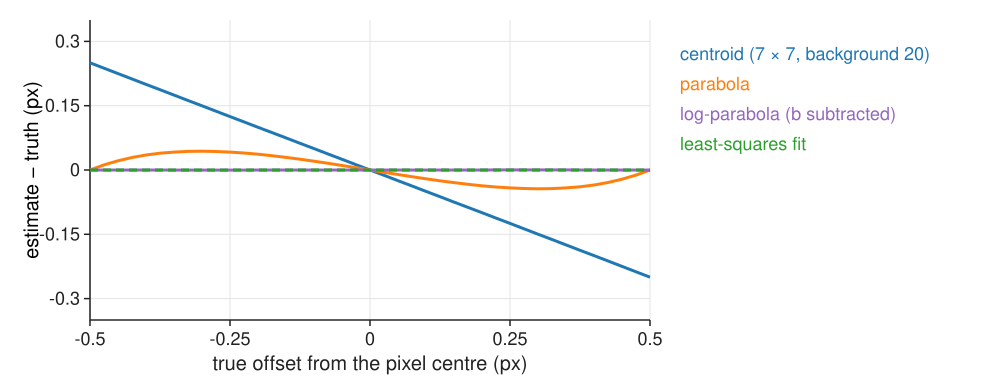
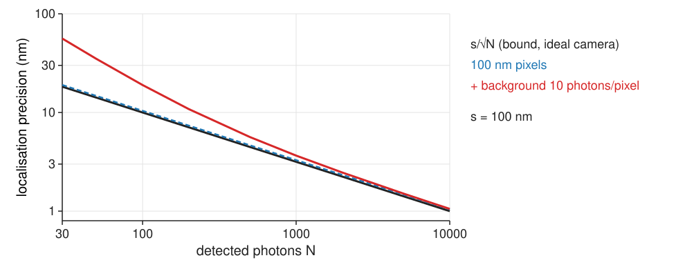

## About this lecture

A detection so far is a pixel. A spot covers many pixels, and all of them carry information about its centre: we can locate it to a **small fraction** of a pixel.

- The **centroid** and its bias towards the window centre.
- **Three-point** rules: the parabola (pixel locking) and the log-parabola (exact for a Gaussian).
- **Fitting** a Gaussian model to all pixels: least squares, maximum likelihood.
- **How precise can it get?** About $s/\sqrt N$ for $N$ photons (the Cramér–Rao bound).
- What makes it worse: background, pixel size, the wrong model.

*Slides titled **The math** give the formulas and proofs; the ideas are complete without them.*

## Better than a pixel

- The brightest pixel gives the position to **±0.5 px**: ±50 nm with 100 nm pixels.
- But the spot spreads over 10–20 pixels, and how its light is shared between them tells where the centre is: a spot slightly right of a pixel centre makes the right neighbour brighter than the left one.
- Recall [FFT registration](../stitching/lec.qmd): the sub-pixel peak of a correlation surface by a parabola or a centroid, and **pixel locking**. Here the peak is a spot whose shape we know (the PSF), and that changes what works best.

Every detection gets a position **and an error bar**. Tracking and localisation microscopy need both.

## The centroid

The centre of mass of the pixel values in a small window around the brightest pixel:
$\hat x = \sum_k x_k I_k / \sum_k I_k$ (and the same for $y$).

- Simple and fast. Exact for a symmetric spot without background, if the window holds the whole spot.
- **Background pulls it to the window centre**: the background's own centre of mass is the window centre, and it adds weight there.
- Noisy pixels at the window edge get large lever arms $x_k$: a big window is noisy.
- Fixes: subtract the background first, keep the window small (± 2σ), re-centre the window on the estimate and repeat.

Worked example (1D, Gaussian of σ = 1, true offset 0.30 px; samples $0.430, 0.956, 0.783$ at $-1, 0, 1$): centroid **0.16**. With a background of 0.5 added to each sample: **0.10**.

## The math: centroid bias {.math}

1D window $-m, \dots, m$ around the brightest pixel, a spot of total intensity $S$ centred at $\delta$ (all of it inside the window), plus a background $b$ per pixel:

$$\hat x = \frac{\sum_k x_k I_k}{\sum_k I_k} = \frac{S\delta + b\sum_{k=-m}^m k}{S + (2m+1)b} = \frac{S\,\delta}{S + (2m+1)\,b}.$$

- The estimate is **shrunk towards 0** (the window centre) by the factor $S/(S + (2m+1)b)$: the background's share of the light.
- $S = 100$, $\delta = 0.3$, $b = 5$, $m = 3$: $\hat x = 30/135 = 0.22$ instead of 0.30.
- With noise, the variance grows with $\sum_k x_k^2\,\mathrm{Var}(I_k)$: the edge pixels dominate.

## Three-point rules

Use only the brightest pixel and its two neighbours, per axis.

- **Parabola** through the three values: its top is the estimate. Biased towards the pixel centre: **pixel locking** (recall FFT registration). Example: **0.25** instead of 0.30.
- **Log-parabola**: the logarithm of a Gaussian *is* a parabola, so a parabola through the **logs** gives the centre **exactly** for a Gaussian spot: **0.30**. It needs the background subtracted first (with 0.5 added: 0.28).

{width="62%" fig-align="center"}

::: notes
The figure is noise-free: a pixel-integrated Gaussian of width 1 px, 1 000 photons, background 20, in a 13 × 13 patch, true centre swept across one pixel. The centroid (7 × 7 window, background not subtracted) is pulled towards the pixel centre: −0.150 px at an offset of 0.3. The parabola shows the S-shaped pixel-locking curve (−0.044 at 0.3). The log-parabola with the background subtracted and the least-squares fit are flat (pixel integration makes the log-parabola very slightly inexact, < 0.01 px).
:::

## The math: the three-point Gaussian {.math}

Samples $c_{-1}, c_0, c_{+1}$ at $-1, 0, 1$ of $c(x) = A\,e^{-(x-\delta)^2/2s^2}$. Then $\ln c(x) = \ln A - (x - \delta)^2/2s^2$ is a parabola in $x$ with vertex at $\delta$. The parabola through three points $(−1, \ell_{-1}), (0, \ell_0), (1, \ell_{+1})$ has its vertex at

$$\delta = \frac{\ell_{-1} - \ell_{+1}}{2(\ell_{-1} - 2\ell_0 + \ell_{+1})}, \qquad \ell_i = \ln c_i.$$

- Exact for point samples of a Gaussian, for any $A$ and $s$. On raw values $c_i$ the same formula is the ordinary parabola, which is exact only for a parabola.
- Pixel integration (each pixel collects the light over its area) makes it slightly inexact; a background $b$ makes it biased unless $b$ is subtracted first.

## Fit the model to all pixels

The model: **background + amplitude × Gaussian**$(x - x_0, y - y_0; \sigma)$. Adjust $(x_0, y_0, A, B)$ (and σ if unknown) until the model image matches the data: the **sum of squared differences** is smallest.

- For fixed $(x_0, y_0, \sigma)$ the best $A, B$ follow from a straight-line fit (two unknowns, linear).
- Only the position (and width) needs iteration: a few **Gauss–Newton** steps from the brightest pixel or the centroid; the model moves onto the spot.
- Check the **residual** (data − model): it should look like noise. A ring or a second bump means the model is wrong (wrong width, two spots: unit 4).
- **Weighted** least squares, or better **maximum likelihood** for Poisson counts (weight each pixel by $1/$its variance), wins at low photon counts.

Image libraries call this "Gaussian fitting" or "sub-pixel refinement". A fast non-iterative alternative is the "radial symmetry centre" (one line: the point where the gradient lines meet).

## The math: least squares and Gauss–Newton {.math}

Minimise $F(\boldsymbol\theta) = \sum_k \big(I_k - \mu_k(\boldsymbol\theta)\big)^2$, $\mu_k = B + A\,g_k(x_0, y_0)$, $\boldsymbol\theta = (x_0, y_0, A, B)$.

- $A, B$ given the position: normal equations of a linear fit, $\begin{bmatrix}\sum g_k^2 & \sum g_k\\ \sum g_k & n\end{bmatrix}\begin{bmatrix}A\\B\end{bmatrix} = \begin{bmatrix}\sum g_k I_k\\ \sum I_k\end{bmatrix}$.
- All parameters: linearise $\mu(\boldsymbol\theta + \Delta) \approx \mu(\boldsymbol\theta) + J\Delta$ with the Jacobian $J_{kj} = \partial\mu_k/\partial\theta_j$, and solve the linear least-squares problem for $\Delta$:
$$\Delta = (J^\top J)^{-1}J^\top\mathbf r, \qquad \mathbf r = \mathbf I - \mu(\boldsymbol\theta).$$
- Levenberg–Marquardt: $(J^\top J + \lambda\,\mathrm{diag}\,J^\top J)\Delta = J^\top\mathbf r$, with λ raised when a step makes $F$ worse.
- Pixel-integrated model: $g_k$ is a product of differences of error functions, $\tfrac12[\mathrm{erf}(\frac{x_k + 1/2 - x_0}{\sqrt2\sigma}) - \mathrm{erf}(\frac{x_k - 1/2 - x_0}{\sqrt2\sigma})]$ in each axis.

## The math: Poisson maximum likelihood {.math}

Photon counts $I_k \sim \mathrm{Poisson}(\mu_k(\boldsymbol\theta))$, independent. The negative log-likelihood (recall [Richardson–Lucy](../richardson-lucy/lec.qmd)) is, up to a constant,

$$L(\boldsymbol\theta) = \sum_k \big(\mu_k - I_k\ln\mu_k\big).$$

- Its gradient is $-\sum_k \frac{I_k - \mu_k}{\mu_k}\,\nabla\mu_k$: least squares with each pixel **weighted by $1/\mu_k$** (its variance).
- Fisher scoring: $\Delta = (J^\top WJ)^{-1}J^\top W\mathbf r$ with $W = \mathrm{diag}(1/\mu_k)$, i.e. iteratively reweighted least squares.
- Bright pixels (spot centre) are noisier in absolute terms and get **less** weight; least squares gives every pixel the same weight, which is why it loses precision.

## Try it: one spot

```{=html}
<link rel="stylesheet" href="../demos/dist/demo.css">
<div data-demo="spotfit" data-preset="fit" data-presets="peak,fit,centroidbg,locking,logexact,airy"></div>
<script src="../demos/dist/spotfit.js"></script>
```

::: notes
A 13 × 13 patch, PSF s = 100 nm, pixel 100 nm, 1 000 photons, background 5 photons per pixel, Poisson noise. Drag on the image to move the true centre (white cross). Markers: brightest pixel (grey square), centroid (blue), parabola (orange), log-parabola (purple), least squares (green), maximum likelihood (red). "Fit all pixels": press step: the green circle (radius s) moves from the brightest pixel onto the spot; RSS 6 804 at step 0, 5 steps; errors this noise realisation: brightest pixel 36 nm, centroid 11 nm, parabola and log-parabola 4.8 nm, least squares 3.1 nm, maximum likelihood 4.0 nm (one realisation; the precision tab averages). Bias tab: "centroid with background" (b = 20, window 7 × 7): −0.150 px at offset 0.3; "parabola: pixel locking": −0.044 px; "log-parabola is exact": 0.000; "Airy spot, Gaussian model": the least-squares fit stays unbiased (the Airy pattern is symmetric too; its cost is precision, not bias).
:::

## How precise can it get?

Each detected photon lands at a random place drawn from the PSF (width $s$). Estimating the spot centre from $N$ photons is like estimating a **mean from $N$ samples**:

$$\text{standard error} \approx \frac{s}{\sqrt N}.$$

- $s$ = 100 nm: 100 photons → **10 nm**; 1 000 photons → **3 nm**; 10 000 photons → 1 nm.
- The diffraction limit (≈ 250 nm) is about **resolving two** points; one isolated point can be **localised** far better ([resolution unit](../resolution/lec.qmd)).
- No unbiased estimator can beat $s/\sqrt N$ with these data: the **Cramér–Rao bound** (math slide).

This is the principle of localisation microscopy: switch on a few molecules at a time, localise each to ~10–20 nm, and build the image from the positions.

## The math: the Cramér–Rao bound {.math}

$N$ independent photon positions $x_1, \dots, x_N \sim \mathcal N(x_0, s^2)$. Log-likelihood $\ell(x_0) = -\sum_i (x_i - x_0)^2/2s^2 + \text{const}$.

$$\text{Fisher information } \mathcal I(x_0) = \mathbb E\Big[-\frac{\partial^2\ell}{\partial x_0^2}\Big] = \frac{N}{s^2}, \qquad \mathrm{Var}(\hat x_0) \ge \frac{1}{\mathcal I} = \frac{s^2}{N}$$

for every unbiased estimator (Cramér–Rao). The mean of the positions reaches it.

- Pixels and background lose information: the Fisher information of a pixelated, noisy image is smaller, and the bound larger (next slide).
- Maximum likelihood reaches the bound for large $N$; least squares does not.

## What makes it worse

{width="58%" fig-align="center"}

- **Pixels**: a photon's position is only known to its pixel (width $a$): adds $a^2/12$ to $s^2$. 100 nm pixels: about 4 % worse.
- **Background photons** carry no position information but add noise. This **dominates for dim spots**: at 100 photons, 10 background photons per pixel nearly double the error (19 nm instead of 10).
- **The wrong model**: an Airy PSF fitted with a Gaussian costs a little; a defocused or tilted emitter can bias the position.
- **Least squares** has about 16/9 of the bound's variance (≈ 1.33× its sd); **maximum likelihood** reaches the bound.

## The math: Thompson and Mortensen {.math}

Thompson, Larson & Webb (2002), for pixels of size $a$ and $b$ background photons per pixel:

$$\langle(\Delta x)^2\rangle \approx \frac{s^2 + a^2/12}{N} + \frac{8\pi s^4 b}{a^2 N^2}.$$

Mortensen et al. (2010), with $s_a^2 = s^2 + a^2/12$ and $\tau = 2\pi s_a^2 b/(N a^2)$:

$$\mathrm{Var}_\text{LSQ} = \frac{s_a^2}{N}\Big(\frac{16}{9} + \frac{8\pi s_a^2 b}{N a^2}\Big), \qquad \mathrm{Var}_\text{MLE} = \frac{s_a^2}{N}\Big(1 + \int_0^1 \frac{\ln t}{1 + t/\tau}\,dt\Big)^{-1}.$$

- The first term: shot noise of the spot's own photons. The second: background noise, which falls as $1/N^2$.
- The demo's repeats agree with Mortensen's formulas within a few per cent (checked in the test file).

## Try it: precision

```{=html}
<link rel="stylesheet" href="../demos/dist/demo.css">
<div data-demo="spotfit" data-preset="thousand" data-presets="thousand,background,pixel,mle"></div>
<script src="../demos/dist/spotfit.js"></script>
```

::: notes
Precision tab: 500 seeded repeats of the same spot (true centre fixed), scatter of the errors in nm with the pixel grid behind; right: RMS error against N for the centroid (5 × 5 window), least squares and maximum likelihood (120 repeats per N), with the bound s/√N (black), Thompson (grey dashed) and Mortensen (coloured dashed). "1 000 photons": centroid 4.9 nm, least squares 4.3, maximum likelihood 3.3, bound 3.2, Thompson 3.3. "Background dominates dim spots" (300 photons, b = 20): 30.0 / 11.3 / 11.0 nm against a bound of 5.8 without background (Thompson 9.6); the centroid scatter splits into clusters, one per brightest pixel. "Pixel size" (250 nm pixels, b = 5): 11.9 / 5.0 / 4.5 nm. "Maximum likelihood vs least squares at 100 photons" (b = 2): 16.9 against 15.2 nm.
:::

## Uncertainty as an output

- Every detection should carry its **error bar**: from the formula (with the fitted $N$ and $b$), or from the curvature of the fit's objective at its minimum (the inverse Fisher information).
- The error bar is per spot: bright spots are precise, dim ones are not. Averaging positions with weights $1/\sigma_i^2$ (tracking, drift correction) uses it.
- Check that the error bars are honest: repeated measurements of a fixed bead should scatter as predicted.

## Summary

- The brightest pixel is good to ±0.5 px; using all pixels gets a **small fraction of a pixel**.
- **Centroid**: simple, pulled to the window centre by background; subtract it, keep the window small.
- **Parabola**: pixel locking. **Log-parabola**: exact for a Gaussian (after background subtraction).
- **Fit** a Gaussian + background to all pixels; least squares, or **maximum likelihood** for Poisson counts.
- Precision ≈ $s/\sqrt N$ (Cramér–Rao): 1 000 photons and $s$ = 100 nm give about 3 nm. Background (dim spots), large pixels and least squares (×1.33) make it worse.
