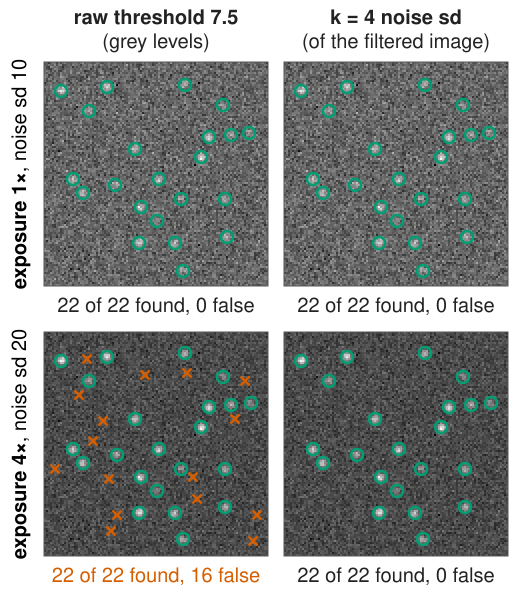
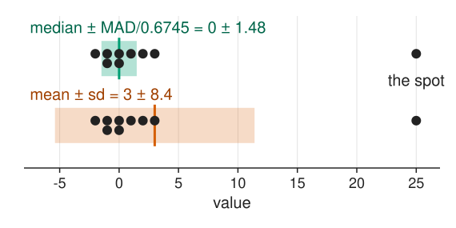
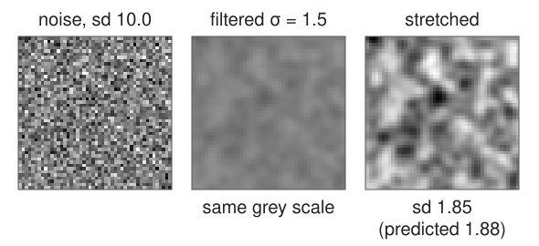
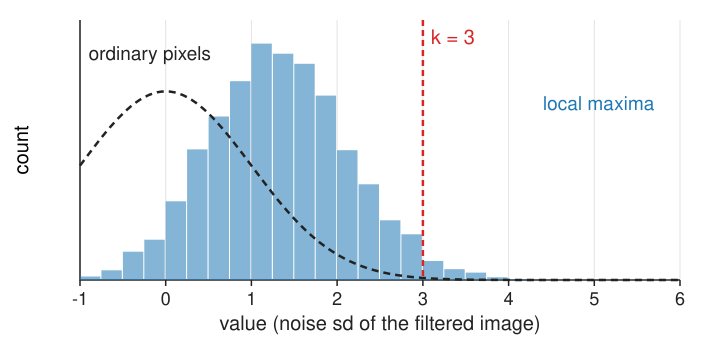
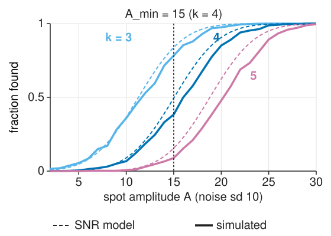
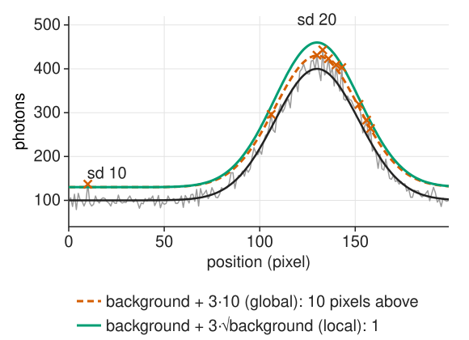

## About this lecture

The previous unit ended with many candidates: one per spot, and hundreds in the noise. Which threshold separates them?

- Decide **how many false spots per image** you accept, then compute the threshold from the noise.
- **Estimate the noise** from the image itself (the MAD).
- Threshold the filtered image in units of **its own** noise.
- Why "3 standard deviations" lets through **many** false spots: maxima are not ordinary pixels.
- The **detection limit**: the dimmest spot a threshold can find.
- **Poisson noise**: one global threshold is wrong on a bright background.

*Slides titled **The math** give the formulas and proofs; the ideas are complete without them.*

## The question every user asks: which threshold?

:::: {.columns}
::: {.column width="54%"}
- A threshold on **raw grey values** does not transfer: a new exposure, another camera, another filter, and the same number means something else.
- A threshold in **units of noise**, $t = k\cdot$(noise sd of the filtered image), does transfer: $k = 4$ means the same thing for every image and every filter.
- How to choose $k$: decide how many **false spots per image** you can live with (1? 0.1?), and read off the $k$ that gives it.

:::
::: {.column width="46%"}
{width="100%" fig-alt="One synthetic scene with 22 spots at two exposures (4 times the light: twice the noise sd, 20 instead of 10), Gaussian filter σ = 1.5. A raw threshold of 7.5 grey levels finds all 22 spots with no false ones in the first exposure, but adds 16 false spots in the brighter one. A threshold of k = 4 noise sd (7.5 and 15.0) finds all 22 spots and no false ones in both."}
:::
::::

To do this we need three numbers: the noise of the image, the noise after the filter, and how often noise alone crosses $k$.

## Estimating the noise from the image

Most pixels are background: spots cover only a small fraction. A **robust** spread estimate ignores the few spot pixels.

**Median absolute deviation (MAD)** of a high-pass version of the image (or of the finest à trous level $w_1$):

$$\hat\sigma = \frac{\mathrm{median}\,|x - \mathrm{median}(x)|}{0.6745}$$

:::: {.columns}
::: {.column width="52%"}
Nine noise values, one of them a spot: $(3, -1, 0, 2, -2, 1, 25, -1, 0)$.

- Median 0; absolute deviations sorted: $0, 0, 1, 1, 1, 2, 2, 3, 25$; median **1**; $\hat\sigma = 1/0.6745 = 1.48$.
- The spot (25) does not matter. The ordinary standard deviation would be **8.4**.
:::
::: {.column width="48%"}
{width="100%" fig-alt="The nine values as dots on a number line, twice. Top: median 0 with a band of ±1.48 (MAD/0.6745) that covers the eight noise values. Bottom: mean 3 with a band of ±8.4 (ordinary standard deviation), pulled wide by the single spot value 25."}
:::
::::

## The math: why 0.6745 {.math}

For $X \sim \mathcal N(\mu, \sigma^2)$, the median of $|X - \mu|$ is the value $m$ with $P(|X - \mu| \le m) = \tfrac12$:

$$P(|Z| \le m/\sigma) = 2\Phi(m/\sigma) - 1 = \tfrac12 \;\Rightarrow\; \Phi(m/\sigma) = \tfrac34 \;\Rightarrow\; m = \Phi^{-1}(0.75)\,\sigma = 0.6745\,\sigma.$$

- Breakdown point 50 %: up to half the values may be spots without making $\hat\sigma$ unbounded.
- On a high-pass image ($w_1$, or a difference of neighbours) the noise sd is a known multiple of the image noise ($\sigma_n\sqrt{\sum w_k^2}$), so divide by it. The background has (almost) no high frequencies and drops out.

## Noise after the filter

{.nostretch width="50%" fig-align="center" fig-alt="A 48 × 48 crop of white noise with sd 10 (grey scale −30 to 30), the same noise after a Gaussian of σ = 1.5 on the same grey scale (almost flat grey), and the filtered noise contrast-stretched: smooth blobs, sd 1.85 measured, 1.88 predicted."}

Recall the first unit: a filter $\mathbf w$ turns white noise of sd $\sigma_n$ into noise of sd $\sigma_n\sqrt{\sum_k w_k^2}$.

- Normalised Gaussian at $\sigma_f = 1.5$: $0.188\,\sigma_n$. For $\sigma_n = 10$: **1.88**.
- Threshold the filtered image at $t = k \times 1.88$: for $k = 4$, $t = 7.5$.
- Each filter (Gaussian, LoG, zero-mean template) has its own $\sqrt{\sum w_k^2}$; dividing by it makes $k$ comparable across filters.

So far, so standard. The surprise is in the next slide.

## False spots per image

In pure noise, a filtered pixel exceeds 3 sd with probability $P(Z > 3) = 0.13\,\%$. But we threshold **local maxima**:

{width="58%" fig-align="center"}

- There are **many**: about one per 24 $\sigma_f^2$ pixels, 4 862 in a 512² image at $\sigma_f = 1.5$.
- A maximum is the largest of its neighbourhood: it is **higher than a typical pixel** (histogram shifted right).
- Naive estimate: 4 862 × 0.13 % ≈ **6.6** false spots. Measured (20 seeded 512² noise images): **99 at k = 3, 4.3 at k = 4, 0.1 at k = 5**.

$k = 3$ is not "safe" for spot detection. Choose $k$ from the false-spot count you can accept.

::: notes
All numbers from the course library (noiseMaximaCount: white noise, Gaussian σ_f = 1.5, maxima in 3 × 3 windows, 20 seeded 512 × 512 images), also checked in the day's test file. The figure uses four 256 × 256 images: 1 220 maxima per image, mean maximum 1.33 sd, 26.5 above 3 sd per image. A false-spot count per image also depends on the image size: twice the area, twice the false spots.
:::

## The math: maxima above a threshold {.math}

For white noise smoothed by a Gaussian of width $\sigma_f$, area $A$ pixels, threshold $u$ (in sd), the expected Euler characteristic of the excursion set $\{z > u\}$ (≈ the number of maxima above $u$ when $u$ is high; Adler, Worsley):

$$\mathbb E[\#\text{maxima} > u] \approx A\,\frac{1}{2\sigma_f^2}\,\frac{u\,e^{-u^2/2}}{(2\pi)^{3/2}}.$$

- $\sigma_f = 1.5$, $A = 512^2$: **123** at $u = 3$, **5.0** at $u = 4$, **0.07** at $u = 5$ (measured: 99, 4.3, 0.1). A slightly conservative guide.
- The naive $(\#\text{maxima})\cdot P(Z > u)$ decays like $e^{-u^2/2}/u$; the correct count like $u\,e^{-u^2/2}$: it misses a factor of about $u^2$.
- The count scales with $A/\sigma_f^2$, the number of "resolution elements".

## Try it: how many false spots?

```{=html}
<link rel="stylesheet" href="../demos/dist/demo.css">
<div data-demo="falsespots" data-preset="k3" data-presets="k3,maxima,formula,bigger,dim"></div>
<script src="../demos/dist/falsespots.js"></script>
```

::: notes
A 256 × 256 image of noise only (flat background 100, sd 10), Gaussian filter σ = 1.5 minus a wide blur, maxima in 3 × 3 windows, threshold k in noise sd. Left: the normalised response with the false detections in red. Top: histogram of all 1 164 local maxima; dashed: what ordinary pixels would look like. Bottom: false spots per image against k, measured on 16 seeded noise images, the naive tail estimate and the Euler formula; the red dot is this image. Tour: "k = 3 is not safe": 25 false spots in this image (26 expected). "Maxima are higher than pixels" (k = 2): 249. "The formula vs the count" (k = 4): this image has 4, the expected count is 0.94; the Euler curve lies on top of the measured one. "Bigger image" (512²): 117 false spots at k = 3 (112 expected): four times the area, four times the count. "Dim spots": spots + noise at k = 5: no false spots but 10 of 40 spots missed (recall 0.75); lower k and watch both numbers.
:::

## The detection limit

:::: {.columns}
::: {.column width="54%"}
With $k$ fixed, the dimmest spot that reaches the threshold has a matched-filter SNR of about $k$ (a bit more for a 50 % chance, because noise pushes it up or down):

$$A_\text{min} \approx \frac{k\,\sigma_n}{\sqrt{\pi\sigma^2}}$$

- $k = 4$, $\sigma_n = 10$, $\sigma = 1.5$: $A_\text{min} \approx 40/2.66 = 15$ grey levels above background.
- Halving the noise (4 × the photons, recall [camera noise](../cameranoise/lec.qmd)) halves $A_\text{min}$.
- The trade-off: a lower $k$ finds dimmer spots and lets in more false ones. The next unit's precision–recall curve (unit 4) makes this one picture.
:::
::: {.column width="46%"}
{width="100%" fig-alt="Fraction of spots found against spot amplitude A (noise sd 10, Gaussian filter σ = 1.5, 256 spots per image, 4 images) for thresholds k = 3, 4 and 5. Solid: simulated; dashed: the model with matched-filter SNR 0.266·A. At k = 4 the model gives 50 % at A = 15; the simulation reaches 50 % at A ≈ 16."}
:::
::::

## The math: detection as a statistical test {.math}

Two hypotheses for a window around pixel $\mathbf x$: $H_0$: $I_k = B + n_k$; $H_1$: $I_k = A p_k + B + n_k$, with unknown $A$, $B$ and known $\sigma_n$. The generalised likelihood ratio (maximise the likelihood over the unknowns under each hypothesis):

$$2\ln\Lambda = \frac{\big((\mathbf p - \bar p\mathbf 1)^\top\mathbf I\big)^2}{\sigma_n^2\,\|\mathbf p - \bar p\mathbf 1\|^2}.$$

- The numerator is the zero-mean matched-filter response (unit 1); the whole statistic is its square **in units of its noise sd**.
- Thresholding at $k^2$ is exactly "zero-mean matched filter > $k$ noise sd": the detector is not a heuristic but the optimal test (Neyman–Pearson for each pixel).
- Under $H_0$ the statistic at a fixed pixel is $\chi^2_1$; at the maxima it is not (previous math slide).

## Poisson noise: the noise depends on the brightness

:::: {.columns}
::: {.column width="54%"}
Photon counts are Poisson (recall [camera noise](../cameranoise/lec.qmd)): the variance equals the mean. On a background of 100 photons the noise sd is 10, on 400 photons it is 20.

- One global threshold $k\hat\sigma$ is then **too low** on bright background (many false spots there) and **too high** on dark background (dim spots missed).
- **Local noise estimate**: $\hat\sigma(\mathbf x) = \sqrt{\text{gain}\cdot\text{background}(\mathbf x) + \text{read noise}^2}$, with the background from a wide blur; threshold $k\hat\sigma(\mathbf x)$.
- Or a **variance-stabilising transform** first: $2\sqrt{x + 3/8}$ (the **Anscombe** transform) makes the noise sd ≈ 1 everywhere; then one global threshold works.
:::
::: {.column width="46%"}
{width="100%" fig-alt="A 1D profile of Poisson counts on a background that rises from 100 to 400 photons. A global threshold of background + 3·10 is crossed by 10 noise pixels, all on the bright part (crosses). A local threshold of background + 3·√background is crossed by 1."}
:::
::::

## The math: Poisson and Anscombe {.math}

$X \sim \mathrm{Poisson}(\mu)$: $\mathbb E X = \mathrm{Var}\,X = \mu$.

Delta method for a smooth $g$: $\mathrm{Var}\,g(X) \approx g'(\mu)^2\,\mathrm{Var}\,X = g'(\mu)^2\mu$. Constant variance needs $g'(\mu) \propto 1/\sqrt\mu$, so $g(x) \propto \sqrt x$.

$$g(x) = 2\sqrt{x + 3/8}: \quad g'(\mu)^2\mu = \frac{\mu}{\mu + 3/8} \approx 1 \quad(0.91 \text{ at } \mu = 4,\ 0.996 \text{ at } \mu = 100).$$

The $3/8$ makes the next term of the expansion small too (Anscombe 1948). Below a few photons per pixel no transform helps; use the Poisson likelihood itself.

## Try it: Poisson noise

```{=html}
<link rel="stylesheet" href="../demos/dist/demo.css">
<div data-demo="falsespots" data-preset="poisson" data-presets="poisson,local,anscombe"></div>
<script src="../demos/dist/falsespots.js"></script>
```

::: notes
Now Poisson noise: 20 photons per pixel with a broad bright patch of up to 200 photons, LoG filter σ = 1.5, k = 4. "Poisson: false spots on the bright patch": the global MAD estimate (7.25) is set by the many dark pixels, so on the patch the threshold is only about 2 local sd: 87 false spots, 80 of them on the patch; noise images would give 1.7. "Local noise estimate": divide by √(local background): 1 false spot, none on the patch. "Anscombe": transform first, then one global threshold: 0 false spots. The histogram shows the maxima: with the global estimate it has a long tail to the right (the bright patch); with either fix it is back to the noise-only shape.
:::

## A test at every maximum

- Each maximum is a statistical test; an image has thousands. "False spots per image" is the **family-wise** view (how many false alarms in the whole image); a **false discovery rate** (the fraction of detections that are false) is the alternative. Pointer: [multiple testing](../replicates/lec.qmd) on the evaluation day.
- Choosing $k$ in practice:
  - from a target false-spot count, with the formula or with blank images (no spots, same noise);
  - from a precision–recall curve against annotated spots (unit 4);
  - the à trous rule $k \approx 3$ **per level**: the product over levels lowers the false rate further.

## Failure modes

| Problem | Why the noise model fails | What helps |
|---|---|---|
| correlated noise (camera patterns, an image that was smoothed or compressed) | the MAD of the raw image underestimates the noise after the filter; $\sqrt{\sum w^2}$ assumes independent pixels | estimate the noise on the **filtered** image, or on blank images |
| structured background (cell edges, autofluorescent granules) | it is not noise: the noise model cannot help | a size or shape test, a zero-mean filter at the spot scale |
| Poisson noise | the sd depends on the brightness | local noise estimate, Anscombe transform |
| saturated spots | clipped tops (bit depth) | no effect on detection, but on brightness and position |

## Summary

- Threshold in **units of noise**, $t = k\cdot\hat\sigma_n\sqrt{\sum w^2}$, with $\hat\sigma_n$ from the **MAD** of a high-pass image.
- Local maxima of noise are **many** and **higher than pixels**: at $k = 3$ a 512² image has about 100 false spots, at $k = 4$ about 4, at $k = 5$ about 0.1 (σ_f = 1.5). The normal tail is far too optimistic; the Euler formula is a good guide.
- Choose $k$ from the **false spots per image** you accept; the dimmest detectable spot has matched-filter SNR ≈ $k$.
- **Poisson** noise: estimate the noise locally or stabilise it (Anscombe) before one global threshold.
