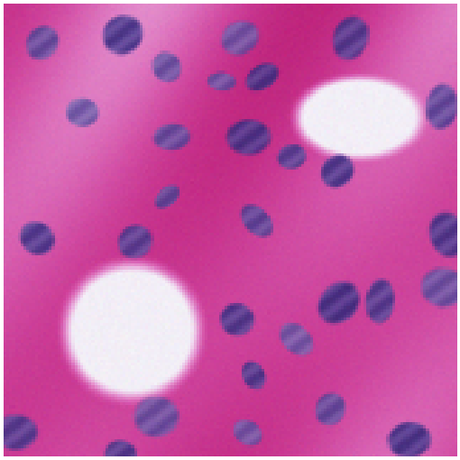
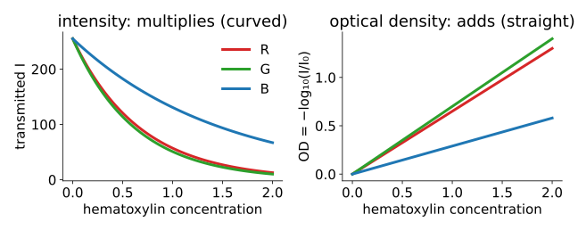
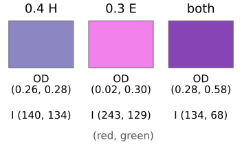
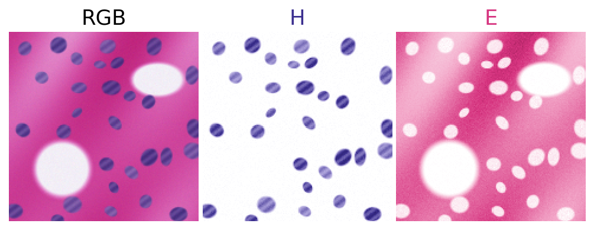
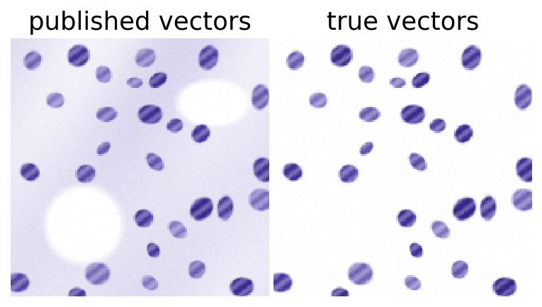
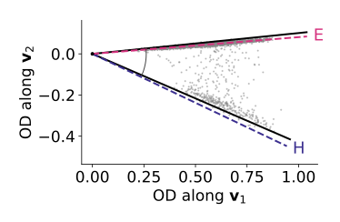

## About this lecture

:::: {.columns}
::: {.column width="66%"}
A brightfield histology slide stained with hematoxylin (nuclei, blue-purple) and eosin (cytoplasm, pink), or with hematoxylin and DAB (a brown antibody stain). We want one image **per stain**.

- Stains **absorb**: they multiply the light. The **optical density** turns that into a sum.
- In optical density the model is the day's $\mathbf y = M\mathbf a$ with 3 channels and 2–3 stains: **colour deconvolution**.
- What goes wrong: wrong stain vectors, similar stains, dark pixels, the white level.
- **Estimating** the stain vectors from the image (Macenko): vertex finding with two components.

Slides titled **The math** give the formulas and proofs; the ideas are complete without them.
:::
::: {.column width="34%"}
{fig-alt="A synthetic H&E slide: pink eosin background of varying strength, scattered blue-purple nuclei, and two white empty regions." width="100%"}

[Synthetic slide of this unit's demos (Beer–Lambert, seeded).]{style="font-size: 0.55em; color: #5a6b7a;"}
:::
::::

::: notes
Fourth unit of the spectral unmixing day; moved here from the colour day, which keeps a one-slide forward pointer. Needs units 1–3 of this day (bleed-through, conditioning, the cone and its vertices) and from the colour day linear light and the colour cloud.
:::


## Recall: colour images are linear light

From the colour day ([RGB: gamma, linear maps & white balance](../rgb-linear/lec.qmd)):

- A camera turns a spectrum into three numbers; stored values are usually gamma-encoded and must be **linearised** before any arithmetic on light.
- **White balance** and the brightfield **white reference** (the empty-slide image, flat-field) are there too: they give $I_0$, the light that enters the sample.
- An image's pixels as a **colour cloud**: an H&E slide fills a thin, curved sheet in RGB.

Today: why it is curved, and how to straighten it.

## Stains absorb: Beer–Lambert

{width="80%" fig-align="center"}

- A layer of stain transmits a **fraction** of the light; twice the stain transmits that fraction squared: $I = I_0 \cdot 10^{-\text{(amount)} \times \text{(absorbance)}}$.
- Two stains on top of each other **multiply** their transmissions: intensity is not additive.
- The **optical density** $\mathrm{OD} = -\log_{10}(I/I_0)$ turns products into sums: straight lines in the concentration.

## The math: from Beer–Lambert to a linear model {.math}

For channel $c$ (red, green, blue), stain $k$ with concentration $C_k$ and absorbance $s_{ck}$:

$$I_c = I_{0,c}\ 10^{-\sum_k s_{ck} C_k} \quad\Longrightarrow\quad \mathrm{OD}_c = -\log_{10}\frac{I_c}{I_{0,c}} = \sum_k s_{ck}\, C_k .$$

- $\mathbf{od} = S\,\mathbf C$: exactly $\mathbf y = M\mathbf a$, with $N = 3$ channels.
- Column $k$ of $S$ is the stain's **OD vector**: how strongly it absorbs red, green and blue. Only its direction matters; scale it to length 1 and let $C_k$ carry the amount.
- (Beer–Lambert is a line integral of the absorption along the light path: the same integral as in the [Radon day](../radon/lec.qmd).)

## Optical density by hand

A pixel with $I = (80, 120, 200)$ on a background of $I_0 = 255$:

$$\mathrm{OD} = -\log_{10}(80/255,\ 120/255,\ 200/255) = (0.50,\ 0.33,\ 0.11).$$

:::: {.columns}
::: {.column width="55%"}
- Red is absorbed most: a blue-purple pixel, hematoxylin-like.
- Additive in OD: 0.4 units of hematoxylin $(0.65, 0.70)$ and 0.3 of eosin $(0.07, 0.99)$ (red, green) give OD $(0.26, 0.28) + (0.02, 0.30) = (0.28, 0.58)$.
- Multiplicative in intensity: alone they transmit $(140, 134)$ and $(243, 129)$ of 255; together $(134, 68) = 255 \times (140/255) \times (243/255)$, and likewise for green.
:::
::: {.column width="45%"}
{fig-alt="Three colour swatches: 0.4 units of hematoxylin (lilac), 0.3 units of eosin (pink), and both (purple). Under each, the optical density (red, green): (0.26, 0.28), (0.02, 0.30), (0.28, 0.58), and the intensity: (140, 134), (243, 129), (134, 68)." width="100%"}
:::
::::


## Try it: H&E pixels in RGB

```{=html}
<link rel="stylesheet" href="../demos/dist/demo.css">
<div data-demo="colourcloud" data-preset="he"></div>
<script src="../demos/dist/colourcloud.js"></script>
```

::: notes
The colour day's colour-cloud demo with its synthetic H&E scene (rendered by Beer–Lambert from two stain maps). In encoded RGB the pixels fill a thin, curved sheet from white (background) towards purple (nuclei) and pink (eosin). Rotate it edge-on to show it is a 2D sheet (two stains), and that it bends: the curvature is the exponential of Beer–Lambert. Next slide: the same pixels in optical density.
:::

## Try it: the same pixels in optical density

```{=html}
<link rel="stylesheet" href="../demos/dist/demo.css">
<div data-demo="unmixcloud" data-scene="he" data-preset="clean"></div>
<script src="../demos/dist/unmixcloud.js"></script>
```

::: notes
The H&E slide in optical density: the sheet becomes a flat wedge (the cone of the endmembers unit with two components) spanned by the hematoxylin and eosin vectors (arrows). "normalise": the wedge becomes a line segment between the two stain directions: every pixel is a mixture of exactly two colours.
:::

## The stain matrix and colour deconvolution

Ruifrok & Johnston (2001) published OD vectors (red, green, blue) for common stains: hematoxylin $\approx (0.65, 0.70, 0.29)$, eosin $\approx (0.07, 0.99, 0.11)$, DAB $\approx (0.27, 0.57, 0.78)$.

- Put the unit vectors as the **columns** of $S$ (3 × 3): $\mathbf{od} = S\mathbf C$, so $\mathbf C = S^{-1}\mathbf{od}$ per pixel: three **concentration images**.
- Two stains only: complete $S$ with a third column perpendicular to both, their **cross product**: the "residual" channel. Where the two stains explain the pixel, it is 0.
- (Ruifrok & Johnston write the vectors as rows; here they are columns, as for the spectra all day.)

{fig-alt="The synthetic H&E slide and its two concentration images: the H map shows only the nuclei in dark purple on white, the E map the pink background with white holes where the nuclei and empty regions are." width="62%" fig-align="center"}

[Concentration images of the demo's synthetic slide, deconvolved with its own stain vectors.]{style="font-size: 0.6em; color: #5a6b7a;"}

## The math: the residual column and the inverse {.math}

Unit vectors $\hat{\mathbf h} = (0.651, 0.701, 0.291)$, $\hat{\mathbf e} = (0.070, 0.991, 0.110)$:

$$\hat{\mathbf h} \times \hat{\mathbf e} = (-0.211,\ -0.051,\ 0.596), \quad \text{unit: } \hat{\mathbf r} = (-0.332,\ -0.081,\ 0.940).$$

$$S = \begin{pmatrix} 0.651 & 0.070 & -0.332 \\ 0.701 & 0.991 & -0.081 \\ 0.291 & 0.110 & 0.940 \end{pmatrix}, \qquad S^{-1} = \begin{pmatrix} 1.482 & -0.162 & 0.510 \\ -1.075 & 1.116 & -0.284 \\ -0.332 & -0.081 & 0.940 \end{pmatrix}.$$

- The last row of $S^{-1}$ is $\hat{\mathbf r}$ itself: since $\hat{\mathbf r}$ is a unit vector perpendicular to both stains, $\hat{\mathbf r}^\top S = (0, 0, 1)$.
- $\kappa(S) = 2.8$. With DAB instead of the residual, $\kappa = 3.8$: three stains are harder than two.

## Try it: colour deconvolution

```{=html}
<link rel="stylesheet" href="../demos/dist/demo.css">
<div data-demo="stainsep" data-preset="ruifrok"></div>
<script src="../demos/dist/stainsep.js"></script>
```

::: notes
A synthetic H&E slide rendered by Beer–Lambert with this slide's own stain vectors (close to Ruifrok's, not equal), detector noise and 8-bit rounding. The triangle shows each pixel's OD divided by its sum: the pixels lie on a line between the two true stain directions (dashed circles). Tour: "Ruifrok defaults": the estimated H map contains 0.20 of the true eosin, E 0.10 of the true H; the residual map is not zero. "True vectors": the matrix becomes the identity in the H and E columns. "Wrong eosin": E vector moved: crosstalk, negative values. "Nearly parallel": κ 10.5, the H map in unstained areas gets 3 times noisier. "Wrong I₀ / saturated": background OD goes negative, dark nuclei clip. "Macenko": vectors from the image, within 2° of the truth.
:::

## What goes wrong

:::: {.columns}
::: {.column width="62%"}
- **Wrong stain vectors**: a real slide's stains differ from the published ones (staining protocol, scanner). On the demo's slide, Ruifrok's eosin vector is 14° off: the estimated H map contains 0.20 of the true eosin. Crosstalk, as in [the first unit](../crosstalk/lec.qmd).
- **Similar stains**: nearly parallel columns, large $\kappa$: noise amplified (the H map's noise in unstained areas: sd 0.007 with the true vectors, $\kappa = 3.7$; 0.020 with a near-parallel eosin vector, $\kappa = 10.5$).
- **Dark pixels**: $I = 0$ has infinite OD; it must be clipped, and saturated nuclei lose their linearity.
- **Wrong $I_0$**: a white level set 15 % too low makes the background's OD **negative** (the H map's background drops to $-0.13$).
- **Scattering** pigments and stains that bind to each other break Beer–Lambert altogether.
:::
::: {.column width="38%"}
{fig-alt="Two hematoxylin maps of the synthetic slide. With the published vectors the eosin background shows as a pale purple haze with white holes; with the slide's true vectors the background is white and only the nuclei remain." width="100%"}
:::
::::


## DAB is not a measuring stain

- DAB is produced by an **enzyme** reaction: its amount depends on incubation time and saturates. Its "concentration" is a **relative** signal, not a number of antibody molecules.
- DAB is dark brown and scatters as well as absorbs: Beer–Lambert holds only approximately, worse in dark regions.
- Honest use: **positive / negative** (threshold the DAB map), or comparisons within one batch stained together. Not absolute protein amounts.

## Estimating the stain vectors: Macenko

:::: {.columns}
::: {.column width="56%"}
The OD cloud of a two-stain slide is a flat **wedge** between the two stain directions. Its two **edges** are the stain vectors: two-component vertex finding ([the endmembers unit](../endmembers/lec.qmd)).

1. Remove the background: keep pixels with total OD above a threshold.
2. Find the **plane** of the wedge: the two leading principal directions of the OD vectors.
3. Measure each pixel's **angle** in that plane; take the extreme angles (robustly: the 1st and 99th percentiles).
4. The two directions at those angles are the stain vectors.

On the demo's slide: within 2.0° (H) and 1.1° (E) of the true vectors, where Ruifrok's defaults were 3.7° and 14° off.
:::
::: {.column width="44%"}
{fig-alt="The optical densities of the stained pixels in their plane: a thin grey wedge from the origin. Two solid black lines at the 1st and 99th percentile angles lie almost on the dashed true stain directions, labelled E (upper) and H (lower)." width="100%"}

[Solid: the extreme angles; dashed: the true stains.]{style="font-size: 0.6em; color: #5a6b7a;"}
:::
::::


## The math: Macenko in formulas {.math}

- Pixels with $\|\mathbf{od}\| > \beta$; $\mathbf v_1, \mathbf v_2$ = leading eigenvectors of $\sum \mathbf{od}\,\mathbf{od}^\top$ (uncentred: the wedge's plane goes through the origin).
- Angle $\varphi = \operatorname{atan2}(\mathbf{od}\cdot\mathbf v_2,\ \mathbf{od}\cdot\mathbf v_1)$; $\varphi_\text{lo}, \varphi_\text{hi}$ = the $\alpha$ and $100 - \alpha$ percentiles.
- Stain vectors $\cos\varphi\,\mathbf v_1 + \sin\varphi\,\mathbf v_2$ at both angles; the one with the larger red OD is hematoxylin.
- Every pixel's OD is a non-negative combination of the two stains, so its angle lies between theirs: the extreme angles are the stains, if some pixels are (nearly) pure.

## Counting positive nuclei in H-DAB

```{=html}
<link rel="stylesheet" href="../demos/dist/demo.css">
<div data-demo="stainsep" data-mode="hdab" data-preset="dab"></div>
<script src="../demos/dist/stainsep.js"></script>
```

::: notes
H-DAB mode: hematoxylin counterstain, light eosin, and some nuclei DAB-positive (brown). The DAB concentration map is an ordinary grey image: Otsu's threshold (day 12) at 0.27 and connected components of at least 15 pixels find 14 positive nuclei; the slide has 14 positive among 30. With Ruifrok's DAB vector the count is the same here (DAB is the most distinct stain); with a near-parallel DAB vector the map gets noisier but still 14.
:::

## Summary

- Brightfield stains **absorb**: intensities multiply. **Optical density** $-\log_{10}(I/I_0)$ makes them add: $\mathbf{od} = S\mathbf C$.
- **Colour deconvolution**: unit stain vectors as the columns of $S$, $\mathbf C = S^{-1}\mathbf{od}$ per pixel; with two stains the third column is their cross product (residual).
- Failure modes are the day's: wrong vectors → **crosstalk**; similar stains → large **$\kappa$**, noise; plus dark pixels (clip) and a wrong $I_0$ (negative OD).
- **Macenko**: the stain vectors are the two extreme directions of the OD wedge: vertex finding with two components.
- DAB is a relative, non-stoichiometric signal: threshold it, do not read it as an amount.
- Stain **normalisation** between scanners uses the same vectors: deconvolve with one slide's vectors, recombine with a reference slide's.
