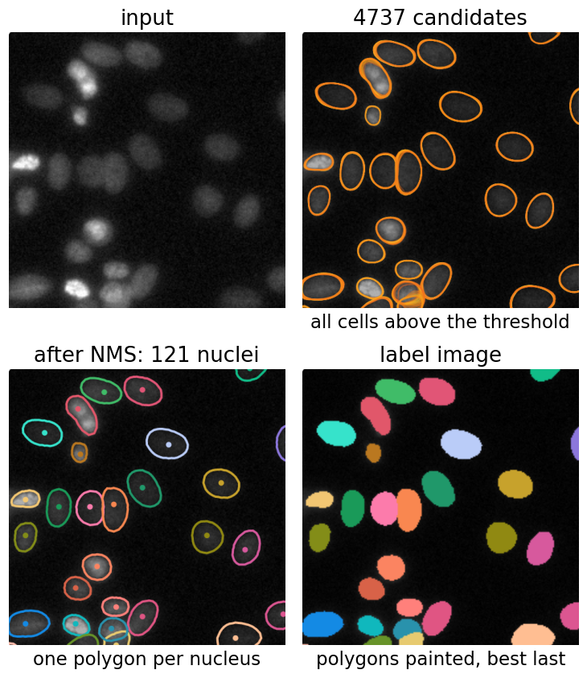

## Goal

By the end of this exercise you should be able to:

- compute the **rays** of a simple shape and the **area of the polygon** through their tips,
- decide whether a shape is **star-convex**, and from which points,
- run **polygon NMS** by hand and predict what the **probability** and **NMS thresholds** do,
- name the failures that are built into the method, and find them with the real network,
- *(math)* derive the polygon area formula and the $n$-gon coverage of a disc, and explain the objectness-weighted ray loss.

Do the pen-and-paper part first, then the demos. The real network takes a few seconds per image: **predict first, then run**.

## Background

| Idea | What it means |
|---|---|
| Objectness | per pixel: distance to the background, divided by its maximum in the nucleus (1 at the centre, 0 outside) |
| Rays | per pixel: the distance to the border of its nucleus along $n$ fixed directions (usually 32, every 11.25°; here ray 0 points right) |
| Polygon | the ray tips joined in order; area $A = \tfrac12\sin\tfrac{2\pi}{n}\sum_k r_k r_{k+1}$ |
| Star-convex | some point $c$ sees the whole shape: the segment from $c$ to every point of the shape stays inside |
| Candidates | grid cells (one per 2 × 2 pixels) with objectness above the **probability threshold** |
| Polygon NMS | sort by objectness; keep the best; delete every polygon whose IoU with it is above the **NMS threshold**; repeat |
| Trained thresholds | probability 0.48, NMS 0.3 (the published fluorescence model) |

## By hand

**B1.** An 8 × 4 rectangle seen from its centre, 8 rays every 45° (ray 0 to the right).
(a) Compute the 8 ray lengths.
(b) Sketch the polygon and compute its area with the triangle rule. What is its IoU with the rectangle?
(c) Where is the area lost?
(d) With 32 rays the polygon area is 31.3. What is the IoU now?

**B2.** A polygon has rays 5, 4, 3, 4, 5, 4, 3, 4 (every 45°, ray 0 to the right).
(a) Sketch the shape.
(b) Compute its area with the triangle rule.
(c) A small bump grows on the right side of the nucleus. Which ray changes? What if the bump sits halfway between two rays?

**B3.** Star-convex or not, and from where? Disc, L-shape, five-pointed star, C-shape, ring, dumbbell (two discs joined by a thin neck). For the L, sketch the 8 rays from the corner where the arms meet and from the end of one arm.

**B4.** **Polygon NMS by hand.** Six candidate polygons with objectness

| | P1 | P2 | P3 | P4 | P5 | P6 |
|---|---|---|---|---|---|---|
| objectness | 0.92 | 0.85 | 0.80 | 0.62 | 0.55 | 0.35 |

and polygon IoUs P1–P2 0.71, P1–P3 0.18, P1–P4 0.05, P1–P5 0.33, P2–P3 0.22, P2–P5 0.41, P3–P4 0.46, P3–P6 0.12, P4–P6 0.58 (all others 0). The truth is four nuclei: A (proposed by P1 and P2), B (P3), C (P4 and P6), D (P5).
Run greedy NMS for
(a) probability ≥ 0.5, NMS 0.3;
(b) probability ≥ 0.5, NMS 0.5;
(c) probability ≥ 0.3, NMS 0.7.
For each, list the kept polygons and the nuclei found, lost or duplicated.
(d) Which setting would you choose? What does this example say about touching nuclei against duplicates?

**B5.** **Predict.** (a) A bent bacterium, shaped like a quarter of a ring. How many objects will the method return, and what will they look like? (b) A nucleus twice as large as any nucleus in the training images?

::: {.callout-note collapse="true" title="Solutions"}
**B1.** (a) Along the axes: 4 (right, left) and 2 (up, down). Along the diagonals the ray leaves through the long side, at height 2: $2/\sin 45° = 2.83$. So 4, 2.83, 2, 2.83, 4, 2.83, 2, 2.83.
(b) Products of neighbours: $4 \cdot 2.83 = 11.31$ (four times) and $2.83 \cdot 2 = 5.66$ (four times), sum 67.88. $A = \tfrac12 \sin 45° \cdot 67.88 = 0.354 \cdot 67.88 = 24.0$. The polygon lies inside the rectangle, so IoU $= 24/32 = 0.75$.
(c) In the four corners. The diagonal rays hit the long sides at $(\pm 2, \pm 2)$, not the corners $(\pm 4, \pm 2)$, so each corner loses a triangle of area $\tfrac12 \cdot 2 \cdot 2 = 2$: $4 \cdot 2 = 8$.
(d) $31.3/32 = 0.98$.

**B2.** (a) Wider than tall: 5 to the left and right, 3 up and down, 4 along the diagonals, like an ellipse lying on its side.
(b) Products: 20, 12, 12, 20, 20, 12, 12, 20, sum 128. $A = 0.354 \cdot 128 = 45.3$.
(c) Ray 0 (to the right) gets longer; if it grows from 5 to 6, the area becomes 48.1. A bump between two rays is **not seen**: no ray passes through it. With 32 rays the gaps between rays are 4 times smaller, so only very narrow bumps are missed.

**B3.** **Disc**: yes, from every inner point (convex). **L**: yes, from the square where the two arms meet; from there the rays run along both arms. From the end of one arm, no: the rays towards the other arm leave the L at the inner corner, and the other arm is hidden. **Five-pointed star**: yes, from its centre (each tip and each notch is visible). **C-shape**: no; from any point, the part behind the opening is hidden. **Ring**: no; the hole hides the far side from every point. **Dumbbell** with a thin neck: no; from a point in one disc the other disc is seen only through the narrow neck, and from the neck only a narrow cone of each disc. (A thick neck, almost as wide as the discs, makes it star-convex from the middle.)

**B4.** (a) Order P1, P2, P3, P4, P5 (P6 below 0.5). Keep **P1**; delete P2 (0.71), P5 (0.33). Keep **P3**; delete P4 (0.46). Kept P1, P3: A and B found, **C and D lost**: two FN.
(b) Keep **P1**; delete P2 (0.71) only (P5 0.33 is allowed). Keep **P3** (P4 0.46 allowed). Keep **P4**, keep **P5**. Kept P1, P3, P4, P5: **all four nuclei**, no duplicate.
(c) Order P1 … P6. Keep **P1**; delete P2 (0.71 > 0.7). Then P3, P4, P5, P6 are all kept (no IoU above 0.7 with a kept polygon). Kept P1, P3, P4, P5, P6: all four nuclei, and **P6 is a duplicate** of C (FP).
(d) (b). Neighbouring nuclei overlap by up to 0.46 here (C with B, D with A), duplicates of one nucleus by 0.58 to 0.71. The NMS threshold must lie in that gap: high enough to keep neighbours, low enough to remove duplicates. In a crowded image the gap is narrow, and no threshold is perfect.

**B5.** (a) A quarter ring is not star-convex. Pixels near the middle of the arc have the highest objectness, but their rays cannot reach the two ends around the bend: the polygon covers the middle part and cuts the ends off. Pixels near each end propose polygons of "their" end, which overlap the middle polygon only a little. So expect **2 or 3 objects**, convex pieces of the arc (or one middle piece with the ends missing). (b) The rays must be twice as long as in training. The network sees only a limited neighbourhood (its receptive field) and has never predicted such long rays. Expect rays that are too short, several objectness peaks and so **several polygons**: a split nucleus. With the real network, enlarging a dense image by 1.47 raises the splits from 2 to 6 (Explore E5).
:::

### Math questions

**B6.** *(math)* Derive $A = \tfrac12\sin\tfrac{2\pi}{n}\sum_k r_k r_{k+1}$ for the polygon of $n$ rays. Show that for a disc of radius $R$ seen from its centre it gives the inscribed regular $n$-gon, a fraction $\tfrac{n}{2\pi}\sin\tfrac{2\pi}{n}$ of the disc. Compute it for $n = 8$ and 32, and show that the error falls like $1/n^2$.

**B7.** *(math)* (a) Show that the polygon of the exact rays of a **convex** shape lies inside the shape. (b) Give a star-convex but non-convex shape where the polygon sticks out. Take a five-pointed star with tips at distance 26 and notches at distance 11 from the centre, seen from the centre with 5 rays through the tips. What are the areas of the star and of the polygon?

**B8.** *(math)* An ellipse with semi-axes 6 (along $x$) and 3, seen from its centre. Show that $r(\theta) = ab/\sqrt{b^2\cos^2\theta + a^2\sin^2\theta}$. Compute the 8 ray lengths and the polygon area for $n = 8$, and compare with the ellipse's area.

**B9.** *(math)* The ray loss is weighted by the objectness, $\sum_p d(p)\,\frac1n\sum_k |r_k(p) - \hat r_k(p)|$. Why does that make sense for the decoding? What would go wrong with an unweighted loss at border pixels, and what with weight 1 in the background?

::: {.callout-note collapse="true" title="Solutions (math)"}
**B6.** Consecutive tips $c + r_k\mathbf u_k$ and $c + r_{k+1}\mathbf u_{k+1}$ form, with $c$, a triangle with two sides $r_k$, $r_{k+1}$ and the angle $\alpha = 2\pi/n$ between them. Its area is $\tfrac12 r_k r_{k+1}\sin\alpha$. The polygon is the union of these $n$ triangles (they share only edges, since the angles increase), so $A = \tfrac12\sin\alpha\sum_k r_k r_{k+1}$. Disc: all $r_k = R$, the tips lie on the circle at equal angles, so the polygon is the regular inscribed $n$-gon with $A = \tfrac n2 R^2\sin\tfrac{2\pi}{n}$. Divided by $\pi R^2$: $\tfrac{n}{2\pi}\sin\tfrac{2\pi}{n}$; 0.900 for $n = 8$, 0.994 for $n = 32$. With $x = 2\pi/n$, $\tfrac{\sin x}{x} = 1 - \tfrac{x^2}{6} + O(x^4)$, so the missing fraction is $\tfrac{(2\pi)^2}{6n^2} \approx 6.6/n^2$: 0.103 for $n = 8$ (exact 0.100), 0.0064 for $n = 32$.

**B7.** (a) Each tip lies on the boundary of the shape $O$, so in its closure. Each triangle $(c, \text{tip}_k, \text{tip}_{k+1})$ is the convex hull of three points of $\bar O$. A convex set contains the convex hull of any of its points, so every triangle, and so the whole polygon, lies in $\bar O$. (b) For the star from its centre with rays only through the tips, each triangle (centre, tip, next tip) spans the notch between the two tips, which lies outside the star. Star with 10 rays (tips and notches): $A = \tfrac12\sin 36° \cdot 10 \cdot 26 \cdot 11 = 840.5$. Pentagon through the tips: $\tfrac12\sin 72° \cdot 5 \cdot 26^2 = 1607.3$. It sticks out by 766.8, almost as much as the star itself (in the demo's preset, 690 extra pixels, IoU 0.55). Exact rays do not guarantee a polygon inside a non-convex shape.

**B8.** A point $(r\cos\theta, r\sin\theta)$ on the ellipse satisfies $\tfrac{r^2\cos^2\theta}{a^2} + \tfrac{r^2\sin^2\theta}{b^2} = 1$, so $r^2 = \tfrac{a^2b^2}{b^2\cos^2\theta + a^2\sin^2\theta}$. From the centre the ellipse is convex, so the first exit is this $r$. $n = 8$: 6, 3.795, 3, 3.795, 6, 3.795, 3, 3.795. Products: $6 \cdot 3.795 = 22.77$ and $3.795 \cdot 3 = 11.39$, four times each: sum 136.6. $A = 0.354 \cdot 136.6 = 48.3$, against $\pi \cdot 6 \cdot 3 = 56.5$: 85.4 % (95.5 % with 16 rays, 98.8 % with 32).

**B9.** Decoding uses only the polygons of the most central pixels: they are kept first, and NMS deletes the others. So their rays must be accurate. Weighting by $d(p)$ puts the training effort there. Unweighted, the loss is dominated by border pixels. Their rays across the whole nucleus are long and hard to predict, and next to a touching neighbour the targets jump from pixel to pixel (the pixel switches nucleus). The network would spend its capacity on polygons that are never used, and average errors would blur the central ones. In the background the ray target is undefined (there is no "own" object); with weight 1 there the network would be trained on arbitrary numbers. With $d(p) = 0$ the background contributes only to the objectness loss.
:::

## Explore: the real network {#explore}

The published fluorescence model (32 rays, grid 2 × 2, trained thresholds 0.48 and 0.3) runs in your browser: the first run downloads a 1.0 MB module and 5.5 MB of weights, then about 2 s per 512 × 512 image. **Show** switches between the stages: input, probability (objectness), ray length (pick a direction), candidates, after NMS, labels. Click a pixel to see its 32 predicted rays. Sample images: fluorescence nuclei from the StarDist test data and the 2018 Data Science Bowl, U2OS nuclei (BBBC039), and two images that are not fluorescence (H&E histology, bright field). You can also load your own image, which stays on your computer and is never uploaded.

```{=html}
<link rel="stylesheet" href="../demos/dist/demo.css">
<div data-demo="stardistnet" data-image="nuclei" data-view="cand"></div>
<script src="../demos/dist/stardistnet.js"></script>
```

{fig-alt="Candidates, kept polygons after NMS, and the label image of the real network on a corner of the fluorescence nuclei sample." width="90%"}

**E1.** Image **nuclei**, view **Probability**. Before looking: where is it highest, and what does it look like between two touching nuclei? Check. Then **Ray length** at 0° and at 180°: predict which side of each nucleus is bright, then check.

**E2.** Click a central pixel of one nucleus, then a pixel one or two steps inside its border. Compare the 32 rays and the probability. Which polygon would you trust, and why?

**E3.** View **Candidates**, then **After NMS**, and read both counts. Then presets **Low probability threshold** (0.15) and **High probability threshold** (0.85). Predict which objects appear or disappear, then check. Repeat on **Nuclei, few**, which has ground truth.

**E4.** Image **Nuclei, dense**. Presets **Weak suppression** (NMS 0.9) and **Strong suppression** (NMS 0.02). Where do duplicates appear, and where are neighbours lost?

**E5.** Failure hunt. (a) Images **Histology** and **Bright field**: describe what the network outlines. Explain it with "what the network saw in training". (b) Back on **nuclei**: **Scale image by** 0.5× and 2×. Predict first: more or fewer objects? Then **Nuclei, dense** at 0.5× and 2×: where do merges and splits appear?

**E6.** Your own image (a local file). (a) A copy of the nuclei image turned by 90° or mirrored (any image viewer can do that): same objects? (b) Find or draw one shape the method cannot represent, and check what it returns.

::: {.callout-note collapse="true" title="Solutions"}
The numbers below were measured with the same network and the demo's settings in a script. Counts can differ by one or two in the browser (image resizing, for example). For images with ground truth, the solutions also give F1 at IoU ≥ 0.5 (matching as on the [evaluation day](../object-eval/lec.qmd)), which the demo does not show.

**E1.** The probability is a bright blob in the middle of each nucleus that fades to 0 at its border. Between two touching nuclei there are **two** blobs with a dark valley along the contact. That valley is why the two get two polygons. Ray 0° points right: its length is largest at the **left** edge of each nucleus (the whole nucleus lies to the right) and near 0 at the right edge. Ray 180° is the mirror image: bright on the right side.

**E2.** At a central pixel the probability is about 0.9 and the 32 rays are all of similar length (for the nucleus the demo selects first: 0.90, rays 11.5–16.7 px), and the polygon follows the outline. Near the border the probability is low, the rays on the near side are very short, a few rays cross the whole nucleus, and the far side is covered by only a few of them. The central polygon is the one to trust, and objectness ranks it first.

**E3.** Nuclei: 4737 candidates → **121** objects. Low threshold (0.15): 10 876 candidates → 126 objects. Five more objects: their best probability lies between 0.15 and 0.48, so they are faint or doubtful (look at them in the Labels view). High threshold (0.85): 352 candidates → 79 objects. 42 objects whose best probability is below 0.85 vanish, many of them clearly nuclei. On **Nuclei, few** (36 true nuclei): trained thresholds 36 objects, all correct (F1 1.00); low: 42 objects, 6 FP (F1 0.92); high: 33 objects, 3 nuclei lost (F1 0.96).

**E4.** Dense image (313 true nuclei): trained thresholds 305 objects (TP 294, FP 11, FN 19, F1 0.95). Weak suppression: **432** objects, 136 FP (F1 0.79). Duplicates: two or more polygons on one nucleus, from off-centre proposals that overlap the best one by less than 0.9. Strong suppression: **286** objects, 35 nuclei lost (F1 0.93), where nuclei touch and their polygons overlap a little.

**E5.** (a) **Histology**: 2352 candidates → 37 objects, **none** matching one of the 70 nuclei (F1 0). The network outlines bright regions: in H&E the background between the dark nuclei is bright. **Bright field**: 96 objects, none matching one of the 98 small nuclei (F1 0), mostly around bright background and cell bodies. The network learned "bright, round blob on dark background"; it has no notion of "nucleus". (b) Nuclei at 0.5×: 115 objects; at 2×: 125 objects (121 at 1×). The network needs 0.5 s and 7.7 s instead of 1.8 s (time grows with the number of pixels). The effect is mild here, because the training data had nuclei of many sizes. On the dense image (with ground truth): at 0.5× 294 objects, merges 12 instead of 6, F1 0.91; at "2×" (the demo caps the input at 1024 px, so 1.47×) 320 objects, splits 6 instead of 2, F1 0.95. Shrinking merges touching nuclei; enlarging splits them. Both mean nuclei outside the size range seen in training.

**E6.** (a) Turned by 90°: 4676 candidates → 123 objects; mirrored: 4727 → 120 (121 for the original). Almost the same, but not exactly. Convolutions on a square grid are not exactly equivariant to rotation, the 2 × 2 output grid shifts relative to the nuclei, and the borderline objects change. (b) Any C-shaped, ring-shaped or strongly bent object: the network returns a piece of it or several pieces (compare E8). A drawing of a thick "C" in white on black is enough.
:::

## Explore: rays, polygons and decoding {#explore-starrays}

**Shape mode**: a shape on a 64 × 64 grid, a draggable centre (yellow), $n$ rays to their first exit, the polygon (red); red hatch = shape pixels missed, blue hatch = polygon pixels outside the shape. **Best centre** tries every pixel. **Edit or draw the shape** lets you change it. **Decoding mode**: ten synthetic nuclei with ground truth (two touching pairs, one dim nucleus) and three debris specks. The network output is **simulated**: the exact objectness and rays plus noise and a contact blur. Then the real decoding (threshold, polygon NMS that you can step through, labels) and the [evaluation day](../object-eval/lec.qmd)'s F1 at IoU ≥ 0.5.

```{=html}
<link rel="stylesheet" href="../demos/dist/demo.css">
<div data-demo="starrays" data-preset="corners8"></div>
<script src="../demos/dist/starrays.js"></script>
```

**E7.** (a) Shape mode, preset **corners cut (8 rays)**: the 8 × 4 rectangle of B1, scaled by 5 (40 × 20 pixels). Compare the ray lengths and the areas with your answer to B1. Raise $n$ to 16 and 32. (b) Preset **L: centre matters**: drag the centre along the L; where is IoU highest? Then **best centre**. (c) Preset **C: no centre works** and the **ring**: what is the best IoU, and does raising $n$ to 64 help? (d) Preset **star: polygon sticks out**: compare with B7; set $n = 10$.
(e) Decoding mode: run B4's three settings: probability 0.5 / NMS 0.3, 0.5 / 0.5, and 0.3 / 0.7. Then **step through NMS** at 0.5 / 0.3, and at NMS 0.02. Which polygons does step 3 delete in each case, and with which IoU? Why does NMS 0.3 lose no neighbour here, while it lost two nuclei in B4?

::: {.callout-note collapse="true" title="Solutions"}
**E7.** (a) Rays 20, 14.1, 10, 14.1, … pixels (B1 times 5); polygon 600 of 800 pixels, triangle rule 600.0, IoU **0.750**. With 16 rays 0.960, with 32 rays 0.975 (pixel counts; 0.96 and 0.98 for the exact rectangle).
(b) From the end of the arm IoU 0.63 (392 pixels missed, the whole other arm). Moving towards the corner the IoU rises; best centre: (25.5, 42.5), in the corner square, IoU **0.99** with 32 rays.
(c) C: best IoU **0.66**; ring 0.58 (with 32 rays). Raising $n$ to 64 hardly changes anything: the missed part is hidden, not between rays. More rays only help shapes that are star-convex.
(d) 5 rays through the tips: the pentagon covers the notches, 690 extra pixels, IoU 0.55 (B7: sticks out by 766.8 in exact area). With 10 rays (tips and notches) IoU 0.955.
(e) 0.5 / 0.3: 239 candidates → 10 polygons, F1 1.00. 0.5 / 0.5: the same 10, F1 1.00. 0.3 / 0.7: 428 candidates → 13 polygons: the 10 nuclei plus the **3 debris specks** (FP 3, F1 0.87); no duplicates at 0.7 with this noise. Stepping at 0.3: every step deletes only polygons of the same nucleus (step 3: 23 polygons, IoU 0.79–0.88). At 0.02, step 3 deletes 51 polygons, 28 of them from the **touching neighbour** (IoU 0.07–0.13), so that nucleus is lost; the same happens to the second pair (IoU 0.03–0.07): FN 2, F1 0.89. Here neighbours overlap by at most 0.13 and duplicates by 0.76 or more, so any threshold between them works. In B4 the neighbours overlapped by up to 0.46: a crowded image leaves a narrow gap.
:::

## Explore: a C-shape in the four-route demo {#explore-instancemaps}

The [four-route demo](../instances/exercise.qmd#explore) of the previous day, on its star-convex route (simulated network output on 14 synthetic cells, one of them C-shaped). Click a pixel of the map to see its rays and polygon.

```{=html}
<link rel="stylesheet" href="../demos/dist/demo.css">
<div data-demo="instancemaps" data-preset="cshape"></div>
<script src="../demos/dist/instancemaps.js"></script>
```

**E8.** Preset **C-shape: no polygon fits**. (a) How many objects for the 14 cells, and what happened to the C? Click a pixel in each half of the C. (b) Set **rays n** to 8 and to 64. (c) Set **NMS IoU t** to 0.1, 0.6 and 0.9. Which changes fix the C, and which make it worse?

::: {.callout-note collapse="true" title="Solutions"}
**E8.** (a) 15 objects (TP 14, FP 1, F1 0.97): the C is split into two pieces (S). One piece is matched to the C (IoU ≥ 0.5), the other is a false positive. The rays of a pixel in either half leave the C at the opening. (b) 64 rays: unchanged (15 objects, F1 0.97); 8 rays: 19 objects, F1 0.73, because corners are cut on the elongated and bent cells too, and they split. More rays do not fix the C. (c) NMS 0.1: unchanged (15). 0.6: 19 objects (F1 0.85); 0.9: 28 objects (F1 0.67): overlapping duplicates survive (more FP). Nothing fixes the C: no single polygon from one point can describe it. The [next unit](../cellpose/lec.qmd) (flow fields) can.
:::

## Where this leads

The same idea works in **3D** (rays on a sphere, polyhedra, the same NMS) for nuclei in stacks. For cells that are not star-convex (bent, branched, irregular cytoplasm), the [next unit](../cellpose/lec.qmd) lets the network predict **flows** that follow the shape instead of straight rays. The [last unit of the day](../cellnets-compare/lec.qmd) compares this network with a classical distance-transform-and-watershed pipeline on the same annotated images, by F1 and by cost.
