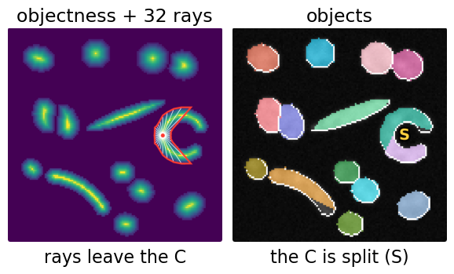
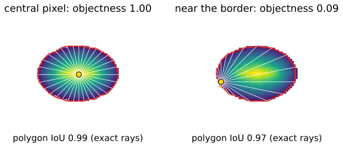
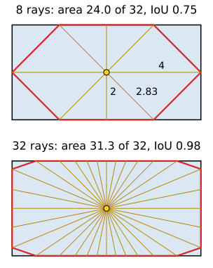
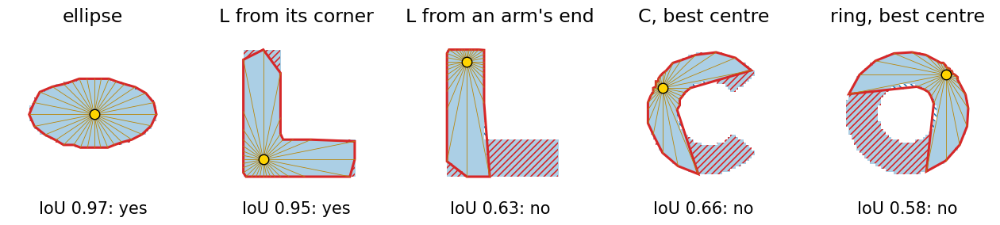
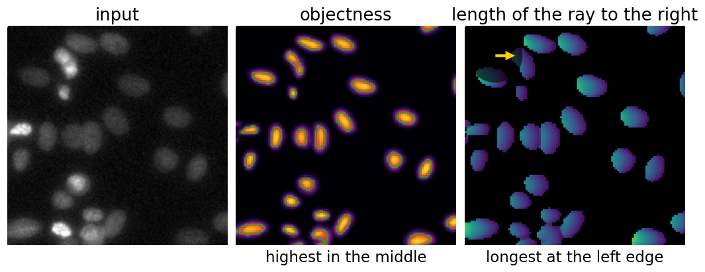
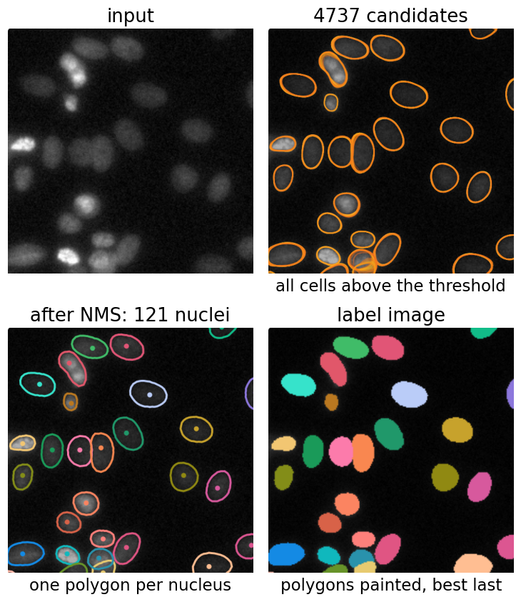
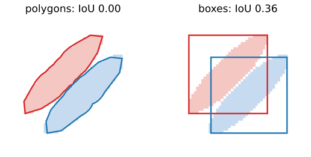
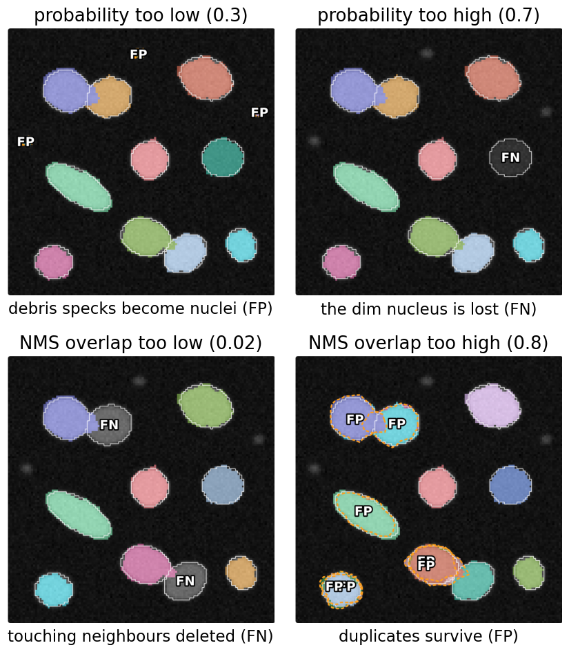
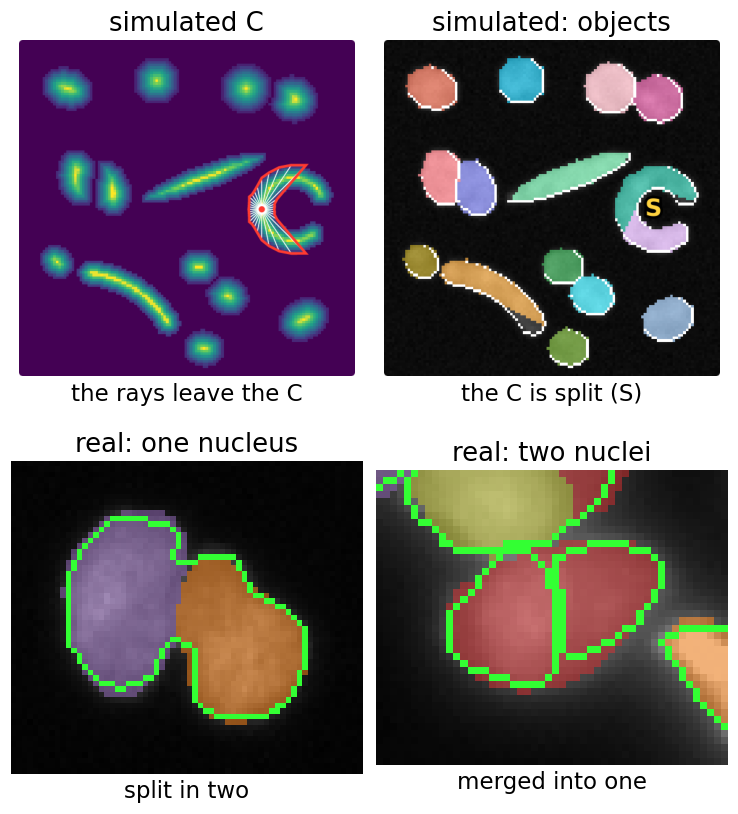
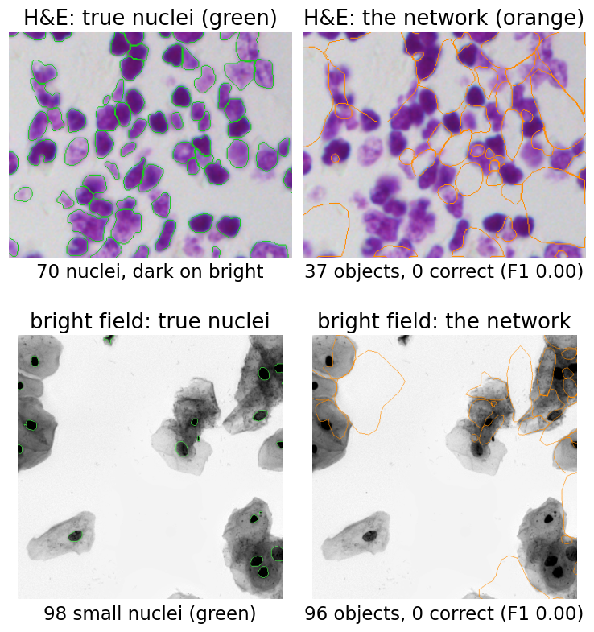

## About this lecture

*How does one pixel describe a whole nucleus, and how do 100 000 pixel guesses become 120 nuclei?*

- What the network predicts per pixel: an **objectness** and **32 ray lengths**.
- From rays to a **polygon**, and which shapes a polygon from one point can describe (**star-convex** shapes).
- **Decoding**: a probability threshold, then **polygon non-maximum suppression**.
- The two thresholds, why touching nuclei separate, and the **failures** built into the method.
- The real network, running in your browser.

*Slides titled **The math** give the formulas and proofs; the ideas are complete without them.*

::: notes
This is the first unit of the networks-for-cells day. It takes route 3 of the [instances unit](../instances/lec.qmd) (star-convex polygons) and works it out in full. It recalls the U-Net (a pixel-wise network), the distance map of the watershed day, greedy non-maximum suppression from the detection unit and object matching from the evaluation day. It does not re-teach them. The method's name is StarDist (Schmidt, Weigert et al., 2018), and the real model in the demos is its published "versatile fluorescence" model.
:::

## Recall: from a mask to nuclei

:::: {.columns}
::: {.column width="52%"}
From the [previous day](../instances/lec.qmd): a network that gives a class per pixel merges touching nuclei. So instance methods let the network predict a **map that makes separation easy**, and a classical step turns that map into objects.

Route 3 of that unit: every pixel proposes a **polygon** for "its" nucleus, and suppression keeps one per nucleus.

Today, the details:

- what exactly the pixel predicts,
- how the polygons are pruned,
- and what goes wrong, and why.
:::
::: {.column width="48%"}
{fig-alt="Simulated star-convex route from the instances unit: the objectness map with the 32 rays and polygon of one pixel in a C-shaped cell; the polygon covers only part of the C, and the C ends up split into two objects (S)." width="100%"}
:::
::::

## What the network predicts

For each pixel (in practice on a coarser grid: one value per 2 × 2 pixels) the network outputs **33 numbers**:

- an **objectness**: how central the pixel is in its nucleus (1 at the centre, near 0 at the border, 0 outside);
- **32 distances**, one along each of 32 fixed directions (every 11.25°), to the border of the nucleus the pixel belongs to.

{fig-alt="One elliptic nucleus coloured by its objectness (yellow centre, dark border), twice. Left: a central pixel (objectness 1.00) with its 32 rays to the border and the polygon through their tips (IoU 0.99 with the nucleus). Right: a pixel near the border (objectness 0.09); its rays are very short on one side and long across the nucleus, and few rays cover the far side (IoU 0.97)." width="80%" fig-align="center"}

The network itself is a [U-Net](../unet/lec.qmd) (the neural networks day) with 1 + 32 output channels instead of one.

## The math: star-convex sets {.math}

Object $O \subset \mathbb R^2$, point $c \in O$, unit vector $\mathbf u(\theta) = (\cos\theta, \sin\theta)$.

- $O$ is **star-convex with respect to $c$** if the segment from $c$ to every $p \in O$ lies in $O$.
- **Radial function**: $r(\theta) = \sup\{r \ge 0 : c + s\,\mathbf u(\theta) \in O \ \forall s \in [0, r]\}$, the distance to the first exit.
- If $O$ is star-convex w.r.t. $c$, then $O = \{c + s\,\mathbf u(\theta) : 0 \le s \le r(\theta)\}$ (up to its boundary): the function $r$ describes $O$ exactly.
- If not, some ray leaves $O$ and enters it again. Its intersection with $O$ is not one interval, and no single number per direction can describe it.
- Every **convex** set is star-convex w.r.t. each of its points. The network samples $r$ at $\theta_k = 2\pi k/n$, $n = 32$.

## From rays to a polygon

:::: {.columns}
::: {.column width="52%"}
Join the tips of the rays in order: a **polygon** with $n$ corners.

Worked example: a rectangle 8 × 4 seen from its centre, 8 rays every 45°:

- lengths 4, 2.83, 2, 2.83, 4, 2.83, 2, 2.83;
- polygon area **24.0** of 32: IoU **0.75**;
- the lost area is the 4 corners, 2.0 each (the corners lie *between* rays).

With 32 rays: area 31.3, IoU **0.98**. More rays, finer outlines; 32 is enough for round nuclei.
:::
::: {.column width="48%"}
{fig-alt="An 8 by 4 rectangle with rays from its centre, twice. Top, 8 rays (lengths 4, 2.83 and 2 labelled): the polygon cuts the four corners, area 24.0 of 32, IoU 0.75. Bottom, 32 rays: the polygon almost fills the rectangle, area 31.3, IoU 0.98." width="78%" fig-align="center"}
:::
::::

## The math: polygon area from the rays {.math}

The polygon is a fan of $n$ triangles at the centre, each with angle $\alpha = 2\pi/n$ between rays $k$ and $k+1$:

$$A = \sum_{k=0}^{n-1} \tfrac12\, r_k\, r_{k+1}\,\sin\alpha = \tfrac12 \sin\tfrac{2\pi}{n}\sum_{k} r_k r_{k+1} \qquad (r_n = r_0).$$

- Rectangle 8 × 4, $n = 8$: $\tfrac12 \sin 45° \cdot (4 \cdot 2.83 + 2.83 \cdot 2 + \dots) = 0.354 \cdot 67.9 = 24.0$.
- Disc of radius $R$ from its centre: $A = \tfrac n2 R^2\sin\tfrac{2\pi}{n}$, a fraction $\tfrac{n}{2\pi}\sin\tfrac{2\pi}{n}$ of $\pi R^2$: 0.900 ($n = 8$), 0.994 ($n = 32$); the error falls like $1/n^2$ since $\sin x \approx x - x^3/6$.
- Ellipse with semi-axes 6 and 3 from its centre, $r(\theta) = ab/\sqrt{b^2\cos^2\theta + a^2\sin^2\theta}$: 85.4 % ($n = 8$), 95.5 % (16), 98.8 % (32).

## Which shapes fit?

A shape is **star-convex** if one point sees its whole border along straight lines. Then the rays from that point describe it.

{fig-alt="Five shapes with 32 rays from one centre each; missed pixels hatched red. Ellipse: IoU 0.97, yes. L-shape seen from its inner corner: IoU 0.95, yes. The same L from the end of an arm: IoU 0.63, no: the other arm is hidden. C-shape and ring from the best possible centre: IoU 0.66 and 0.58: no point works." width="100%"}

- Discs, ellipses, most nuclei: yes, from almost any inner point.
- An L: yes from its corner, **no** from the end of an arm. *The centre matters.*
- A C, a ring, a bent rod: **no point works**. The polygon misses a part of the shape, whatever the network learns.

## Try it: rays and polygons

```{=html}
<link rel="stylesheet" href="../demos/dist/demo.css">
<div data-demo="starrays" data-preset="corners8"></div>
<script src="../demos/dist/starrays.js"></script>
```

::: notes
Shape mode: a shape on a 64 × 64 pixel grid, the yellow centre (drag it), the rays to the first pixel outside the shape, the polygon through their tips. Red hatch: shape pixels the polygon misses; blue hatch: polygon pixels outside the shape. Tour: "corners cut (8 rays)": the 8 × 4 rectangle scaled by 5 (40 × 20 pixels); the rays read 20, 14.1, 10, …, the polygon is 600 of 800 pixels, IoU 0.750, exactly the worked example. Slide n to 16 and 32: IoU 0.960 and 0.975 (counted in pixels; 0.96 and 0.98 for the exact rectangle). "C: no centre works": the best centre over all pixels gives IoU 0.66. "L: centre matters": from the end of an arm IoU 0.63; press "best centre": the centre jumps into the corner and IoU rises to 0.99. "star: polygon sticks out": 5 rays hit the 5 tips and the pentagon covers the notches (blue hatch); 690 extra pixels, IoU 0.55. With 10 rays (tips and notches) IoU 0.955. Tick "objectness" to show the normalised distance map.
:::

## Why rank by objectness?

**Every** pixel inside a nucleus proposes a polygon. A central pixel sees its nucleus evenly; a border pixel sees it lopsidedly (a few long rays cross the whole nucleus, the far side gets few rays, and long rays are the hardest to predict). So each proposal is scored by "how central am I": the **distance to the background**, divided by its maximum in each nucleus. That is the distance map of the [watershed day](../ws-distance/lec.qmd), normalised per nucleus.

{fig-alt="The real network on a fluorescence micrograph of nuclei: the input; the predicted objectness, a bright blob in the middle of each nucleus that fades to the border; and the predicted length of the ray to the right, longest at the left edge of each nucleus and short at its right edge." width="84%" fig-align="center"}

## The math: training targets and loss {.math}

For a training image with true objects $O_1, O_2, \dots$ and a pixel $p \in O_j$:

- **objectness target** $d(p) = \dfrac{\operatorname{dist}(p, \mathbb R^2 \setminus O_j)}{\max_{q \in O_j}\operatorname{dist}(q, \mathbb R^2 \setminus O_j)} \in (0, 1]$, and $d(p) = 0$ in the background;
- **ray targets** $r_k(p)$ = distance from $p$ to the first point outside $O_j$ along $\mathbf u_k$ (other objects count as outside);
- **loss** per pixel: binary cross-entropy between $d(p)$ and the predicted $\hat d(p)$, plus an **objectness-weighted** absolute error on the rays:
  $$\mathcal L = \sum_p \mathrm{BCE}\big(d(p), \hat d(p)\big) + \lambda \sum_p d(p)\,\frac1n\sum_k \big|r_k(p) - \hat r_k(p)\big|.$$
- Central pixels weigh most in the ray loss. These are the pixels whose polygons decoding will use.

## Decoding: from candidates to objects

:::: {.columns}
::: {.column width="50%"}
1. Keep the grid cells with objectness above the **probability threshold**.
2. Each one gives its polygon: the **candidates**.
3. Sort them by objectness.
4. **Polygon NMS**: keep the best, delete every polygon that overlaps it by more than the **NMS threshold** (IoU of polygons), repeat.
5. Paint the kept polygons into a label image, best last, so the better one wins where two overlap.

On the micrograph: 512 × 512 pixels, 256 × 256 grid cells, **4737 candidates → 121 nuclei**.
:::
::: {.column width="50%"}
{fig-alt="A corner of the nuclei micrograph decoded by the real network: the input; thousands of overlapping candidate polygons outline each nucleus many times (4737 in the whole image); after polygon NMS one coloured polygon per nucleus remains (121 nuclei); the label image paints each kept polygon in its own colour." width="80%" fig-align="center"}
:::
::::

## The math: the cost of polygon NMS {.math}

- Greedy NMS over $m$ candidates compares each kept polygon with the remaining ones: at most $m(m-1)/2$ polygon IoUs. For $m = 4737$ that is 11.2 million, each needing the overlap of two polygons.
- **Bounding-box pre-check**: two polygons whose boxes do not overlap cannot overlap, so their IoU is 0 and need not be computed. In a nuclei image only neighbours are left: about $m \times$ (a few) IoUs.
- **Order matters**: greedy NMS keeps the first of two overlapping candidates. Sorting by objectness makes "first" mean "most central".
- Only the **order** of the scores is used. Any increasing transform of the objectness (squaring it, a logit) gives the same result (recall the [detection unit](../detection/lec.qmd)).

## Why touching nuclei separate

:::: {.columns}
::: {.column width="48%"}
Two touching nuclei:

- have **two** objectness peaks, one in each nucleus (the objectness is low along the contact);
- their polygons meet only along the contact, so their **IoU is small**;
- so NMS at 0.3 keeps both.

Boxes are different: two touching diagonal nuclei have boxes that overlap a lot (here IoU 0.36). Box NMS would be tempted to delete one of them (recall the [detection unit](../detection/lec.qmd)).

A polygon fits the object; a box fits the axes.
:::
::: {.column width="52%"}
{fig-alt="Two elongated nuclei touching along their long sides at 45 degrees. Left: their two polygons, which meet only along the contact, IoU 0.00. Right: their bounding boxes overlap in a large square, IoU 0.36." width="100%"}
:::
::::

## The two thresholds

:::: {.columns}
::: {.column width="40%"}
**Probability threshold**

- too low: specks and dim debris become objects (FP);
- too high: dim nuclei are lost (FN).

**NMS threshold** (allowed overlap)

- too low: touching neighbours are deleted (FN);
- too high: duplicates survive (FP).

The trained model ships with a tuned pair, chosen on validation images: probability **0.48**, NMS **0.3**.
:::
::: {.column width="60%"}
{fig-alt="Four results of the simulated decoding demo, labels on the image with the true outlines dashed. Probability threshold 0.3: three debris specks are marked FP. Threshold 0.7: the dim nucleus is marked FN. NMS overlap 0.02: one nucleus of each touching pair is deleted, marked FN. NMS overlap 0.8: duplicate polygons survive, marked FP." width="67%" fig-align="center"}
:::
::::

## Try it: decoding step by step

```{=html}
<link rel="stylesheet" href="../demos/dist/demo.css">
<div data-demo="starrays" data-preset="step"></div>
<script src="../demos/dist/starrays.js"></script>
```

::: notes
Decode mode. A synthetic 128 × 128 scene with ten nuclei (two touching pairs, one dim nucleus, one elongated) and three debris specks. The "network" is simulated: the exact objectness and rays plus noise, and a contact blur (rays near a contact reach a little into the neighbour, as a real network does). Tour: "step through NMS": press step. Step 1 keeps the most central polygon (yellow) and deletes 21 polygons of the same nucleus (red, IoU 0.81–0.92). Ten steps, ten nuclei. Readout: 239 candidates above 0.5, and only 280 IoUs computed thanks to the bounding-box pre-check (all pairs would be 28 441). F1 1.00. "NMS too strong: neighbour deleted" (0.02): the readout shows FN 2; one nucleus of each touching pair is deleted. Step through it to see the deleted neighbour's small IoU printed on it. "NMS too weak: duplicates" (0.8): FP 7. "low threshold: specks" (0.3): the three debris specks, FP 3. "high threshold: dim nucleus lost" (0.7): FN 1. Rays n = 8 shows corners cut on every nucleus.
:::

## Try it: the real network

```{=html}
<link rel="stylesheet" href="../demos/dist/demo.css">
<div data-demo="stardistnet" data-image="nuclei" data-view="cand"></div>
<script src="../demos/dist/stardistnet.js"></script>
```

::: notes
The published versatile fluorescence model runs in the browser (WebAssembly, in a worker). It downloads a 1.0 MB module and 5.5 MB of weights, about 2 s for 512 × 512 on one laptop core. If the page is opened as a local file, the demo explains why it cannot run; the static figures on the previous slides show the same states. Tour: view Candidates (4737), then After NMS (121 objects), Labels. Probability: one bright blob per nucleus. Ray length at 0°: bright on the left side of each nucleus. Click a central pixel and a border pixel of the same nucleus to compare their 32 rays. Presets: low probability (0.15): 10 876 candidates and 126 objects; high (0.85): 352 candidates and 79 objects, the dim nuclei are gone. Weak suppression (0.9): 205 objects, duplicates everywhere. Strong suppression (0.02): 117 objects; touching neighbours vanish. A second embed with the strong preset is in the exercise.
:::

## Failures by construction

:::: {.columns}
::: {.column width="48%"}
Some failures are built into the representation, whatever the training:

- **C-shapes, rings, bent cells**: no centre sees the whole border. They come out **split** into pieces, or **cut off**.
- **Very elongated** nuclei at a fixed $n$: the tips fall between rays and are cut.
- **Much larger objects** than in training: the rays can only reach as far as the network "sees" (its receptive field). The nucleus is split.

Real examples (bottom): a peanut-shaped nucleus split in two, and two elongated touching nuclei merged into one. Images: BBBC039 and 2018 Data Science Bowl (CC0).
:::
::: {.column width="52%"}
{fig-alt="Left two panels, simulated: the objectness map of a C-shaped cell with the rays of one pixel leaving the C, and the resulting objects: the C is split into two (S). Right two panels, the real network on public images (predictions as colour fills, true outlines green): a peanut-shaped U2OS nucleus that the annotators drew as one object, split into two polygons; and two elongated touching nuclei in a dense image covered by one polygon." width="80%" fig-align="center"}
:::
::::

## Failures of the training data

:::: {.columns}
::: {.column width="48%"}
The published model was trained on **fluorescence** nuclei: bright on dark.

- **Histology (H&E)**: nuclei are dark on bright. The network outlines the bright gaps between them: 37 objects, **0** of 70 nuclei found.
- **Bright field**: 96 objects, **0** of 98 nuclei found.

The network has no idea what a nucleus is; it learned what nuclei looked like in its training images. Inverting the image helps a little; a model trained on that kind of image helps a lot.

Images: 2018 Data Science Bowl (CC0). Matching at IoU 0.5.
:::
::: {.column width="52%"}
{fig-alt="The fluorescence model on images it was not trained for. H&E histology: the 70 true nuclei (green outlines, dark purple), and the network's 37 polygons (orange), which outline bright background between nuclei; none matches a nucleus. Bright field: the 98 small true nuclei (green), and the network's 96 polygons, mostly around bright background and cell bodies; none matches one of the 98 small nuclei." width="82%" fig-align="center"}
:::
::::

## Where this leads

- **3D**: rays on a sphere (e.g. 96 directions), polyhedra instead of polygons, the same decoding with polyhedron NMS. This is the method's 3D version, for nuclei in stacks.
- **Other shapes per pixel**: ellipses, splines and other contours can be predicted per pixel and pruned the same way. The "one shape per pixel, then suppression" pattern is general.
- **Non-star-convex cells**: the [next unit](../cellpose/lec.qmd) (flow fields) handles bent and irregular shapes.
- **Comparison**: the [last unit of the day](../cellnets-compare/lec.qmd) scores this network against a classical pipeline on the same annotated images.

Software packages with the same name implement this method.

## Summary

- Per pixel (on a 2 × 2 grid): an **objectness** and **32 ray lengths** to the border.
- Rays → a **polygon** through their tips; area by the triangle rule. It describes a shape exactly only if the shape is **star-convex** from that pixel.
- Decoding: **probability threshold** → candidate polygons → **polygon NMS** (sorted by objectness) → labels.
- Two thresholds: probability (specks vs lost dim nuclei), NMS overlap (deleted neighbours vs duplicates). Touching nuclei survive because their polygons barely overlap.
- Fails by construction on C-shapes, rings, bent and very large objects, and on images unlike its training data.
