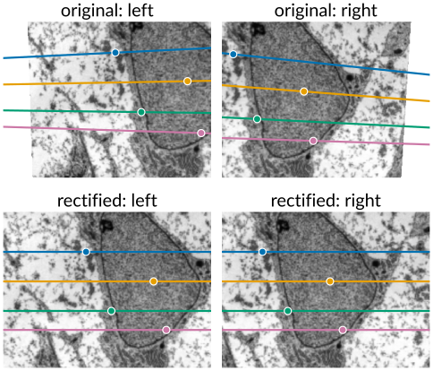
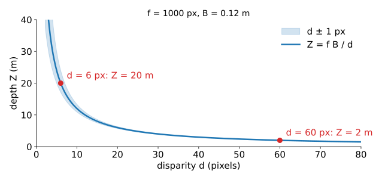
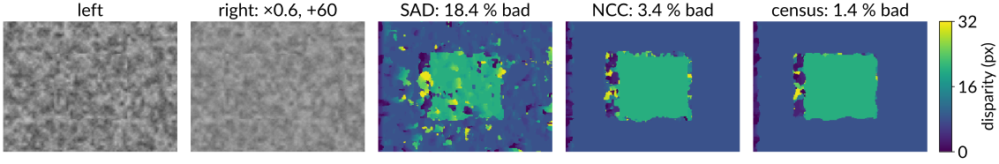
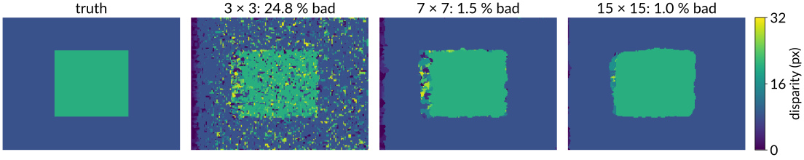
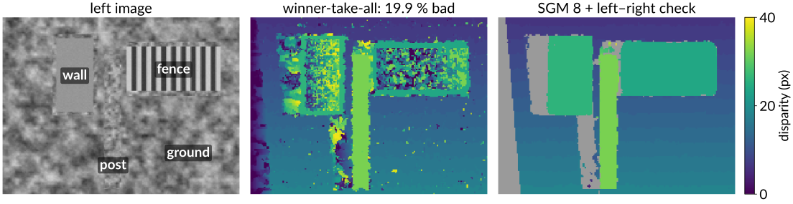
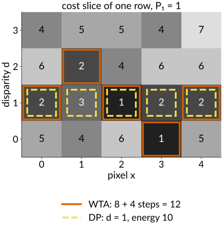
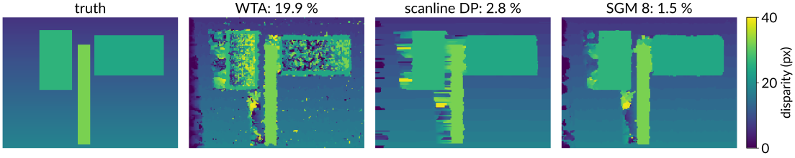
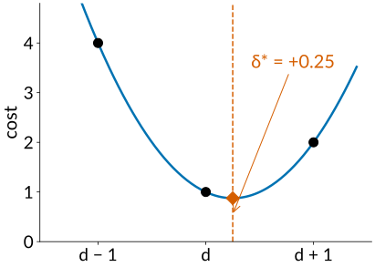

## About this lecture

Two calibrated cameras side by side, like two eyes. Last unit: a match lies on an epipolar line. Today: match **every** pixel, and turn the result into a depth map.

- **Rectification**: warp both images so that epipolar lines become the same **rows**.
- **Disparity → depth**: $Z = fB/d$, and why far things are hard.
- **Matching costs** in a window (SAD, NCC, census) and the **cost volume**.
- What goes wrong: textureless regions, repetition, **occlusions**; the **left–right check**.
- **Global** methods: scanline dynamic programming and **semi-global matching**.
- **Sub-pixel** disparity; active stereo; stereo in microscopy.

*Slides titled **The math** give the formulas and proofs; the ideas are complete without them.*

::: notes
This unit owns stereo for the course (rectification, matching costs, aggregation, scanline DP and SGM). The dynamic programming elective's "scanline stereo" is a one-slide pointer to here; the graph-cuts day mentions stereo as a multi-label energy. Disparity d = x − x' ≥ 0 (left minus right), f in pixels, B baseline, Z depth.
:::

## Rectification: epipolar lines become rows

:::: {.columns}
::: {.column width="54%"}
After rectification, a pixel's match is on the **same row** in the other image, a little to the left. Matching becomes a 1D search along a row.

- Turn both cameras (in the computer) to a common orientation whose $x$ axis is the **baseline**: then the motion between them is purely **sideways**, and the epipolar lines are rows (last unit).
- Turning a camera about its centre changes the image by a **homography**, so each image is **resampled** once: for every output pixel, ask where it comes from in the original and interpolate ([images day](../images/lec.qmd), "go backwards").
- Stereo rigs are built nearly rectified (parallel cameras on a bar); a calibration makes it exact. Lens distortion is removed in the same resampling.
:::
::: {.column width="46%"}
{fig-alt="A flat textured scene (an electron micrograph of a cell) seen by two toed-in cameras. Top: the original left and right images with four points and their epipolar lines, which are slanted and not parallel. Bottom: the same pair after rectification: the epipolar lines are horizontal and each point's match lies on the same row." width="100%"}
:::
::::

## The math: rectifying homographies {.math}

A camera rotated about its centre by $R'$ sees $\mathbf x_\text{new} \simeq K R'\,\mathbf X_\text{cam} \simeq K R' K^{-1}\mathbf x_\text{old}$: a homography (the pure-rotation case of the last unit).

- New common orientation $R_\text{rect}$ with rows $\mathbf e_1 = \frac{\mathbf c' - \mathbf c}{\lVert\mathbf c' - \mathbf c\rVert}$ (the baseline), $\mathbf e_2 = \frac{\mathbf z \times \mathbf e_1}{\lVert\cdot\rVert}$ with $\mathbf z$ the average viewing direction, $\mathbf e_3 = \mathbf e_1 \times \mathbf e_2$.
- For each camera with rotation $R$: $H = K_\text{new}\,R_\text{rect}\,R^\top K^{-1}$.
- In the new frames both cameras differ only by a translation along $x$: $E = [(B, 0, 0)]_\times$, and $\hat{\mathbf x}'^\top E\hat{\mathbf x} = 0$ reduces to $y' = y$ (with the same $K_\text{new}$ for both).

## Disparity and depth

{width="62%" fig-align="center"}

For rectified cameras the **disparity** $d = x - x'$ (left minus right column) gives the depth:
$$Z = \frac{fB}{d}\qquad(f \text{ in pixels, } B \text{ the baseline}).$$

- Near things shift a lot, far things little; $d = 0$ is infinitely far.
- $f = 1000$ px, $B = 0.12$ m: $d = 60$ px is 2 m, $d = 6$ px is 20 m, $d = 5$ px is 24 m. **One pixel** is 3 cm of depth at 2 m, but 4 m at 20 m.
- So depth resolution falls with **distance squared**: measure disparities to a fraction of a pixel, or widen the baseline.

## The math: depth from disparity {.math}

Rectified cameras at $(0, 0, 0)$ and $(B, 0, 0)$, both with focal length $f$ (pixels) and the same principal point:
$$x = f\frac{X}{Z}, \qquad x' = f\frac{X - B}{Z} \quad\Longrightarrow\quad d = x - x' = \frac{fB}{Z}, \qquad Z = \frac{fB}{d}.$$

- Sensitivity: $\dfrac{\partial Z}{\partial d} = -\dfrac{fB}{d^2} = -\dfrac{Z^2}{fB}$, so $\delta Z \approx \dfrac{Z^2}{fB}\,\delta d$.
- To keep the depth error fixed at larger $Z$, the baseline must grow like $Z^2$ (or $f$, i.e. finer pixels).
- Then $X = xZ/f$ and $Y = yZ/f$ (measured from the principal point): every valid disparity becomes a 3D point.

## Matching costs and the cost volume

For a left pixel and a candidate disparity $d$, compare a small **window** around it with the window around $(x - d, y)$ in the right image:

- **SAD/SSD** (sum of absolute/squared differences): fast, but a brightness or gain difference between the cameras ruins it.
- **NCC** (normalised cross-correlation): subtract each window's mean and divide by its standard deviation first: insensitive to gain and offset.
- **Census**: replace each pixel by a bit string, "is this neighbour darker than the centre?"; compare bit strings (count differing bits). Only the **order** of brightnesses matters: robust to any monotone brightness change. The standard choice in practice.

All costs for all pixels and all disparities form the **cost volume** $C(x, y, d)$: one image of costs per disparity.

{fig-alt="A random-texture stereo pair in which the right camera has gain 0.6 and offset +60, and the disparity maps found with 7 by 7 windows and winner-take-all: SAD 18.4 % bad pixels (a noisy map), NCC 3.4 %, census 1.4 % (both show the raised square cleanly)." width="100%"}

## The math: costs {.math}

With windows $\mathcal W$ around $(x, y)$ and around $(x - d, y)$, $I$ left, $J$ right:

$$\mathrm{SAD} = \sum_{\mathcal W}|I - J|, \qquad \mathrm{NCC} = \frac{\sum_{\mathcal W}(I - \bar I)(J - \bar J)}{\sqrt{\sum_{\mathcal W}(I - \bar I)^2\sum_{\mathcal W}(J - \bar J)^2}}, \qquad \text{cost} = 1 - \mathrm{NCC}.$$

- **Census**: $c(\mathbf p) = \big([I(\mathbf q) < I(\mathbf p)]\big)_{\mathbf q \in \mathcal N(\mathbf p)}$, a bit string; cost = Hamming distance $\#\{k: c_L(\mathbf p)_k \ne c_R(\mathbf p - d)_k\}$, summed over the window.
- A strictly increasing brightness map $g$ keeps every comparison $I(\mathbf q) < I(\mathbf p)$, so census codes are unchanged; NCC is invariant under $I \to aI + b$ ($a > 0$) only.
- Window sums for all pixels cost $O(1)$ per pixel with running sums or integral images ([integral images elective](../integral-image/lec.qmd)), whatever the window size.

## Window size and winner-take-all

**Winner-take-all** (WTA): for each pixel, the disparity of lowest cost. The window size is the main knob:

- **Small windows**: little texture inside, so many disparities look alike: **noisy** disparity maps.
- **Large windows**: reliable in textured areas, but at a **depth edge** the window straddles foreground and background, and the textured foreground wins: objects come out **fatter** than they are (foreground fattening). Slanted surfaces blur too.

By hand: left row $(1, 1, 5, 9, 5, 1, 1, 1)$, right row shifted 2 to the left. A window of 3 centred on the 9: SAD = 12, 12 and **0** for $d = 0, 1, 2$. A constant row gives the same cost for every $d$: no information.

{fig-alt="Random-dot stereo pair with a raised square: the true disparity map and winner-take-all results with SAD windows of 3 by 3 (24.8 % bad pixels, very noisy), 7 by 7 (1.5 %) and 15 by 15 (1.0 %, but the square's corners are rounded and it grows)." width="100%"}

## Try it: stereo matching

```{=html}
<link rel="stylesheet" href="../demos/dist/demo.css">
<div data-demo="stereomatch" data-preset="window"></div>
<script src="../demos/dist/stereomatch.js"></script>
```

::: notes
A rectified 192 × 144 pair with ground truth. Panels: left (click a pixel: its window in yellow), right (the matched window in yellow, the true match in green, the row in cyan), disparity (viridis, grey = invalid), errors (red: > 1 px off, blue: occluded, the left strip x < maxD is not evaluated). The cost curve C(d) of the clicked pixel with the true d. Tour: "window 3 × 3 vs 15 × 15" (random dots, SAD): 3 × 3 gives 24.8 % bad pixels (pixel (50, 70): true 8, found 6); 7 × 7: 1.5 %; 15 × 15: 1.0 %, but look at the corners of the raised square: they round off and the square grows. Switch to the "wall, fence, post" scene for the failures on the next slide.
:::

## What goes wrong

- **Textureless** regions: every disparity matches equally well; the minimum is decided by noise.
- **Repetitive** patterns (a fence, tiles, a grid): several disparities match equally well, one period apart.
- **Occlusions**: near every depth edge, a strip of background is visible in one image only. Those pixels have **no** correct match; whatever WTA picks is wrong.
- **Specular highlights** move with the viewpoint: they are not on the surface.

**Left–right check**: match left→right **and** right→left; keep a pixel only if the two disparities agree (within one pixel). Occluded and ambiguous pixels mostly fail and are marked **invalid**: holes to be filled later, never "depth 0".

{fig-alt="The scene 'wall, fence, post': left image with a textureless wall, a striped fence, a post in front and slanted textured ground. Winner-take-all with 3 by 3 SAD: 19.9 % bad pixels, the wall and the fence are full of wrong disparities. Semi-global matching with the left-right check: clean, with grey invalid strips just left of the wall, the fence and the post, where the background is occluded in the right image." width="100%"}

## Global methods: add smoothness

Neighbouring pixels usually have similar disparities. Make that part of the problem: the same **data + λ·smoothness** energy as for segmentation ([segmentation as energy minimisation](../seg-energy/lec.qmd)), with the disparity as a label from $0, \dots, D - 1$:

$$E(d) = \sum_{\mathbf p} C(\mathbf p, d_\mathbf p) + \sum_{\text{neighbours}} V(d_\mathbf p, d_\mathbf q), \qquad V = \begin{cases} 0 & \text{equal} \\ P_1 & \text{differ by 1 (slanted surfaces)} \\ P_2 & \text{a larger jump (depth edges)}\end{cases}$$

- In 2D this is hard to minimise exactly (many labels, many loops). Graph cuts with α-expansion give good approximations ([graph-cut segmentation](../graphcut-seg/lec.qmd)).
- Along **one row** it is a chain, and a chain is solved exactly by dynamic programming.

## Scanline dynamic programming

:::: {.columns}
::: {.column width="60%"}
One row of the cost volume is a table: columns $x$, rows $d$. A disparity profile is a **path** through it.

- Find the cheapest path, with $P_1$ for small steps and $P_2$ for jumps: exactly the table filling and backtracking of [dynamic programming on paths](../dp-paths/lec.qmd): fill the cumulative cost column by column, keep a pointer to the best predecessor, backtrack from the best end.
- Occlusions appear as jumps in the path (Ohta & Kanade, 1985).
- Each row is solved **independently**: one row's mistake does not know about its neighbours: horizontal **streaks**.

By hand (the exercise): a $4 \times 5$ slice where WTA jumps $1, 2, 1, 0, 1$ (cost 8 + four steps of $P_1 = 1$ = 12) and DP takes the straight path at disparity 1 (cost 10).
:::
::: {.column width="40%"}
{fig-alt="A 4 by 5 cost table, pixel x across and disparity d upwards. Red boxes: the winner-take-all cells, d = 1, 2, 1, 0, 1, energy 8 plus four steps of 1 = 12. Yellow dashed boxes: the dynamic-programming path, d = 1 everywhere, energy 10." width="100%"}
:::
::::

## Semi-global matching

Hirschmüller (2008): do the 1D dynamic programming along **several directions** (left, right, up, down, and the diagonals: 4 or 8), and **add** the results.

- Each direction carries evidence from far along its own line; together they cover the 2D neighbourhood. Few streaks.
- Then winner-take-all on the summed costs.
- Linear in the number of pixels × disparities × directions; easy to run in parallel. The standard algorithm in practice (cars, drones, depth cameras).
- Learned matching costs (neural networks comparing patches) and end-to-end networks are common today; they still build a cost volume and often keep an SGM-like aggregation.

{fig-alt="True disparity of the 'wall, fence, post' scene and the results with 3 by 3 SAD: winner-take-all 19.9 % bad pixels, scanline dynamic programming 2.8 % with horizontal streaks, semi-global matching with 8 directions 1.5 %." width="100%"}

## The math: semi-global matching {.math}

For a direction $\mathbf r$, along the line of pixels $\mathbf p - \mathbf r, \mathbf p, \dots$:

$$L_\mathbf r(\mathbf p, d) = C(\mathbf p, d) + \min\!\Big(L_\mathbf r(\mathbf p - \mathbf r, d),\ L_\mathbf r(\mathbf p - \mathbf r, d \pm 1) + P_1,\ \min_k L_\mathbf r(\mathbf p - \mathbf r, k) + P_2\Big) - \min_k L_\mathbf r(\mathbf p - \mathbf r, k).$$

- The last term only keeps the numbers small (it is the same for every $d$).
- $S(\mathbf p, d) = \sum_\mathbf r L_\mathbf r(\mathbf p, d)$, then $d_\mathbf p = \arg\min_d S(\mathbf p, d)$.
- One direction alone is the **forward pass** of scanline DP: at the row's last pixel its minimum is the DP's end label; elsewhere SGM does not backtrack, which is why it needs several directions.
- $P_1 = P_2 = 0$: each $L_\mathbf r$ is $C$ plus a constant, and SGM is WTA.

## Try it: aggregation

```{=html}
<link rel="stylesheet" href="../demos/dist/demo.css">
<div data-demo="stereomatch" data-preset="scanline"></div>
<script src="../demos/dist/stereomatch.js"></script>
```

::: notes
Scene "wall, fence, post": a slanted textured ground (d from 6 at the top to 18 at the bottom), a textureless wall with a textured frame (d = 26), a striped fence with textured rails (period 8 px, d = 24), a textured post in front (d = 32). SAD 3 × 3, WTA: 19.9 % bad; the wall pixel (58, 45) has true d = 26, WTA finds 34. "Textureless wall" (7 × 7): still 15.3 %, the wall pixel gets 31; "striped fence": pixel (140, 40) has true 24, found 8 (two periods off). This preset, "scanline DP" (P1 = 0.1, P2 = 1): 2.8 % bad, the wall is filled from its frame, the wall pixel gets 26; look for streaks. "SGM 8": 1.5 %. "Occlusion": SGM 8 with the left–right check marks 1103 pixels invalid, 939 of them among the 1138 occluded pixels (without the check, 1054 occluded pixels are simply wrong). "Gain change": SAD 7 × 7 18.4 %, NCC 3.4 %, census 1.4 %. The second tab shows one row's x × d cost slice with WTA (red dots), the DP path (yellow) and the truth (dashed). Each update takes some 50–250 ms here (SGM 8 is the slowest).
:::

## Sub-pixel disparity

:::: {.columns}
::: {.column width="60%"}
Integer disparities give depth in steps: at 20 m, one step is 4 m in the example. Interpolate the cost curve:

- Fit a **parabola** through the costs at $d - 1$, $d$, $d + 1$; take its minimum. By hand: costs 4, 1, 2 give the offset $+0.25$.
- Works best on textured, smooth surfaces; the stitching unit uses the same trick for sub-pixel shifts.
- In the demo (SGM 4 on the slanted ground): the mean error of the good pixels drops from 0.26 to 0.12 px.

Together with a long baseline, sub-pixel matching is what makes stereo useful at a distance.
:::
::: {.column width="40%"}
{fig-alt="Costs 4, 1 and 2 at disparities d − 1, d and d + 1, the parabola through them, and its minimum at an offset of +0.25 pixels." width="100%"}
:::
::::

## The math: the sub-pixel parabola {.math}

Fit $c(\delta) = a\delta^2 + b\delta + c_0$ through $(-1, C_-)$, $(0, C_0)$, $(1, C_+)$:
$$a = \tfrac12(C_- - 2C_0 + C_+), \quad b = \tfrac12(C_+ - C_-) \quad\Longrightarrow\quad \delta^* = -\frac{b}{2a} = \frac{C_- - C_+}{2\,(C_- - 2C_0 + C_+)} .$$

- $C_0$ is the discrete minimum, so $a \ge 0$ and $|\delta^*| \le \tfrac12$.
- The parabola is exact for a quadratic cost; for SAD (a V-shaped cost near the minimum) it is biased towards integers ("pixel locking"); other fits (a symmetric V) reduce the bias.

## Active stereo, and stereo under the microscope

- **Active stereo, structured light**: project a random-dot or striped pattern onto the scene. Textureless surfaces get texture; matching works everywhere the pattern lands. Many depth cameras work like this (with one camera, the projector itself plays the second "camera").
- **Stereo microscopes and stereo endoscopes**: two optical paths at a small angle: the same geometry, a small baseline.
- **Scanning electron microscope tilt pairs**: two images at tilt angles differing by $\Delta\theta$ about an axis in the image plane. The camera is affine, and a height difference $h$ shows up as a parallax $p$ perpendicular to the tilt axis: $h = p / (2\sin(\Delta\theta/2))$. A 2 µm parallax with a 10° tilt difference is a height of 11.5 µm.

Other routes to depth from images: depth from **focus** (the sharpest slice of a focus stack, per pixel) and from **defocus** (the blur size), the optional last unit of this day.

## Summary

- **Rectify** (one homography per image) so that matches lie on the same row.
- **Depth** $Z = fB/d$; the depth error grows with $Z^2$: sub-pixel disparity and a long baseline help.
- **Costs** in a window: SAD (fast, fragile), NCC (gain-invariant), census (order only, robust); the **cost volume** $C(x, y, d)$.
- **Window size**: small = noisy, large = fat foreground. **Failures**: textureless, repetitive, occluded; the **left–right check** marks them invalid.
- **Smoothness**: scanline **DP** per row (streaks), **semi-global matching** along 4–8 directions (the practical standard), graph cuts in 2D.
