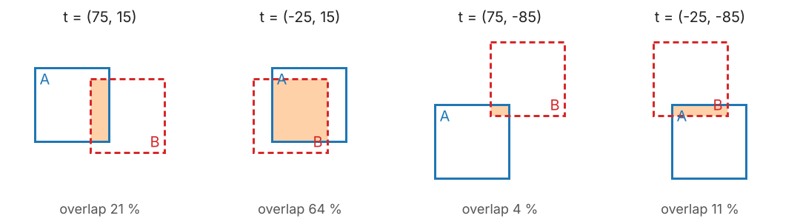

## About this lecture

Phase correlation gives a spike. Turning it into a usable shift, and many shifts into one consistent picture, takes three more steps.

- **The four candidates**: a circular peak only knows the shift up to the tile size.
- **Sub-pixel** shifts: parabola, centroid, and the upsampled DFT.
- **Global alignment** of a mosaic: pairwise shifts do not add up around a loop; least squares on the graph of tiles.
- **Drift** in a time-lapse and in localisation microscopy; channels; 3D stacks.
- The limits: what a shift cannot describe.

*Slides titled **The math** give the formulas and proofs; the ideas are complete without them.*

::: notes
Convention as before: the shift t of tile B relative to tile A is where B sits on A, B(x) = A(x + t); for a mosaic it is the position of B minus the position of A. The demos use 128 × 128 tiles cut from the course micrograph enlarged to 384 × 384; with only 256² pixels of real data, the mosaic is a teaching model, honestly labelled.
:::

## A peak means four shifts

Without padding, the FFT treats each tile as periodic: a peak at $(p, q)$ only says the shift **modulo the tile size** $N$.

{width="95%" fig-align="center"}

- $t_x \in \{p,\ p - N\}$ and $t_y \in \{q,\ q - N\}$: **four** ways tile B can sit against tile A, with very different overlaps.
- Decide by computing **NCC on the actual overlap** of each candidate and keeping the best; ignore candidates whose overlap is too small to judge.

## Resolving the candidates

- For each candidate, cut out the overlapping parts of A and B and compute their NCC (the matching unit): a direct, cheap check.
- Require a **minimum overlap**: a few dozen pixels always correlate by chance.
- In practice, check the candidates of the few highest peaks, not only the first: on small overlaps, the true peak is not always the highest.
- The best NCC is also the pair's **confidence**.
- Alternative: **zero-pad** the tiles (the previous unit): no ambiguity, but FFTs four times as large, and the overlap gets a smaller share of the padded image. Stitching programs usually test candidates instead.

## Sub-pixel shifts

Stages, drift and chromatic shifts are rarely whole pixels. A drift of 0.3 px matters when single molecules are localised to 0.1 px.

- **Parabola**: fit a parabola through the peak and its two neighbours (in $x$, and separately in $y$); its top is the estimate. Cheap, but biased towards whole pixels: **pixel locking**.
- **Centroid** of the peak and its neighbours: simplest, strongly biased for broad or narrow peaks.
- **Upsampled DFT**: evaluate the inverse DFT of the (normalised) cross-power spectrum on a **fine grid** (e.g. 1/20 px) near the peak only. This is the exact interpolation of the correlation, without a huge padded FFT (Guizar-Sicairos et al., 2008).

To **apply** a sub-pixel shift: interpolate (bilinear, the images unit) or multiply the spectrum by a phase ramp (the shift theorem, backwards).

## The math: sub-pixel peaks {.math}

**Parabola.** Through $(-1, c_{-1})$, $(0, c_0)$, $(1, c_{+1})$: $c(\delta) = a\delta^2 + b\delta + c_0$ with $a = \tfrac12(c_{-1} + c_{+1}) - c_0$, $b = \tfrac12(c_{+1} - c_{-1})$; the vertex is at
$$\delta = -\frac{b}{2a} = \frac{c_{-1} - c_{+1}}{2(c_{-1} - 2c_0 + c_{+1})}.$$
**The true shape.** For a non-integer shift, the phase-correlation peak is a Dirichlet kernel $\frac{\sin(\pi(t - t_0))}{N\sin(\pi(t - t_0)/N)}$ (the phasecorr unit, B7), not a parabola: hence the bias. Fitting the kernel itself works too (Foroosh et al., 2002).

**Upsampled DFT.** $c(x, y) = \frac{1}{N^2}\sum_{k_x,k_y} R_{k_y k_x}e^{2\pi i(k_xx + k_yy)/N}$ at $U \times U$ points: $C = E_y\,R\,E_x^{\top}$ with small DFT matrices $E_x \in \mathbb C^{U\times N}$, $(E_x)_{jk} = e^{2\pi i k x_j/N}$. Cost $\mathcal O(N^2U)$ instead of an FFT of size $(UN)^2$.

## Try it: sub-pixel estimates

```{=html}
<link rel="stylesheet" href="../demos/dist/demo.css">
<div data-demo="subpixel" data-preset="parabola"></div>
<script src="../demos/dist/subpixel.js"></script>
```

::: notes
B is A shifted by 3.3 px through the Fourier phase ramp, so the truth is exact. Left: the correlation samples near the peak (dots), the parabola through the top three (red dashed), the upsampled-DFT curve (blue); vertical lines: truth (green), parabola, centroid, upsampled. Right: the error of each method for every fraction from 0 to 1. Tour: "parabola: pixel locking" (phase correlation): the parabola's error is an S-curve, 3.262 instead of 3.300, at most 0.038 px; the centroid's up to 0.065; the upsampled DFT is within its grid of 1/20 px (0.020). "a broad CC peak": the parabola fits a broad peak well (0.004), the centroid is terrible (0.47). "upsampling too coarse" (U = 4): the upsampled estimate is quantised to 1/4 px, error up to 0.12. "noise sets the floor": with noise all methods scatter.
:::

## Many tiles: the mosaic as a graph

A mosaic of tiles is a **graph**: one node per tile, one edge per overlapping pair, labelled with the measured shift and its confidence.

- **Stage positions** alone: seams, off by several pixels.
- **Chaining** pairwise shifts along a path: each step adds its error; tiles far down the chain inherit all of them, and one wrong pair moves everything after it.
- Around a loop of four tiles, the measured shifts should add up to zero; with noise they do not.
- **Global alignment**: find the tile positions that agree best with **all** measured shifts at once, weighting each by its confidence. One tile is fixed (the whole mosaic can be moved freely).

Pairs with low confidence (a blank tile, a repetitive pattern) are dropped or down-weighted; a pair whose shift disagrees strongly with the rest (a large **residual**) is suspicious.

## The math: least squares on a graph {.math}

Tile positions $\mathbf x_1, \ldots, \mathbf x_n$, measured shifts $\mathbf d_{ij} \approx \mathbf x_j - \mathbf x_i$ with weights $w_{ij}$. Minimise, separately in $x$ and in $y$,
$$E(\mathbf x) = \sum_{(i,j)} w_{ij}\,(x_j - x_i - d_{ij})^2.$$
Setting $\partial E/\partial x_m = 0$ gives the normal equations $L\,\mathbf x = \mathbf b$ with
$$L_{mm} = \sum_{j \sim m} w_{mj}, \quad L_{mj} = -w_{mj}, \qquad b_m = \sum_{(i,m)} w_{im}d_{im} - \sum_{(m,j)} w_{mj}d_{mj}.$$
$L$ is the **weighted graph Laplacian**. It is singular: adding a constant to every $x_m$ changes nothing ($L\mathbf 1 = 0$). Fixing $x_1 = 0$ (deleting its row and column) makes it invertible when the graph is connected. The graph-cuts day meets the same matrix in normalized cuts.

## Try it: stitching a mosaic

```{=html}
<link rel="stylesheet" href="../demos/dist/demo.css">
<div data-demo="stitch" data-preset="stage"></div>
<script src="../demos/dist/stitch.js"></script>
```

::: notes
3 × 3 tiles of 128², nominal overlap 24 px, stage error up to ±6 px, noise, a brightness change and vignetting per tile. Edges: green = trusted (overlap NCC ≥ 0.7), red dashed = not. Tour: "stage positions: seams": errors up to 10.1 px (rms 6.4). Default noise: chain 0-1-2-5-4-3-6-7-8 max 1.66 px, global 0.60. "chained pairs: errors add up" (noise 12): max 1.94 at the end of the chain; "global: errors spread": max 0.83. "an empty tile": tile 4 is blank, its four pairs are untrusted (NCC 0.27–0.51); the chain runs through it and tiles 3–8 are off by ~130 px; global keeps every other tile within 0.9 px (tile 4 itself cannot be placed from its image). "a wrong pair": the region shared by tiles 4 and 5 is empty, pair 4-5 measures nonsense (NCC 0.42); its residual after global alignment is 127.7 px, everything else below 0.8 px. "the four candidates": click any edge to see its surface and candidates. Then blending.
:::

## Seams and blending

Even well-placed tiles show **seams**: each tile has its own brightness (exposure, bleaching) and darker corners (**vignetting**).

- **Feathering**: in the overlap, blend the tiles with weights that fall off towards each tile's border; the seam becomes a smooth transition.
- Vignetting is better **corrected** before stitching: divide by a flat-field image (a picture of an empty, even sample).
- Vignetting is also a registration hazard: the same dark corners in every tile do not move with the shift, like the border jumps of the phasecorr unit.

## Drift in a time-lapse

Frame $k$ is shifted by the drift $\mathbf d_k$ since frame 1. Register every frame, then shift it back.

- **To the first frame**: errors do not accumulate, but late frames may no longer look like the first one (the sample changes, cells move, bleaching makes them dim).
- **To the previous frame**: neighbours look alike, but the drift is a **sum** of steps; each step's error is added, and the error grows like a random walk ($\sqrt{k}$ times one step's error).
- **Key frames**: register to a key frame every few frames, and the key frames to each other: a compromise.

Phase correlation ignores bleaching (a gain) and slow illumination changes; noise and real changes of the sample are the limit.

## Try it: drift correction

```{=html}
<link rel="stylesheet" href="../demos/dist/demo.css">
<div data-demo="drift" data-preset="bleach"></div>
<script src="../demos/dist/drift.js"></script>
```

::: notes
40 frames (128²) with a random-walk drift of 0.6 px per frame (sd), ending at (6.2, 0.9). "bleaching: no problem": the last frame keeps 20 % of the brightness, noise 10; to the first frame: max error 0.19 px. The corrected average is sharp, the uncorrected one blurred. "to the previous: errors add up" (noise 30): the error grows from 0.1 to 1.3 px by frame 30 and 5.1 px at the end, where the frames are dim; to the first frame instead: max 0.29. "sample changes: to the first fails" (the field slowly turns into its mirror image): to the first, max 8.4 px at frame 37; "key frames": 0.44 px; to the previous: 0.76 px.
:::

## Localisation microscopy and other uses

- **Single-molecule localisation**: there are no images, only lists of molecule positions over thousands of frames. Render the positions of each **time block** as an image, correlate **all pairs** of blocks, and solve for one drift per block by least squares, the same graph problem as the mosaic (redundant cross-correlation). Alternative: fiducial beads.
- **Colour channels**: the channels show different structures, so register a calibration image (beads) instead; chromatic aberration also **scales** the image, so a shift is only a first approximation.
- **3D stacks**: the same formula with a 3D FFT. Report the shift in µm with the voxel spacing $(\Delta x, \Delta y, \Delta z)$, which is usually larger in $z$ (the 3D images unit of the marching-cubes elective).
- **Motion estimation**: register small windows separately (particle image velocimetry, video coding).

## Try it: drift in localisation microscopy

```{=html}
<link rel="stylesheet" href="../demos/dist/demo.css">
<div data-demo="drift" data-mode="smlm"></div>
<script src="../demos/dist/drift.js"></script>
```

::: notes
7981 localisations of three rings and two lines over 4000 frames, precision 0.25 camera px, drift up to 6.2 px. 10 time blocks, 45 block pairs correlated, least squares for the 10 block drifts (block 0 fixed). The rendered image sharpens from a smear to thin rings. Drift error: max 1.57 px, rms 0.74 with 10 blocks (the drift changes within a block); with 40 blocks (780 pairs) max 0.43; with 3 blocks max 2.72. "strong drift" (35 px): blocks of 400 frames are far too long, error up to 15 px.
:::

## Limits of a shift

- **Translation only.** Rotation and scale: the Fourier–Mellin method resamples the magnitude spectrum in log-polar coordinates, where they become shifts that phase correlation can find (Reddy & Chatterji, 1996; further reading).
- **Rigid only.** Tissue deforms, cells move independently: non-rigid registration, optical flow and tracking are the Motion elective.
- **Features instead of pixels**: match interest points (the edges day, structure tensor) and fit a transform; robust to large changes.
- **Empty or repeated texture** gives no or many answers: check the confidence, use the stage positions as a fallback.

## Summary

- A circular peak at $(p, q)$ means four shifts; test them by **NCC on the overlap** and keep the best (with a minimum overlap).
- **Sub-pixel**: the parabola is quick but locks to pixels; the **upsampled DFT** evaluates the exact peak on a fine grid at little cost.
- A mosaic is a **graph**; pairwise shifts are combined by **weighted least squares** (a graph Laplacian), which spreads errors instead of accumulating them and exposes wrong pairs by their residuals.
- **Drift**: register to the first frame, to the previous one, or to key frames; the same graph solution corrects localisation microscopy.
- A shift cannot describe rotation, scaling or deformation.
