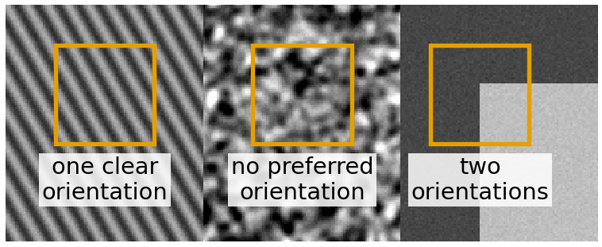
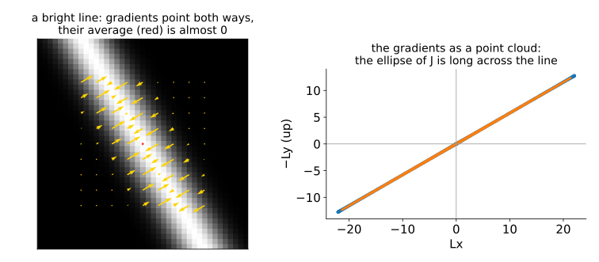
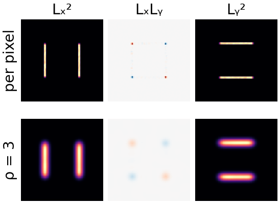
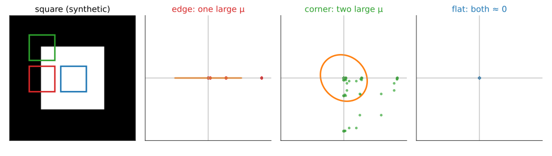
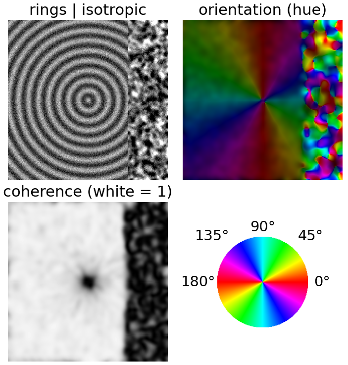
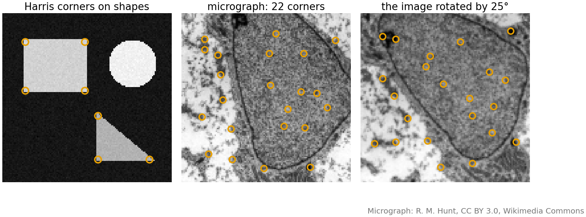
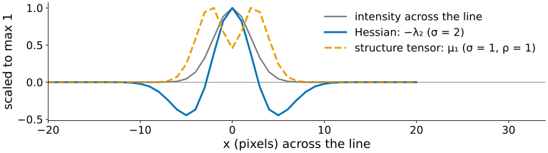
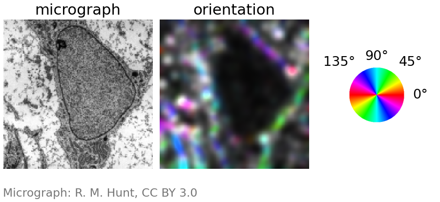

## About this lecture

Fibres, wood grain, fingerprints, muscle, collagen: what is the dominant **orientation** in a small window, and how sure are we? And where are the **corners**?

- Averaging gradients **fails**; averaging $\nabla L\,\nabla L^\top$ works.
- The **structure tensor** $J$: a 2 × 2 matrix per pixel, with two scales σ and ρ.
- $J$ is the **covariance matrix of the gradients** in the window (recall [PCA](../pca/lec.qmd)).
- Its eigenvalues give **orientation**, **coherence**, and **edge / corner / flat**.
- Corners (**Harris**) as interest points.

*Slides titled **The math** give the formulas and proofs; the ideas are complete without them.*

## The question: orientation in a window

:::: {.columns}
::: {.column width="54%"}
- At one pixel the gradient points across the local edge. But in a textured region, we want **one** orientation for a whole window, and a measure of how well defined it is.
- Uses: fibre orientation maps (collagen, muscle, cytoskeleton), fingerprint ridge flow, wood grain, flow-like textures; also "is there an edge, a corner, or nothing here?"
- First idea: **average the gradient vectors** in the window.
:::
::: {.column width="46%"}
{width="100%" fig-alt="Three textures side by side with a square window on each: stripes at one angle (one clear orientation), a blotchy isotropic texture (no preferred orientation), and the corner of a bright square (two orientations)."}
:::
::::

## First try: average the gradients. It fails.

{width="85%" fig-align="center" fig-alt="Left: a diagonal bright line with gradient arrows pointing towards it from both sides; their average is almost 0. Right: the gradients as a point cloud, spread along one axis through the origin: the ellipse of J is long across the line."}

- On a bright line the gradients on the two sides point in **opposite** directions (towards the line from both sides) and **cancel**: the average is ≈ 0, although the orientation is perfectly clear.
- Same on stripes: every bright stripe has two sides.
- Fix: average something that does not care about the sign. The **outer product** $\nabla L\,\nabla L^\top$ is the same for $\mathbf g$ and $-\mathbf g$: a direction counted as an **axis**, not an arrow.

## The structure tensor

:::: {.columns}
::: {.column width="58%"}
$$J = G_\rho * \begin{pmatrix} L_x^2 & L_xL_y \\ L_xL_y & L_y^2 \end{pmatrix}$$

- **Two scales**: the gradient is taken at scale σ (against noise, as in Canny); the products are averaged with a Gaussian window of width ρ (how large a region we summarise).
- Every entry is an average of products of gradients: symmetric, 2 × 2, at every pixel.
- **It is the covariance matrix of the gradient vectors in the window** (without subtracting the mean, which is the point): plot the window's gradients as a point cloud, and $J$ is its ellipse. The same picture as in the PCA unit.
:::
::: {.column width="42%"}
{width="100%" fig-alt="The three entries of J for a bright square on a dark background. Top row, per pixel: Lx² lights up on the left and right sides, Ly² on the top and bottom, LxLy only at the corners. Bottom row, after the Gaussian window ρ = 3: the same entries blurred, so at a corner Lx² and Ly² overlap in the same window."}
:::
::::

## Reading $J$: three kinds of clouds

{width="100%" fig-alt="Gradient vectors of a window drawn as a point cloud with the ellipse of J, for an edge (a long thin cloud), a corner (a large round cloud) and a flat region (a tiny cloud)."}

- **Edge** (or oriented texture): gradients all along one axis: a long thin cloud, **one** large eigenvalue $\mu_1$, $\mu_2 \approx 0$.
- **Corner**: gradients in two directions in the same window: a round, large cloud, **two** large eigenvalues.
- **Flat**: tiny cloud, both eigenvalues ≈ 0.

## Orientation and coherence

:::: {.columns}
::: {.column width="58%"}
With eigenvalues $\mu_1 \ge \mu_2 \ge 0$:

- The eigenvector of $\mu_1$ is the dominant gradient direction, **across** the stripes. The structure's **orientation** is perpendicular to it.
- **Coherence** $\Big(\dfrac{\mu_1 - \mu_2}{\mu_1 + \mu_2}\Big)^2$: 1 = perfectly oriented, 0 = no preferred direction (isotropic texture, or a corner).
- **Energy** $\mu_1 + \mu_2$: how much is going on at all.
- Display: **hue** = orientation, **saturation** = coherence, **brightness** = energy.

Example: $J = \begin{pmatrix} 5 & 2 \\ 2 & 2\end{pmatrix}$: $\mu = 3.5 \pm 2.5$, i.e. 6 and 1; coherence $(5/7)^2 = 0.51$.
:::
::: {.column width="42%"}
{width="100%" fig-alt="Concentric rings next to an isotropic blotchy texture, with noise (σ = 1, ρ = 3). The orientation as hue follows the rings around the centre, going twice around the colour wheel; the isotropic texture gives random colours. The coherence is close to 1 on the rings (0.95), low at the ring centre and low on the isotropic texture (about 0.3)."}
:::
::::

## The math: why the outer product works {.math}

The squared slope in a direction $\mathbf u$ (unit vector) is

$$(\nabla L\cdot\mathbf u)^2 = \mathbf u^\top\nabla L\,\nabla L^\top\mathbf u, \qquad\text{averaged over the window: } E(\mathbf u) = \mathbf u^\top J\,\mathbf u.$$

- $E(\mathbf u)$ is the **energy of change** in direction $\mathbf u$. Maximise over unit $\mathbf u$: $J\mathbf u = \mu\mathbf u$ (Rayleigh quotient, the same algebra as PCA's largest variance direction). The maximum $\mu_1$ is along the first eigenvector, the minimum $\mu_2$ along the second.
- $(\nabla L\cdot\mathbf u)^2$ is the same for $\nabla L$ and $-\nabla L$: opposite gradients **add** instead of cancelling.
- Without the window (ρ = 0), $J = \nabla L\,\nabla L^\top$ has **rank 1**: $\mu_2 = 0$ at every pixel. Every pixel is an "edge"; only the window can see two directions at once.

## The math: the doubled angle {.math}

Write the gradient as $\nabla L = r(\cos\phi, \sin\phi)$. Then

$$J_{xx} - J_{yy} = \langle r^2(\cos^2\phi - \sin^2\phi)\rangle = \langle r^2\cos2\phi\rangle, \qquad 2J_{xy} = \langle r^2\,2\sin\phi\cos\phi\rangle = \langle r^2\sin2\phi\rangle.$$

- So $J$ averages the vectors $r^2(\cos2\phi, \sin2\phi)$: the **doubled** angle. Opposite gradients ($\phi$ and $\phi + 180°$) have the same doubled angle and add up.
- The dominant gradient direction: $\theta = \tfrac12\operatorname{atan2}(2J_{xy},\, J_{xx} - J_{yy})$ (image coordinates, $y$ down); the orientation of the structure is $\theta + 90°$.
- Coherence: $\dfrac{\mu_1 - \mu_2}{\mu_1 + \mu_2} = \dfrac{\sqrt{(J_{xx} - J_{yy})^2 + 4J_{xy}^2}}{J_{xx} + J_{yy}}$, the length of the averaged doubled-angle vector relative to the average $r^2$.

## Try it: the structure tensor

```{=html}
<link rel="stylesheet" href="../demos/dist/demo.css">
<div data-demo="structtensor" data-preset="edge" data-presets="edge,corner,flat,cancel,rho0,rotating"></div>
<script src="../demos/dist/structtensor.js"></script>
```

::: notes
Left: the image with one ellipse of J per 16-pixel cell (tabs: orientation map, Harris corners). Middle: the window around the clicked pixel with its gradient arrows (yellow) and their mean (red), and the gradient cloud with the ellipse of J. Tour, square image, σ = 1, ρ = 3: "edge" (32, 64): J = [740 0; 0 0], μ2 = 0, coherence 1. "Corner" (32, 32): μ1 = 447, μ2 = 285, coherence 0.05, the cloud is a fan in two directions. "Flat": nothing. "Averaging gradients cancels": stripes at 30°, naive mode: the map is black; the mean gradient at (64, 64) is 0.48 against √μ1 = 32.1. "ρ = 0": the corner pixel has μ2 = 0 and the Harris response is never positive: no corners. "Rotating stripes": the hue follows the turning stripes; orientation 106°, 120°, 0°, 60°, 74° across the image at x = 16, 32, 64, 96, 112.
:::

## Edge, corner, flat: Harris and Förstner

| | $\mu_1$ | $\mu_2$ | |
|---|---|---|---|
| flat | small | small | |
| edge / oriented | large | small | |
| **corner** | large | **large** | gradients in two directions in one window |

- **Harris** corner response: $R = \det J - k\,(\operatorname{tr} J)^2 = \mu_1\mu_2 - k(\mu_1 + \mu_2)^2$, $k \approx 0.04$ to $0.06$: positive at corners, negative at edges, ≈ 0 in flat regions. No eigenvalues needed.
- **Förstner / Shi–Tomasi**: the smaller eigenvalue $\mu_2$ itself.
- Corners are local maxima of $R$ above a threshold.
- Example ($k = 0.05$): edge $J = \mathrm{diag}(10, 0.1)$: $R = 1 - 0.05 \cdot 10.1^2 = -4.1$; corner $\mathrm{diag}(10, 8)$: $R = 80 - 16.2 = 63.8$; flat $\mathrm{diag}(0.1, 0.1)$: $R = 0.008$.

## The math: Harris from shifting a window {.math}

How much does a window change when shifted by a small $\mathbf h$?

$$E(\mathbf h) = \sum_{\mathbf x} w(\mathbf x)\,\big(I(\mathbf x + \mathbf h) - I(\mathbf x)\big)^2 \approx \sum_{\mathbf x} w(\mathbf x)\,(\nabla I^\top\mathbf h)^2 = \mathbf h^\top J\,\mathbf h \quad(\text{first-order Taylor}).$$

- Flat: $E \approx 0$ for every shift. Edge: $E$ large across the edge, ≈ 0 along it ($\mu_2 \approx 0$). Corner: $E$ large for **every** direction of $\mathbf h$, i.e. $\mu_2$ large.
- $\det J = \mu_1\mu_2$ and $\operatorname{tr}J = \mu_1 + \mu_2$, so Harris's $R$ is large only if both eigenvalues are, without computing them.
- This is why corners are good **interest points**: a corner's window cannot be shifted in any direction without changing, so it can be found again, uniquely, in a shifted image.

## Interest points

- A corner can be found again in a **shifted or rotated** image: that is what tracking and feature-based registration match.
- Modern keypoint detectors and descriptors (SIFT, ORB and others) combine a detector (corners, or DoG blobs from the [scale-space unit](../scale-space/lec.qmd)) with a description of the window around each point, so that points can be matched between images.
- Pointer: [keypoints and descriptors](../keypoints/lec.qmd) and [optical flow](../lucas-kanade/lec.qmd) build on this.

{width="88%" fig-align="center" fig-alt="Left: Harris corners on synthetic shapes: the four corners of a rectangle and the three of a triangle, none on the disc. Middle: the 22 strongest corners in a crop of the micrograph. Right: the same crop of the micrograph rotated by 25°, with its own corners; 16 of the 22 are found again within 2 pixels."}

Right: 16 of the 22 corners are found again, within 2 pixels, after rotating the image by 25°.

## Hessian vs structure tensor

| | Hessian (last unit) | Structure tensor |
|---|---|---|
| built from | **second** derivatives | **products of first** derivatives |
| sign | signed: bright vs dark | unsigned: $\mu \ge 0$ |
| finds | **centres** of blobs and lines | **orientation**, edges and **corners** |
| scales | σ | σ (gradient) and ρ (window) |
| at a line's centre | strong ($\lambda_2 \ll 0$) | weak (the gradient is 0 there) |

{width="92%" fig-align="center" fig-alt="Profile across a bright line: the Hessian response −λ2 peaks at the centre of the line; the structure-tensor eigenvalue μ1 has two peaks on the flanks and dips to about half at the centre, where the gradient is zero."}

Both are symmetric 2 × 2 matrices per pixel, both drawn as ellipses, both read through their eigenvalues.

## Try it: textures and corners

```{=html}
<link rel="stylesheet" href="../demos/dist/demo.css">
<div data-demo="structtensor" data-preset="rho" data-presets="rho,rotating,checker,cell"></div>
<script src="../demos/dist/structtensor.js"></script>
```

::: notes
"ρ too small or too large": two textures (30° and 120°) meeting at x = 64, noise 25, ρ = 1: the orientation map is speckled with noise; raise ρ to 3: clean; to 8: the boundary between the two textures becomes a wide band of low coherence (at x = 62 the coherence is 0.01 for ρ = 8). "Corners of a checkerboard" (ρ = 2): 35 corners: the 21 inner corners of the checkerboard, and corners of the square, the triangle and the checkerboard's right border. Micrograph (σ = 1.5, ρ = 4): oriented membranes and fibres in colour, isotropic nucleus texture grey.
:::

## Uses

:::: {.columns}
::: {.column width="52%"}
- **Orientation maps** of fibres: collagen in tissue, actin, muscle; fingerprint analysis.
- **Coherence-enhancing diffusion** and other anisotropic filters: smooth along the orientation, not across it (pointer: [nonlinear diffusion](../perona-malik/lec.qmd)).
- **Corners** for registration and tracking.
- A **feature channel** for pixel classifiers: the eigenvalues of $J$ (and of the Hessian) at several scales are standard features on the random-forest day ([pixel classification](../pixelclass/lec.qmd)).
:::
::: {.column width="48%"}
{width="100%" fig-alt="The micrograph and its orientation map (σ = 1.5, ρ = 4): membranes and fibres outside the nucleus appear in colour by their orientation, the nuclear envelope as a coloured curve, and the isotropic texture inside the nucleus dark or grey."}

σ = 1.5, ρ = 4: oriented membranes in colour, the isotropic texture of the nucleus grey or dark.
:::
::::

## Summary

- Averaging gradients cancels on lines and stripes; averaging $\nabla L\,\nabla L^\top$ does not.
- **Structure tensor** $J = G_\rho * (\nabla L\,\nabla L^\top)$: gradient at scale σ, window ρ; the covariance matrix of the window's gradients.
- Eigenvector of $\mu_1$: dominant gradient direction (orientation = perpendicular); **coherence** $((\mu_1 - \mu_2)/(\mu_1 + \mu_2))^2$.
- **Flat**: both small; **edge**: one large; **corner**: both large. **Harris** $\det J - k(\operatorname{tr}J)^2$, or $\mu_2$.
- Corners are **interest points**: a window that changes under every shift.
