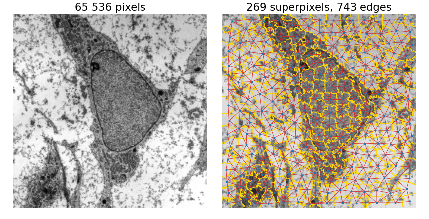
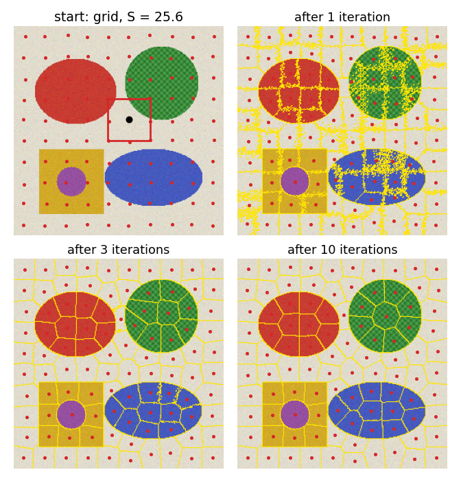
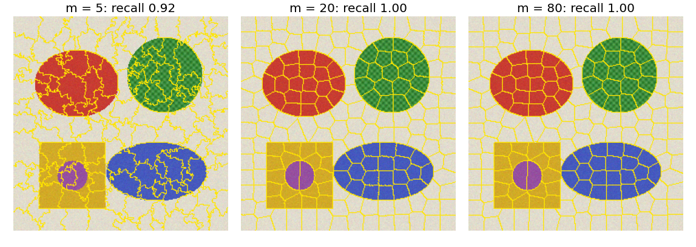
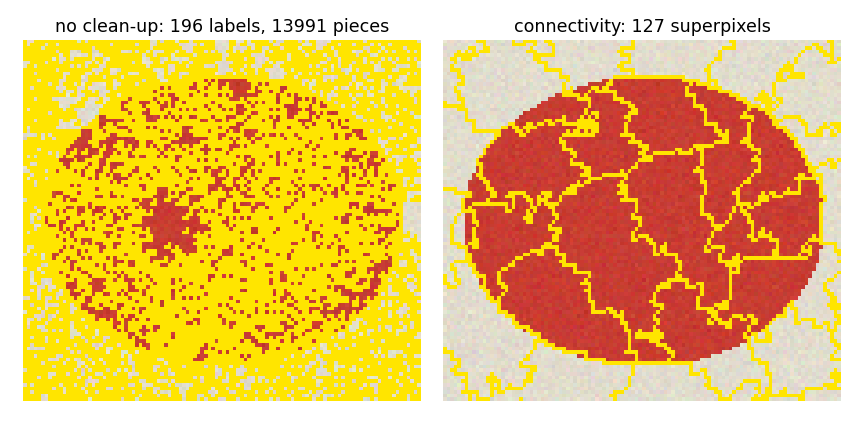
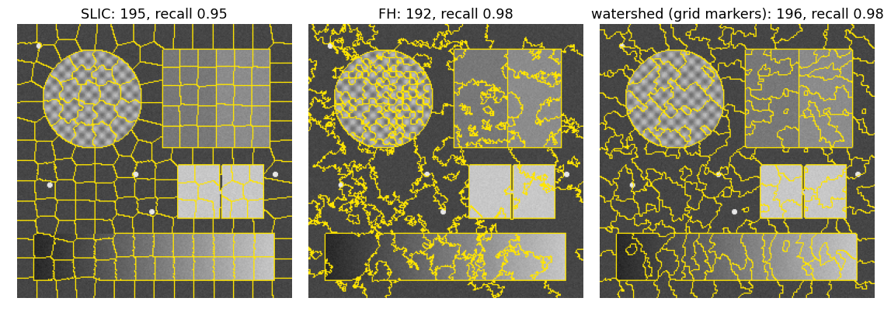
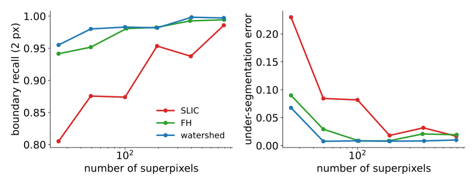
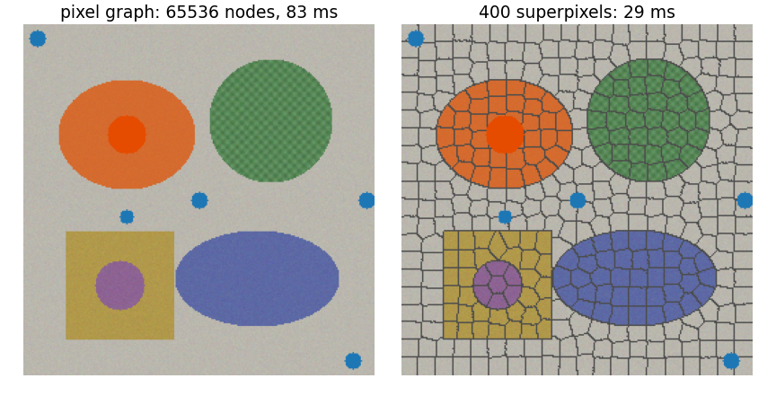
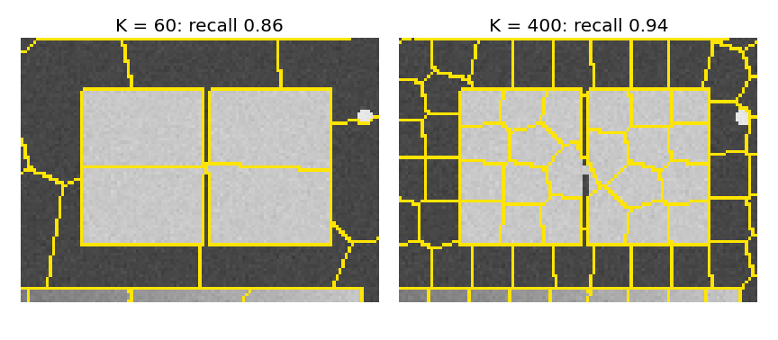

## About this lecture

Graph cuts, the random walker and hierarchies all work on a graph with one node per pixel. Today: **replace the pixels by a few hundred regions**, and run everything on the much smaller graph.

- Why **superpixels**, and what we want from them.
- **SLIC**: k-means in colour and position, with a grid start and a local search window.
- What the **compactness** $m$ and the number $K$ do; the **connectivity** clean-up.
- **Measuring** superpixels: boundary recall, under-segmentation error, achievable accuracy.
- **Using** them: the superpixel graph.

*Slides titled **The math** give the formulas and proofs; the ideas are complete without them.*

## Why superpixels

:::: {.columns}
::: {.column width="44%"}
A $256 \times 256$ image is **65 536 nodes** and about 130 000 edges (4 neighbours). 269 superpixels are 269 nodes and 743 edges (right).

- **Smaller graphs**: graph cut, random walker, normalized cuts and hierarchies become much cheaper.
- **Regions to measure**: mean, histogram, texture per superpixel, more stable than per pixel.
- The natural **leaves** of a [hierarchy](../merge-trees/lec.qmd).

The price: a boundary **missed** by the superpixels is missed by everything that comes after them.
:::
::: {.column width="56%"}
{fig-alt="Left: the micrograph, 256 by 256 pixels. Right: the same image with 269 SLIC superpixel boundaries in yellow, a blue dot at each superpixel's centre and red lines between touching superpixels: the region adjacency graph with 743 edges. Micrograph: Robert M. Hunt, CC BY 3.0, via Wikimedia Commons." width="100%"}
:::
::::

## What we want from superpixels

1. **Adhere to boundaries**: every true boundary lies on a superpixel boundary.
2. **Regular** size and shape: compact, about the same area, so that neighbours are few and statistics comparable.
3. A **chosen number** $K$.
4. **Fast**.

FH ([spanning-tree unit](../mst-seg/lec.qmd)) and the watershed ([spanning-forest unit](../ws-msf/lec.qmd)) give 1 and 4, but their regions are irregular and their number is controlled only indirectly (by $k$, or by the markers). SLIC aims at all four.

## Recall: k-means in two steps

k-means groups points into $K$ clusters by alternating ([Otsu's isodata](../otsu/lec.qmd) is 1D 2-means; [k-means](../kmeans/lec.qmd) in the Gaussian-mixture day):

1. **Assign** each point to the **nearest centre**;
2. **Move** each centre to the **mean** of its points.

Repeat until nothing changes. Each step lowers the sum of squared distances, so it always settles (at a local minimum, which depends on the start).

## SLIC: k-means in colour and position

:::: {.columns}
::: {.column width="44%"}
**SLIC** (Achanta et al., 2012): k-means on 5-D points (L, a, b, $x$, $y$), with three changes:

1. Centres **start on a regular grid** with spacing $S = \sqrt{N/K}$, each moved to the lowest gradient in its $3 \times 3$ neighbourhood (so none starts on an edge).
2. The distance mixes colour and position:
$$D^2 = d_c^2 + \Big(\frac{m\,d_s}{S}\Big)^2,$$
$d_c$ = colour difference (CIELAB, recall [colour](../colour-perceptual/lec.qmd)), $d_s$ = distance in pixels, $m$ = **compactness**.
3. Each centre only looks at pixels in a **$2S \times 2S$ window** around it.

About 10 iterations.
:::
::: {.column width="56%"}
{width="86%" fig-alt="Four panels (2 by 2) of a synthetic colour scene (a red ellipse, a textured green disc, a yellow square with a purple disc, a blue ellipse on a beige background). Start: red centre dots on a regular grid with spacing 25.6 and one 2S by 2S search window drawn as a square. After 1 iteration: noisy, blocky superpixels. After 3: compact superpixels that follow the object boundaries. After 10: almost the same as after 3."}
:::
::::

## SLIC by hand: one pixel, two centres

Grey pixel $p$: $I = 50$ at $(4, 4)$. Centre A: $I = 52$ at $(0, 0)$. Centre B: $I = 70$ at $(6, 4)$. $S = 8$.

| | $d_c^2$ | $d_s^2$ | $D^2$, $m = 10$ | $D^2$, $m = 40$ |
|---|---|---|---|---|
| A | 4 | 32 | $4 + \tfrac{100}{64}\cdot 32 = 54$ | $4 + \tfrac{1600}{64}\cdot 32 = 804$ |
| B | 400 | 4 | $400 + \tfrac{100}{64}\cdot 4 = 406.25$ | $400 + \tfrac{1600}{64}\cdot 4 = 500$ |

- $m = 10$: **A** wins: similar colour beats the larger distance.
- $m = 40$: **B** wins: position dominates.
- The switch: $4 + 32m^2/64 = 400 + 4m^2/64$, i.e. $m^2 = 396 \cdot 64/28$, $m \approx 30$.

## Why the window

- Plain k-means compares **every pixel with every centre**: $N \cdot K$ distances per iteration. For $N = 65\,536$ and $K = 256$: **16.8 million**.
- SLIC compares each pixel only with the centres whose $2S \times 2S$ windows cover it: about **4** (windows of side $2S$ on a grid of spacing $S$). About $4N \approx 262\,000$ distances: **64 times fewer**, and independent of $K$.
- The windows also make the superpixels **local**: no superpixel can grab pixels far from its centre, even with small $m$.

## The math: the SLIC objective {.math}

- **Objective**: $J = \sum_k \sum_{p \in C_k} D^2(p, \mathbf c_k)$ with $D^2 = \lVert\mathbf f_p - \mathbf f_k\rVert^2 + \frac{m^2}{S^2}\lVert\mathbf x_p - \mathbf x_k\rVert^2$.
- **Update step**: $D^2$ is a weighted squared Euclidean norm in 5-D (weights 1 for colour, $m^2/S^2$ for position). For fixed assignments, $\sum_{p \in C_k} D^2(p, \mathbf c)$ is minimised by the **mean** of the cluster in every coordinate (set the gradient to zero: $\sum_p (\mathbf f_p - \mathbf f) = 0$, likewise for position, whatever the weights).
- **Why monotonicity can break**: k-means' proof needs each pixel to choose the nearest of **all** centres. In SLIC a pixel only sees the centres whose windows cover it, and the windows **move** with the centres: a pixel can lose its centre's window and be forced to a farther one, so $J$ can increase. In practice it decreases quickly (on the colour scene: from $10.2$ to $6.7$ million in 10 iterations) and 10 iterations suffice.
- **Cost**: $O(N)$ per iteration, independent of $K$.

## Compactness $m$

:::: {.columns}
::: {.column width="40%"}
- **Small $m$**: colour wins; superpixels follow every edge and every texture, with **irregular**, ragged shapes.
- **Large $m$**: position wins; a grid of near-**squares** (hexagon-like) that ignores weak edges.
- In between: compact superpixels that still snap to strong edges.

$m$ is in the units of the colour difference: for CIELAB, 10–40 is typical. For grey images, scale the grey levels to 0–100 (like lightness) and use the same range.

Right ($K = 200$): boundary recall 0.92, 1.00 and 1.00 at $m = 5$, 20 and 80 on this easy scene.
:::
::: {.column width="60%"}
{fig-alt="SLIC with K = 200 on the colour scene at three compactness values. m = 5: ragged superpixels that follow the texture of the green disc and noise. m = 20: compact superpixels following the object boundaries. m = 80: nearly regular cells, still following the strong object boundaries." width="100%"}
:::
::::

## Connectivity

:::: {.columns}
::: {.column width="44%"}
k-means does not know that a superpixel should be **one piece**: with small $m$ and noise, a label can be scattered over many fragments.

- After the last iteration, every label keeps its **largest connected piece**; every other piece (an **orphan**) joins a neighbouring superpixel.
- Connected components and union–find again ([labelling unit](../label-connectivity/lec.qmd)).

Right ($m = 6$, noisy, a crop): 196 labels in 13 991 pieces before the clean-up; 127 superpixels after it.
:::
::: {.column width="56%"}
{fig-alt="A crop of the colour scene around the red ellipse. Left, without the clean-up: speckled yellow boundaries everywhere, the 196 labels scattered in 13 991 pieces. Right, after the connectivity step: 127 connected superpixels with ragged boundaries." width="100%"}
:::
::::

## Try it: SLIC

```{=html}
<link rel="stylesheet" href="../demos/dist/demo.css">
<div data-demo="slic" data-preset="grid"></div>
<script src="../demos/dist/slic.js"></script>
```

::: notes
Left: superpixel boundaries and centres (red); the iteration slider replays the k-means steps (0 = grid start); click a superpixel to see its centre's 2S × 2S window. Right: mean colours, or "use them". Tour: "grid start" then step; "m small", "m large"; "orphans without connectivity" (switch the check box); "same K, three methods" (FH, watershed, SLIC; compare the recall in the readout); "graph cut on superpixels"; "thin line lost"; "micrograph".
:::

## Measuring superpixels

Against a ground-truth segmentation:

- **Boundary recall**: the fraction of true boundary pixels with a superpixel boundary within 2 px. High = no boundary missed.
- **Under-segmentation error**: for each superpixel and each true region it overlaps, the smaller of "inside" and "outside"; summed over all pairs and divided by $N$. It counts how much superpixels **spill** over true regions.
- **Achievable segmentation accuracy**: give every superpixel its majority true label; the fraction of pixels that are then right. No method that labels whole superpixels can do better: an **upper bound** for everything after.

More superpixels: recall and accuracy rise, but the graph grows and the regions get noisier.

## Three methods compared

:::: {.columns}
::: {.column width="56%"}
{fig-alt="The grey test scene (textured disc, two squares with a faint step, two bright halves with a dark line, spots, ramp) with about 200 superpixels from three methods. SLIC: regular cells, boundary recall 0.95. FH: irregular regions that follow edges and noise, recall 0.98. Watershed from grid markers: irregular regions, recall 0.98." width="100%"}

{fig-alt="Two plots against the number of superpixels from 25 to 800 (log scale). Boundary recall: SLIC rises from 0.81 to 0.99, with dips; FH and watershed stay higher, 0.94 to 0.99. Under-segmentation error: SLIC falls from 0.23 at 25 to about 0.02; FH and watershed from about 0.08 to below 0.02." width="100%"}
:::
::: {.column width="44%"}
On the grey test scene (texture, faint step, ramp, thin line):

- **FH** and the **watershed** follow the edges more closely (higher recall, lower error) at every $K$;
- **SLIC** gives **regular** cells of the requested size; it trades some boundary adherence for that regularity, especially at small $K$ (recall 0.81 at 25 superpixels).

Which matters depends on what comes next: regular cells give comparable features and a regular graph; edge-following regions lose fewer boundaries.
:::
::::

## The math: achievable accuracy is an upper bound {.math}

Let superpixel $s$ contain $n_{s,c}$ pixels of true class $c$. A method that gives all pixels of $s$ one label $\ell_s$ gets $n_{s,\ell_s}$ of them right. Its accuracy is
$$\frac{1}{N}\sum_s n_{s,\ell_s} \le \frac{1}{N}\sum_s \max_c n_{s,c} = \text{ASA},$$
with equality exactly when every superpixel gets its majority class. So no superpixel-level method can exceed the achievable segmentation accuracy, whatever it computes.

Similarly the under-segmentation error is zero iff every superpixel lies inside one true region (each "smaller part" is then 0).

## Using superpixels: a smaller graph

:::: {.columns}
::: {.column width="42%"}
Build the **superpixel graph** (the RAG): one node per superpixel, an edge per touching pair, with weight = boundary length × contrast weight of the two means. Then run graph cuts, the random walker, normalized cuts or a hierarchy on it.

Right, the same seeds and $\sigma$: graph cut on 65 536 pixel nodes (83 ms) and on 400 superpixel nodes (29 ms, plus about 65 ms for SLIC itself). The result is the same object here.

Or **classify** superpixels with region features instead of pixels with pixel features ([pixel classification](../pixelclass/lec.qmd)).
:::
::: {.column width="58%"}
{fig-alt="Two copies of the colour scene with the same seeds (an orange disc inside the red ellipse, blue dots in the background). Left: the graph cut on the pixel graph labels the red ellipse as object (tinted orange), 83 ms. Right: the graph cut on 400 superpixels (grey boundaries) gives the same ellipse, 29 ms." width="100%"}
:::
::::

## What superpixels cannot do

:::: {.columns}
::: {.column width="42%"}
- A structure **narrower than a superpixel** gets no superpixel of its own. Right: the 2-pixel dark line between the two bright halves. With $K = 60$ (S ≈ 33 px) the superpixel boundaries happen to run along it, but the line itself is merged into its neighbours; boundary recall over the whole scene is 0.86 at $K = 60$ and 0.94 at $K = 400$.
- On flat regions SLIC produces an arbitrary grid: the boundaries there mean nothing.
- With $K$ too small for the objects, superpixels straddle object boundaries and the achievable accuracy drops.
:::
::: {.column width="58%"}
{fig-alt="A crop of the grey test scene: two bright rectangles separated by a thin dark line. With K = 60 the superpixels are large; a boundary runs along the line but the line has no superpixel of its own; recall 0.86. With K = 400 the superpixels are smaller and follow the line and the rectangle edges more closely; recall 0.94." width="100%"}
:::
::::

## Variants

- **Compact watershed**: a watershed from grid markers with a compactness term: SLIC-like regularity at watershed speed.
- **Energy-driven boundary moves** (SEEDS and relatives): start from a grid and move boundary pixels while an energy improves.
- **Supervoxels** in 3D and video: the same algorithm with $z$ or $t$ added to the position.

Image libraries ship SLIC, FH and compact watershed under those names.

## Summary

- Superpixels shrink the graph from tens of thousands of pixels to a few hundred regions; a boundary they miss is lost for good.
- **SLIC** = k-means in (colour, $x$, $y$), started on a grid with spacing $S = \sqrt{N/K}$, distance $D^2 = d_c^2 + (m\,d_s/S)^2$, each centre searching a $2S \times 2S$ window: about $4N$ distances per iteration instead of $NK$.
- **Compactness** $m$: small = follows edges, ragged; large = regular grid. A **connectivity** step removes orphan fragments.
- Measure with **boundary recall**, **under-segmentation error** and **achievable accuracy** (an upper bound for everything after).
- FH and the watershed adhere better to edges; SLIC gives regular cells of a chosen size.

## Where this leads

- Run the [random walker](../random-walker/lec.qmd), a [graph cut](../graphcut-seg/lec.qmd) or a [hierarchy](../merge-trees/lec.qmd) on the superpixel graph.
- Superpixel features for [pixel classification](../pixelclass/lec.qmd).
- Supervoxels for large 3D stacks.
