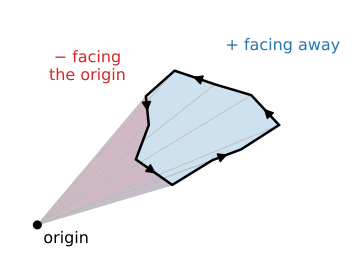
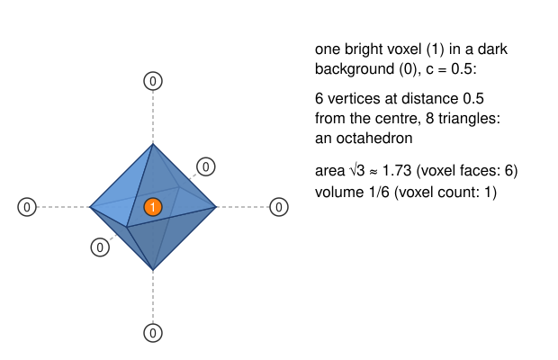
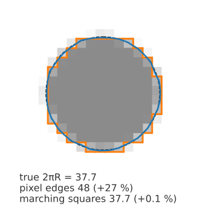
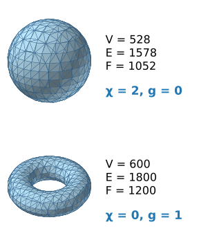
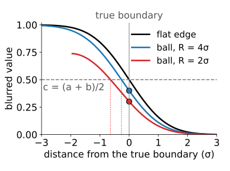
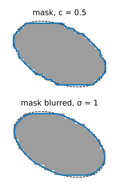

## About this lecture

A marching-cubes mesh is not only a picture: it is a **measurement**. Today: what we can measure from it, how well, and which choices change the answer.

- **Area** and **volume** from the triangles (the volume by the 3D shoelace formula).
- Why **counting voxel faces** gets the area wrong at any resolution, and marching cubes does not.
- **Topology**: components, holes, cracks, the Euler characteristic.
- The choices: the **iso-value** $c$, **smoothing**, anisotropic **spacing**, surfacing a **segmentation**, and **mesh size**.

*Slides titled **The math** give the formulas and proofs; the ideas are complete without them.*

::: notes
Last unit of the marching-cubes day. Builds on marching cubes (previous unit), the shoelace formula (isocontour unit; owned by the labelling day) and `volumes3d/` (spacing). Choosing thresholds from histograms (Otsu) is the thresholding day's; here it is one line.
:::

## Area and volume from the triangles

:::: {.columns}
::: {.column width="60%"}
- **Area**: the sum of the triangle areas. Each triangle's area is half the length of the cross product of two of its edges.
- **Volume**: pick any point, e.g. the origin. Each triangle and the origin form a **tetrahedron**; add up their volumes **with sign** (+ when the triangle faces away from the origin, − when it faces it). Parts outside the object cancel, and what is left is the volume inside: the 3D version of the shoelace formula.
- This needs a **closed**, consistently **oriented** mesh (all normals pointing out). A surface that touches the border of the volume is open: pad the volume with background first.
- Both are sums over triangles: cheap, even for millions of triangles.
:::
::: {.column width="40%"}
{fig-alt="A closed polygon with arrows running counter-clockwise and a point labelled origin outside it. Each edge and the origin form a triangle: triangles of edges facing away from the origin are shaded blue (+), those of edges facing the origin red (−). Where they overlap, between the origin and the polygon, they cancel; what remains is the polygon." width="100%"}

The same in 2D: signed triangles from the origin add up to the enclosed area.
:::
::::

## The math: area and the divergence theorem {.math}

For a triangle with corners $\mathbf a, \mathbf b, \mathbf c$ (counter-clockwise seen from outside):

$$\text{area} = \tfrac12\,\lVert(\mathbf b - \mathbf a) \times (\mathbf c - \mathbf a)\rVert, \qquad V = \sum_{\text{triangles}} \tfrac16\,\mathbf a \cdot (\mathbf b \times \mathbf c) = \sum \tfrac16 \det[\mathbf a\;\mathbf b\;\mathbf c].$$

- $\tfrac16\det[\mathbf a\,\mathbf b\,\mathbf c]$ is the signed volume of the tetrahedron $(\mathbf 0, \mathbf a, \mathbf b, \mathbf c)$.
- Divergence theorem with $\mathbf F = \mathbf x/3$ ($\nabla\cdot\mathbf F = 1$): $V = \iiint 1\,dV = \oiint \tfrac13\,\mathbf x\cdot\mathbf n\,dA$. On a flat triangle, $\mathbf x \cdot \mathbf n$ is constant ($= \mathbf a \cdot \mathbf n$), and $\tfrac13 (\mathbf a\cdot\mathbf n)\cdot\text{area} = \tfrac16\,\mathbf a\cdot(\mathbf b\times\mathbf c)$.
- In 2D the same argument with $\mathbf F = \mathbf x/2$ gives the shoelace formula.
- Translating the mesh adds $\tfrac16\,\mathbf t\cdot\sum(\ldots) = 0$ for a closed mesh: the origin does not matter.

## One bright voxel, by hand

:::: {.columns}
::: {.column width="55%"}
{width="100%"}
:::
::: {.column width="45%"}
One voxel of value 1, all neighbours 0, $c = 0.5$.

- Each of the 6 edges to a neighbour is crossed halfway: $t = 0.5$.
- The surface: an **octahedron** with vertices at distance 0.5 from the centre.
- Area $\sqrt3 \approx 1.73$, volume $\tfrac16$.
- Counting voxels: volume 1, area 6 (the voxel's faces).

A single voxel is the extreme case; on large objects the two volume estimates agree, the areas do not (next slide).
:::
::::

## Counting voxels: fine for volume, wrong for area

:::: {.columns}
::: {.column width="60%"}
- **Volume** = number of voxels inside × voxel volume. Errors at the boundary go both ways and cancel: a good estimate for large objects.
- **Area** = number of exposed voxel faces × face area. Always **too large**: a slanted surface becomes a staircase, and a staircase is longer than the slope.
- For a sphere about **1.5 times** too large, at **any resolution**: finer voxels make smaller steps, but just as many of them per unit of area.
- In 2D, the pixel-edge perimeter of a disk is $4/\pi \approx 1.27$ times too long (for a convex shape it equals the perimeter of its bounding box).
- Marching cubes cuts the corners: its area converges to the true area as the voxels shrink.
:::
::: {.column width="40%"}
{fig-alt="A disk of radius 6 pixels as a partial-volume grey image. The outline of the pixels more than half inside (orange) is a staircase of 48 pixel edges, 27 % longer than the true circumference 2πR = 37.7 (dashed). The marching-squares contour (blue) follows the circle and is 37.7 long (+0.1 %)." width="100%"}
:::
::::

## The math: where 1.5 comes from {.math}

- A small patch of area $dA$ with unit normal $\mathbf n$, replaced by a voxel staircase, exposes faces whose total area is its projections onto the three coordinate planes: $(|n_x| + |n_y| + |n_z|)\,dA$.
- Averaged over all directions on a sphere, $\langle|n_x|\rangle = \tfrac12$ (the mean of $|\cos\theta|$ over the sphere), so the staircase area is $3 \cdot \tfrac12 = \tfrac32$ times the true area, independent of the voxel size.
- In 2D: $(|n_x| + |n_y|)\,ds$, with $\langle|\cos\phi|\rangle = 2/\pi$ on the circle: $4/\pi$.
- Weighting voxel configurations cleverly (Lindblad, 2005) reduces the bias to a few per cent without a mesh.

## Try it: voxel faces vs marching cubes

```{=html}
<link rel="stylesheet" href="../demos/dist/demo.css">
<div data-demo="meshmeasure" data-preset="faces"></div>
<script src="../demos/dist/meshmeasure.js"></script>
```

::: notes
Disk and ball of radius R, as a partial-volume grey image (each pixel ≈ the fraction of it inside) or a binary mask. At R = 6: voxel faces 674 against 4πR² = 452.4 (+49 %), marching cubes 449.4 (−0.7 %); pixel edges +27 %. Slide R up to 16: faces stay at +50 %, marching cubes at +0.07 %. Then "binary mask": marching cubes now runs on 0/1 values, every vertex at an edge midpoint, and the area stays about 8 % too large at every R (terraces); volumes are fine either way.
:::

## Spacing, slices and topology

:::: {.columns}
::: {.column width="58%"}
- **Anisotropic voxels**: vertex positions use $(\Delta x, \Delta y, \Delta z)$ (forgetting $\Delta z$ scales every volume by $\Delta x/\Delta z$ and distorts areas); gradient normals use them too (forgetting tilts the normals; recall `volumes3d/`).
- **Slice planes**: the slice of an isosurface is an isocontour: the marching-squares contour of the slice lies on the mesh. A quick check of a surface against the image.
- **Topology**: count connected **components**, **boundary edges** (edges with a triangle on one side only: cracks, or the volume border) and the **Euler characteristic** $\chi = V - E + F$.
- For one closed surface, $\chi = 2 - 2g$ with $g$ the number of holes (handles): a sphere 2, a torus 0. Several components add up. Noise shows up as hundreds of components; a crack as boundary edges.
:::
::: {.column width="42%"}
{fig-alt="Two marching-cubes meshes. A sphere: 528 vertices, 1578 edges and 1052 triangles, χ = 2, no handles. A torus: 600 vertices, 1800 edges and 1200 triangles, χ = 0, one handle." width="100%"}
:::
::::

## The math: Euler characteristic {.math}

- Octahedron: $V - E + F = 6 - 12 + 8 = 2$. Any closed triangulated surface without holes: 2 (Euler's polyhedron formula).
- A torus made from an $m \times n$ grid of quads, each split into 2 triangles: $V = mn$, $E = 3mn$, $F = 2mn$, $\chi = 0$.
- $\chi$ is a **topological invariant**: refining, decimating or deforming the mesh without tearing does not change it. For a closed surface with $g$ handles $\chi = 2 - 2g$; for $k$ components $\chi = \sum_i(2 - 2g_i)$.
- On a closed triangle mesh every edge has two triangles: $2E = 3F$, so $\chi = V - F/2$ and $F \approx 2V$ for large meshes (the "2 triangles per vertex").

## Choosing $c$

:::: {.columns}
::: {.column width="56%"}
- A blurred **step edge** between a dark level $a$ and a bright level $b$, blurred symmetrically, passes the **half-way value** $(a + b)/2$ exactly at the true edge. Natural choice: $c = (a + b)/2$, from the two levels (read off the histogram).
- On **small or strongly curved** objects the blur leaks brightness out of the object: at the true boundary the value is below half-way, the surface at $c = (a + b)/2$ lies inside, and the object looks too small (the **partial-volume** effect).
- Plot the **volume against $c$**. A flat **plateau**: the measurement is robust. A steep curve: the result is mostly your choice of $c$; report it, or deblur/fit a model instead.
- Thresholds from the histogram (Otsu and others) are the thresholding day's tools; the same reasoning applies.
:::
::: {.column width="44%"}
{fig-alt="Profiles across the boundary after a Gaussian blur of width σ, with the dark level 0 and the bright level 1. A flat edge (black) passes 0.5 exactly at the true boundary. A ball of radius 4σ (blue) has the value 0.40 there, a ball of radius 2σ (red) 0.30, so the level 0.5 (dashed) lies inside them, at 0.26σ and 0.64σ in from the true boundary." width="100%"}
:::
::::

## The math: the half-way level {.math}

- A step from $a$ to $b$ at $x = 0$, blurred by a symmetric kernel $g$ (e.g. Gaussian): $I(x) = a + (b - a)\,G(x)$ with $G$ the cumulative distribution of $g$. Symmetry gives $G(0) = \tfrac12$: $I(0) = (a + b)/2$.
- For a ball of radius $R$ blurred by a Gaussian of width $\sigma$: at a boundary point, the ball covers **less** than half of the Gaussian's weight (the boundary curves away), so $I(R) < (a + b)/2$. The error grows with $\sigma/R$.
- Sensitivity: $\dfrac{dV}{dc} = -\displaystyle\oiint \frac{dA}{\lVert\nabla I\rVert}$. A sharp edge (large gradient) gives a flat volume curve; a blurred edge a steep one.

## Try it: volume against $c$

```{=html}
<link rel="stylesheet" href="../demos/dist/demo.css">
<div data-demo="meshmeasure" data-preset="plateau"></div>
<script src="../demos/dist/meshmeasure.js"></script>
```

::: notes
A ball of radius 8 voxels (binary), blurred with σ, and the marching-cubes volume as a function of c. σ = 0.5: at c = 0.5 the volume is 2115.5 against the true 2144.7 (−1.4 %), and c ± 0.05 changes it by 2.3 %. "Heavy blur" (σ = 2.5): 1524.5 (−29 %), ± 14 % per ± 0.05 in c: the curve is steep and the partial-volume loss large. Then the nuclei stack (true total 79.2 µm³).
:::

## Smoothing: before or after?

- **Before extraction**: Gaussian blur of the volume (in physical units, per axis). Removes noise, rounds corners, shrinks small and convex objects, removes thin structures. The surface stays a level set of a (smoothed) image.
- **After extraction**: smooth the mesh, e.g. **Laplacian smoothing** (move each vertex towards the mean of its neighbours). Removes facets and terraces, but **shrinks** the whole surface step by step. Taubin's two-step smoothing alternates a shrinking and an inflating step and keeps the size (mention only).
- Either way, report what you smoothed: area is sensitive to it, volume less so.

## Surfacing a segmentation

:::: {.columns}
::: {.column width="58%"}
- The output of thresholding, watershed (day 15) or graph cuts (day 27) is a **mask** (0/1) or a **label image**. Marching cubes at $c = 0.5$ on a mask puts every vertex at an **edge midpoint**: terraces, staircase normals, and an area that stays several per cent too large at any resolution.
- Remedies: **blur the mask slightly** (σ ≈ 1 voxel) before extraction, or use a **signed distance function** (positive inside, negative outside, zero on the boundary; what the level-set day works with): its zero level set is placed with sub-voxel accuracy.
- **Label images**: one surface per label (mask of label $\ell$, then marching cubes). Two touching labels give two surfaces with a small gap or overlap between them; methods that produce one shared surface exist (multi-label marching cubes, dual methods), pointer only.
:::
::: {.column width="42%"}
{fig-alt="A slice through a binary mask of a tilted ellipse (grey pixels) with the true ellipse dashed. Left: the contour at c = 0.5 of the mask itself (blue) has every vertex at an edge midpoint and follows the pixel terraces. Right: the contour of the mask after a Gaussian blur of σ = 1 voxel is smooth and close to the true ellipse." width="62%" fig-align="center"}

In 2D, a slice through a mask: marching squares on the mask, and on the mask blurred first.
:::
::::

## Mesh size and decimation

- Triangles ∝ surface area / voxel area: about 3 per voxel² of area. A skull in a 512³ CT has about $10^6$ voxel² of surface: about 3 million triangles.
- Storage: **shared vertices** (1.5 million × 12 bytes + 3 million × 12 bytes ≈ 54 MB) vs a **triangle soup** with every triangle storing its 3 vertices (108 MB).
- **Decimation** reduces the count where the surface is flat:
  - **vertex clustering**: snap vertices to a coarser grid, merge each cell's vertices into one, drop collapsed triangles. Simple and fast; the topology may break;
  - **edge collapse with quadric error metrics** (Garland & Heckbert, 1997): repeatedly merge the two ends of the edge whose removal changes the shape least. The standard; mention only.
- Always check area and volume after decimating.

## Try it: binary masks and decimation

```{=html}
<link rel="stylesheet" href="../demos/dist/demo.css">
<div data-demo="meshmeasure" data-preset="terraces"></div>
<script src="../demos/dist/meshmeasure.js"></script>
```

::: notes
A tilted ellipsoid (semi-axes 16, 9, 11 voxels; true volume 6635) from a grey image, a binary mask, or the mask blurred with σ = 1. "Terraces": the binary mask gives staircase surfaces and 8.6 % more area than the grey image (1932.9 against 1779.4). "Blurred mask": smooth again, but 2.3 % too little volume. "Decimate 10×" (cell size 3): 508 triangles instead of 5332, area −2.1 %, volume −4.3 %. At cell size 6 the topology breaks (χ = 4, non-manifold edges).
:::

## Summary

- **Area** = Σ triangle areas; **volume** = Σ ⅙ det[a b c] (divergence theorem, the 3D shoelace); needs a closed, oriented mesh: pad first.
- Counting **voxels** gives good volumes; counting **voxel faces** overestimates area by about 1.5× at every resolution (4/π in 2D). Marching cubes converges.
- Use the **spacing** in positions and normals; check **topology** with components, boundary edges and $\chi = V - E + F$.
- **$c$**: half-way between the levels for a sharp edge; blur and small objects bias the size (partial volume); a **volume-vs-$c$** curve shows how much the choice matters.
- **Masks** give terraces: blur slightly or use a signed distance. **Decimate** big meshes, and re-check area and volume.
