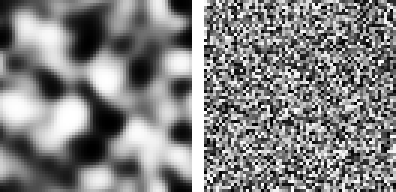
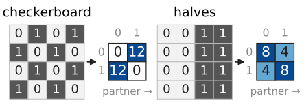
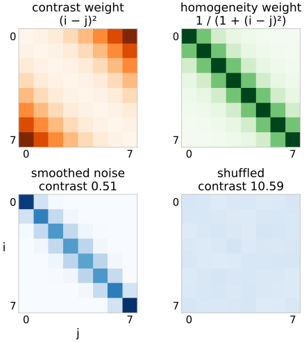
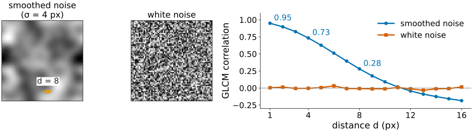
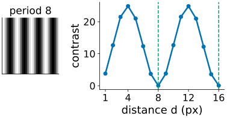
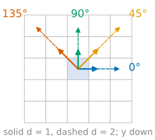
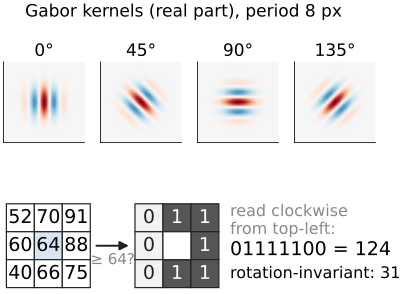

## About this lecture

The [last unit](../intensity-features/lec.qmd) measured the pixel values of an object as a bag of numbers. Texture is about how the values are **arranged**: fine or coarse, oriented or not, regular or random.

- Histogram features cannot see arrangement: we need **pairs of pixels**.
- The **grey-level co-occurrence matrix** (GLCM): a 2D histogram of a pixel and its neighbour at a fixed offset.
- **Haralick features**: contrast, homogeneity, ASM/energy, entropy, correlation.
- The **choices** that change the numbers: distance, angle, number of grey levels, quantisation range.
- Briefly: Gabor filters, local binary patterns, granularity.

*Slides titled **The math** give the formulas and proofs; the ideas are complete without them.*

::: notes
Second unit of the measurements day. The GLCM is introduced as a 2D histogram; the same object comes back in the colocalisation day (`coloc/`; two channels instead of an image and its shifted copy). Entropy is owned by the compression day and gets one line here. Grey levels are numbered from 0.
:::

## Same histogram, different texture

{width="62%"}

Left: smoothed noise. Right: **the same pixel values, shuffled**. Same mean, standard deviation, median, quartiles: every statistic of the [last unit](../intensity-features/lec.qmd) is identical.

- Left: neighbours are similar. Right: neighbours are unrelated.
- Texture needs **pairs**: compare each pixel with the pixel $d$ steps away.
- Demo numbers (8 grey levels, neighbour to the right): contrast **0.51** left, **10.59** right.

::: notes
The two 64 × 64 patches are the "pair" presets of the glcm demo: Gaussian-smoothed noise (σ = 3 px), histogram-equalised to 256 equally filled levels (exact equalisation, [contrast](../contrast/lec.qmd)), and a random permutation of the same pixels.
:::

## The co-occurrence matrix

:::: {.columns}
::: {.column width="52%"}
1. **Quantise** the image to $L$ grey levels $0, \dots, L-1$.
2. Choose an **offset**: distance $d$ and angle (0° = to the right, 90° = up).
3. For every pixel whose partner at that offset is also inside the image (or object), add 1 to cell (level of the pixel, level of the partner).
4. Usually **symmetric**: count each pair both ways. Divide by the total: a joint probability $p(i, j)$.

Two $4 \times 4$ images with 8 zeros and 8 ones, offset 1 to the right:

| image | pairs (0,0) | (0,1) and (1,0) | (1,1) |
|---|---|---|---|
| checkerboard 0 1 0 1 / 1 0 1 0 / … | 0 | 12 + 12 | 0 |
| halves 0 0 1 1 (every row) | 8 | 4 + 4 | 8 |

:::
::: {.column width="48%"}
{width="100%" fig-alt="Two 4 × 4 binary images, each with an arrow to its symmetric co-occurrence matrix for the offset one pixel to the right. Checkerboard: (0,0) 0, (0,1) 12, (1,0) 12, (1,1) 0. Halves (0 0 1 1 in every row): (0,0) 8, (0,1) 4, (1,0) 4, (1,1) 8. Rows are the pixel's level, columns the partner's."}

Same histogram, different matrices: all mass off the diagonal for the checkerboard, mostly on it for the halves.
:::
::::

## The math: the GLCM {.math}

For a quantised image $q$, offset $\mathbf d = (d_x, d_y)$ and region $\Omega$:

$$P_{\mathbf d}(i, j) = \#\{\mathbf x : \mathbf x \in \Omega,\ \mathbf x + \mathbf d \in \Omega,\ q(\mathbf x) = i,\ q(\mathbf x + \mathbf d) = j\}.$$

- Symmetric version $P_{\mathbf d} + P_{\mathbf d}^\top = P_{\mathbf d} + P_{-\mathbf d}$: the offsets $\mathbf d$ and $-\mathbf d$ are merged, so 0° and 180° give the same matrix.
- $p = P / \sum P$ is the joint distribution of $(q(\mathbf X), q(\mathbf X + \mathbf d))$ for a random pixel $\mathbf X$: the **2D histogram** of the image against its own copy shifted by $-\mathbf d$.
- The marginals $p_x(i) = \sum_j p(i, j)$ are (nearly) the grey-level histogram: the histogram is inside the GLCM, the arrangement is in how the mass spreads around the diagonal.
- Angles on a pixel grid (Haralick 1973): 0°, 45°, 90°, 135° with offsets $(d, 0)$, $(d, -d)$, $(0, -d)$, $(-d, -d)$, $y$ pointing down.

## Features: statistics of the matrix

:::: {.columns}
::: {.column width="62%"}
Each feature summarises where the mass of $p(i, j)$ lies:

- **Contrast**: the mean of $(i - j)^2$: large when neighbours differ. Checkerboard 1, halves 0.33.
- **Homogeneity**: the mean of $1/(1 + (i - j)^2)$: large when the mass is near the diagonal. 0.5 and 0.83.
- **ASM** (angular second moment) $= \sum p^2$, and **energy** $= \sqrt{\text{ASM}}$: large when few pairs dominate. 0.5 and 0.28.
- **Entropy** $= -\sum p \log_2 p$: the expected surprise of a pixel pair, in bits (entropy itself is the [compression day](../entropy/lec.qmd)'s topic). 1.0 and 1.92.
- **Correlation**: the Pearson correlation of a pixel with its partner. −1 and +0.33.

Haralick listed 14 features; the others (sum and difference averages, variances and entropies, information measures of correlation) are mostly strongly correlated with these five.
:::
::: {.column width="38%"}
{width="100%" fig-alt="Top: the weights that contrast and homogeneity give to each cell (i, j) of an 8 × 8 matrix: contrast weight (i − j) squared grows away from the diagonal, homogeneity weight 1 / (1 + (i − j) squared) is 1 on the diagonal and falls off. Bottom: the GLCMs of the same-histogram pair: the smoothed noise has its mass along the diagonal (contrast 0.51); the shuffled patch spreads it over the whole matrix (contrast 10.59)."}
:::
::::

## The math: Haralick features {.math}

With $\mu = \sum_{i,j} i\,p(i,j)$ and $\sigma^2 = \sum_{i,j} (i - \mu)^2 p(i,j)$ (the same for rows and columns of a symmetric $p$):

$$\text{contrast} = \sum_{i,j} (i - j)^2 p, \quad \text{homogeneity} = \sum_{i,j} \frac{p}{1 + (i-j)^2}, \quad \text{ASM} = \sum_{i,j} p^2,$$
$$\text{entropy} = -\sum_{i,j} p \log_2 p, \qquad \text{correlation} = \frac{\sum_{i,j} (i - \mu)(j - \mu)\, p}{\sigma^2}.$$

- For symmetric $p$: $\text{contrast} = E[(I - J)^2] = 2\sigma^2 - 2\operatorname{cov}(I, J) = 2\sigma^2(1 - \text{correlation})$.
- $\text{ASM} \le 1$ with equality iff all pairs fall into one cell (a constant patch); $0 \le \text{entropy} \le \log_2 L^2$.
- Correlation is undefined for a constant patch ($\sigma = 0$).

## A familiar object, twice {.smaller}

- The GLCM is the **2D histogram of an image against its shifted copy**. The [colocalisation day](../coloc/lec.qmd) draws the same picture with two **channels** instead.
- **Correlation** at offset $\mathbf d$ is the **autocorrelation** of the image at lag $\mathbf d$ (the [Fourier unit](../fourier/lec.qmd)): how similar the image is to itself shifted by $\mathbf d$.
- Plotting a feature against $d$ is therefore a cheap look at the **scale** of the texture: correlation falls off over about the size of the grains.

Demo, smoothed noise (σ = 4 px), 8 levels: correlation 0.95 at $d = 1$, 0.73 at $d = 4$, 0.28 at $d = 8$. White noise: about 0 at every $d$.

{width="85%" fig-alt="Left: a smoothed-noise patch (σ = 4 px) with an arrow of length 8 px, and a white-noise patch. Right: GLCM correlation (8 levels, angle 0°) against the distance d from 1 to 16. Smoothed noise falls from 0.95 at d = 1 through 0.73 at d = 4 to 0.28 at d = 8 and dips slightly below 0 after d = 11; white noise stays near 0 at every d."}

## Try it: the co-occurrence matrix

```{=html}
<link rel="stylesheet" href="../demos/dist/demo.css">
<div data-demo="glcm" data-preset="samehist"></div>
<script src="../demos/dist/glcm.js"></script>
```

::: notes
Tour: "same histogram, different texture": A has its mass along the diagonal (38 of 64 cells used), B (shuffled) fills the whole matrix; contrast 0.51 against 10.59, correlation 0.95 against −0.01. Then "fine vs coarse": move d from 1 to 8; the contrast of the smoothed noise grows (0.18 → 2.29), that of white noise stays near 10.3. "period = d": stripes with period 8; at d = 8 the contrast is 0 and correlation 1, at d = 4 contrast is maximal and correlation −0.98. The polar plot shows contrast against angle at the current d.
:::

## Choices that change the numbers

:::: {.columns}
::: {.column width="62%"}
- **Distance $d$**: the scale of the texture you look at. Stripes with period 8: contrast 0 at $d = 8$ and $d = 16$, maximal at $d = 4$ and $d = 12$.
- **Angle**: oriented textures give different matrices per angle. Report each angle, or average the four for rotation invariance.
- **Number of levels $L$**: 8–256. Too many levels for a small object: the matrix is mostly empty. Disc of radius 6 (200 pairs), $L = 64$: entropy 6.80 bits, against 9.01 on the whole patch.
- **Quantisation range**: each object's own min–max, or one fixed range. Per-object min–max makes a dim, low-contrast cell look like a bright one: it destroys comparisons between objects.
- **Symmetric or not**, and **which pairs count**: only pairs with both pixels inside the object.
:::
::: {.column width="38%"}
{width="100%" fig-alt="Left: a patch of vertical stripes with period 8 px. Right: GLCM contrast (8 levels) against the distance d from 1 to 16: it rises to about 25 at d = 4 and d = 12 and drops to about 0 at d = 8 and d = 16 (dashed lines), where every pixel is paired with an identical one."}
:::
::::

## The math: angles and rotation {.math}

:::: {.columns}
::: {.column width="68%"}
- Rotating the image by 90° maps the offset $(d, 0)$ to $(0, -d)$ (or its negative): the four standard angles are permuted. The **average** over the four angles is therefore invariant to rotations by multiples of 90° (and nearly to 45°).
- For an angle $\theta$ that is not a multiple of 45°, the offset $(d\cos\theta, -d\sin\theta)$ is not on the grid. Rounding it changes both the direction and the length; interpolating the partner pixel blurs the values. Either way, only four (or eight) directions are exact.
- With $L$ levels and $N$ pairs, at most $\min(L^2, N)$ cells are non-zero, so $\text{entropy} \le \log_2 \min(L^2, N)$: on a small object the entropy measures $N$, not the texture.
:::
::: {.column width="32%"}
{width="100%" fig-alt="A 5 × 5 pixel grid with the reference pixel in the centre and arrows to its partners at the four standard angles: 0° to the right, 45° up and right, 90° up, 135° up and left; solid arrows for d = 1, dashed for d = 2. The y axis points down."}
:::
::::

## Naming traps

The same name, different formulas, depending on the program:

| name | formulas in use |
|---|---|
| homogeneity / inverse difference moment | $\sum p/(1 + (i-j)^2)$ |
| inverse difference | $\sum p/(1 + \lvert i-j \rvert)$, sometimes also called homogeneity |
| energy | $\sqrt{\text{ASM}}$, or ASM itself |
| entropy | $\log_2$ (bits) or $\ln$ (nats) |
| sum variance | with the sum average or (a misprint in the original paper) the sum entropy |

Grey levels numbered from 0 or from 1 change the sum average. Always state the formula, $d$, angle, $L$ and the range together with the numbers.

## Other texture descriptors

:::: {.columns}
::: {.column width="58%"}
- **Gabor filter bank**: convolve with a Gaussian window times a wave (the [Fourier unit](../fourier/lec.qmd): a band-pass filter tuned to one frequency and orientation). The mean energy of each filter's output is one feature; a bank of 4 orientations × 4 frequencies gives 16.
- **Local binary patterns** (LBP): compare each pixel's 8 neighbours with it (1 if brighter or equal) and read the 8 bits as a code 0–255. The **histogram of codes** over the object is the feature vector. Taking the smallest of the 8 rotations of each code makes it rotation invariant; "uniform" codes (at most two 0/1 changes around the circle) are edges, corners and flat spots.
- **Granularity**: how much of the signal disappears in openings of growing size (the granulometry of the [morphology day](../morph-openclose/lec.qmd)).
- Learned features: the activations of a trained network act as texture descriptors (the [neural network](../cnn/lec.qmd) days).
:::
::: {.column width="42%"}
{width="100%" fig-alt="Top: the real part of four Gabor kernels with period 8 px at orientations 0°, 45°, 90° and 135°: a Gaussian window filled with light and dark bands. Bottom: an LBP worked example. A 3 × 3 neighbourhood with centre 64 and neighbours 52, 70, 91 / 60, 88 / 40, 66, 75; each neighbour becomes 1 if it is at least 64. Read clockwise from the top-left the bits are 01111100 = 124; the rotation-invariant code is 31."}
:::
::::

## The math: Gabor and LBP {.math}

**Gabor** kernel with frequency $f$, orientation $\theta$, width $\sigma$:
$$g(x, y) = e^{-(x^2 + y^2)/2\sigma^2}\, e^{2\pi i f (x\cos\theta + y\sin\theta)}.$$
Its Fourier transform is a Gaussian centred at $f(\cos\theta, \sin\theta)$: it passes one patch of the spectrum. Feature: $\frac{1}{|\Omega|}\sum_\Omega |I * g|^2$.

**LBP** at pixel $c$ with neighbours $n_0, \dots, n_7$ clockwise from the top-left:
$$\mathrm{LBP} = \sum_{k=0}^{7} s(n_k - c)\, 2^{7-k}, \qquad s(t) = [t \ge 0].$$
Invariant to any increasing grey-level map (offset, gain, gamma): only the order of values matters. Rotation-invariant code: $\min_r \mathrm{rot}_r(\mathrm{LBP})$ over the 8 circular shifts.

## Catalogue: texture columns

| column | measures | unit | range |
|---|---|---|---|
| contrast | mean squared level difference of pairs | levels² | $0 \dots (L-1)^2$ |
| homogeneity | closeness of pairs to the diagonal | – | $0 \dots 1$ |
| ASM, energy | uniformity of the pairs | – | $0 \dots 1$ |
| entropy | randomness of the pairs | bits | $0 \dots \log_2 L^2$ |
| correlation | linear dependence of a pixel and its partner | – | $-1 \dots 1$ |
| Gabor energy | power in one frequency band and orientation | intensity² | $\ge 0$ |
| LBP histogram | frequency of each local pattern | – | sums to 1 |
| granularity | signal removed per opening size | – | $0 \dots 1$ |

Every texture column comes with its settings: $d$, angle (or average), $L$, quantisation range.

## Summary

- Texture is the **arrangement** of values; the histogram cannot see it.
- The **co-occurrence matrix** counts pairs (level at $\mathbf x$, level at $\mathbf x + \mathbf d$): a 2D histogram of the image against its shifted copy.
- **Contrast** and **homogeneity** say how far pairs are from the diagonal, **ASM**/**entropy** how concentrated they are, **correlation** how linearly related.
- The numbers depend on **$d$** (scale), the **angle**, the number of **levels** and the **range**: fix them, report them, and do not rescale each object to its own min–max.
- Gabor energies, LBP histograms and granularity are other texture columns.
