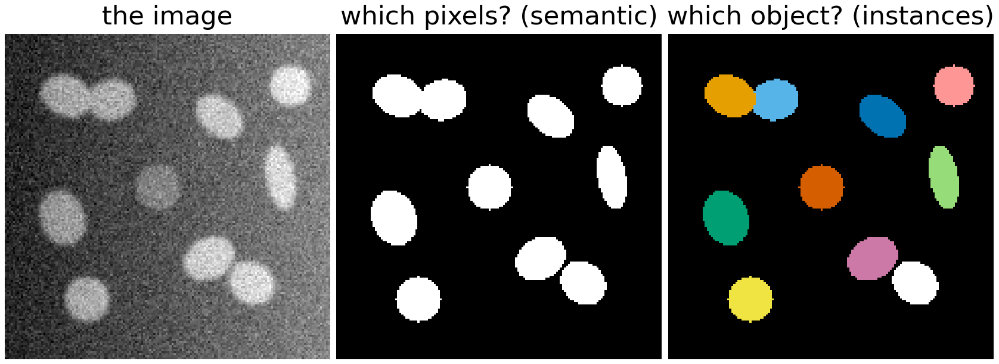
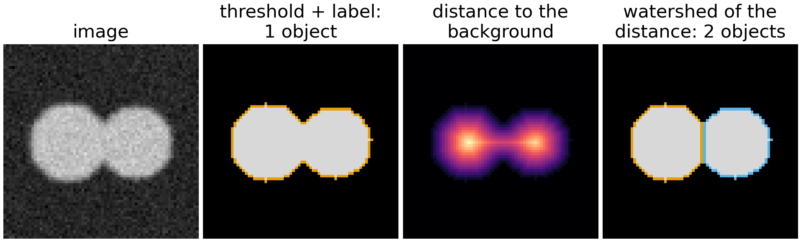

Segmentation is taught on many days of this course, each time from a different angle. This
page puts the approaches next to each other. It does not teach any of them; follow the links to
the units for that. Read it after you have met a few methods, or use it to choose where to go
next.

## The question {#question}

Segmentation answers two questions about an image:

- **Which pixels are object?** One label per pixel: object or background, or one of a few
  classes. This is *semantic* segmentation.
- **Which object does each pixel belong to?** Touching nuclei must become two objects, not
  one blob. This is *instance* segmentation, and it is what you need for counting and
  measuring.

{fig-alt="Three panels. Left: a grey noisy image with ten oval bright nuclei on a background that gets brighter from left to right; one nucleus in the middle is dim; two pairs of nuclei touch. Middle: the ground-truth mask, white nuclei on black. Right: the ground-truth instances, each nucleus in its own colour."}

What makes it hard is never the easy pixels in the middle of an object. It is the pixels where
the image does not decide: noise, a weak or missing piece of edge, uneven light, two objects
that touch, an object that looks like the background. Every method below is a different answer
to "what do we do where the image does not decide?". Each one adds an assumption: a grey level
model, a smooth boundary, a seed, a shape, or examples.

## Five families {#families}

Across the course, the methods fall into five families.

1. **Each pixel alone.** Decide from the grey level (or colour, or a vector of filter
   responses) of one pixel: a [global threshold](../histogram/lec.qmd), [Otsu and minimum
   error](../otsu/lec.qmd), [local thresholds](../local-threshold/lec.qmd),
   [k-means](../kmeans/lec.qmd) and [Gaussian mixtures](../gmm-images/lec.qmd),
   [colour clusters](../colour-perceptual/lec.qmd).
2. **Regions grown on a graph.** Pixels are nodes, neighbours are joined by edges, and regions
   grow from seeds or minima: the [watershed](../ws-landscape/lec.qmd) ([on a real
   image](../ws-gradient/lec.qmd), [on the distance transform](../ws-distance/lec.qmd),
   [as a spanning forest](../ws-msf/lec.qmd)), the [random walker](../random-walker/lec.qmd),
   [spanning trees and Felzenszwalb–Huttenlocher](../mst-seg/lec.qmd), [merge
   trees](../merge-trees/lec.qmd), [superpixels](../superpixels/lec.qmd).
3. **Energy with neighbours.** Write down a cost for a whole labelling (misfit to a grey level
   model plus a price for every pair of neighbours with different labels) and find its
   minimum: [segmentation as energy minimisation](../seg-energy/lec.qmd), [graph
   cuts](../graphcut-seg/lec.qmd), the [Ising prior](../mrf-denoise/lec.qmd), [normalized
   cuts](../ncut/lec.qmd).
4. **A moving boundary.** Start with a curve and move it until it fits: [snakes](../snakes/lec.qmd),
   [active shape models](../asm/lec.qmd), [geodesic active contours](../geodesic/lec.qmd),
   [Chan–Vese](../chanvese/lec.qmd); or find the best boundary in one global search with
   [dynamic programming in polar coordinates](../polar-boundary/lec.qmd) and
   [live-wire](../livewire/lec.qmd).
5. **Learned from examples.** Let labelled pixels or images define what "object" means:
   [pixel classification with a forest](../pixelclass/lec.qmd) or [an
   SVM](../pixel-classify/lec.qmd), the [U-Net](../unet/lec.qmd), [routes from masks to
   objects](../instances/lec.qmd), [StarDist](../stardist/lec.qmd),
   [Cellpose](../cellpose/lec.qmd), [promptable segmentation (SAM)](../sam/lec.qmd).

Two further steps belong to almost every pipeline: [cleaning a mask with
morphology](../morph-openclose/lec.qmd) and [turning a mask into objects by
labelling](../label-connectivity/lec.qmd).

{fig-alt="A scatter of method names. x axis, what you must supply: nothing, a few parameters, seeds or a start curve, painted pixels or shapes, many labelled images. y axis, what one decision looks at: one pixel, a neighbourhood, a region or a boundary, the whole object or image. Global threshold and Otsu sit bottom left; k-means and local thresholds a little higher; graph cut and MRF at a neighbourhood with a few parameters; FH, superpixels and merge trees at regions with few parameters; normalized cuts top left; watershed, snakes, Chan–Vese and random walker in the middle column; live-wire and polar DP between seeds and shapes; the active shape model top, at shapes; forests and SVMs at painted pixels and a neighbourhood; U-Net, SAM, StarDist and Cellpose at the right, high up. Colours mark the five families."}

## One image, seven methods {#gallery}

The same image as above, through one method of each kind. Each panel gives the pixel overlap
with the truth ([Dice](../seg-eval/lec.qmd)), how many of the ten nuclei were found as a
separate object with more than half overlap ([matched objects](../object-eval/lec.qmd)), and
how many objects the method reported.

{fig-alt="Eight panels in two rows. Image; global threshold (Otsu): Dice 0.59, 3 of 10 found, 6 objects, the bright right side of the background is all object; local threshold: Dice 0.89, 8 of 10, 9 objects, the touching pairs are merged; local threshold plus watershed: Dice 0.89, 9 of 10, 10 objects, pairs split, the dim nucleus only a speck; Chan–Vese: Dice 0.49, 3 of 10, 5 objects, the boundary runs down the middle of the background; graph cut with an intensity model: Dice 0.54, 3 of 10, 5 objects, similar; random walker from clicks: Dice 0.95, 10 of 10, 10 objects; forest from painted pixels: Dice 0.85, 5 of 10, 7 objects, dim nucleus missed, pairs merged."}

What the panels show:

- **Global threshold, Chan–Vese and graph cut fail together** (3 of 10 found). All three
  assume *one* grey level for the background. The light ramp (0.40 from left to right) is
  larger than the contrast of the dim nucleus (0.20), so no single split of grey levels can
  work. The graph cut removes the noise specks of the threshold (its job), but it cannot fix a
  wrong grey level model. A better optimiser does not repair a wrong assumption.
- **The local threshold** follows the background, and finds 8 of 10. It still merges the
  touching pairs: a mask is not yet a set of objects.
- **Adding the watershed of the distance transform** splits the pairs (9 of 10). The dim
  nucleus is still only a speck: its contrast is too low for the window chosen.
- **The random walker** gets everything right, because it was told where every nucleus is
  (one click each). Seeds are information; the cost is your time.
- **The forest** learned "bright and round like these three" from the painting, so it misses
  the dim nucleus it was never shown and, without a splitting step, merges the pairs.

None of this ranks the methods in general; change the image and the order changes. It shows
*which assumption* each method needs.

## Side by side {#compare}

| Approach | Assumes | You supply | Cost | Fails when | Units |
|---|---|---|---|---|---|
| Global threshold, Otsu, mixtures | object and background differ in grey level, everywhere the same | nothing (or the number of classes) | one histogram pass | uneven light; overlapping grey levels; noise specks | [histogram](../histogram/lec.qmd), [Otsu](../otsu/lec.qmd), [mixtures](../gmm-images/lec.qmd) |
| Local threshold, hysteresis | the background varies slowly; objects are smaller than the window | window size, offset | a few box filters | objects larger than the window; low contrast | [local thresholds](../local-threshold/lec.qmd) |
| k-means, colour clusters | classes are compact clouds in feature space | k, the feature space | a few passes over the pixels | elongated or unequal clouds; spatial context ignored | [k-means](../kmeans/lec.qmd), [colour](../colour-perceptual/lec.qmd) |
| Watershed | objects are basins of a landscape (gradient, inverted distance) | the landscape; markers or h | sort + one flooding pass | over-segmentation without markers; leaks through gaps | [landscape](../ws-landscape/lec.qmd), [real image](../ws-gradient/lec.qmd), [distance](../ws-distance/lec.qmd) |
| Random walker | boundaries lie where neighbours differ; seeds are representative | seeds for every label | one sparse linear system | far from all seeds; no edge; small seeds near big ones | [random walker](../random-walker/lec.qmd) |
| Spanning trees, FH, merge trees, superpixels | regions are internally similar; borders are weak links | a scale k or a cut of the tree | nearly linear (sort edges) | chaining through one weak link; texture | [MST and FH](../mst-seg/lec.qmd), [merge trees](../merge-trees/lec.qmd), [superpixels](../superpixels/lec.qmd) |
| Graph cut, MRF | a grey level model per label + short boundaries | the model or seeds, the weight λ | one max-flow (exact for two labels) | thin structures (shrinking bias); wrong model; blocky boundaries | [energy](../seg-energy/lec.qmd), [graph cut](../graphcut-seg/lec.qmd), [Ising](../mrf-denoise/lec.qmd) |
| Normalized cuts | groups are strongly linked inside, weakly between, and balanced | the affinities, the number of groups | eigenvectors of a large matrix | unbalanced groups; only approximate | [normalized cuts](../ncut/lec.qmd) |
| Snakes, geodesic contours | the boundary is a smooth curve on strong edges | a start curve near the object | many small steps (local minimum) | gaps in the edge (leaks); bad start; concavities | [snakes](../snakes/lec.qmd), [geodesic](../geodesic/lec.qmd) |
| Chan–Vese | inside and outside have different mean grey levels | a start (any), λ | many steps (local minimum) | uneven light; objects of several grey levels | [Chan–Vese](../chanvese/lec.qmd) |
| Dynamic programming, live-wire | the boundary is a path of low cost (star-shaped, or between clicks) | a centre, or clicks along the boundary | one global search on a grid | non-star shapes (polar); many clicks on weak edges | [polar DP](../polar-boundary/lec.qmd), [live-wire](../livewire/lec.qmd) |
| Active shape model | the object looks like the training shapes | landmarked training shapes, a start | a few search iterations | shapes outside the training set | [shape models](../shape-models/lec.qmd), [ASM](../asm/lec.qmd) |
| Forest or SVM on feature stacks | the painted pixels represent all cases; filters capture the difference | painted strokes; the filter bank | training: seconds; prediction: per pixel | anything not painted (dim cells, new stains); merges | [forest](../pixelclass/lec.qmd), [SVM](../pixel-classify/lec.qmd) |
| U-Net and instance networks | the test images look like the training images | many annotated images, a GPU | training: hours; prediction: fast | domain shift; confident errors; merged contacts | [U-Net](../unet/lec.qmd), [instances](../instances/lec.qmd), [StarDist](../stardist/lec.qmd), [Cellpose](../cellpose/lec.qmd) |
| Promptable models (SAM) | the object is "a thing" in natural-image terms | a click or box per object; a very large pretrained model | heavy encoder once, light decoder per click | microscopy unlike its training data; ambiguous parts | [SAM](../sam/lec.qmd), [networks vs classical](../cellnets-compare/lec.qmd) |

## Edges or regions? {#edges-regions}

Many pairs in the table differ in one way: do they look at **edges** (local differences
between neighbours) or at **regions** (what the inside and outside look like as a whole)?

- **Edge-based**: the gradient watershed, snakes, geodesic contours, live-wire, the
  contrast-sensitive weights of graph cuts and the random walker. They cope with uneven light,
  because an edge is local. They suffer where the edge is weak or broken: there the boundary
  leaks.
- **Region-based**: thresholds, mixtures, Chan–Vese, the data term of graph cuts. Noise averages
  out over a region, and blurred edges are fine. They fail when the region model is wrong:
  uneven light, an object with two grey levels.

Most good methods use both: graph cuts and the random walker put the region model in the data
term and the edges in the neighbour weights. The [Chan–Vese
unit](../chanvese/lec.qmd) has the full comparison table, and the [three seeded
methods](../ws-msf/lec.qmd) (watershed, random walker, graph cut) differ in exactly how they
add up the edges between the seeds. Try them on the same seeds:

```{=html}
<link rel="stylesheet" href="../demos/dist/demo.css">
<div data-demo="randwalk" data-mode="compare" data-preset="agree"></div>
<script src="../demos/dist/randwalk.js"></script>
```

Try the presets: on a clean edge the three agree; at a gap in a wall, or where there is no
edge at all, they disagree, each in its own way. Questions on this demo:
[exercise of the watershed as a spanning forest](../ws-msf/exercise.qmd#explore).

## From a mask to objects {#instances}

A semantic mask is not yet a list of objects. Labelling the connected components gives one
object per blob, so two nuclei that touch come out as one. The classical cure is the watershed
of the distance transform: every object has a peak of "distance to the background" in its
middle, and the watershed cuts at the narrow neck between two peaks.

{fig-alt="Four panels. A noisy image of two overlapping bright discs; the thresholded mask outlined as one object; the distance transform, bright at the two disc centres and darker at the neck; the watershed result with two objects in two colours split along a straight line at the neck."}

Networks face the same problem and solve it in the same spirit: they predict a map from which
objects can be separated (a boundary class, a distance map, star-convex rays, or a flow field),
and a decoding step turns it into objects. See [from masks to objects](../instances/lec.qmd),
then [StarDist](../stardist/lec.qmd) and [Cellpose](../cellpose/lec.qmd). The cure fails in the
same way for both: a neck that is too wide (two nuclei squashed together) gives only one peak;
an elongated or bent object gives several peaks and is split.

## How each family fails {#failures}

Each assumption has a typical failure. Recognising it in a result tells you which method to
try next.

![One typical failure per family, all computed. (a) Watershed of the gradient without markers: every noise minimum floods its own basin: 1004 regions for 2 true ones. (b) Graph cut with a large smoothness weight (λ = 12): the thin arm costs more boundary than its pixels gain, so 0 % of it is kept (99 % at λ = 0.5). (c) An edge-based contour pushed outwards by a balloon force escapes through a gap in the wall and fills 6524 pixels outside the object (of 8100 in the image; 0 with the wall closed). (d) A forest trained on bright nuclei finds 0 % of the dim one (dashed circle): its mean object probability there is 0.26.](fig-seg-failures.png){fig-alt="Four panels. (a) A mosaic of 1004 small coloured regions. (b) A noisy disc with a thin horizontal arm; the graph-cut outline follows the disc and ignores the arm. (c) A light image with a dark ring that has a gap on the right; the contour has escaped through the gap and runs along the image border. (d) The ten-nucleus image with outlines; the dim nucleus in the middle, marked by a dashed red circle, has no outline."}

| What you see | Likely cause | What helps |
|---|---|---|
| Hundreds of tiny regions | one region per minimum (watershed) or per noise blob | markers, h-minima, smoothing first, region merging |
| Thin parts and corners cut off | boundary length is penalised (graph cut, snakes, Chan–Vese) | smaller λ; edge-sensitive weights; seeds on the thin part |
| A region floods into the background | an edge with a gap (watershed, geodesic contours) | a region term; markers on both sides; smaller balloon |
| One side of the image is all object | one grey level model for uneven light | background correction, local threshold, an edge-based method |
| Touching objects merged | a mask was labelled directly | distance-transform watershed; an instance network |
| A class of objects missing | not in the training examples (forest, network) | paint or annotate those cases; check per subgroup |

## The math: one energy behind many methods {#math}

::: {.callout-note collapse="true" title="The math: data + λ · boundary"}
Many of the methods minimise the same kind of energy over a labelling $L$ (one label $L_p$ per
pixel $p$):
$$
E(L) \;=\; \sum_{p} D_p(L_p) \;+\; \lambda \sum_{(p,q)\ \text{neighbours}} w_{pq}\,[L_p \ne L_q].
$$
The **data term** $D_p$ says how well pixel $p$ fits label $L_p$ (for example
$(I_p - c_{L_p})^2$, or $-\log$ of a mixture or classifier probability); the **boundary term**
pays $w_{pq}$ for every neighbouring pair with different labels, a small $w_{pq}$ across a
strong edge.

- $\lambda = 0$: each pixel decides alone. With $D_p = (I_p - c_\ell)^2$ and fixed means this is a
  **threshold** halfway between the means; alternating with updating the means gives
  **isodata/k-means**.
- Two labels, any $\lambda \ge 0$: the exact minimum is **one minimum cut** ([graph
  cuts](../graphcut-seg/lec.qmd)); with an Ising prior it is the MAP estimate of the [Markov
  random field](../mrf-denoise/lec.qmd).
- A continuous curve $C$ instead of pixel labels, with $D = (I - c_{\text{in/out}})^2$ and
  boundary term $\lambda\cdot\text{length}(C)$: the **Chan–Vese** energy, minimised locally by
  [level sets](../chanvese/lec.qmd). With the data term dropped and the length weighted by an
  edge function $g(|\nabla I|)$: **geodesic active contours**.
- Seeds fix some labels; the data term disappears. Replacing $[L_p \ne L_q]$ by
  $|x_p - x_q|^\beta$ with $x_p \in [0,1]$: $\beta = 1$ gives the **graph cut**, $\beta = 2$ the
  **random walker** (a linear system), and with the weights raised to a large power only their
  order matters, giving the **watershed** (a minimum spanning forest; see [the power
  watershed](../ws-msf/lec.qmd)).
- [Dynamic programming](../polar-boundary/lec.qmd) minimises a boundary energy (cost along the
  curve plus a smoothness price per step) exactly, but only over curves of a restricted kind
  (one radius per angle).
- A network trained with a per-pixel loss learns $D_p$ from examples, with a receptive field so
  large that the "neighbour" term is folded into the data term.

What changes between methods is the **model** (which $D$, which $w$, pixels or a curve) and the
**optimiser** (exact cut, linear system, flooding, gradient descent, dynamic programming). The
failures above come from the model; the local minima of snakes and level sets come from the
optimiser.
:::

## Judging a segmentation {#evaluation}

A segmentation is only as good as the comparison that checks it. Pixel scores (Dice, Jaccard,
[ROC and precision–recall](../seg-eval/lec.qmd)) cannot see whether two nuclei were merged: the
gallery above has a local threshold and a split version with the same Dice (0.89) but 8 and 9
matched objects. For objects, match predicted to true objects at an IoU threshold and count
splits, merges, misses and false objects ([object evaluation](../object-eval/lec.qmd)).
Annotators disagree too: [boundaries and the uncertain ground
truth](../agreement/lec.qmd). And a learned method is only honestly evaluated on images it
never saw during training or tuning ([leakage](../leakage/lec.qmd)).

## Choosing {#choosing}

A short guide, not a rule:

1. **Look at the histogram and the image.** Two clear peaks and even light: a threshold is
   enough. Uneven light: correct the background or use a local threshold.
2. **Objects touch?** Add the watershed of the distance transform (or an instance network).
3. **Noisy, but the grey level model is right?** Add a smoothness term: graph cut or MRF.
4. **Edges are clear but regions are not uniform?** Edge-based: seeded watershed, random walker,
   live-wire, geodesic contours.
5. **A few important objects, and you can click?** Seeded methods and live-wire are fast and
   exact where the image is ambiguous.
6. **Objects differ by texture or context, not by grey level?** Paint pixels and train a
   classifier; for many images of one kind, annotate and train a network.
7. **Always**: check the result against a hand-annotated subset, with object-level scores.

## All units on this topic {#units}

| Day | Units |
|---|---|
| 12 Thresholding | [histogram](../histogram/lec.qmd) · [Otsu](../otsu/lec.qmd) ([demo](../otsu/exercise.qmd#explore)) · [local thresholds](../local-threshold/lec.qmd) ([demo](../local-threshold/exercise.qmd#explore), [hysteresis](../local-threshold/exercise.qmd#explore-hysteresis)) · [evaluation](../seg-eval/lec.qmd) ([demo](../seg-eval/exercise.qmd#explore)) |
| 13 Morphology | [opening, closing, distance transform](../morph-openclose/lec.qmd) ([demo](../morph-openclose/exercise.qmd#explore-distance)) |
| 14 Labelling | [connectivity and labelling](../label-connectivity/lec.qmd) ([demo](../label-connectivity/exercise.qmd#explore)) |
| 15 Watershed | [landscape](../ws-landscape/lec.qmd) ([demo](../ws-landscape/exercise.qmd#explore)) · [real image](../ws-gradient/lec.qmd) ([demo](../ws-gradient/exercise.qmd#explore)) · [distance transform](../ws-distance/lec.qmd) ([demo](../ws-distance/exercise.qmd#explore)) |
| 27 Graph cuts | [energy](../seg-energy/lec.qmd) ([demo](../seg-energy/exercise.qmd#explore)) · [graph cut](../graphcut-seg/lec.qmd) ([demo](../graphcut-seg/exercise.qmd#explore)) · [normalized cuts](../ncut/lec.qmd) ([demo](../ncut/exercise.qmd#explore)) |
| 28 Ising | [Bayesian denoising with an Ising prior](../mrf-denoise/lec.qmd) ([demo](../mrf-denoise/exercise.qmd#explore)) |
| 29 Graph-based | [random walker](../random-walker/lec.qmd) ([demo](../random-walker/exercise.qmd#explore)) · [spanning trees, FH](../mst-seg/lec.qmd) ([demo](../mst-seg/exercise.qmd#explore)) · [watershed as MSF](../ws-msf/lec.qmd) ([demo](../ws-msf/exercise.qmd#explore)) · [merge trees](../merge-trees/lec.qmd) ([demo](../merge-trees/exercise.qmd#explore)) · [superpixels](../superpixels/lec.qmd) ([demo](../superpixels/exercise.qmd#explore)) |
| 30 Snakes | [snakes](../snakes/lec.qmd) ([demo](../snakes/exercise.qmd#explore)) · [shape models](../shape-models/lec.qmd) · [active shape models](../asm/lec.qmd) ([demo](../asm/exercise.qmd#explore)) |
| 31 Level sets | [geodesic contours](../geodesic/lec.qmd) ([demo](../geodesic/exercise.qmd#explore)) · [Chan–Vese](../chanvese/lec.qmd) ([demo](../chanvese/exercise.qmd#explore)) |
| 32 Dynamic programming | [polar boundaries](../polar-boundary/lec.qmd) ([demo](../polar-boundary/exercise.qmd#explore)) · [live-wire](../livewire/lec.qmd) ([demo](../livewire/exercise.qmd#explore)) |
| 33–35 Learning | [pixel classification (forest)](../pixelclass/lec.qmd) ([demo](../pixelclass/exercise.qmd#explore)) · [SVM pixels](../pixel-classify/lec.qmd) ([demo](../pixel-classify/exercise.qmd#explore)) · [k-means](../kmeans/lec.qmd) ([demo](../kmeans/exercise.qmd#explore)) · [mixtures on images](../gmm-images/lec.qmd) ([demo](../gmm-images/exercise.qmd#explore)) |
| 36, 39, 40 Networks | [U-Net](../unet/lec.qmd) ([demo](../unet/exercise.qmd#explore)) · [masks to objects](../instances/lec.qmd) ([demo](../instances/exercise.qmd#explore)) · [StarDist](../stardist/lec.qmd) · [Cellpose](../cellpose/lec.qmd) · [SAM](../sam/lec.qmd) · [compared with classical pipelines](../cellnets-compare/lec.qmd) |
| 37 Evaluation | [matching objects](../object-eval/lec.qmd) ([demo](../object-eval/exercise.qmd#explore)) · [uncertain ground truth](../agreement/lec.qmd) |
| 42 Colour | [colour segmentation](../colour-perceptual/lec.qmd) ([demo](../colour-perceptual/exercise.qmd#explore-seg)) |

Related topic pages: [energy minimisation](energy.qmd) (the energy view in depth), [eigenvectors](eigenvectors.qmd) (normalized cuts, shape models), [removing noise](denoising.qmd); [all topics](index.qmd).
