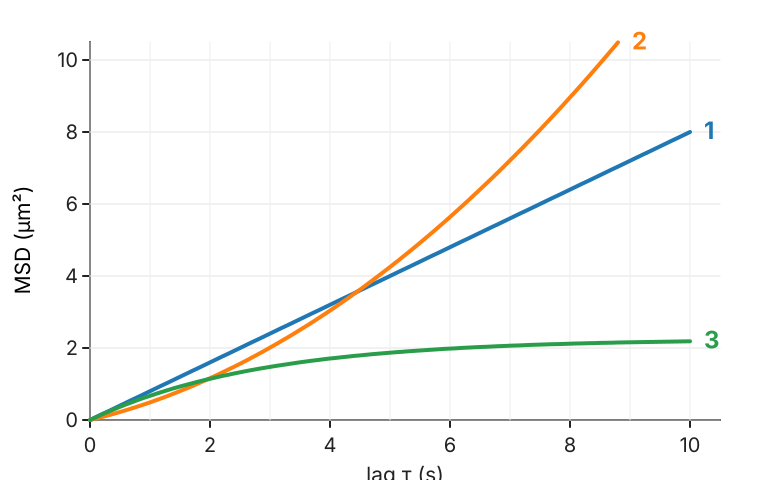

## Goal

By the end of this exercise you should be able to:

- compute per-track numbers (path length, straightness) and explain why "speed" is not defined for random motion,
- compute an **MSD** by hand and read D, v and the confinement size from MSD curves,
- recognise free diffusion, directed motion, confinement and anomalous motion from the shape of the MSD,
- correct for **localisation error** and fit the right range,
- *(math)* derive the MSD of a random walk with drift and noise, the confinement plateau, the mean step length and the persistent random walk limits.

## Background

| Idea | What it means |
|---|---|
| Straightness | net displacement / path length |
| Apparent speed of a random walk | $\sqrt{\pi D/\Delta t}$ in 2D: depends on Δt |
| MSD(τ) | mean of $|\mathbf r(t + \tau) - \mathbf r(t)|^2$ over all pairs τ apart |
| Free diffusion | $\text{MSD} = 2dD\tau$ ($4D\tau$ in 2D) |
| Directed + diffusion | $\text{MSD} = 4D\tau + v^2\tau^2$ |
| Confined in a disc of radius R | plateau $R^2$ |
| Anomalous | $\text{MSD} \propto \tau^\alpha$ |
| Localisation error σ | offset $+4\sigma^2$ in 2D |
| Persistent random walk | slope 2 (log–log) below the persistence time, slope 1 above |

## By hand

**B1.** A 1D track has positions 0, 1, 3, 2, 4 at frames 0–4 (Δt = 1 s).
(a) Compute the MSD at lags 1, 2, 3 and 4. How many pairs is each value based on?
(b) Estimate D from lag 1 (in 1D, MSD = 2Dτ).
(c) Which of the four values would you trust least, and why?

**B2.** Three particles in 2D give these MSD curves:

{width="55%" fig-align="center"}

(a) Which curve is free diffusion, which directed, which confined?
(b) Read D for curve 1.
(c) Curve 2 has the same shape at short lags as a diffusion with half of curve 1's slope. Read D and estimate the speed v from the MSD at τ = 8 s.
(d) Estimate the radius of the cage for curve 3.

**B3.** **The speed trap.** A particle with D = 0.1 µm²/s is imaged every 0.1 s and every 0.01 s. Compute the apparent speed $\sqrt{\pi D/\Delta t}$ for both. What should be reported instead?

**B4.** **Localisation error.** σ = 30 nm, D = 0.01 µm²/s, Δt = 0.05 s.
(a) Compare the offset $4\sigma^2$ with the lag-1 signal $4D\Delta t$.
(b) Take the exact MSD at lags 1–4 and fit a line **through the origin**. Which D do you get? And with a free intercept?

**B5.** A track visits (0, 0), (1, 0), (2, 1), (3, 1), (4, 2), (5, 2).
(a) Path length, net displacement, straightness.
(b) What happens to the straightness if each position gets a random error of 0.3?

**B6.** **Predict.** (a) At high density, linking errors increase. Does the measured D go up or down? (b) You keep only tracks longer than 50 frames. Which particles do you lose, and what happens to the mean D?

::: {.callout-note collapse="true" title="Solutions"}
**B1.** (a) Lag 1: differences 1, 2, −1, 2 → (1 + 4 + 1 + 4)/4 = **2.5** (4 pairs). Lag 2: 3, 1, 1 → 11/3 = **3.67** (3 pairs). Lag 3: 2, 3 → 13/2 = **6.5** (2 pairs). Lag 4: 4 → **16** (1 pair).
(b) D ≈ 2.5/2 = 1.25 (units² per s).
(c) Lag 4: a single squared displacement, with a large random error.

**B2.** (a) Curve 1 (straight line): free diffusion. Curve 2 (curving upward): directed. Curve 3 (levelling off): confined.
(b) Slope 8/10 = 0.8 µm²/s = 4D, so D = 0.2 µm²/s.
(c) Short-lag slope 0.4 µm²/s, so D = 0.1 µm²/s. At τ = 8 s the MSD is about 9: diffusion contributes $0.4 \cdot 8 = 3.2$, so $v^2 \cdot 64 \approx 5.8$ and $v \approx 0.3$ µm/s.
(d) The plateau is about 2.2 µm² (still rising slightly at 10 s; the curve approaches 2.25): $R \approx \sqrt{2.25} = 1.5$ µm. Its initial slope (0.8) is the same as curve 1's: the same D, but in a cage.

**B3.** $\sqrt{\pi \cdot 0.1/0.1} = 1.77$ µm/s and $\sqrt{\pi \cdot 0.1/0.01} = 5.60$ µm/s: ten times faster imaging gives a $\sqrt{10}$ times larger "speed". Report D = 0.1 µm²/s (from the MSD), which does not depend on Δt.

**B4.** (a) Offset $4 \cdot 0.03^2 = 0.0036$ µm²; lag-1 signal $4 \cdot 0.01 \cdot 0.05 = 0.0020$ µm²: the noise contributes more than the motion at lag 1.
(b) MSD at τ = 0.05, 0.10, 0.15, 0.20 s: 0.0056, 0.0076, 0.0096, 0.0116 µm². Through the origin: slope $\sum\tau\,\text{MSD}/\sum\tau^2 = 0.064$ µm²/s, D = 0.016 µm²/s (60 % too high). With a free intercept: slope 0.04, D = 0.010, intercept 0.0036 = $4\sigma^2$.

**B5.** (a) Steps 1, √2, 1, √2, 1: path $3 + 2\sqrt2 = 5.83$; net $\sqrt{25 + 4} = 5.39$; straightness 0.92.
(b) Noise makes every step a little longer and more crooked: the path length grows (each step gains about $2 \cdot 0.3^2$ in squared length on average) while the net displacement hardly changes, so the straightness drops. For short steps the effect is large; straightness of noisy tracks must be compared at the same frame interval and noise level.

**B6.** (a) Down: the tracker prefers short links, so long true jumps are replaced by shorter wrong links. (b) Fast particles leave the field (or the focal plane) sooner and give short tracks; keeping only long tracks keeps the slow ones, so the mean D is too low.
:::

### Math questions

**B7.** *(math)* Derive $\text{MSD}(\tau) = 2dD\tau$ for a random walk with independent steps of variance $2D\Delta t$ per axis. Then add a constant velocity $\mathbf v$, and a static localisation error σ per axis on every position, and show $\text{MSD} = 2dD\tau + v^2\tau^2 + 2d\sigma^2$.

**B8.** *(math)* Show that the MSD plateau of a particle uniformly distributed in a disc of radius R (long lags, positions independent) is $R^2$.

**B9.** *(math)* Derive the mean step length $\sqrt{\pi D\Delta t}$ of a 2D random walk (Rayleigh distribution), and hence the apparent speed.

**B10.** *(math)* Show the two limits of the persistent random walk $\text{MSD} = 2s^2P(\tau - P(1 - e^{-\tau/P}))$: $s^2\tau^2$ for $\tau \ll P$ and $2s^2P\tau$ (minus a constant) for $\tau \gg P$. What is the effective D at long times?

::: {.callout-note collapse="true" title="Solutions (math)"}
**B7.** Over $n$ frames ($\tau = n\Delta t$), $\Delta x = \sum_{k=1}^n \xi_k$ with independent $\xi_k$ of mean 0 and variance $2D\Delta t$: $E[\Delta x^2] = 2Dn\Delta t = 2D\tau$ per axis, $2dD\tau$ over $d$ axes. With velocity: $\Delta\mathbf r = \mathbf v\tau + \boldsymbol\xi$, $E|\Delta\mathbf r|^2 = v^2\tau^2 + 2\mathbf v\tau\cdot E[\boldsymbol\xi] + E|\boldsymbol\xi|^2 = v^2\tau^2 + 2dD\tau$. With measured positions $\mathbf r + \boldsymbol\epsilon$, independent errors of variance σ² per axis: the difference gets $\boldsymbol\epsilon_2 - \boldsymbol\epsilon_1$ with variance $2\sigma^2$ per axis, independent of the motion: $+2d\sigma^2$ ($4\sigma^2$ in 2D).

**B8.** For independent $X, Y$ uniform in the disc, $E|X - Y|^2 = E|X|^2 + E|Y|^2 - 2E[X]\cdot E[Y] = 2E|X|^2$ (mean 0). $E|X|^2 = \int_0^R r^2 \cdot \frac{2r}{R^2}\,dr = R^2/2$. So the plateau is $R^2$.

**B9.** The step components are independent $\mathcal N(0, s^2)$ with $s^2 = 2D\Delta t$. In polar coordinates the length has density $p(r) = \frac{r}{s^2}e^{-r^2/2s^2}$ (Rayleigh). $E[r] = \int_0^\infty \frac{r^2}{s^2}e^{-r^2/2s^2}dr = s\sqrt{\pi/2}$ (a half-Gaussian second moment). So $E[r] = \sqrt{2D\Delta t \cdot \pi/2} = \sqrt{\pi D\Delta t}$, and the apparent speed $E[r]/\Delta t = \sqrt{\pi D/\Delta t}$.

**B10.** $\tau \ll P$: $e^{-\tau/P} \approx 1 - \tau/P + \tau^2/2P^2$, so $\tau - P(1 - e^{-\tau/P}) \approx \tau^2/2P$ and $\text{MSD} \approx s^2\tau^2$ (ballistic, at speed s). $\tau \gg P$: $e^{-\tau/P} \to 0$, $\text{MSD} \approx 2s^2P\tau - 2s^2P^2$: linear in τ, like diffusion with $4D_\text{eff} = 2s^2P$, i.e. $D_\text{eff} = s^2P/2$. Example: s = 0.2 µm/s, P = 10 s: at τ = 200 s the formula gives 152 µm² and $2s^2P\tau - 2s^2P^2 = 160 - 8 = 152$ µm².
:::

## Explore: the MSD {#explore}

Simulated 2D tracks (seeded) of one motion type: **free** diffusion, **directed** + diffusion, **confined** in a disc of radius R, **anomalous** (fractional Brownian motion with exponent α), **switching** (waiting and running), or a **persistent** random walk. Sliders: D, frame interval Δt, points per track N, number of tracks, localisation error σ, speed v, cage radius R, α, and the fit range. Panels: the first eight tracks (the first in black); the MSD of single tracks (thin) and of all tracks pooled (thick), with the line fitted over the shaded range, on linear or log–log axes; a histogram of the D of each track (a line through its first four lags). **Speed trap** switches to one long random walk measured at frame intervals Δt, 2Δt, 4Δt, … .

```{=html}
<link rel="stylesheet" href="../demos/dist/demo.css">
<div data-demo="msdplot" data-preset="free"></div>
<script src="../demos/dist/msdplot.js"></script>
```

**E1.** Preset **free diffusion: slope 1**. Read D and α. How close is D to the true value? Untick log–log: is the ensemble MSD a straight line through 0?

**E2.** Preset **directed: slope 2 at long lags**. Read α and v. Why is "D = slope/4" (0.41) wrong here? What does the histogram of per-track D show?

**E3.** Preset **confined: plateau at R²**. Read the plateau and compare with R². What D does the line fit give, and why is it far too small? What do the per-track values (first four lags) say?

**E4.** Preset **localisation error: the offset**. Read the offset and compare with 4σ². Set σ to 0: what happens to the offset? Compare with B4.

**E5.** Preset **short tracks: D scatters** (N = 20). Read the mean and spread of the per-track D. Now set N = 200 (same number of tracks). By how much does the spread shrink?

**E6.** Preset **noisy tail: fit only the start** (fit over all lags). Read D. Set the fit range to 25 % and to 10 %. Which is closest to the true 0.1, and why?

**E7.** Preset **anomalous: α = 0.5**, then **a persistent cell: from 2 to 1**. Read α for the first. For the persistent cell, where does the slope change, and how does that compare with the persistence time P = 10 s?

**E8.** Preset **the speed trap**. Read the apparent speed at the shortest and the longest Δt. Then add a localisation error of 0.03 µm: which end of the curve changes, and why?

::: {.callout-note collapse="true" title="Solutions"}
**E1.** D = 0.096 µm²/s (true 0.1), α = 0.99. On linear axes the ensemble MSD is a straight line through the origin (offset 0.002 µm², essentially 0); single tracks wander around it, more at long lags.

**E2.** α = 1.41 over the fit range (it approaches 2 at the longest lags); v from the τ² term 0.49 µm/s (true 0.5). The line fit mixes the τ² term into the slope: 4D + (curvature) gives "D" = 0.41, four times the true 0.1. The per-track D from the first four lags is 0.13 on average: at short lags diffusion dominates, so it is much closer to the true value (but still raised by the drift).

**E3.** Plateau 0.24 µm² against R² = 0.25 µm². The line fit over the first 25 % of the lags (up to 6.3 s) gives D = 0.005: those lags lie mostly on the plateau, where the MSD no longer grows. The per-track D from the first four lags is about 0.058: still too low, because even at lag 0.1–0.4 s the walls are felt (R = 0.5 µm, the free rms step in 0.4 s is 0.4 µm). Use the shortest lags, or fit a confined model.

**E4.** Offset 0.0038 µm² against $4\sigma^2 = 0.0036$; D = 0.0095 µm²/s (true 0.01). With σ = 0 the offset drops to about 0. As in B4, the offset is larger than the lag-1 signal (0.002); the fit with a free intercept still finds D, a fit through the origin would not.

**E5.** N = 20: per-track D mean 0.092, sd 0.044 (about 50 %); the histogram runs from about 0.01 to 0.23 for identical particles. N = 200: sd 0.016 (about 15 %): about 3 times smaller for 10 times longer tracks (√10 = 3.2).

**E6.** Fit over all lags: D = 0.133; over 25 %: 0.108; over 10 %: 0.109 (true 0.1). The long lags are averages of few, overlapping pairs: noisy, and with only 10 tracks a few wandering tracks pull the fit. The first lags are the most precise.

**E7.** Anomalous: α = 0.50 (subdiffusion). Persistent cell: slope 2 at short lags, bending over to slope 1 around τ ≈ 10–20 s, near P = 10 s (the formula curve is drawn dashed). Below P the cell moves almost straight; above it the directions are forgotten.

**E8.** D = 0.1: 7.98 µm/s at Δt = 5 ms (formula 7.93), 0.45 µm/s at 1.28 s (formula 0.50). With σ = 0.03 µm the short-Δt end shoots up (the green curve): at 5 ms the noise per axis (0.03 µm) is larger than the motion ($\sqrt{2D\Delta t} = 0.03$ µm), so most of the "speed" is noise. The long-Δt end hardly changes.
:::

## Where this leads

- **Velocity fields** from optical flow (the optical flow day of the motion group) against velocities from tracks: flow everywhere, tracks only where there are objects.
- **Lineage statistics** from the previous unit: cycle times, sister correlations.
- **Intensity over time** per track: the measurements day, applied frame by frame along each track.
