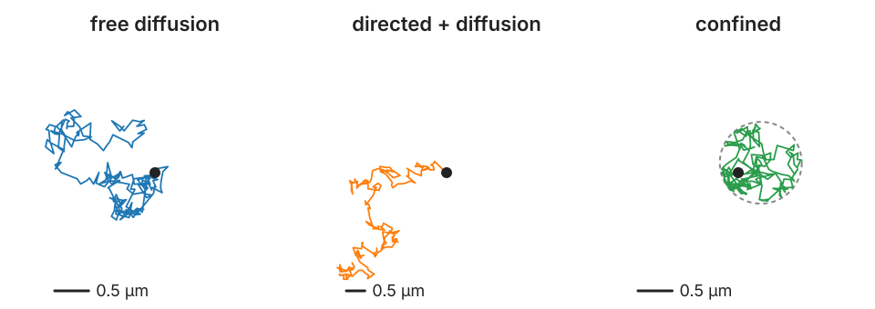

## About this lecture

Tracks are made to be **measured**. What do they tell us about how objects move?

- **Per-track numbers**: duration, path length, speed, straightness.
- The **speed trap**: random motion has no speed.
- The **mean squared displacement** (MSD): free diffusion, directed motion, confinement, anomalous diffusion.
- Reading an MSD honestly: fit range, localisation error, short tracks.
- **Biases** from tracking itself; ensemble against single tracks.
- Migrating cells: the persistent random walk.

*Slides titled **The math** give the formulas and proofs; the ideas are complete without them.*

::: notes
This unit owns track analysis (MSD, diffusion coefficient, anomalous exponent, speed, straightness) for the course. Naming: "diffusion" here is the random motion of particles; the diffusion models of the deep learning day borrowed the name from it.
:::

## Per-track numbers

{width="88%" fig-align="center"}

- **Duration**, **net displacement** (first to last point), **path length** (sum of steps).
- **Mean speed** = path length / duration. **Straightness** = net displacement / path length: 1 for a straight line, near 0 for a random walk.
- **Turning angles** between consecutive steps: near 0 for directed motion, spread out for random motion.

The three tracks above (simulated, same D) look different, and the numbers say so. But some of the numbers depend on how the movie was taken.

## The speed trap

For **random** motion, the "speed" measured from consecutive frames depends on the frame interval:

- $D = 0.1$ µm²/s measured every $\Delta t = 0.1$ s: about **1.8 µm/s**.
- The same particle every $\Delta t = 0.01$ s: about **5.6 µm/s**.

The displacement grows only as $\sqrt{\Delta t}$, so displacement / Δt grows as $1/\sqrt{\Delta t}$. **Random motion has no speed**; report the diffusion coefficient instead. Localisation noise adds apparent speed and lowers straightness as well: noise makes every step a little longer.

## The math: the speed of a random walk {.math}

A 2D random-walk step over $\Delta t$ has independent Gaussian components with variance $s^2 = 2D\Delta t$ each. Its length $r$ is **Rayleigh** distributed:

$$p(r) = \frac{r}{s^2}e^{-r^2/2s^2}, \qquad E[r] = s\sqrt{\pi/2} = \sqrt{\pi D\Delta t}.$$

So the apparent speed is $E[r]/\Delta t = \sqrt{\pi D/\Delta t}$: $\sqrt{\pi \cdot 0.1/0.1} = 1.77$ µm/s and $\sqrt{\pi \cdot 0.1/0.01} = 5.60$ µm/s. With localisation error σ per axis, the variance per axis becomes $2D\Delta t + 2\sigma^2$ and the apparent speed $\sqrt{\pi(D\Delta t + \sigma^2)}/\Delta t$, which blows up for small Δt.

## The mean squared displacement

For every **lag** τ (a number of frames apart), average the squared displacement over all pairs of points that far apart:

$$\text{MSD}(\tau) = \text{mean over } t \text{ of } |\mathbf r(t + \tau) - \mathbf r(t)|^2.$$

Worked (1D track, positions 0, 1, 3, 2, 4):

| lag | differences | MSD | pairs |
|---|---|---|---|
| 1 | 1, 2, −1, 2 | (1 + 4 + 1 + 4)/4 = **2.5** | 4 |
| 2 | 3, 1, 1 | 11/3 = **3.67** | 3 |
| 3 | 2, 3 | 13/2 = **6.5** | 2 |
| 4 | 4 | **16** | 1 |

"Diffusion" in this unit means random motion of particles; the diffusion models of the deep learning day borrowed the name.

## What the shape of the MSD says

- **Free diffusion**: a straight line through 0. Slope $2dD$ ($d$ = number of dimensions: $4D$ in 2D). On log–log axes, slope **1**.
- **Directed** motion (plus diffusion): curves **upward**; at long lags slope **2** on log–log axes; the velocity comes from the $\tau^2$ term.
- **Confined** in a region: levels off at a **plateau** set by the size of the cage ($R^2$ for a disc of radius $R$).
- **Anomalous** (crowded, obstacles, binding): a power law $\tau^\alpha$ with $\alpha < 1$ (subdiffusion); $\alpha > 1$ is superdiffusion.

## The math: MSD of a random walk, and more {.math}

$\mathbf r(t) = \sum_k \Delta\mathbf r_k$ with independent steps of variance $2D\Delta t$ per axis. Over a lag of $n$ frames ($\tau = n\Delta t$) the variances add:

$$\text{MSD}(\tau) = E|\mathbf r(t + \tau) - \mathbf r(t)|^2 = d \cdot n \cdot 2D\Delta t = 2dD\tau.$$

- **Directed + diffusion** (velocity $\mathbf v$): $\Delta\mathbf r = \mathbf v\tau + $ noise, so $\text{MSD} = 2dD\tau + v^2\tau^2$ (the cross term has mean 0).
- **Localisation error** σ per axis (static): each position has its own error, so $\text{MSD} = 2dD\tau + 2d\sigma^2$ (in 2D: $+4\sigma^2$). Motion blur during the exposure subtracts a term $\propto D\,t_\text{exposure}$.
- **Confined**, uniform in a disc of radius $R$, long lags: positions independent, $E|X - Y|^2 = 2E|X|^2 = 2 \cdot R^2/2 = R^2$.
- **Anomalous**: $\text{MSD} \propto \tau^\alpha$; α = slope on log–log axes.

## Try it: the MSD

```{=html}
<link rel="stylesheet" href="../demos/dist/demo.css">
<div data-demo="msdplot" data-preset="free" data-panels="msd"></div>
<script src="../demos/dist/msdplot.js"></script>
```

::: notes
Simulated 2D tracks (seeded): 40 tracks of 200 points, D = 0.1 µm²/s, Δt = 0.1 s. Thin grey: MSD of single tracks; thick blue: all tracks pooled; dashed red: the line fitted over the yellow range (the first 25 % of the lags shown); dotted guides of slope 1 and 2. Tour: "free diffusion: slope 1": D = 0.096, α = 0.99. "directed": the curve bends up to slope 2, α = 1.41 over the fit range, v from the τ² term 0.49 (true 0.5). "confined: plateau at R²" (R = 0.5 µm): plateau 0.24 against R² = 0.25; a line through these lags gives D = 0.005, twenty times too small. "localisation error: the offset" (σ = 30 nm, D = 0.01, Δt = 0.05 s): the fitted line does not go through 0, offset 0.0038 against 4σ² = 0.0036. "anomalous: α = 0.5": slope 0.50. "a persistent cell": slope 2 at short lags, 1 at long lags, the crossover near the persistence time of 10 s.
:::

## Reading an MSD honestly

- **Long lags are noisy**: at lag τ a track of N points has only N − τ (overlapping) pairs. Fit only the **first part** (e.g. the first quarter of the lags, or the first few for D).
- **Localisation error** adds a constant **offset** $4\sigma^2$ in 2D: the line does not go through 0. With σ = 30 nm, D = 0.01 µm²/s, Δt = 0.05 s, the offset (0.0036 µm²) is **larger** than the lag-1 signal $4D\Delta t$ (0.0020 µm²). A line forced through the origin over lags 1–4 gives D = 0.016 instead of 0.010.
- **Short tracks** give widely scattered D values: a histogram of per-track D is wide even for identical particles.
- **Gap-closed tracks** have missing frames: compute lags from the **times**, not from the indices.

## The math: why the tail is noisy {.math}

In a track of $N$ points, lag $n$ has $N - n$ squared displacements, but they **overlap** (share steps), so they are far from independent.

- The relative standard error of the time-averaged MSD grows roughly as $\sqrt{n/N}$ for $n \ll N$ (Qian, Sheetz and Elson, 1991): at $n = N/4$ it is about 50 %.
- A per-track D from a line through the first four lags scatters by roughly $2/\sqrt{N}$ (more with localisation error): in the demo about 50 % for tracks of 20 points and 15 % for 200 points (Saxton, 1997, gives the full distribution).
- Fitting MSD vs τ by ordinary least squares ignores that the points are correlated: more lags do **not** mean more information. The optimal number of fitted lags depends on $4\sigma^2/(4D\Delta t)$ (Michalet, 2010): few lags when the motion dominates.

## Biases from the tracking itself

- **Fast particles leave** the field or the focal plane sooner: their tracks are short. Keeping only long tracks keeps the **slow** ones: D is under-estimated.
- At high density, linking errors **cut long jumps short**: the tracker prefers short links, so true long steps are replaced by shorter wrong ones. D is **under**-estimated (recall the difficulty ratio of the first unit).
- Missed detections handled without gap closing: tracks shatter into short pieces, with all the problems of short tracks.

## Ensemble or single track?

- **Ensemble MSD**: pool all pairs of all tracks at each lag. One smooth curve: the **population average**.
- **Single-track MSD**: one curve per track, then the **distribution** of D (or α). Shows **heterogeneity**: two populations, or a fraction of stuck particles.
- Different questions: "how fast do these particles move on average?" against "are there several kinds?"
- A single track can **switch** between modes (waiting, diffusing, running): its MSD averages them. Segment the track first (for example with hidden-state models, one per mode).

## Cells: the persistent random walk

Migrating cells keep their direction for a while, then turn: **persistent** motion.

- On short times: almost straight, MSD ∝ τ² (slope 2 on log–log axes).
- On long times: random, MSD ∝ τ (slope 1).
- The **persistence time** P is where the slope changes from 2 to 1.
- Report the speed (meaningful here, on times shorter than P) and the persistence time, not one "diffusion coefficient".

## The math: the persistent random walk {.math}

Speed $s$, direction diffusing so that the velocity correlation is $\langle\mathbf v(t)\cdot\mathbf v(t')\rangle = s^2e^{-|t - t'|/P}$ (Fürth, 1920). Then

$$\text{MSD}(\tau) = \int_0^\tau\!\!\int_0^\tau s^2e^{-|t - t'|/P}\,dt\,dt' = 2s^2P\big(\tau - P(1 - e^{-\tau/P})\big).$$

- $\tau \ll P$: $1 - e^{-\tau/P} \approx \tau/P - \tau^2/2P^2$, so $\text{MSD} \approx s^2\tau^2$: ballistic.
- $\tau \gg P$: $\text{MSD} \approx 2s^2P\tau - 2s^2P^2$: diffusive, with an effective $D = s^2P/2$ in 2D.

## Try it: the speed trap

```{=html}
<link rel="stylesheet" href="../demos/dist/demo.css">
<div data-demo="msdplot" data-mode="speed" data-panels="msd"></div>
<script src="../demos/dist/msdplot.js"></script>
```

::: notes
One long random walk (D slider) recorded every 5 ms and then subsampled at 2, 4, …, 512 frames: apparent speed = mean step length / Δt, with the √(πD/Δt) curve. D = 0.1: 7.98 µm/s at Δt = 5 ms (formula 7.93), 2.03 µm/s at 80 ms, 0.45 µm/s at 1.28 s. Add localisation error σ: the short-Δt speeds shoot up further (green curve).
:::

## Summary

- Per-track numbers: duration, path length, **straightness**, turning angles.
- **Random motion has no speed**: the apparent speed grows as $1/\sqrt{\Delta t}$. Report D.
- **MSD**: straight line (slope $2dD$) for free diffusion; upward curve for directed motion; plateau $R^2$ for confinement; $\tau^\alpha$ for anomalous motion. Use log–log axes to read the exponent.
- Fit the **first lags**; expect an **offset** $4\sigma^2$ from localisation error; short tracks scatter.
- Tracking biases D: fast particles leave, dense linking cuts long jumps.
- Cells: **persistent random walk**, slope 2 then 1, crossover at the persistence time.
