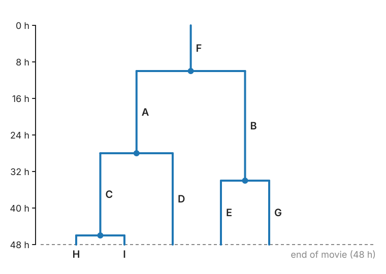

## Goal

By the end of this exercise you should be able to:

- solve a small **gap-closing** assignment with alternative costs and explain the role of b,
- read a table of detections and find a **gap**, a **division** and a **segmentation split**,
- read a **lineage tree**: cycle times, generations, **censored** cells,
- **evaluate** links and divisions against a reference,
- *(math)* write the segment-linking matrix, the min-cost flow formulation, and the censoring bias.

## Background

| Idea | What it means |
|---|---|
| Segment | a piece of track from strict frame-to-frame linking |
| Gap closing | an end at $t$ joins a start at $t + g$, $2 \le g \le G + 1$; gate $\propto \sqrt g$ (random motion); cost = squared distance / $g$ |
| Split | a start joins the middle of another segment one frame earlier: a division (mother + two daughters) |
| Merge | an end joins the middle of another segment one frame later |
| Alternative cost b | every end, start and candidate may stay unjoined at cost b; a join is taken only if it is cheaper than its two alternatives |
| Bubble | split followed by a merge: usually a segmentation error, removed by "daughters must stay separate k frames" |
| Cycle time | from a cell's birth (its mother's division) to its own division |
| Censored | a cycle that starts before or ends after the movie: incomplete |
| Link scores | precision TP/(TP + FP), recall TP/(TP + FN), F1 = 2TP/(2TP + FP + FN) |
| Division score | a division is TP only if the mother and both daughters match |

## By hand

**B1.** **Gap closing as an assignment.** Two segment ends E1, E2 and two segment starts S1, S2 (later, nearby). Join costs: E1–S1 = 5, E1–S2 = 30, E2–S1 = 8, E2–S2 outside the gate. Every end or start left unjoined costs b.
(a) List the possible solutions and their totals as functions of b.
(b) Which is optimal for b = 12, and for b = 20?
(c) Explain in words why a larger b forces more joins.

**B2.** **Reading detections.** Six frames of detections (x, y in µm, area in µm²):

| frame | detections (x, y, area) |
|---|---|
| 1 | (10, 10, 100), (40, 12, 200) |
| 2 | (11, 11, 102), (41, 12, 212) |
| 3 | (42, 13, 222) |
| 4 | (13, 12, 104), (36, 13, 112), (48, 14, 110) |
| 5 | (13, 11, 60), (16, 14, 44), (35, 14, 116), (49, 14, 113) |
| 6 | (15, 13, 108), (34, 15, 120), (50, 13, 118) |

(a) Sketch the detections (x against frame) and draw the tracks.
(b) Mark one gap, one division and one segmentation split. Which numbers support each?
(c) How would the second stage of linking see each of the three events?

**B3.** **A lineage tree.** The figure shows a 48 h movie: cell F at the start, its daughters A and B, and so on (times in hours).

{width="55%" fig-align="center"}

(a) Give the cycle time of every cell for which it is known. Which cells are censored, and how?
(b) Give the generation of each cell (F = 0) and name two pairs of sisters.
(c) Mean cycle time using complete cycles only; and if you wrongly counted every cell born by a division as if its observed time were a full cycle.
(d) Which of the two is closer to the truth, and in which direction are both biased?

**B4.** **Evaluation.** A reference has 12 links and one division. The result has 11 links, of which 10 are in the reference, and one division with the right mother but one wrong daughter.
(a) Link precision, recall and F1.
(b) Division TP, FP, FN.

**B5.** **Predict.** (a) The segmentation starts splitting nuclei more often. What happens to the number of divisions found, with and without a k-frame rule? (b) Missed detections rise from 1 % to 10 % in a movie of 50 cells over 60 frames. Roughly how many gaps are there, and what happens without gap closing?

::: {.callout-note collapse="true" title="Solutions"}
**B1.** (a) E1–S1 alone: 5 + 2b (E2 and S2 unjoined). E2–S1 alone: 8 + 2b. E1–S2 alone: 30 + 2b. E1–S2 + E2–S1: 38. Nothing: 4b. (E1–S1 + E2–S2 is not allowed.)
(b) b = 12: E1–S1 alone = 29, both = 38, nothing = 48: **E1–S1 (29)**. b = 20: E1–S1 alone = 45, both = **38**, nothing = 80: **E1–S2 + E2–S1**.
(c) Leaving an end or a start unjoined costs b each. When b is large, every unjoined element is expensive, so the assignment accepts even a poor join (E1–S2, 30) if it lets two other elements join too. b is the price of "this track really ends here".

**B2.** (a) Left object (a): frames 1, 2, —, 4, two pieces in 5, 6. Right object (b): frames 1, 2, 3, then two objects from frame 4 on.
(b) **Gap**: object a is missing in frame 3: (11, 11) in frame 2 and (13, 12) in frame 4, 2.2 µm apart over two frames, same area (102, 104). **Division**: object b at (42, 13) in frame 3 with area 222, then (36, 13, 112) and (48, 14, 110) in frame 4: two objects 6 µm on either side, areas adding up to 222, and they stay separate in frames 5 and 6 (116 + 113, 120 + 118). **Segmentation split**: object a in frame 5 is two pieces (60 + 44 = 104, its area in frame 4), and in frame 6 one object again (108): split then merge, a bubble.
(c) Gap: an end at frame 2 and a start at frame 4: a gap join over 2 frames (cost 5/2 = 2.5 in squared µm per frame). Division: frame-to-frame linking continues the mother into one daughter; the other daughter's start is joined to the mother's frame-3 detection by a split (area factor 1). Bubble: one piece continues the track; the other is joined by a split from frame 4 and a merge into frame 6; the k-frame rule (k ≥ 2) removes both joins.

**B3.** (a) Complete cycles: A 28 − 10 = 18 h, B 34 − 10 = 24 h, C 46 − 28 = 18 h. Censored: F (its birth is before the movie; observed 10 h, cycle ≥ 10 h); D (born 28 h, not divided by 48 h: cycle > 20 h), E and G (born 34 h: > 14 h), H and I (born 46 h: > 2 h).
(b) F 0; A, B 1; C, D, E, G 2; H, I 3. Sisters: A and B; C and D; E and G; H and I.
(c) Complete only: (18 + 24 + 18)/3 = **20 h**. Counting all cells born by a division with their observed times: (18 + 24 + 18 + 20 + 14 + 14 + 2 + 2)/8 = **14 h**.
(d) Both are too low: the censored cells' true cycles are longer than what was seen (D > 20, E, G > 14), and long cycles are the ones most often cut off. Complete-only (20 h) is closer but still biased; counting censored times as complete (14 h) is badly biased.

**B4.** (a) TP = 10, FP = 1, FN = 2. Precision 10/11 = 0.909, recall 10/12 = 0.833, F1 = 20/23 = 0.870.
(b) TP 0, FP 1, FN 1.

**B5.** (a) Without a rule, every segmentation split followed by a merge looks like a division: false divisions rise with the split rate. With a k-frame rule most bubbles are removed (they rejoin within one frame), at the price of losing true divisions whose daughters are cut off by the end of the movie or merge with a neighbour. (b) 50 cells × 60 frames = 3000 detections: about 30 missed at 1 %, about 300 at 10 %, so about 300 gaps (a few double gaps). Without gap closing each gap splits a track in two: the tracks shatter into pieces averaging about 10 frames, and almost no cell is followed from birth to division.
:::

### Math questions

**B6.** *(math)* Three segments: A (frames 0–10), B (frames 4–10) and C (frames 12–15). Candidates: a gap join from B's end (frame 10) to C's start (frame 12), cost 6; a split from A's detection at frame 3 to B's start (frame 4), cost 9. Write the square segment-linking matrix with alternative cost b for every row and column, mark the blocks, and find the optimum for b = 5 and for b = 4.

**B7.** *(math)* Formulate linking **without divisions** over a whole movie as a minimum-cost flow: nodes, capacities, costs. Why must each detection have capacity 1, and how is that done with a node capacity?

**B8.** *(math)* **Censoring.** Cycle times are $T = m + X$ with $X$ exponential of mean μ; cells are born uniformly over a movie of length $L$. A cycle is observed complete if birth + T ≤ L. Show that the mean of the observed complete cycles is approximately $m + \mu - \mu^2/(L - m - \mu)$ (for $L$ well above $m + \mu$), below the true mean $m + \mu$. Evaluate it for $m = 10$ h, μ = 10 h, L = 48 h.

::: {.callout-note collapse="true" title="Solutions (math)"}
**B6.** Rows: B-end, A-at-3 (split candidate); columns: C-start, B-start. Square 4 × 4 matrix (rows 3–4 are the alternatives of the columns, columns 3–4 of the rows):
$$\begin{pmatrix} 6 & \infty & b & \infty \\ \infty & 9 & \infty & b \\ b & \infty & 0 & 0 \\ \infty & b & 0 & 0 \end{pmatrix}.$$
Top left: the gap block (B-end × C-start) and the split block (A-at-3 × B-start); top right: the row alternatives ("B really ends", "no split at A-at-3"); bottom left: the column alternatives ("C really starts", "B really starts"); bottom right: zeros. A join is taken if its cost is below 2b. b = 5: gap (6 < 10) and split (9 < 10): both, total 15. b = 4: gap (6 < 8) yes, split (9 > 8) no: total 6 + 4 + 4 = 14 (B starts unexplained).

**B7.** Source s, sink t; for every detection $k$ an in-node $k^-$ and an out-node $k^+$ with an edge $k^- \to k^+$ of capacity 1 and cost 0 (or minus a detection reward). Edges $s \to k^-$ with the start cost, $k^+ \to t$ with the end cost, and $k^+ \to l^-$ for every allowed link (detection $l$ in a later frame within the gate and the gap limit) with the link cost, all capacity 1. Each unit of flow from s to t is one track; the cost of a flow is the sum of start, link and end costs. Capacity 1 on $k^- \to k^+$ makes every detection belong to at most one track (no two tracks share a detection; no branching). Minimise over the flow value as well (or add flow-value-independent rewards). The constraint matrix is a network matrix, hence totally unimodular, so the LP has an integer optimum.

**B8.** A cycle of length τ (≤ L) is complete if the birth is in $[0, L - τ]$: probability $(L - τ)/L$. The observed density is proportional to $f(τ)(L - τ)$, so the observed mean is $\frac{E[T(L - T)]}{E[L - T]} = \frac{L\,E[T] - E[T^2]}{L - E[T]}$ (ignoring cycles longer than L, which is fine for L well above m + μ). With $E[T] = m + μ$ and $E[T^2] = μ^2 + (m + μ)^2$: $\frac{(m + μ)(L - m - μ) - μ^2}{L - m - μ} = m + μ - \frac{μ^2}{L - m - μ}$. For m = 10, μ = 10, L = 48: $20 - 100/28 = 16.4$ h (an exact integral over $[m, L]$ gives 16.8 h) instead of 20 h.
:::

## Explore: gaps, divisions and lineage trees {#explore}

Simulated dividing cells in a 400 × 40 px strip over 60 frames (4 founder cells; cycle times 8 frames plus a gamma distribution, mean 20 frames; daughters placed on either side of the mother, areas halved). Sliders add missed detections, false detections, segmentation splits (a fragment cut off for one frame) and cells entering at the left border. Stage 1 links frame to frame (global assignment); stage 2 joins the segments: gap closing up to **G** frames, splitting, merging, with an alternative cost b. Left: the **space–time** view (x across, time down; segments coloured, gap joins dashed blue, splits orange, merges purple, wrong links red, candidates dotted grey). Middle: the **lineage** of the selected founder, true and found (wrong branches red). Right: **cycle times** of the found lineages, complete cycles and all (including censored ones), with the model mean. The readout gives link P/R/F1, division TP/FP/FN, perfect tracks and why tracks start and end.

```{=html}
<link rel="stylesheet" href="../demos/dist/demo.css">
<div data-demo="gapclose" data-preset="blink"></div>
<script src="../demos/dist/gapclose.js"></script>
```

**E1.** Preset **a blink: gap closing**. How many gaps are closed? Read the link recall, the perfect tracks and the unexplained starts. Then **no gap closing**: what changes?

**E2.** Preset **G too large: wrong joins** (also false detections, a wider gate and b). Read the link precision. Set G to 3, then 2. Then also gate and b to 8. What happens to precision and recall, and why?

**E3.** Preset **a division**. How many divisions are found? Compare the true and found lineages of the four founders. Untick **splitting**: what happens to the divisions and to the starts?

**E4.** Preset **segmentation split → a bubble**. Read the division FP. Look at the space–time view for small orange–purple loops. Then **bubble removed by the k-frame rule**. How many joins are undone, and what happens to TP, FP and FN?

**E5.** Preset **cells entering at the border**. How many starts are explained by the border? Find one in the space–time view.

**E6.** Preset **the censoring trap** (cycle mean 26 frames, a broad distribution). Compare the mean of the complete cycles with the model mean, and look at the histogram. Why is the "all" histogram even lower?

**E7.** Press **reset** and raise the miss probability to 0.1. How many divisions are lost, and why can missed detections hide a division?

::: {.callout-note collapse="true" title="Solutions"}
**E1.** 46 gaps are closed; link recall 0.962; 55 of 56 true tracks are complete; 27 unexplained starts (they are the second daughters: splitting is off in this preset). Without gap closing: recall 0.899, only 25 of 56 tracks complete, 73 unexplained starts and 47 unexplained ends.

**E2.** G = 10: precision 0.868 (99 gap joins, many to false detections or to other cells). G = 3: 0.927; G = 2: 0.949; G = 3 with gate and b of 8: 0.959 (recall 0.950). A larger G and gate let an end reach starts of other cells and false detections; a larger b makes the assignment prefer a poor join to leaving an end unjoined. Recall barely changes, because most real gaps are 1–2 frames.

**E3.** 28 of 28 divisions found (FP 0, FN 0); the found lineages match the true ones. Without splitting: no divisions (FN 28), and the second daughter of every division starts an unexplained track (28 unexplained starts).

**E4.** Bubble: 24 false divisions (TP 29, FN 3); each bubble shows as an orange split and a purple merge one frame apart. With the k-frame rule (k = 3): 38 joins undone, FP 3, TP 28, FN 4: almost all bubbles are gone, at the cost of one more missed division (a true division whose daughter branch was too short).

**E5.** 6 starts and 6 ends are at the border (plus 5 unexplained starts). The entering cells appear at the left edge (x ≈ 0) partway down the space–time view.

**E6.** The 20 complete cycles average 18.9 frames, against a model mean of 26: long cycles do not fit into the 60-frame movie (cells born after about frame 30 can only complete short cycles). The "all" histogram (48 cells born by a division, mean 15.4) also counts cells whose observed time was cut by the end of the movie as if it were a whole cycle.

**E7.** At miss probability 0.1: 20 of 27 divisions found (FN 7). The split join only looks one frame back: if the mother's last detection or a daughter's first detection is missed, the daughter's start is no longer next to the mother's track, and gap closing joins it as a gap (or not at all) instead of as a division.
:::

## Where this leads

The tracks are now complete enough to **measure**: speeds, straightness and the **mean squared displacement**, which tells free diffusion, directed motion and confinement apart. The [next unit](../track-analysis/lec.qmd).
