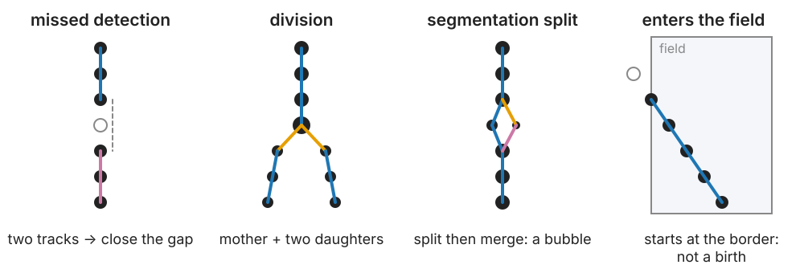
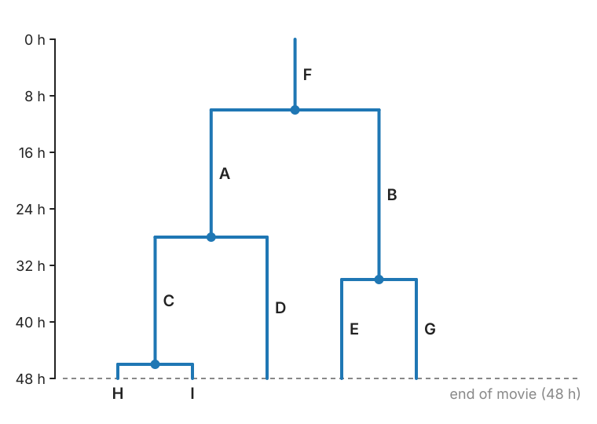

## About this lecture

Frame-to-frame linking gives **pieces** of tracks. Real movies break them: missed detections, cells that divide, objects that touch, objects that enter or leave.

- What breaks a track.
- **Two-stage linking**: reliable pieces first, then join them: **gap closing**, **splitting**, **merging**.
- A split is not always a division.
- The **track graph** and the **lineage tree**; cell-cycle times and **censoring**.
- **Evaluating** tracks: links, divisions, complete tracks.

*Slides titled **The math** give the formulas and proofs; the ideas are complete without them.*

::: notes
This unit owns gap closing, splitting and merging, track graphs and lineage trees, and track evaluation at the link and division level. The optional unit track-eval (not built yet) would go further: graph edit scores and identity-based scores.
:::

## What breaks a track

{width="95%" fig-align="center"}

- **Missed detection** (blinking, out of focus, too dim): one track becomes two.
- **Division**: one cell becomes two.
- **Touching** objects detected as one (a merge), or one cell **cut in two** by the segmentation (a split).
- Objects **enter or leave** the field (or the focal plane). And a false detection starts a short spurious track.

## Two stages

The standard recipe (Jaqaman et al., 2008):

1. **Frame to frame** (the first unit), with **strict** gates: short, reliable **segments**.
2. One more **global assignment** over the segment **ends** and **starts**. Each end and each start may:
   - **close a gap**: an end at $t$ joins a start at $t+2, \dots, t+G+1$ (up to $G$ missed frames);
   - **split**: a start joins the **middle** of another segment one frame earlier (a division);
   - **merge**: an end joins the middle of another segment one frame later;
   - or stay a **real** end or start, at an alternative cost, as in the first unit.

Each option has a cost; the assignment picks the cheapest consistent set.

## Gap closing

A track ends at frame $t$; another starts at $t + g$ nearby. Same object, missed $g - 1$ times?

- Allow gaps up to **G** frames, and a **larger gate** for longer gaps: the object may have moved further. For random motion the gate grows as $\sqrt g$, for directed motion as $g$. A Kalman prediction (previous unit) gives the natural gate.
- Cost: the squared distance **per frame elapsed**, so long gaps are not penalised for the extra distance they need.
- **G too large**: an end can join a start of a **different** object, especially with false detections around.

## The math: how far in a gap? {.math}

For a random walk in $d$ dimensions, the displacement over $g$ frames is the sum of $g$ independent steps, each with variance $2D\Delta t$ per axis:

$$E|\Delta\mathbf r_g|^2 = 2dD\,g\Delta t, \qquad \text{so a gate of } k \text{ standard deviations has radius } k\sqrt{2D\Delta t}\,\sqrt g.$$

- The cost $|\Delta\mathbf r|^2/g$ is the squared distance in units of the expected squared step: the minus log-likelihood of a $g$-frame jump, up to a $\log g$ term.
- For directed motion with speed $v$ the jump is about $vg\Delta t$: the gate grows linearly in $g$. A Kalman filter predicted over $g$ frames gives both cases from its covariance.

## Divisions

At a division the mother's track ends next to **two** new starts. Cues beyond distance:

- the two daughters have about **half** the mother's area (their areas add up to hers);
- just before dividing the mother is often **bright and round** (mitosis);
- the daughters move apart on **opposite sides** of the mother.

A division is a **mother and both daughters**. In the two-stage scheme: frame-to-frame linking continues the mother into one daughter, and a **split** joins the other daughter's start to the mother.

## A split is not always a division

The segmentation can cut one cell in two for a frame; the pieces rejoin in the next: a split followed by a merge, a small **"bubble"** in the graph.

- Keep what the linking observed; decide what it **means** in a separate step. For example: a division must be followed by two daughters that stay separate for **k frames**.
- Likewise, a track that ends is not a dead cell, and one that starts is not a newborn. Record **why** each track starts and ends: first or last frame, near the border, after a gap, at a division, at a merge, or unexplained.

## Entering and leaving

Objects cross the image border, or the focal plane.

- Tracks that start or end within a **border band** are "entered" or "left", not births or deaths.
- The same idea as the [border rule for counting objects](../label-measure/lec.qmd#/border-objects-and-the-counting-frame) on the labelling day: objects cut by the border are incomplete, and statistics must say so.
- A track that starts in the middle of the field, away from any division, with no gap before it: **unexplained**. Many unexplained starts and ends point at missed detections or too strict gates.

## The math: the segment-linking matrix {.math}

Rows: segment **ends** $E$ and **split candidates** $M_s$ (detections in the middle of a segment that may send a second link). Columns: segment **starts** $S$ and **merge candidates** $M_m$. Square augmented matrix:

$$\begin{pmatrix}
C_\text{gap} & C_\text{merge} & D_E & \infty \\
C_\text{split} & \infty & \infty & D_{M_s} \\
B_S & \infty & 0 & 0 \\
\infty & B_{M_m} & 0 & 0
\end{pmatrix}$$

with $C_\text{gap}$ ($E \times S$), $C_\text{merge}$ ($E \times M_m$), $C_\text{split}$ ($M_s \times S$), and diagonal alternative blocks $D$, $B$ (∞ off the diagonal).

- Every row and column has its own alternative ("stay an end", "no split here"); the zero block pairs the leftover dummies.
- Split and merge costs: squared distance times an **area factor** $\max(\rho, 1/\rho)^2$, with $\rho$ = mother area / sum of the daughters' areas.
- Alternative costs are often set from the data: a high percentile of all candidate costs, times a factor slightly above 1.

## Try it: gaps and divisions

```{=html}
<link rel="stylesheet" href="../demos/dist/demo.css">
<div data-demo="gapclose" data-preset="bubble" data-panels="space-time,tree"></div>
<script src="../demos/dist/gapclose.js"></script>
```

::: notes
Simulated dividing cells in a 400 × 40 px strip over 60 frames (4 founders, cycle times 8 + gamma, mean 20 frames). Left: space–time view, x across and time down: segments coloured, gap joins dashed blue, splits orange, merges purple, wrong links red. Middle: the lineage of founder 1, true and found. Tour: "a blink: gap closing" (8 % missed, no splitting): 46 gaps closed, link recall 0.962; "no gap closing" (G = 0): recall 0.899, only 25 of 56 true tracks complete instead of 55. "G too large" (G = 10, 1.5 false detections per frame, wider gate and b): precision drops to 0.868 (0.927 with G = 3). "a division": 28 of 28 divisions found. "segmentation split → a bubble" (3 % splits, merging on): 24 false divisions; "bubble removed by the k-frame rule" (k = 3): 3 false divisions, 38 joins undone. "cells entering at the border": 6 starts at the border. "the censoring trap": see the next slides.
:::

## The track graph and the lineage tree

- **Track graph**: nodes = detections, edges = links of four kinds (continue, gap, divide, merge). A **track** = a maximal chain without branches.
- **Lineage tree**: one branch per cell, time downwards, a fork at each division.

{width="40%" fig-align="center"}

Reading it: **cell-cycle time** = time from a cell's birth (its mother's division) to its own division (A: 28 − 10 = 18 h); **generation** = number of divisions since the founder; **sisters** share a mother (A and B).

## Censoring: what the movie cannot see

A movie has a start and an end. Cycles that start before or end after it are **incomplete** (censored).

- In a 48 h movie, cells born late cannot finish a 20 h cycle before the end. Only **short** cycles complete near the end.
- Measuring cycle times **only on complete cycles** therefore **under-estimates** the mean: slow cells are missing.
- Counting incomplete cycles as if complete is worse.
- Report how many cycles were incomplete; use methods that include censored times (survival analysis), or restrict to cells born early enough.

In the demo (cycle mean 26 frames, 60-frame movie): the 20 complete cycles average **18.9**.

## Evaluating tracks

Needs a **reference** (manual, or simulated) on the same detections.

- **Links**: TP (in both), FP (only in the result), FN (only in the reference): precision, recall, F1, as for [objects on the evaluation day](../object-eval/lec.qmd).
- **Divisions**: correct only if the **mother and both daughters** match. One wrong daughter = 1 FP + 1 FN.
- **Complete tracks**: the fraction of reference tracks reconstructed without any error; shows the compounding of the first unit.
- **Identity switches** at crossings.
- If the detections themselves differ from the reference, first match detections per frame (by distance or overlap), then compare links. Evaluate only where the reference is complete: a link missing from an incomplete reference is not an error.

## The math: whole-movie linking as a flow {.math}

Frame by frame is fast, but each decision sees only two frames. Linking **without divisions** over the whole movie at once is a **minimum-cost flow** (Zhang et al., 2008; recall [max-flow](../maxflow/lec.qmd) on the graph-cut day):

- every detection is a node with **capacity 1** (split into an in-node and an out-node joined by an edge of capacity 1): it belongs to at most one track;
- source → node: start cost; node → sink: end cost; node at $t$ → node at $t' > t$: link cost (gap links included);
- each unit of flow from source to sink is one track; the minimum-cost flow (over all flow values) is the best set of tracks.
- Integer flows are optimal because the constraint matrix is totally unimodular. Divisions break this structure (one node feeds two).

Compounding again: a track of $T$ links with error rate $e$ per link is perfect with probability $(1-e)^T \approx e^{-eT}$; it has $eT$ errors on average.

## Summary

- Missed detections, divisions, merges, splits and border crossings **break** tracks.
- **Two stages**: strict frame-to-frame segments, then one global assignment over ends and starts: **gap closing** (gate ∝ √gap for random motion), **splitting**, **merging**, or real ends and starts.
- A split is not always a division: keep the graph, interpret it separately (the k-frame rule); record **why** tracks start and end.
- **Lineage trees**: cycle times, generations, sisters. Beware **censoring**: complete cycles alone under-estimate the mean.
- **Evaluate** links (P/R/F1), divisions (mother + both daughters) and complete tracks.
