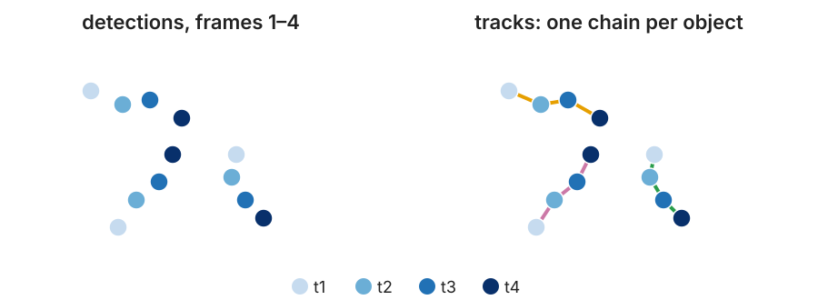
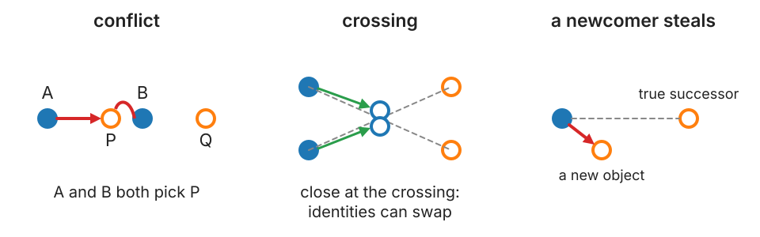
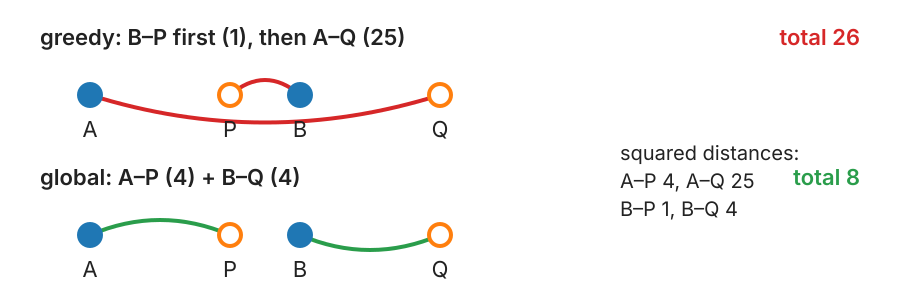

## About this lecture

A time-lapse gives one table of detections per frame. Tracking turns these tables into **tracks**: which dot in the next frame is the same object?

- **Nearest neighbour**, and the three ways it fails.
- **One number** that says how hard a tracking problem is.
- **Costs**: why squared distance is the natural one.
- **Greedy** against **global assignment**.
- **Gates**, and the cost of **ending** or **starting** a track.
- Why small error rates ruin long tracks.

*Slides titled **The math** give the formulas and proofs; the ideas are complete without them.*

::: notes
This unit owns frame-to-frame linking and the linear assignment problem with costs, gates and alternatives for the course (the evaluation day keeps the IoU special case for matching objects to a reference). Units 2 to 4 of the day: prediction (Kalman filter), gaps and divisions, and what tracks measure (MSD).
:::

## From detections to tracks

{width="80%" fig-align="center"}

- Input: per frame a **list of detections**, each a position (± a localisation error σ) with a few measurements: area, intensity. They come from labelling ([centroids of objects](../regionprops/lec.qmd)) or from the point detection day (spots with sub-pixel positions).
- A **track** is a chain of detections, at most one per frame, that belong to the same object.
- **Tracking** = deciding, for every detection at $t$, which detection at $t+1$ continues it, or none.

## Flow or tracking?

Two ways to describe motion in a movie:

- **Optical flow** (the optical flow day of the motion group): a velocity for **every pixel**. No objects, no identities.
- **Tracking**: objects keep an **identity** over time. You can ask "how far did *this* cell go?", "when did *it* divide?"

They help each other: flow can **predict** where an object goes next (next unit: prediction), and tracks give velocities only where there are objects.

## Recall: correct drift first

If the stage drifts, **every** object seems to move the same way. On the FFT registration day the drift was measured from the whole image and removed ([Drift in a time-lapse](../stitching/lec.qmd#/drift-in-a-time-lapse)).

- Correct the drift **before** linking: then a link only has to explain the object's own motion.
- Without correction the displacement per frame includes the drift: every gate has to be larger, and the problem becomes harder (next slides) for no reason.

## Nearest neighbour, and how it fails

Link each detection to the **closest** detection in the next frame. Works when objects are **sparse** and **slow**.

{width="88%" fig-align="center"}

1. **Conflict**: two detections choose the same successor.
2. **Crossing**: two objects pass close to each other; the identities can swap.
3. **A newcomer steals**: the true successor was missed or left; a new object nearby takes the link.

## One number says how hard it is

$$\text{difficulty} = \frac{\text{typical displacement per frame}}{\text{typical spacing between objects}}$$

- Below about **0.2**: easy, every method works.
- Around **0.5**: nearest neighbour makes many errors, global assignment fewer.
- Near **1**: no linking method is reliable. Image **faster** (shorter frame interval) or at **lower density**.

Worked example: random motion with $D = 0.1$ µm²/s, frame interval $\Delta t = 0.1$ s: rms displacement $\sqrt{4D\Delta t} = 0.2$ µm. One object per µm²: mean nearest-neighbour spacing $\approx 0.5/\sqrt{n} = 0.5$ µm (the [measurements day](../relations/lec.qmd)). Ratio **0.4**: nearest neighbour gets about **11 %** of links wrong.

## The math: the nearest-neighbour error rate {.math}

Random positions at density $n$; an object moves a distance $r$ to its true successor. Nearest neighbour is wrong if some **other** object lies within $r$ of the old position:

$$P(\text{wrong} \mid r) = 1 - e^{-\pi n r^2} \qquad \text{(no other point in a disc of area } \pi r^2\text{)}.$$

For a 2D random walk, $r^2$ is exponential with mean $4D\Delta t$, and $E\big[e^{-c\,r^2}\big] = 1/(1 + 4cD\Delta t)$. With $c = \pi n$:

$$P_\text{err} = 1 - \frac{1}{1 + a} = \frac{a}{1+a}, \qquad a = 4\pi n D\Delta t = \frac{\pi}{4}\,\rho^2,$$

where $\rho$ = rms displacement / mean spacing (because $\rho^2 = 4D\Delta t \cdot 4n$). Example: $a = 4\pi \cdot 1 \cdot 0.1 \cdot 0.1 = 0.126$, so $P_\text{err} = 0.112$. For $a \ll 1$: $P_\text{err} \approx a$, which grows with the **square** of the ratio.

## Costs: a number per candidate link

Small cost = likely link. The default is the **squared distance** between the two detections.

- Why squared? For random motion, a step of length $r$ has probability $\propto e^{-r^2/4D\Delta t}$: the squared distance is (up to a constant) the **minus log-probability** of the step. Adding costs = multiplying probabilities.
- For segmented objects, add terms: change in **area**, in **intensity**, or **1 − overlap** (IoU) for objects that move less than their own size.
- Terms in different units must be **weighted** into one number. The weights are choices, and they matter.

## The math: squared distance as a log-likelihood {.math}

A 2D random-walk step $\Delta\mathbf r$ over $\Delta t$ has density

$$p(\Delta\mathbf r) = \frac{1}{4\pi D\Delta t}\, e^{-|\Delta\mathbf r|^2/4D\Delta t}, \qquad -\log p = \frac{|\Delta\mathbf r|^2}{4D\Delta t} + \log(4\pi D\Delta t).$$

- For independent objects, the probability of a set of links is the product of the step probabilities. Its minus log is the **sum** of squared distances (times $1/4D\Delta t$) plus a constant per link.
- Minimising the sum of squared distances = **maximum likelihood** set of links.
- The cost of ending or starting a track (coming up) is then a **log-ratio of probabilities**: $b = -\log(p_\text{end})$ in the same units. In squared-distance units, $\sqrt{2b}$ is "how far is too far".

## Greedy or global?

{width="75%" fig-align="center"}

- **Greedy**: take the cheapest link first (B–P, cost 1), never revisit. A is left with Q (25). Total **26**.
- **Global assignment**: minimise the **sum** of all link costs at once, each detection used at most once: A–P + B–Q = 4 + 4 = **8**.
- The exact solver is the **Hungarian algorithm**; image analysis software calls this a "LAP" (linear assignment problem) tracker. It is the same solver as for [matching objects to a reference](../object-eval/lec.qmd#/below-0.5-greedy-can-lose-a-match) on the evaluation day, now with general costs.

## Try it: linking two frames

```{=html}
<link rel="stylesheet" href="../demos/dist/demo.css">
<div data-demo="linkpairs" data-preset="greedy"></div>
<script src="../demos/dist/linkpairs.js"></script>
```

::: notes
Filled discs are frame t, rings frame t+1; drag any of them. The matrix shows the costs (rows t, columns t+1) with the chosen links boxed. Tour: "NN conflict": both A and B point at P (red). "greedy loses": press step: B–P (1) first, then A–Q (25), total 26; the readout shows global 8. "global: 8 < 26". Untick squared distance: greedy 6 against global 4, the same choice. "gate too small": the gate (dashed circles) has radius 3 and the fast middle object moves 4.5: its link is forbidden, so its track ends and a new one starts. "ending is cheaper (b = 2)": only B–P (cost 1) is kept; A ends and Q starts (total 1 + 2 + 2 = 5 < 8). "a newcomer steals": the ring near A is a new object; A links to it. "augmented matrix (b = 3)": the 4 × 4 matrix with b on the diagonals; total 7.
:::

## Gating: some links are not allowed

A **gate** is a maximum link distance (or speed × elapsed time). Pairs outside it are **not candidates at all**.

- Keeps the problem small: most pairs of detections are impossible, so the cost matrix is mostly empty (fast solvers use that).
- Stops absurd links across the image.
- **Too small**: fast objects cannot be linked, their tracks break.
- **Too large**: wrong links can compete with the right ones.

A good gate follows from the motion: a few rms displacements for random motion, the expected step plus a margin for directed motion. The next unit makes the gate come from the **predicted uncertainty**.

## Ending and starting tracks

An object can **leave** the field, **die**, or be **missed**; a new one can **enter**. So "no link" must be an option, with a price.

- Give "end this track" a cost **b**, and "start a new track" a cost **b**.
- A link is chosen only if it is cheaper than ending one track and starting another: **cost < 2b**.
- With A, B, P, Q: for b ≥ 3.5 both links (total 8); for 0.5 < b < 3.5 only B–P (cost 1 + 2b); for b < 0.5 no links at all.
- **b is the most important parameter**: it acts like a soft gate. Too small: tracks shatter. Too large: wrong links.

## The math: linking as a linear assignment problem {.math}

With costs $c_{ij}$ ($m$ detections at $t$, $n$ at $t+1$), choose $x_{ij} \in \{0, 1\}$ to minimise $\sum_{ij} c_{ij}x_{ij}$, each row and column used at most once; gated pairs have $c_{ij} = \infty$. With ends and starts, one **square** $(m+n)\times(n+m)$ matrix:

$$M = \begin{pmatrix} C & \operatorname{diag}(d_1, \dots, d_m) \\ \operatorname{diag}(b_1, \dots, b_n) & 0 \end{pmatrix}, \qquad \text{off-diagonals of the diagonal blocks} = \infty.$$

- A perfect assignment of $M$ = a set of links + an end (death dummy) for every unlinked row + a start (birth dummy) for every unlinked column; leftover dummies pair up in the zero block. (Jaqaman et al., 2008, put $C^\top$ in the lower right; the optimum is the same.)
- Taking link $ij$ instead of ending $i$ and starting $j$ changes the total by $c_{ij} - d_i - b_j$: the link wins iff $c_{ij} < d_i + b_j$.
- The constraint matrix is **totally unimodular**, so the LP relaxation has integer solutions; the Hungarian (Kuhn) or Jonker–Volgenant algorithm solves it in $O(N^3)$, sparse versions much faster.

## Try it: a simulated movie

```{=html}
<link rel="stylesheet" href="../demos/dist/demo.css">
<div data-demo="linkmovie" data-preset="half" data-sweep="on"></div>
<script src="../demos/dist/linkmovie.js"></script>
```

::: notes
60 frames of simulated particles (seeded) in a 256 × 256 px field; they enter and leave at the border. Dots and tails are coloured by track; red crosses mark wrong links. The side plot is the link error against the ratio, for all three methods, with the a/(1+a) estimate. Tour: "ratio 0.5": nearest 15.5 % errors, greedy 14.5 %, global 9.3 % (switch methods). "sparse and slow" (ratio 0.12): under 1 % for all. "ratio 1: nobody can": global still 34 %. "drift": 6.7 px/frame of stage drift, ratio 0.44 instead of 0.17, global 17.9 % errors; tick "correct drift": 1.7 %. "b too low" (b = 3 px as a distance): 38 % of true links missed, tracks shatter. "b too high" (60 px, gate off): wrong links rise to 11.8 % against 4.4 % at b = 8 to 15.
:::

## Errors compound

A track of $T$ links is perfect only if **every** link is right.

| error rate per link | 20-frame track perfect | 50-frame track perfect |
|---|---|---|
| 10 % | $0.9^{20} \approx$ 12 % | $0.9^{50} \approx$ 0.5 % |
| 2 % | 67 % | 36 % |
| 0.5 % | 90 % | 78 % |

- Long, correct tracks need **very** low per-link error rates. That is why the frame interval and density matter so much.
- Linking can also be done over the **whole movie at once** (min-cost flow, multiple-hypothesis tracking); frame by frame is the common, fast default.

## Summary

- A track = a chain of detections; tracking = linking frame to frame. Correct **drift** first.
- **Difficulty** = displacement per frame / spacing. Nearest neighbour fails at conflicts, crossings and newcomers; its error grows as the square of the ratio.
- **Cost** = squared distance (the minus log-probability of a random step), plus optional terms.
- **Global assignment** minimises the total cost; greedy can be much worse.
- **Gates** forbid long links; the **end/start cost b** decides when "no link" is better (link iff cost < 2b).
- Per-link errors **compound** over long tracks.
