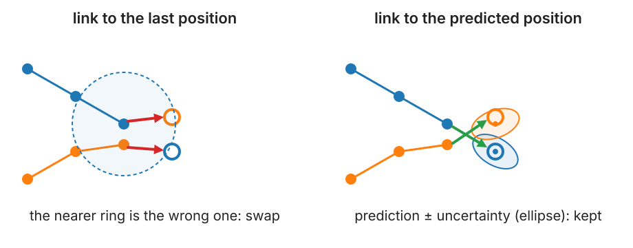
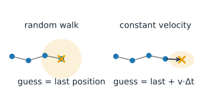
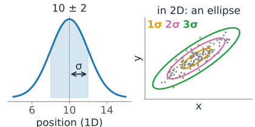
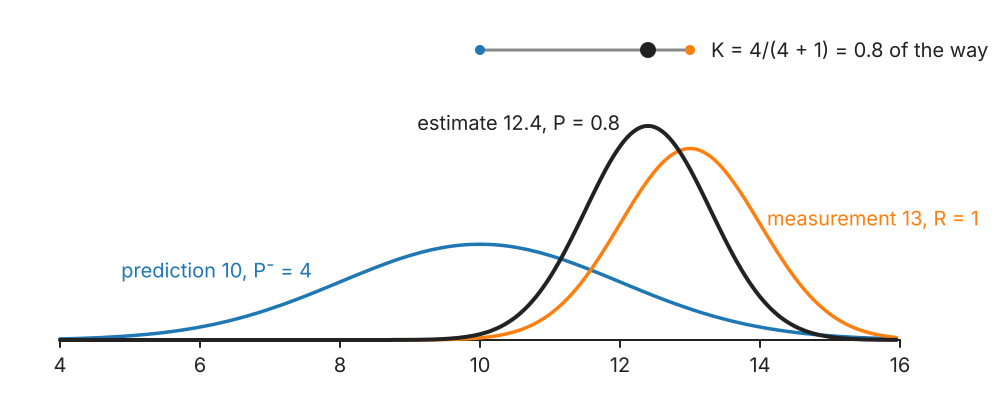
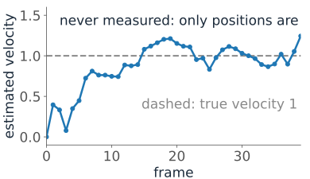
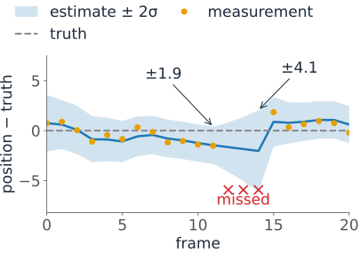
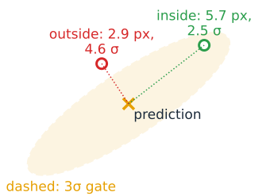
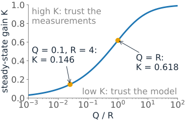

## About this lecture

The [previous unit](../track-linking/lec.qmd) linked each detection to the **last** position of a track. Fast objects are far from where they were, but close to where they are **going**.

- **Motion models**: random walk and constant velocity.
- The **Kalman filter** in one dimension: **predict** (the uncertainty grows), **update** (a weighted average, the **gain**).
- Estimating a **velocity** that is never measured.
- **Missed detections**: predict again.
- **Gates** from the predicted uncertainty: the Mahalanobis distance.
- Tuning: how much to trust the model and the measurements.

*Slides titled **The math** give the formulas and proofs; the ideas are complete without them.*

::: notes
This unit owns motion models and the Kalman filter for the course. The concept layer is one-dimensional; the matrix form (constant velocity in 2D, four states) is on the math slides only.
:::

## Why predict?

{width="88%" fig-align="center"}

Two particles cross at speed. Linking to the last position, the nearer ring is the **wrong** one: the identities swap. Linking to where each particle is **expected** to be, with an uncertainty around it, keeps them apart.

## Motion models in words

A **motion model** says where an object is expected next, and how sure we are.

:::: {.columns}
::: {.column width="54%"}
- **Random walk** (diffusing particles, wandering cells): best guess = **the last position**. The uncertainty grows with time.
- **Constant velocity** (vesicles on a cable, migrating cells over short times): best guess = **last position + velocity × Δt**. The velocity itself must be estimated from the track.
:::
::: {.column width="46%"}
{fig-alt="Two sketches of a track of four blue positions. Random walk: the guess (orange cross) is the last position, with a large circle of uncertainty. Constant velocity: the guess is one step further along the track's direction (arrow), with a smaller ellipse." width="100%"}
:::
::::

Real objects switch: a vesicle waits, then runs along a microtubule. One model at a time is a simplification (last slide).

## Uncertainty as a bell curve

An estimate is a **position ± a standard deviation**: a Gaussian.

:::: {.columns}
::: {.column width="55%"}
- In 1D, a bell curve on a line: mean = best guess, variance = how unsure.
- In 2D, an **ellipse** around the best guess: the covariance ellipse of the [PCA unit](../pca/lec.qmd), at 1, 2 or 3 standard deviations.
- Two kinds of uncertainty enter tracking:
  - the **detector's** localisation error (R: σ² from the point detection day, [sub-pixel localisation](../spot-fit/lec.qmd)),
  - the **model's** imperfection (Q: objects do not move exactly as the model says).
:::
::: {.column width="45%"}
{fig-alt="Left: a bell curve for the estimate 10 ± 2 on a line, the region within one standard deviation shaded. Right: in 2D, a cloud of points with the 1σ, 2σ and 3σ ellipses of its covariance." width="100%"}
:::
::::

## The Kalman filter: predict, then update

Two steps per frame (Kalman, 1960):

1. **Predict**: move the estimate with the model. Its uncertainty **grows**: $P^- = P + Q$.
2. **Update**: a measurement $z$ arrives with variance $R$. The new estimate is a **weighted average** of prediction and measurement. The weight on the measurement is the **gain**

$$K = \frac{P^-}{P^- + R}, \qquad \hat x = \hat x^- + K\,(z - \hat x^-), \qquad P = (1 - K)\,P^-.$$

{width="62%" fig-align="center"}

Worked: prediction 10 ± 2 ($P^- = 4$), measurement 13 ± 1 ($R = 1$): $K = 0.8$, estimate **12.4**, variance **0.8**: smaller than both. With a noisy measurement ($R = 16$): $K = 0.2$, estimate 10.6.

## The math: the product of two Gaussians {.math}

Prior (prediction) $\mathcal N(x;\,\hat x^-, P^-)$, likelihood of the measurement $\mathcal N(z;\,x, R)$. By Bayes, the posterior is their product (normalised). The exponent is

$$-\frac{(x - \hat x^-)^2}{2P^-} - \frac{(z - x)^2}{2R} = -\frac{1}{2}\Big(\frac{1}{P^-} + \frac{1}{R}\Big)x^2 + \Big(\frac{\hat x^-}{P^-} + \frac{z}{R}\Big)x + \text{const},$$

a Gaussian in $x$ with

$$\frac{1}{P} = \frac{1}{P^-} + \frac{1}{R} \quad \text{(precisions add)}, \qquad \hat x = P\Big(\frac{\hat x^-}{P^-} + \frac{z}{R}\Big) = \hat x^- + \frac{P^-}{P^- + R}(z - \hat x^-).$$

So $K = P^-/(P^- + R)$ and $P = (1 - K)P^- = P^-R/(P^- + R)$, smaller than both $P^-$ and $R$.

## Try it: the filter step by step

```{=html}
<link rel="stylesheet" href="../demos/dist/demo.css">
<div data-demo="kalman1d" data-preset="model"></div>
<script src="../demos/dist/kalman1d.js"></script>
```

::: notes
An object moves along a line at 1 unit per frame and turns back (velocity −0.8) at frame 20; measurements have variance R (seeded noise). Top: the current step as Gaussians (blue prediction, orange measurement, dark estimate; the dot between them is the gain). Bottom: truth (dashed), measurements, estimate with a ±2σ band. Right: the gain over time and its steady state. Tour: "trust the model (Q small)": constant velocity with Q = 0.001, R = 4: K settles near 0.16 and the estimate lags 6 units behind at frame 29, after the turn. "trust the measurements" (R = 0.1): K = 0.71, the estimate follows the dots. "random walk on a moving object": the RW model always predicts "no motion", K = 0.146, the estimate trails about 5 units behind. "constant velocity: locks on": K falls to 0.27 and the velocity estimate converges to about 1. "three missed frames": P grows from 0.87 to 4.18, the band widens from ±1.9 to ±4.1. "golden ratio": random walk with Q = R = 1: K → 0.618. Use predict / update / step to walk through one frame.
:::

## Velocity without measuring it

In the **constant-velocity** model the state is (position, velocity). Only the position is measured.

:::: {.columns}
::: {.column width="55%"}
- Predict: position + velocity × Δt; both uncertainties grow, and they become **correlated** (a wrong velocity means a wrong position next frame).
- Update: a surprise in position corrects the position **and** the velocity, through that correlation.
:::
::: {.column width="45%"}
{fig-alt="Plot of the estimated velocity against the frame number in the demo's constant-velocity preset (Q = 0.01, R = 4): it starts at 0, rises to about 0.8 by frame 7 and then stays near the true velocity 1 (dashed)." width="100%"}
:::
::::

Worked ($\Delta t = 1$, $P = I$, process noise 0.1 on the velocity, $R = 1$): the gain is $(2/3,\; 1/3)$. A measurement 3 units ahead of the prediction moves the position by **2** and the velocity by **1**. After a few frames the velocity estimate **locks on**.

## The math: the matrix form {.math}

State $\mathbf x$, model $\mathbf x_{t+1} = F\mathbf x_t + \mathbf w$, $\mathbf w \sim \mathcal N(0, Q)$; measurement $\mathbf z = H\mathbf x + \mathbf v$, $\mathbf v \sim \mathcal N(0, R)$.

- **Predict**: $\hat{\mathbf x}^- = F\hat{\mathbf x}$, $\quad P^- = FPF^\top + Q$.
- **Update**: innovation $\mathbf y = \mathbf z - H\hat{\mathbf x}^-$, $\;S = HP^-H^\top + R$, $\;K = P^-H^\top S^{-1}$,
  $\hat{\mathbf x} = \hat{\mathbf x}^- + K\mathbf y$, $\;P = (I - KH)P^-$.
- Constant velocity in 1D: $F = \begin{pmatrix}1 & \Delta t\\ 0 & 1\end{pmatrix}$, $H = (1\;\;0)$. With $P = I$, $Q = \operatorname{diag}(0, 0.1)$: $P^- = \begin{pmatrix}2 & 1\\ 1 & 1.1\end{pmatrix}$, $S = 3$, $K = (2/3, 1/3)^\top$, $P = \begin{pmatrix}2/3 & 1/3\\ 1/3 & 23/30\end{pmatrix}$.
- In 2D: two such blocks (x and y), a 4-state filter. With $F = H = 1$ it reduces to the 1D formulas.

## Missed detections: predict again

No detection near the track in this frame (blinking, out of focus, too dim)?

:::: {.columns}
::: {.column width="52%"}
- **No update**: the prediction is the estimate. Predict again for the next frame.
- The uncertainty keeps **growing**: the next measurement may be farther away and still be accepted.
- After a few missed frames, give up: the track ends (or waits for gap closing, [next unit](../track-events/lec.qmd)).
:::
::: {.column width="48%"}
{fig-alt="Plot of the filter's error (estimate minus truth) with a ±2σ band over 20 frames, from the demo preset with three missed frames (12 to 14, red crosses). The band is ±1.9 before the gap and widens to ±4.1 at the last missed frame; the next measurement pulls the estimate back." width="100%"}
:::
::::

This is how prediction helps to bridge gaps: the allowed region grows exactly as fast as the uncertainty.

## Gates from the prediction

Accept a candidate only **inside the predicted ellipse**, e.g. within 3 standard deviations.

:::: {.columns}
::: {.column width="58%"}
- Distance in standard deviations, along the shape of the ellipse: the **Mahalanobis distance** ([Gaussian mixtures](../gaussian-mixture/lec.qmd#/mahalanobis-distance) treats it in depth).
- The gate **grows** for uncertain tracks (new, or after a miss) and **shrinks** for well-predicted ones: no single gate radius for all tracks.
- The link cost becomes the squared Mahalanobis distance (plus a term for the size of the ellipse, so that vague predictions do not win cheaply).
:::
::: {.column width="42%"}
{fig-alt="A tilted predicted ellipse (the 3σ gate) around the prediction. A candidate 5.7 px away along the long axis is inside the gate (2.5σ); a candidate only 2.9 px away across the short axis is outside (4.6σ)." width="100%"}
:::
::::

## The math: gates and link costs {.math}

With innovation $\mathbf y$ and its covariance $S$:

$$d^2 = \mathbf y^\top S^{-1}\mathbf y.$$

- If the model is right, $\mathbf y \sim \mathcal N(0, S)$ and $d^2$ is χ² with 2 degrees of freedom in 2D: $P(d^2 \le g^2) = 1 - e^{-g^2/2}$. A 3σ gate ($g^2 = 9$) keeps 98.9 %; $d^2 \le 9.21$ keeps 99 %.
- Minus log-likelihood of a candidate: $\tfrac12 d^2 + \tfrac12\log\det S + \text{const}$, so the link cost is $d^2 + \log\det S$.
- Checking the tuning: the average $d^2$ over many links should be 2 (in 2D). Much larger: Q or R too small; much smaller: too large.

## Try it: linking with prediction

```{=html}
<link rel="stylesheet" href="../demos/dist/demo.css">
<div data-demo="kalmanlink" data-preset="cross"></div>
<script src="../demos/dist/kalmanlink.js"></script>
```

::: notes
Particles move at nearly constant velocity with noise σ = 1.5 px; three trackers run on the same detections: nearest neighbour on the last position, global assignment on the last position (fixed gate radius), and global assignment on the Kalman prediction (gate = the predicted ellipse at 3.5 σ). The table gives the link error (true links missed) and identity switches of all three; the buttons choose which one is drawn. Tour: "particles cross": 11.0 %, 3.9 % and 1.1 % of true links missed; identity switches 51, 18, 5. A new track starts with velocity 0 and a large ellipse that shrinks once the velocity is known. "missed frames" (25 % missed): 15.3 %, 12.0 %, 8.7 %: the ellipses of tracks that missed a frame grow. "a sudden turn": all particles turn 90° at frame 26 and Q is small (0.002): the predictions overshoot and the gates miss (Kalman 4.7 %, worse than global on the last position with its 20 px gate, 2.3 %); raise Q to 0.2: 2.8 %. "mixed: waiting + running": Kalman 7.4 % against 1.8 % on the last position: one constant-velocity model fits neither waiting nor running particles; with Q = 1 the filter recovers to 3.6 %.
:::

## Tuning Q and R

:::: {.columns}
::: {.column width="55%"}
- **R** comes from the detector: the localisation error σ² (measured on the point detection day, [sub-pixel localisation](../spot-fit/lec.qmd), or from fixed beads).
- **Q** is the model's honesty: how much the real motion deviates from the model per frame.
- **Q too small**: the filter trusts a wrong model; it **lags** at turns and its gates miss.
- **Q too large**: the filter follows the noise; no better than the raw positions, and the gates are wide.
- Only the **ratio** Q/R matters for the gain in the long run. Check with the average $d^2$ (math slide).
:::
::: {.column width="45%"}
{fig-alt="Plot of the steady-state gain K of the random-walk filter against Q/R on a log axis: an S-curve from near 0 (trust the model) to near 1 (trust the measurements). Marked: Q = 0.1, R = 4 gives K = 0.146; Q = R gives K = 0.618." width="100%"}
:::
::::

## The math: the steady state {.math}

For the 1D random-walk filter ($F = H = 1$), the variances settle: $P^-_{t+1} = P_t + Q$ and $P_t = P^-_tR/(P^-_t + R)$. At the fixed point $P^-_\infty$:

$$P^-_\infty = \frac{P^-_\infty R}{P^-_\infty + R} + Q \;\Longrightarrow\; (P^-_\infty)^2 - QP^-_\infty - QR = 0 \;\Longrightarrow\; P^-_\infty = \tfrac12\big(Q + \sqrt{Q^2 + 4QR}\big).$$

- $K_\infty = P^-_\infty/(P^-_\infty + R)$ depends only on $Q/R$. For $Q = R$: $P^-_\infty = (1 + \sqrt5)/2$, $K_\infty = (\sqrt5 - 1)/2 \approx 0.618$.
- With a constant gain, $\hat x_t = (1 - K_\infty)\hat x_{t-1} + K_\infty z_t$: **exponential smoothing** of the measurements.

## When one model is not enough

- Objects **switch** between waiting, diffusing and running. Run several filters in parallel and weight them by how well each predicts (**interacting multiple models**), or choose a model per track. The [analysis unit](../track-analysis/lec.qmd) classifies motion from the MSD.
- **Smoothing**: once the whole movie is known, run the filter **backwards** too (a smoother): every position uses past and future measurements, and positions in gaps improve most.
- **Flow as prediction**: in dense tissue, the local velocity field (optical flow) can predict where each cell goes.

## Summary

- **Predict**, then link: link to where an object is expected, not where it was.
- **Motion models**: random walk (stay), constant velocity (keep going).
- **Kalman filter**: predict (estimate moves, uncertainty grows by Q), update (weighted average with gain $K = P^-/(P^- + R)$; uncertainty shrinks).
- The **velocity** is estimated from positions alone.
- **Missed detection**: predict again; the gate grows.
- **Gate** = the predicted ellipse (Mahalanobis distance); cost = $d^2$ + a size term.
- **Tuning**: R from the detector; Q too small lags, too large follows the noise.
