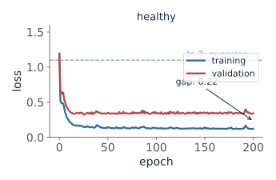
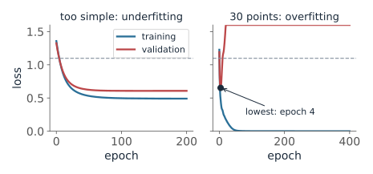
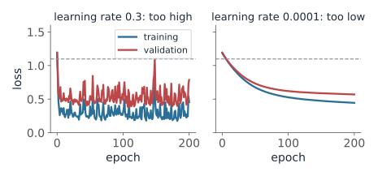
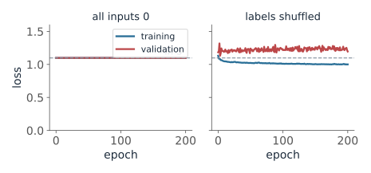
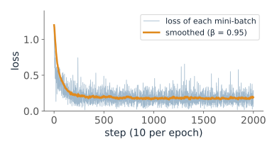
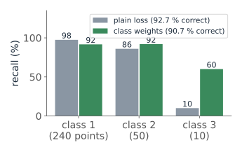

## About this lecture

The training and validation loss, plotted against the epoch, are the main instrument for seeing what training does. This unit is a field guide:

- healthy curves, **underfitting** and **overfitting**;
- a learning rate **too high** or **too low**;
- **bugs**: a loss stuck at $\ln K$, labels that do not match the images;
- **class imbalance**, where good curves hide a useless classifier;
- a **checklist**: overfit one batch first, check the inputs, fix the seeds, keep a validation set.

*Slides titled **The math** give the formulas and proofs; the ideas are complete without them.*

::: notes
All curves come from one small network on a three-armed spiral (three classes; 300 training and 300 validation points unless stated), recorded with the curvedoctor demo's code (curvedoctor/model.ts, dump in tools/figs/training-curves/). Demo tour: play runs 1–8, let the audience diagnose, then apply the fixes. The coding exercise repeats the cases with its own random numbers.
:::

## Healthy curves

:::: {.columns}
::: {.column width="45%"}
A network with two hidden layers (32 units each), Adam with learning rate 0.01, a little weight decay:

- both curves fall **fast**, then **flatten**;
- validation stays a little **above** training (the gap, here 0.22): the network fits its own data a bit better than new data;
- both end far below the dashed line $\ln 3 = 1.10$, the loss of guessing among three classes.

Final accuracy: 96 % training, 89 % validation (the classes overlap, so 100 % is impossible).
:::
::: {.column width="55%"}
{fig-alt="Training and validation loss against the epoch for 200 epochs. Both start at about 1.2, drop steeply within 10 epochs and flatten: training near 0.12, validation near 0.34. A dashed line marks ln 3, the loss of guessing; an arrow marks the gap of 0.22 between the curves at the end." width="100%"}
:::
::::

## Underfitting and overfitting

:::: {.columns}
::: {.column width="40%"}
**Underfitting** (left): a linear classifier on the spiral. Both losses level off **high** and **together** (0.49 and 0.61). The model cannot express the boundary: train longer and nothing changes. Fix: a larger model, better features.

**Overfitting** (right): 30 training points and a large network (two layers of 64). The training loss goes to 0; the validation loss is lowest at **epoch 4** (0.65), then climbs to 4.6. Fix: more data, augmentation, weight decay, early stopping.
:::
::: {.column width="60%"}
{fig-alt="Two plots of loss against epoch. Left, too simple: training and validation loss fall together and level off at about 0.5 and 0.6. Right, 30 training points: the training loss falls to zero within about 50 epochs, the validation loss is lowest at epoch 4 (marked) and then rises out of the plot." width="100%"}
:::
::::

## The learning rate, seen in the curves

:::: {.columns}
::: {.column width="40%"}
**Too high** (left, Adam 0.3): a fast first drop, then the loss **jumps up and down** and never settles; validation is noisier still. Each step overshoots the valley ([optimisers unit](../optimisers/lec.qmd)). In worse cases the loss explodes to NaN.

**Too low** (right, Adam 0.0001): smooth, together, and **still falling** at the end: training stopped long before it was done. Easy to mistake for underfitting: the test is whether the curves are still falling.

Fix: try learning rates a factor 3–10 apart on short runs; use a schedule.
:::
::: {.column width="60%"}
{fig-alt="Two plots of loss against epoch. Left, learning rate 0.3: a drop to about 0.3 within a few epochs, then training loss jumping between 0.2 and 0.6 and validation between 0.3 and 1.1 for the rest of the run. Right, learning rate 0.0001: both curves fall slowly and smoothly from 1.2 to about 0.45 and 0.57 at epoch 200, still falling." width="100%"}
:::
::::

## Bugs: a loss stuck at ln K

:::: {.columns}
::: {.column width="40%"}
**All inputs 0** (left: the images were never loaded, or divided by 255 twice): both losses sit at **exactly 1.0986 = ln 3** from the first epoch. The network can only learn how common each class is.

**Labels shuffled** against the inputs (right: a sorting bug, a misaligned file list): the training loss creeps **below** ln 3 (memorising nonsense), the validation loss stays **above** it. Validation accuracy 22 %, worse than guessing.

A loss near $\ln K$ that will not move: check the data before the model.
:::
::: {.column width="60%"}
{fig-alt="Two plots of loss against epoch with ln 3 dashed. Left, all inputs 0: both curves lie exactly on the ln 3 line for all 200 epochs. Right, labels shuffled: training loss falls slowly from 1.13 to 1.0, just below ln 3; validation loss stays around 1.2, above it." width="100%"}
:::
::::

## The math: the loss of guessing {.math}

A network that ignores its input can still learn a constant output: class probabilities $q_k$ for every example. With class frequencies $f_k$, its mean cross-entropy is

$$\mathcal L(q) = -\sum_k f_k\ln q_k, \qquad \text{minimal at } q_k = f_k: \quad \mathcal L^* = -\sum_k f_k\ln f_k = H(f)$$

- $H(f)$ is the **entropy** of the class frequencies. Balanced, $f_k = 1/K$: $\mathcal L^* = \ln K$ (0.693 for 2 classes, 1.099 for 3, 2.303 for 10).
- Imbalanced 90 % / 10 %: $\mathcal L^* = -0.9\ln 0.9 - 0.1\ln 0.1 = 0.325$. A loss of 0.3 then means **nothing learnt**.
- Minimum by Lagrange multipliers ($\sum q_k = 1$): $f_k/q_k = \mu$ for all $k$, so $q_k = f_k$ (Gibbs' inequality).
- At initialisation a network should give about $\ln K$; much more means overconfident random outputs (initial weights too large).

## Other signs of trouble

- **Validation better than training**: normal with dropout or strong augmentation (training is measured on harder, modified data); suspicious otherwise: is the validation set easier, or does it overlap the training set?
- **Validation suspiciously good** from the first epoch: leakage (duplicates, augment-then-split, neighbouring tiles of one image; [leakage unit](../leakage/lec.qmd)).
- **Loss becomes NaN**: learning rate far too high, a division by zero or log of zero in the loss, unnormalised inputs in the thousands.
- **Loss 0 at once**: the label is in the input (a filename, a channel that is the mask).
- **Sudden spikes**: a bad batch (a corrupt image), or the learning rate at the edge of stability.

## Noisy curves and smoothing

:::: {.columns}
::: {.column width="40%"}
Curves per **epoch** (on the whole training and validation sets) are smooth. Curves per **mini-batch** are noisy: each batch of 32 points is different.

The healthy run of the course code, 2000 steps: in the second half the batch losses range from 0.02 to 0.66.

A **moving average** shows the trend: $s_t = \beta s_{t-1} + (1 - \beta)x_t$; with $\beta = 0.95$ the second half stays between 0.16 and 0.20.

Do not react to one bad batch; do react to a trend.
:::
::: {.column width="60%"}
{fig-alt="The loss of each of 2000 mini-batches (light blue, very noisy between about 0 and 0.7 after the first 200 steps) and its moving average with beta 0.95 (orange), which falls smoothly from 1.2 to about 0.2 and stays there." width="100%"}
:::
::::

## Try it: the curve doctor

```{=html}
<link rel="stylesheet" href="../demos/dist/demo.css">
<div data-demo="curvedoctor" data-run="1"></div>
<script src="../demos/dist/curvedoctor.js"></script>
```

::: notes
Eight recorded runs: 1 overfitting, 2 inputs 0, 3 learning rate too high, 4 healthy, 5 class imbalance, 6 underfitting, 7 shuffled labels, 8 learning rate too low. Play a run, ask for a diagnosis, click it, then "apply the fix". Run 5 is the trap: the curves look healthy; the recall line gives it away.
:::

## Class imbalance: accuracy lies

:::: {.columns}
::: {.column width="40%"}
The same spiral with 240, 50 and 10 points of the three classes (training and validation alike). Always answering "class 1" is already 80 % correct.

- Plain loss: 92.7 % correct, healthy curves; but class 3 is found in only **1 of 10** cases.
- **Class weights** $N/(Kn_k)$ (0.42, 2, 10): class 3 found in 6 of 10; overall 90.7 %.

With imbalance, look at the **recall of each class** (or a confusion matrix, F1 per class), not the accuracy.
:::
::: {.column width="60%"}
{fig-alt="Bar chart of the validation recall per class. Plain loss (grey): class 1 (240 points) 98 percent, class 2 (50) 86, class 3 (10) 10. Class weights (green): 92, 92 and 60. Overall accuracy 92.7 percent with the plain loss, 90.7 with class weights." width="100%"}
:::
::::

## The math: weighted loss and focal loss {.math}

- **Weighted cross-entropy**: $\mathcal L = -\frac1N\sum_n w_{y_n}\ln p_{y_n}$ with $w_k = N/(Kn_k)$. Each class then contributes equally in total: $\sum_{n: y_n = k} w_k = N/K$. Equivalent in expectation to resampling the classes to equal frequency.
- **Focal loss** (Lin et al., 2017): $\ell = -(1 - p)^\gamma\ln p$, $p$ the probability of the true class. $\gamma = 0$ is cross-entropy; $\gamma = 2$ turns down the easy examples: $p = 0.9$ gives 0.105 → 0.001, $p = 0.1$ gives 2.30 → 1.87. The many easy background examples stop dominating the gradient (used in detection, the [cell networks](../cellnets-compare/lec.qmd) day).
- Alternatives: oversample the rare class (with augmentation), or adjust the decision threshold after training.

## A checklist before the long run

1. **Look at the inputs** as the network gets them: after loading, normalisation and augmentation. Are the values in the expected range? Do images and masks still match?
2. **Check the loss at initialisation**: about $\ln K$ for $K$ balanced classes.
3. **Overfit one batch**: a few examples must be learnt to loss ≈ 0. If not, there is a bug.
4. **Fix the seeds**, so that two runs can be compared (initial weights, data order, augmentation).
5. **Keep a validation set** apart from the training data (by image, by experiment); never tune on the test set ([evaluation day](../leakage/lec.qmd)).
6. Start **small** (a short run, a few learning rates), then scale up.
7. Plot both curves **during** training; keep the weights with the lowest validation loss.

## Overfit one batch first

The cheapest test of the whole pipeline (course code, the healthy network, 300 steps on the same 8 examples):

| | loss at step 0 | after 300 steps | correct |
|---|---|---|---|
| 8 examples | 1.102 | **0.0003** | 100 % |
| the same 8, inputs 0 (the bug) | 1.099 | **1.082** | 38 % |

- A correct network with a correct pipeline memorises 8 examples in seconds. If it cannot, no amount of data or training will help: something between the files and the loss is broken.
- The bugged run ends at the loss of guessing **the class frequencies of those 8 labels**: it learnt only the bias.

## Early stopping as pseudocode

```
best = infinity;  waited = 0
for each epoch:
    train one epoch
    v = loss on the validation set
    if v < best:
        best = v;  save the weights;  waited = 0
    else:
        waited = waited + 1
        if waited ≥ patience: stop
use the saved weights
```

- **Patience** (e.g. 10–50 epochs) keeps one noisy epoch from stopping training too early. Course code, overfitting case: patience 10 stops at epoch 14 and keeps epoch 4 (validation 70 % correct); patience 50 stops at epoch 88 and keeps epoch 38 (83 %).

::: notes
The coding exercise (training/src/training_curves/) writes smooth, early_stopping, chance_loss, class_weights and focal_loss, and runs all the cases of this lecture on its own data.
:::

## Summary

| Curves | Diagnosis | First thing to try |
|---|---|---|
| fall fast, flatten, close together | healthy | nothing |
| level off high, together | underfitting | larger model |
| training → 0, validation turns up | overfitting | more data, augmentation, early stopping |
| jumpy, never settle | learning rate too high | lower it, schedule |
| smooth, still falling at the end | learning rate too low | raise it, train longer |
| stuck exactly at $\ln K$ | inputs carry nothing | check the data loading |
| training below, validation above $\ln K$ | labels do not match inputs | check the pairing |
| healthy, but one class never found | imbalance | recall per class, class weights |

Next: the [evaluation day](../object-eval/lec.qmd): measuring how good the trained network really is.
