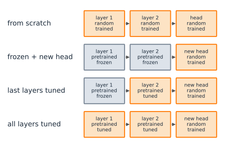
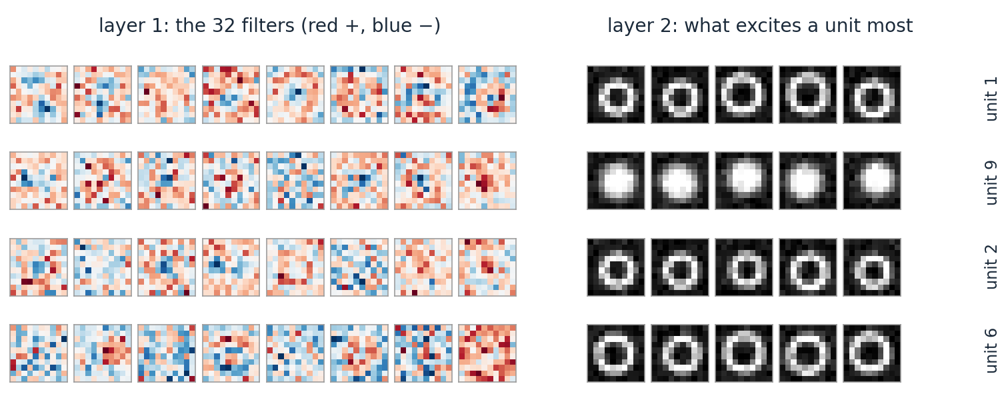
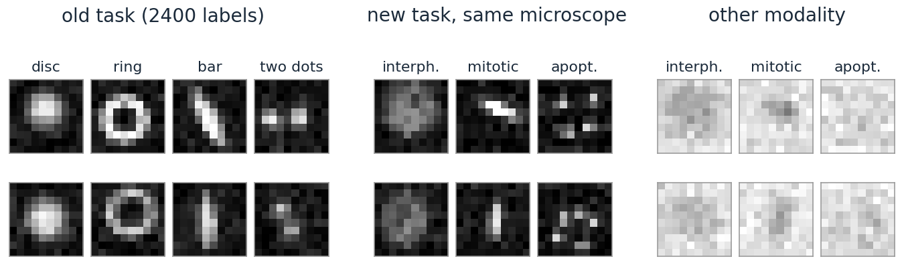
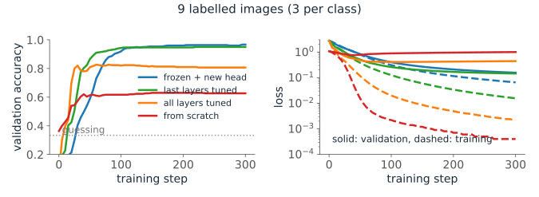
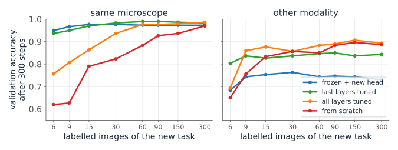
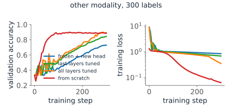

## About this lecture

The [cell-networks day](../stardist/lec.qmd) used networks trained by others (StarDist, Cellpose, SAM). The [attention unit](../attention/lec.qmd) showed the two ways to reuse one: frozen features with a probe, or fine-tuning. This day is about doing that well on **your** images.

- What a pretrained network has learnt, layer by layer.
- Four options: use it **as is**, **frozen backbone + new head**, **fine-tune** some or all layers, or **train from scratch**.
- Which one wins depends on **how many labels** you have and **how different** your images are.
- A toy you can train in the browser: four small networks, side by side.

*Slides titled **The math** give the formulas and proofs; the ideas are complete without them.*

::: notes
Demo tour: transfercurves, presets "9 labels" (the frozen probe wins), "300 labels" (everyone catches up, fine-tuning is best), "9 labels, smaller rate", then the two "other modality" presets (the frozen features do not fit). The deck's numbers come from the demo's own code (tools/figs/transfer/dump.ts).
:::

## Why reuse a network?

:::: {.columns}
::: {.column width="55%"}
- A segmentation or classification network has **millions** of weights. Learning them from scratch needs many thousands of annotated objects.
- You have **dozens**: annotating is slow, and needs an expert.
- But a network trained on **another** large image collection has already learnt what images are made of: edges, blobs, textures, shapes.
- **Transfer learning**: start from that network and spend your few labels on the part that is specific to your task.
:::
::: {.column width="45%"}
{fig-alt="Four rows of three boxes: layer 1, layer 2 and head. From scratch: all three random and trained. Frozen + new head: layers 1 and 2 pretrained and frozen (grey), a new random head trained. Last layers tuned: layer 1 frozen, layer 2 pretrained and tuned, new head. All layers tuned: both layers pretrained and tuned, new head." width="100%"}
:::
::::

## What a pretrained network has learnt

{fig-alt="Left: the 32 first-layer filters of the toy network as 10 × 10 colour maps, red positive and blue negative; most look noisy, a few have a centre-surround or a stripe. Right: for four units of layer 2, the five patches of the old task that excite each unit most: rings for three units, discs for one." width="92%" fig-align="center"}

- **Layer 1**: weighted sums of pixels: small local detectors (in large networks: edges and blobs at every orientation).
- **Layer 2** combines them: units that answer to **rings**, others to **discs**: parts of objects.
- Deeper layers of large networks: textures, then parts, then whole objects. The **early layers are general**; the last ones are specific to the old task.

::: notes
The toy network (100 → 32 → 16 → 4) was trained on 2400 labelled 10 × 10 patches of four shapes (disc, ring, bar, two dots), old-task accuracy 98 %. Its first-layer filters are noisy: 2400 small patches are not much; filters of networks trained on millions of photographs are clean Gabor-like edges and colour blobs.
:::

## The toy: an old task and a new one

{fig-alt="Example 10 × 10 patches. Old task, 2400 labels: disc, ring, bar, two dots, bright on dark. New task, same microscope: interphase (a large dim nucleus with dark nucleoli), mitotic (a bright compact bar), apoptotic (scattered bright fragments). New task, other modality: the same cells dark on a bright, blurred background." width="88%" fig-align="center"}

- **Old task** (pretraining): four shapes, 2400 labelled patches.
- **New task**: three cell phenotypes; only **6 to 300** labels. Validation: 300 other labelled patches.
- The new classes look **somewhat** like the old shapes (mitotic plate ~ bar, fragments ~ dots), as cells look somewhat like everyday objects.

## Four options

| option | what is trained | weights trained (toy) |
|---|---|---|
| **as is** | nothing (only if the old task **is** your task) | 0 |
| **frozen + new head** (linear probe) | a new last layer on the frozen features | 51 |
| **last layers tuned** | layer 2 and the head; layer 1 frozen | 579 |
| **all layers tuned** | every weight, starting from the pretrained ones | 3811 |
| **from scratch** | every weight, starting from random | 3811 |

- **Frozen**: the backbone's outputs never change: compute them once, then train a tiny classifier (fast; works on a laptop).
- **Fine-tuning**: keep training the pretrained weights on your labels, usually with a **smaller** learning rate.
- "As is" applies when the network already knows your classes: Cellpose on nuclei that look like its training nuclei.

## The math: a linear probe {.math}

Frozen features $\mathbf f(\mathbf x) \in \mathbb R^d$ (the outputs of the last frozen layer). The head is softmax regression:

$$p_k(\mathbf x) = \frac{e^{\mathbf w_k\cdot\mathbf f(\mathbf x) + b_k}}{\sum_j e^{\mathbf w_j\cdot\mathbf f(\mathbf x) + b_j}}, \qquad \mathcal L = -\frac1N\sum_n \log p_{y_n}(\mathbf x_n)$$

- $\mathcal L$ is **convex** in $(\mathbf w, b)$: one minimum, gradient descent finds it, no bad starts.
- Gradient for one example: $\partial\mathcal L/\partial\mathbf w_k = (p_k - y_k)\,\mathbf f$: the backpropagation of the [neural-networks day](../backprop/lec.qmd), stopped at the head.
- Parameters: $K(d + 1)$; toy: $3 \cdot 17 = 51$. With $N$ labels and $K(d+1) \ll N$ it cannot memorise much.

## Try it: four networks side by side

```{=html}
<link rel="stylesheet" href="../demos/dist/demo.css">
<div data-demo="transfercurves" data-preset="few"></div>
<script src="../demos/dist/transfercurves.js"></script>
```

::: notes
Pretraining takes about a second when the page opens. Then "train": four networks, 300 full-batch Adam steps each, learning rate 0.003. "9 labels": frozen 96.7 %, last layers 95.0 %, all layers 80.7 % (best 82.7 % at step 60), scratch 62.7 %. "300 labels": 97.3, 98.3, 98.7, 97.0 %. "show loss": with 9 labels the training loss of "all layers" and "scratch" goes to 0.002 and 0.0004 while their validation loss rises: memorising.
:::

## Few labels: the frozen probe wins

{fig-alt="Training with 9 labelled images. Left: validation accuracy against the training step: frozen + new head rises to 97 %, last layers tuned to 95 %, all layers tuned to 81 %, from scratch to 63 %; guessing is 33 %. Right: losses on a log scale: the training losses (dashed) of all layers and scratch fall to 0.002 and 0.0004, while their validation losses (solid) stay high, 0.44 and 1.0; the frozen probe's training and validation losses stay close (0.07 and 0.16)." width="85%" fig-align="center"}

- 9 labels, 3 per class. **Scratch** memorises them (training loss 0.0004) and generalises badly: 63 %.
- **All layers tuned** starts well but drifts away from the useful pretrained features: 81 %.
- **Frozen + new head**: 51 weights cannot memorise much, and the features already separate the classes: **97 %**.

## How many labels for which option?

{fig-alt="Validation accuracy after 300 steps against the number of labelled images (6 to 300, log scale), two panels. Same microscope: frozen + new head is near 97 % from 9 labels on and flat; last layers tuned 94 to 99 %; all layers tuned rises from 76 % to 99 %; from scratch from 62 % to 97 %. Other modality: frozen stays near 74 %; last layers near 84 %; all layers tuned and scratch rise to about 89 %." width="92%" fig-align="center"}

- **Same microscope**: frozen is best up to 15 labels; tuning the last layers is best from 30; all layers catch up at 150 to 300; scratch reaches 97 % only at 300.
- **Other modality** (dark cells on a bright background): the frozen features **do not fit**; the probe is stuck at 74 %, and tuning wins at every size.

## The math: why fewer trained weights need fewer labels {.math}

A rough rule from learning theory: the gap between training and test error grows with the **capacity** of what is trained and shrinks with the number of examples $N$,

$$\text{test error} \;\lesssim\; \text{training error} + C\sqrt{\frac{\text{capacity}}{N}}$$

(for a linear head: capacity ≈ number of weights $K(d+1)$).

- Frozen: the training error may be **higher** (the features are fixed: **bias**), but the gap is small (51 weights: little **variance**).
- Fine-tuning all 3811 weights: training error → 0, but with 9 labels the gap is large.
- Starting from pretrained weights acts like a strong **prior**: fine-tuning moves little, so the effective capacity is smaller than the weight count suggests (next unit: low-rank changes).

## When the new images look different

:::: {.columns}
::: {.column width="55%"}
- The old features answer to **bright** blobs and rings. On dark cells on a bright background they respond to the background.
- With 300 labels the frozen probe still reaches only **73 %**, and its **training** loss stays at 0.86: it **underfits**. More labels do not help a head whose features are wrong.
- Tuning **all layers** (89 %) adapts the features; it is as good as scratch here (89 %), and better with 9 labels (86 % against 76 %).
- The pretrained weights still help as a **starting point**, even when they are wrong as **features**.
:::
::: {.column width="45%"}
{fig-alt="Other modality, 300 labels. Left: validation accuracy against the training step: all layers tuned and from scratch reach about 89 %, last layers tuned 84 %, frozen + new head 73 %. Right: training loss on a log scale: from scratch falls to 0.06, all layers tuned to 0.36, last layers tuned to 0.70, while frozen + new head stays at 0.86." width="100%"}
:::
::::

## A decision table

| your situation | first choice |
|---|---|
| the network was trained on images and classes like yours | **as is**; check on an annotated subset |
| few labels (tens), images like the pretraining images | **frozen backbone + new head** |
| hundreds of labels, similar images | fine-tune the **last layers**, then all, with a small rate |
| images unlike anything in pretraining | fine-tune **all layers** (or scratch with many labels) |
| very many labels and a very different domain | from scratch is fine, but rarely better than fine-tuning |

Always: a **held-out** annotated set of **your** images to choose, and a separate test set to report (the [leakage unit](../leakage/lec.qmd)).

## Fine-tuning as pseudocode

```
start:    W[1..L-1] = pretrained weights,  W[L] = small random (new head, K outputs)
frozen:   F = the first f layers (rate 0);  T = the other layers
if f > 0: compute h = output of layer f for every training image, once
repeat for a number of steps:
    batch = some labelled images (or their stored h)
    forward through the layers in T, loss = cross-entropy
    backward through the layers in T only
    for every layer l in T:  W[l] = W[l] − rate[l] · gradient[l]
keep the weights with the best validation score
```

- Frozen layers cost nothing to train: their outputs are computed once and stored.
- The coding exercise trains a linear probe on frozen features and compares it with training from scratch.

::: notes
The coding exercise (finetuning/src/transfer/ in the course code download): features after a number of layers, a softmax-regression probe trained by gradient descent, its accuracy, and the count of trained weights. The program also compares a probe on the features of an untrained (random) network: the pretraining, not the architecture, makes the features good.
:::

## Practical pitfalls

:::: {.columns}
::: {.column width="55%"}
- **Preprocess like the pretraining**: the same intensity scaling, the same channel order, the same **pixel size** (a network trained at 0.3 µm per pixel sees different objects at 0.1 µm: rescale, as Cellpose's diameter does).
- **Validation with few labels is noisy**: 9 validation images give accuracies in steps of 11 %. Keep a separate held-out set, or cross-validate.
- **Early stopping** matters more when fine-tuning: "all layers" was best at step 60 (82.7 %) and then fell to 80.7 %.
- Grey images into a colour network: copy the grey channel three times.
:::
::: {.column width="45%"}
{fig-alt="The 9-label training curves again: all layers tuned peaks early and falls slightly." width="100%"}
:::
::::

## Summary

| Idea | In one line |
|---|---|
| Pretrained features | early layers general (edges, blobs), later layers specific to the old task |
| Frozen + new head | a linear probe on fixed features: few weights, few labels, convex |
| Fine-tuning | continue training pretrained weights; needs more labels and a small rate |
| From scratch | needs the most labels; with few it memorises |
| The choice | few labels → frozen; more labels or a different domain → tune more layers |
| Different images | frozen features underfit; pretrained weights still help as a start |

Next: [fine-tuning strategies](../finetune-strategies/lec.qmd): which layers, which rates, and changing a network with very few new numbers.
