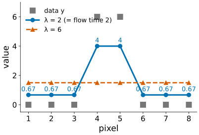
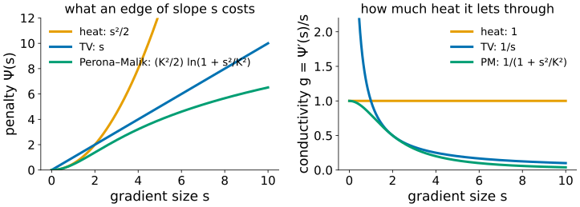
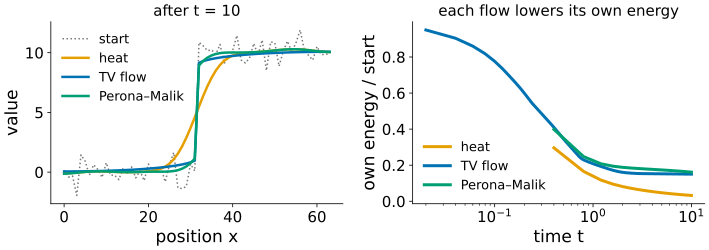
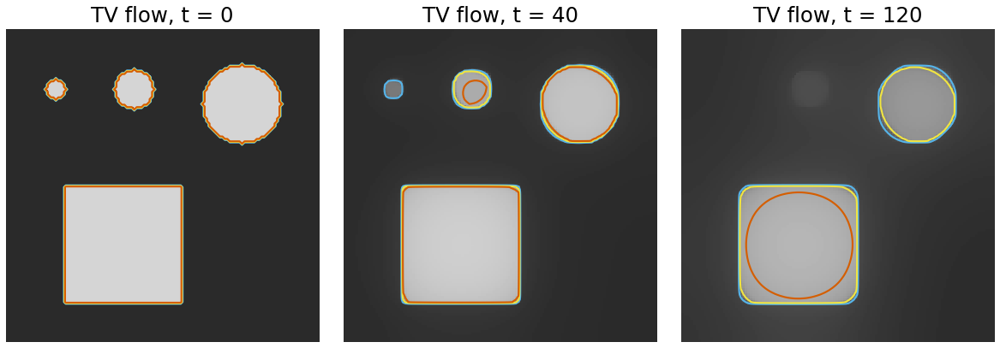
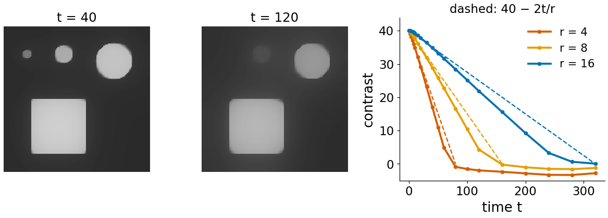
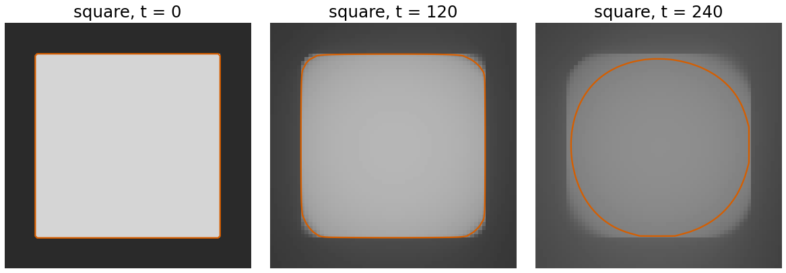
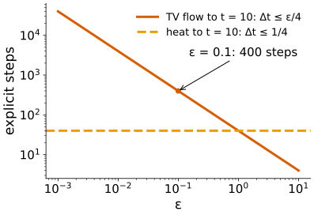
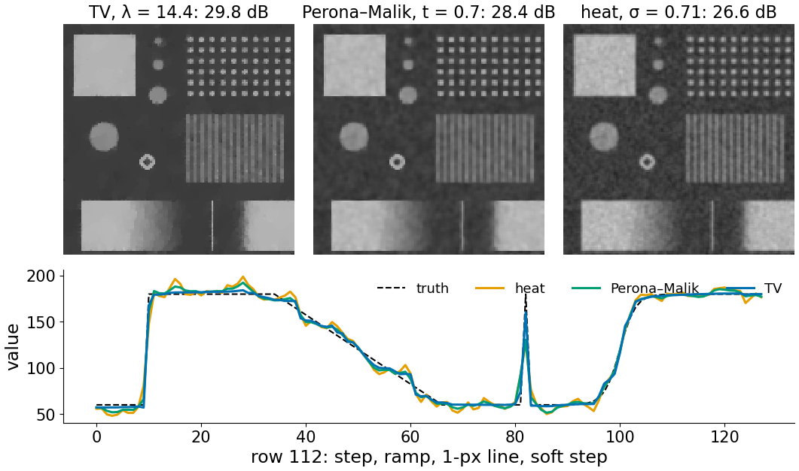

## About this lecture

Two units ago: heat flow. Last unit: Perona–Malik. Both look like rules ("move towards your neighbours, but not across edges"). Here they become one idea: **go downhill on an energy**, and a third member of the family, **total variation flow**.

- **Three smoothers, three energies**: what each charges for a gradient.
- **TV flow**: every level line moves by its curvature; flat regions keep their sharp edges but **lose contrast at a rate perimeter/area**.
- **Small things go first**: a scale space of its own, where scale is area over perimeter.
- **Flow time ≈ λ** of TV denoising, and why the flow is hard to compute ("stiff").

Slides titled **The math** give the formulas and proofs; the ideas are complete without them.

::: notes
Recalled: total variation as a prior and TV denoising (ROF) from the Ising day ([gmrf](../gmrf/lec.qmd)); curvature flow of a curve from the level-set day ([levelset-eq](../levelset-eq/lec.qmd)). Both recalls are self-contained for students who did not take those days. The day's earlier units: [heat-equation](../heat-equation/lec.qmd) (explicit steps, stability) and [perona-malik](../perona-malik/lec.qmd).
:::

## Recall: total variation

:::: {.columns}
::: {.column width="55%"}
The **total variation** of an image adds up the size of the gradient, $\sum |\nabla u|$ (the Ising day, [quadratic and TV smoothing](../gmrf/lec.qmd)).

- A step of height $h$ costs $h$ per unit of its length, however sharp it is: **sharp edges are cheap**.
- A squared penalty would charge a sharp step much more than the same rise spread over many pixels: it prefers blur.
- **TV denoising** (Rudin, Osher & Fatemi): minimise $\tfrac12\sum (u - y)^2 + \lambda\,\mathrm{TV}(u)$. It keeps steps, turns ramps into staircases, and lowers the contrast of small plateaus.

By hand, $y = (0, 0, 0, 6, 6, 0, 0, 0)$, $\lambda = 2$: the middle plateau drops by 2 to 4, the outer ones rise by $2/3$; the steps stay sharp.
:::
::: {.column width="45%"}
{width="100%" fig-alt="The data 0 0 0 6 6 0 0 0 (grey squares) and its TV denoising: with lambda = 2 the middle plateau is at 4 and the outer pixels at 0.67, still with sharp steps; with lambda = 6 all values are 1.5."}
:::
::::

## Three smoothers, three energies

:::: {.columns}
::: {.column width="45%"}
Each smoother says what a gradient of size $s$ **costs**, $\Psi(s)$:

- **heat**: $\Psi = s^2/2$. Big gradients are very expensive: blur them away.
- **TV**: $\Psi = s$. Every unit of rise costs the same, however steep: sharp edges are cheap.
- **Perona–Malik**: $\Psi = \tfrac{K^2}{2}\ln(1 + s^2/K^2)$: flattens out. Large gradients are almost **free**: edges are kept, even sharpened.

The conductivity of the flow is $g = \Psi'(s)/s$ (right): 1 for heat, $1/s$ for TV, $g_2$ for Perona–Malik. The same "data + λ · penalty" pattern as in [regularisation](../regularise/lec.qmd).
:::
::: {.column width="55%"}
{width="100%" fig-alt="Left: the penalty against the gradient size for heat (a parabola), TV (a straight line) and Perona–Malik with K = 2 (a logarithm that flattens out). Right: the corresponding conductivity g: constant 1 for heat, 1/s for TV (infinite at 0), and 1/(1 + s²/K²) for Perona–Malik."}
:::
::::

## Smoothing = going downhill on an energy

:::: {.columns}
::: {.column width="40%"}
Each flow changes the image in the direction that lowers **its own** energy fastest (gradient descent):

- heat lowers $\sum|\nabla u|^2$: it removes noise and blurs the step;
- TV flow lowers $\sum|\nabla u|$: it removes the noise and keeps the step sharp;
- Perona–Malik lowers its flattening energy, which is **not convex** (the backward range of the last unit): the result depends on the start and on when you stop.

A convex energy (heat, TV) has one minimum and a well-behaved flow towards it.
:::
::: {.column width="60%"}
{width="100%" fig-alt="Left: a noisy step and the results of heat (a blurred step), TV flow and Perona–Malik (both sharp) after time 10. Right: each flow's own energy divided by its start value falls monotonically over time."}
:::
::::

## The math: Euler–Lagrange equations {.math}

- Energy $E(u) = \int \Psi(|\nabla u|)\,dx$. Perturb $u \to u + \epsilon v$: $\frac{d}{d\epsilon}E = \int \Psi'(|\nabla u|)\,\frac{\nabla u}{|\nabla u|}\cdot\nabla v = -\int \nabla\cdot\Big(\Psi'(|\nabla u|)\frac{\nabla u}{|\nabla u|}\Big)\,v$ (integrate by parts, no flux at the border).
- So the gradient of $E$ is $-\nabla\cdot(g\,\nabla u)$ with $g(s) = \Psi'(s)/s$, and gradient descent is $u_t = \nabla\cdot(g(|\nabla u|)\,\nabla u)$.
- $\Psi = s^2/2$: $g = 1$, heat. $\Psi = s$: $g = 1/s$, **TV flow** $u_t = \nabla\cdot(\nabla u/|\nabla u|)$. $\Psi = \tfrac{K^2}2\ln(1 + s^2/K^2)$: $g = 1/(1 + s^2/K^2) = g_2$, Perona–Malik.
- $\Psi'' < 0$ (non-convex) exactly where $s > K$: the backward range of Perona–Malik is where its energy bends the wrong way.

## TV flow: level lines move by their curvature

:::: {.columns}
::: {.column width="40%"}
Think of the image as a stack of **level lines** (iso-contours). Under TV flow each level line moves **inwards by its curvature** ($1/\text{radius}$), the curve-shortening flow of the [level-set day](../levelset-eq/lec.qmd):

- a **straight edge** has curvature 0: it does not move, it stays sharp;
- a **corner** has high curvature: it rounds off;
- a small **disc** has large curvature everywhere: it shrinks in contrast quickly.

The edge position hardly changes; what changes is the **height** of the regions.
:::
::: {.column width="60%"}
{width="100%" fig-alt="Three discs and a square under TV flow at times 0, 40 and 120, with level lines at three heights drawn in colour. The smallest disc fades away, the outlines of the larger ones stay where they were, and the square's level lines round off at the corners."}
:::
::::

## The math: the curvature of level lines {.math}

- At a point with $\nabla u \ne 0$, the unit normal of the level line is $n = \nabla u/|\nabla u|$, and its curvature is $\kappa = \nabla\cdot n$ (for a circle of radius $r$: $1/r$).
- So TV flow is $u_t = \nabla\cdot(\nabla u/|\nabla u|) = \kappa$: the **height** changes by the curvature of the level line through the point.
- Equivalently, a level line moves along its normal with speed $\kappa/|\nabla u|$: steep edges (large $|\nabla u|$) move slowly, the level lines of gentle slopes fast.
- Compare the heat equation: $u_t = \Delta u = |\nabla u|\,\kappa + u_{\eta\eta}$; it has the extra term across the edge, which is what blurs.

## Small things go first

:::: {.columns}
::: {.column width="40%"}
A bright **disc** of radius $r$ and contrast $c$ on a flat background:

- it keeps its **shape** and its **sharp edge**;
- its contrast falls at the steady rate **perimeter/area** = $2\pi r/\pi r^2 = 2/r$;
- it disappears at $t = c\,r/2$.

Radius 4, 8, 16, contrast 40: gone at $t$ = 80, 160, 320 (right: measured, and the predicted lines).

TV flow is a **scale space of its own**: the scale of a region is its area over its perimeter, not a σ.
:::
::: {.column width="60%"}
{width="100%" fig-alt="Discs of radius 4, 8 and 16 and a square under TV flow at t = 40 and t = 120: the small disc has gone by 120, the others keep sharp outlines but are fainter. Right: the contrast of each disc against time falls along straight lines 40 − 2t/r and reaches 0 near t = 80, 160 and 320."}
:::
::::

## The math: the rate $2/r$ {.math}

- Let $D$ be a bright plateau of height $h(t)$ and $\partial D$ its boundary, where the image steps down. Integrate the flow over $D$:
$$|D|\,h'(t) = \int_D \nabla\cdot\frac{\nabla u}{|\nabla u|} = \oint_{\partial D}\frac{\nabla u}{|\nabla u|}\cdot n_{\text{out}} = -|\partial D|,$$
since on the edge the gradient points inwards (uphill), so the unit vector $\nabla u/|\nabla u|$ is $-n_{\text{out}}$.
- So $h' = -|\partial D|/|D|$: **perimeter over area**. For a disc, $-2/r$; in 1D a plateau of width $w$ with two jumps: $-2/w$, with one jump: $-1/w$.
- Exactly true for convex shapes whose curvature never exceeds perimeter/area (discs are such "calibrable" sets; a square is not, which is why its corners round off).

## Flow time ≈ λ

:::: {.columns}
::: {.column width="45%"}
Run TV flow for a time $t$, or solve TV denoising (ROF) with weight $\lambda = t$: in 1D the two give **exactly** the same result (for the ideal flow); in 2D they are close.

By hand, $y = (0, 0, 0, 6, 6, 0, 0, 0)$, $t = \lambda = 2$:

- the middle plateau (width 2, two jumps) drops at rate $2/2 = 1$: $6 \to 4$;
- each outer plateau (width 3, one jump) rises at rate $1/3$: $0 \to 2/3$;
- the mean (1.5) is kept; the steps stay sharp.

With $\lambda = 6$ the middle would drop to 0 and the outer rise to 2: they **meet** first (at $\lambda = 4.5$), and the result is flat at 1.5.
:::
::: {.column width="55%"}
{width="100%" fig-alt="The same by-hand example: data 0 0 0 6 6 0 0 0; lambda = 2 gives 0.67, 0.67, 0.67, 4, 4, 0.67, 0.67, 0.67; lambda = 6 gives 1.5 everywhere."}
:::
::::

## The math: ROF is one implicit TV-flow step {.math}

- ROF: minimise $\tfrac12\|u - y\|^2 + \lambda\,\mathrm{TV}(u)$. Optimality (a subgradient condition, since TV is not differentiable where $\nabla u = 0$): $u - y = \lambda\,\nabla\cdot\big(\nabla u/|\nabla u|\big)$.
- That is one **implicit** (backward Euler) step of TV flow from $y$ with $\Delta t = \lambda$: $\frac{u - y}{\lambda} = \kappa(u)$.
- Many small implicit steps give the flow; one big step gives ROF. In 1D (and for radially symmetric data in 2D) one big step and many small ones agree exactly; in general they differ slightly.
- The demo computes TV flow in 2D as repeated ROF steps (time step 2), which is stable for any step size.

## Try it: discs, plateaus, corners

```{=html}
<link rel="stylesheet" href="../demos/dist/demo.css">
<div data-demo="tvflow" data-preset="discs"></div>
<script src="../demos/dist/tvflow.js"></script>
```

::: notes
Discs tab: discs of radius 3, 4.5, 6, 9, 12 (contrast 40), a square, a star and a bar, under TV flow (repeated ROF steps). Right: contrast against time, dashed: 40 − 2t/r. Tour: "small discs vanish first" (t = 90): r = 3 and 4.5 are gone; r = 6 has 4.3 left, r = 9 15.9, r = 12 21.5. Measured disappearance (contrast below 1): t ≈ 50, 80, 102, 154, 298 against the predicted 60, 90, 120, 180, 240: small digital discs go a little faster (their pixel outline is longer than 2πr), the largest a little slower (the repeated ROF steps are not converged on large regions). "corners round, edges stay": watch the square and the star; the bar (width 8) fades like a plateau of width 8. Then the 1D tab: "plateaus sink at rate 2/width": at t = 40 the plateaus of width 2, 4, 8 are at 80, 100, 110 exactly as predicted; dashed red (ROF with λ = t) lies on the blue flow.
:::

## Corners round, edges stay

:::: {.columns}
::: {.column width="45%"}
A square is not a disc: its corners have a very high curvature, so the level lines near the corners move fastest.

- The straight sides stay where they are and stay sharp.
- The corners are **cut**: the square turns into a rounded square, then fades; its last remains look like a disc.
- The contrast of the square falls at about perimeter/area = $4/\text{side}$, faster near the corners.

For measurement: TV-smoothed objects keep their **position** and **edge sharpness**, but lose **contrast** (in proportion to perimeter/area) and **corners**.
:::
::: {.column width="55%"}
{width="100%" fig-alt="A bright square of side 48 under TV flow at t = 0, 120 and 240, with one level line in red: at 120 the corners are rounded and the square is fainter; at 240 the level line is nearly a circle."}
:::
::::

## Numerics, honestly: TV flow is stiff

:::: {.columns}
::: {.column width="45%"}
The conductivity of TV flow is $1/|\nabla u|$: **infinite** in flat regions. Every implementation replaces it by $1/\sqrt{|\nabla u|^2 + \varepsilon^2}$, at most $1/\varepsilon$.

An explicit step must then obey the heat limit for conductivity $1/\varepsilon$:

$$\Delta t \le \varepsilon/4 \quad (2D).$$

Small ε (close to true TV) means tiny steps: flowing to $t = 10$ with ε = 0.1 takes 400 steps; with ε = 0.01, 4000. Such a problem is called **stiff**.

That is why TV denoising is solved by other algorithms (a projection on the dual problem, or primal–dual iterations), and why the demo's 2D flow uses repeated ROF steps instead of explicit ones.
:::
::: {.column width="55%"}
{width="100%" fig-alt="Number of explicit steps to reach t = 10 against epsilon on log axes: TV flow needs 40 divided by epsilon steps (400 at epsilon 0.1), the heat equation a constant 40."}
:::
::::

## The math: stiffness {.math}

- With $|\nabla u|_\varepsilon = \sqrt{|\nabla u|^2 + \varepsilon^2}$, the conductivity $g = 1/|\nabla u|_\varepsilon \in (0, 1/\varepsilon]$.
- The heat-equation analysis of the first unit with conductivity $\le g_{\max}$: the explicit step is a convex combination iff $\Delta t \le \Delta x^2/(2d\,g_{\max})$, here $\Delta t \le \varepsilon\,\Delta x^2/4$ in 2D ($\varepsilon/2$ in 1D).
- The time scale of the interesting dynamics (plateaus sinking at rate perimeter/area) does not depend on ε, so the number of steps grows like $1/\varepsilon$.
- Implicit steps (ROF) avoid the limit; their cost is an inner iterative solver per step.

## TV, Perona–Malik and heat on one image

:::: {.columns}
::: {.column width="40%"}
The noisy test card ($\sigma_n = 15$), each method tuned to remove **exactly as much as the noise** (the residual noisy − result has SD 15: the discrepancy principle of the [regularisation unit](../regularise/lec.qmd)).

- **TV** (λ ≈ 14): flat regions, sharp step, line kept; ramp slightly terraced; lattice dots lose contrast. 29.8 dB.
- **Perona–Malik** ($g_2$, $K = 15$, pre-smoothed): similar edges, more noise left in flat parts. 28.4 dB.
- **Heat** (σ ≈ 0.71): everything a little blurred, noise everywhere. 26.6 dB.

(The noisy input: 24.5 dB.)
:::
::: {.column width="60%"}
{width="100%" fig-alt="TV, Perona–Malik and heat results on the noisy test card with their PSNR (29.8, 28.4 and 26.6 dB), and their profiles along row 112 against the truth: TV and Perona–Malik follow the step and the line sharply; heat is softer and noisier."}
:::
::::

## Try it: TV, Perona–Malik and heat

```{=html}
<div data-demo="tvflow" data-preset="compare"></div>
<script src="../demos/dist/tvflow.js"></script>
```

::: notes
Image tab: each method tuned by bisection so that the residual noisy − result has the same SD as the noise (the discrepancy principle). Test card, noise 15: TV 29.8 dB, PM 28.4 dB, heat 26.6 dB (noisy 24.5). Zoom into the profile: TV and PM keep the step and the line; heat rounds both. Noise 30: TV 25.3, PM 24.2, heat 23.6 (noisy 18.5). "… on the micrograph" (noise 15): TV 25.4, PM 25.4, heat 25.3 dB: on a textured image without flat regions the three are almost equal in PSNR; TV makes the texture look patchy. Then 1D: "ramp staircases" (noise 4, t = 15): the ramp's differences cluster into jumps of 5–10 with flat bits between. "small ε": ε = 0.05 needs 1000 steps to t = 20, ε = 0.5 needs 100, same result.
:::

## Compare with Perona–Malik

| | TV flow | Perona–Malik |
|---|---|---|
| energy | $\sum|\nabla u|$, **convex** | flattening $\Psi$, **non-convex** |
| edges | kept sharp, never sharpened | kept, can be **sharpened** |
| staircases on ramps | yes (ramps with noise) | yes (ramps steeper than $K$) |
| contrast loss | predictable: rate perimeter/area | almost none at strong edges |
| well-posed | yes: one answer, continuous in the data | no (without pre-smoothing) |
| parameters | λ or time | $K$, time, pre-smoothing σ |
| when to stop | at λ (ROF), or a chosen time | must stop: no useful end state |

Both are "heat with a conductivity": TV's conductivity $1/|\nabla u|$ never reaches 0, Perona–Malik's does almost.

## Summary

- Heat, TV flow and Perona–Malik are **gradient descent** on $\sum\Psi(|\nabla u|)$ with $\Psi = s^2/2$, $s$ and a flattening function; the conductivity is $\Psi'(s)/s$.
- **TV flow** moves every level line by its curvature: straight edges stay, corners round, regions keep sharp edges and **lose contrast at rate perimeter/area** ($2/r$ for a disc; gone at $t = cr/2$).
- Small things go first: a scale space where scale = area/perimeter.
- **Flow time ≈ λ**: one ROF problem is one implicit TV-flow step; equal in 1D.
- Explicit TV flow is **stiff** ($\Delta t \le \varepsilon/4$); in practice TV is computed by other algorithms.
