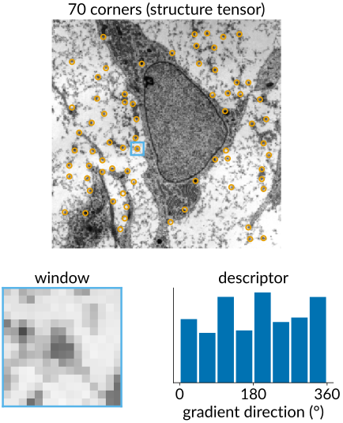
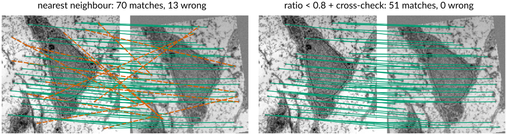
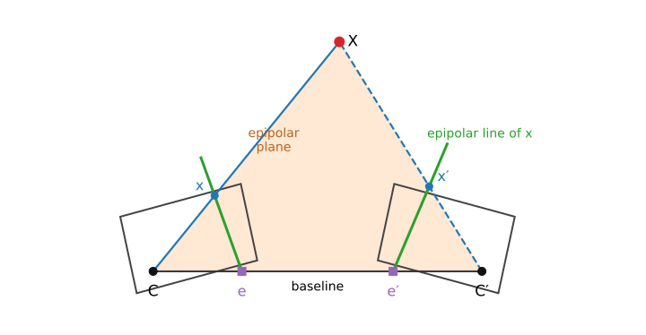
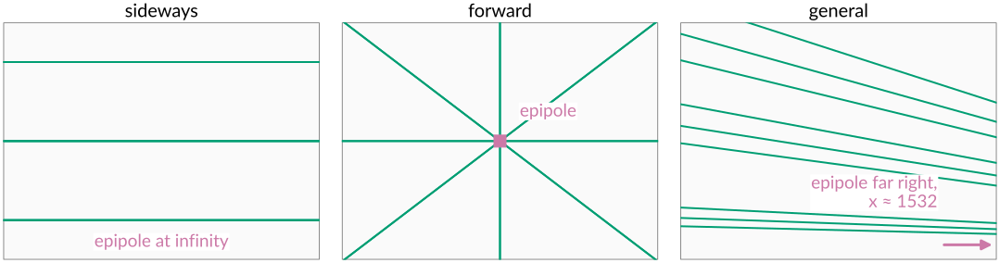
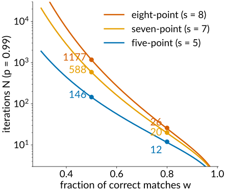
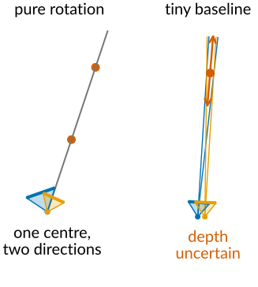
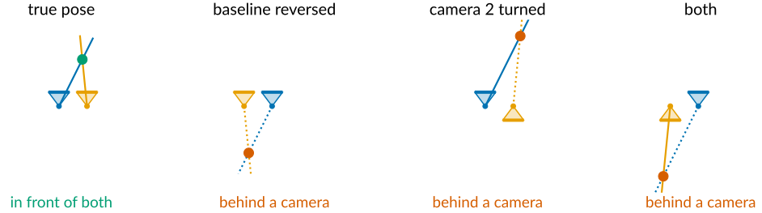
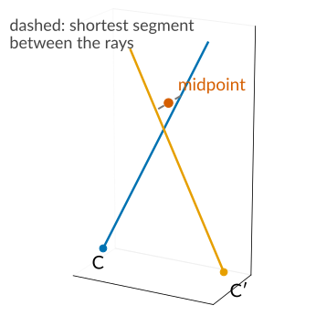
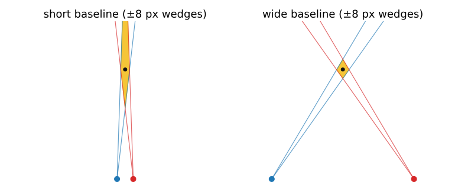

## About this lecture

Last unit: one calibrated camera turns a pixel into a ray. Now **two** cameras see the same scene.

- **Correspondences**: find the same point in both images.
- **Epipolar geometry**: the match of a point must lie on a known **line** in the other image.
- The **essential** and **fundamental** matrices: that constraint as one $3 \times 3$ matrix.
- **Estimating** it from point matches: the eight-point algorithm, inside **RANSAC**.
- What it gives: the relative **pose** of the cameras, but **not the scale**.
- **Triangulation**: from two rays to a 3D point, and how its error grows with depth.

*Slides titled **The math** give the formulas and proofs; the ideas are complete without them.*

::: notes
This unit owns matching interest points between images (descriptors, ratio test, cross-check), epipolar geometry, E and F, the eight-point algorithm and triangulation. RANSAC belongs to the Hough elective and is recalled in two slides; NCC belongs to the FFT registration day. The essential matrix is called E here; the graph-cuts day's energy is also E, but the two never meet on a slide.
:::

## Correspondences first

:::: {.columns}
::: {.column width="62%"}
Geometry from two images needs the **same** physical point found in both.

- **Interest points**: corners, where the structure tensor has two large eigenvalues, can be found again in another view ([structure tensor unit](../structure-tensor/lec.qmd)).
- **Describe** the window around each point, so that the same point looks the same in both images:
  - the normalised patch itself, compared with **normalised cross-correlation** (NCC: subtract the mean, divide by the standard deviation, then correlate; insensitive to brightness and contrast; the [matching unit](../matching/lec.qmd) has the full story);
  - or a **histogram of gradient orientations** in the window, which survives small rotations and lighting changes (the standard descriptors of image libraries are of this kind).
- A descriptor turns each interest point into a vector; similar points have nearby vectors.
:::
::: {.column width="38%"}
{fig-alt="An electron micrograph of a cell with 70 corners circled. One 15 by 15 window is enlarged, with its histogram of gradient directions in 8 bins: that histogram is the point's descriptor." width="100%"}
:::
::::

## Matching, and why it still goes wrong

For each point in image 1, take the **nearest** descriptor in image 2. Then throw out the doubtful ones:

- **Ratio test** (Lowe): accept only if the best match is clearly better than the second best, e.g. distance ratio below 0.8. Distances 0.20 and 0.60: ratio 0.33, accept. Distances 0.30 and 0.32: ratio 0.94, ambiguous, reject.
- **Cross-check**: accept only if each point is the other's best match.

Even then some matches are wrong: **repetitive texture** (windows, tiles, a regular grid of cells) produces confident, wrong matches. So whatever we estimate from matches must survive **outliers**.

{fig-alt="The micrograph and a second view of it (rotated 8 degrees, shifted, darker, noisy), with lines joining matched corners (normalised 15 by 15 patches as descriptors). Nearest neighbour alone: 70 matches, 13 wrong (red dashed lines). With the ratio test below 0.8 and the cross-check: 51 matches, none wrong." width="100%"}

## Epipolar geometry

{width="62%" fig-align="center"}

The two camera centres and a 3D point span a plane, the **epipolar plane**. It cuts each image in a line.

- The ray of $\mathbf x$ lies in the plane; so does its match $\mathbf x'$. So $\mathbf x'$ lies on a known line in image 2: the **epipolar line** of $\mathbf x$. The search for a match becomes **1D**.
- All epipolar lines pass through the **epipole**: the image of the other camera's centre (where the baseline pierces the image plane).

## Three motions, three pictures

- **Sideways** (the second camera moved along the first one's $x$ axis, same orientation): the baseline is parallel to the images, the epipoles are **at infinity**, all epipolar lines are **horizontal**. Matches lie on the same row: the setup of **stereo** (next unit).
- **Forward** (moved along the optical axis): the epipoles sit at the principal point, the epipolar lines **radiate** from it: the **focus of expansion**. Driving forward, everything streams outwards from it.
- **General** motion: lines through an epipole somewhere, often far outside the image.

The epipolar lines depend only on the two cameras, not on the scene.

{fig-alt="Epipolar lines in the second image (640 by 480, f = 700 px) for three motions. Sideways: horizontal lines, the epipole at infinity. Forward: lines radiating from the epipole at the image centre. General motion: slanted lines converging on an epipole far to the right of the image." width="100%"}

## Essential and fundamental matrix

The epipolar constraint is a single $3 \times 3$ matrix: a match $(\mathbf x, \mathbf x')$ satisfies
$$\mathbf x'^\top F\,\mathbf x = 0, \qquad F\mathbf x = \text{the epipolar line of } \mathbf x .$$

- The **essential matrix** $E$: the same constraint for **calibrated** cameras (normalised coordinates $K^{-1}\mathbf x$). It depends only on the rotation and the **direction** of the translation between the cameras: 5 degrees of freedom.
- The **fundamental matrix** $F$: in **pixels**, with both $K$s folded in: 7 degrees of freedom. Needs no calibration at all.
- Every epipolar line passes through the epipole, so $F$ is **singular** (rank 2).

## The math: from coplanarity to $E$ and $F$ {.math}

Put camera 1 at the origin; camera 2 sees $\mathbf X_2 = R\mathbf X_1 + \mathbf t$. In normalised coordinates $\hat{\mathbf x} = K^{-1}\mathbf x$, the vectors $\hat{\mathbf x}'$, $\mathbf t$ and $R\hat{\mathbf x}$ (all in camera 2's frame) lie in the epipolar plane, so

$$\hat{\mathbf x}' \cdot (\mathbf t \times R\hat{\mathbf x}) = 0 \;\Longleftrightarrow\; \hat{\mathbf x}'^\top\underbrace{[\mathbf t]_\times R}_{E}\,\hat{\mathbf x} = 0, \qquad [\mathbf t]_\times = \begin{bmatrix} 0 & -t_3 & t_2 \\ t_3 & 0 & -t_1 \\ -t_2 & t_1 & 0 \end{bmatrix}.$$

- In pixels: $\mathbf x'^\top K'^{-\top}EK^{-1}\mathbf x = 0$, so $F = K'^{-\top}E\,K^{-1}$.
- $\det F = 0$; the epipoles are the null vectors, $F\mathbf e = 0$ and $F^\top\mathbf e' = 0$.
- $E$ has two **equal** singular values and one zero ($[\mathbf t]_\times$ has singular values $\lVert\mathbf t\rVert, \lVert\mathbf t\rVert, 0$; $R$ does not change them).
- Example, sideways: $\mathbf t = (1, 0, 0)$, $R = I$: $\hat{\mathbf x}'^\top E\hat{\mathbf x} = y - y'$, so $y' = y$: the same row.

## Try it: epipolar lines

```{=html}
<link rel="stylesheet" href="../demos/dist/demo.css">
<div data-demo="epipolar" data-preset="general"></div>
<script src="../demos/dist/epipolar.js"></script>
```

::: notes
A synthetic scene (a house, a ground grid, three posts) seen by two cameras with f = 700 px, 640 × 480. Click a point in image 1: its epipolar line (green) in image 2 passes through the true match (red circle); faint green lines show the pencil through the epipole; purple marks the epipoles (an arrow when outside). The 3D view shows the epipolar plane. Tour: "general motion" (baseline 1.2, direction 20°, rotation −10°): epipoles at (2243, 240) in image 1 and (1547, 183) in image 2, both far outside. "Sideways": horizontal lines, epipoles at infinity. "Forward": lines radiate from (320, 240), the focus of expansion. "Pure rotation": no baseline, no lines at all. Drag the baseline and the direction sliders slowly between the presets.
:::

## Estimating $F$: the eight-point algorithm

Each match gives **one** equation, linear in the 9 entries of $F$.

- $F$ has 8 entries up to scale (7 with the rank condition), so **8 matches** give a linear solution: again a null vector, as for the DLT.
- **Force rank 2** afterwards: the closest singular matrix (set the smallest singular value to 0), so that all epipolar lines meet in one epipole.
- **Normalise first** (shift and scale the points to mean 0, size about 1), or the pixel coordinates ruin the conditioning. In the demo, with 0.5 px noise, the true matches lie 0.41 px from the estimated epipolar lines with normalisation and 4.7 px without.
- With **more** than 8 matches: least squares. Fine with noise, **fatal with outliers**: one wrong match pulls the whole solution.

## The math: the eight-point algorithm {.math}

With $\mathbf x = (u, v, 1)$, $\mathbf x' = (u', v', 1)$ and $\mathbf f$ the 9 entries of $F$ row by row:

$$\mathbf x'^\top F\mathbf x = 0 \;\Longleftrightarrow\; (u'u,\ u'v,\ u',\ v'u,\ v'v,\ v',\ u,\ v,\ 1)\,\mathbf f = 0 .$$

- Stack $n \ge 8$ rows into $A$; $\mathbf f$ = right singular vector of the smallest singular value of $A$ (minimises $\lVert A\mathbf f\rVert$ with $\lVert\mathbf f\rVert = 1$).
- Rank 2: $F = U\,\mathrm{diag}(s_1, s_2, s_3)V^\top \to U\,\mathrm{diag}(s_1, s_2, 0)V^\top$, the closest rank-2 matrix in the Frobenius norm (Eckart–Young).
- Normalisation $\hat{\mathbf x} = T\mathbf x$, $\hat{\mathbf x}' = T'\mathbf x'$: estimate $\hat F$, then $F = T'^\top\hat F\,T$.
- Calibrated cameras: the five-point algorithm estimates $E$ from 5 matches (Nistér, 2004); fewer points per sample matters for RANSAC (next slide).

## Recall: RANSAC

From the [RANSAC unit](../ransac/lec.qmd) of the detection elective: **guess and check**.

```{=html}
<link rel="stylesheet" href="../demos/dist/demo.css">
<div data-demo="ransac" data-preset="seventeen"></div>
<script src="../demos/dist/ransac.js"></script>
```

::: notes
The built RANSAC demo, here for lines: draw a minimal sample (2 points), fit, count the points within ε, keep the best, refit on its inliers. 17 iterations at 50 % outliers. For F the minimal sample is 8 matches and the "distance" is how far a match lies from its epipolar line.
:::

## RANSAC for the fundamental matrix

:::: {.columns}
::: {.column width="58%"}
- Sample **8** matches, fit $F$ by the eight-point algorithm, count the matches within a few pixels of their epipolar lines, keep the best $F$, refit on its inliers.
- Iterations for a 99 % chance of one clean sample: $N = \log(1 - p)/\log(1 - w^s)$. With half the matches correct ($w = 0.5$):

| minimal solver | sample size $s$ | iterations $N$ |
|---|---|---|
| eight-point ($F$) | 8 | 1177 |
| seven-point ($F$) | 7 | 588 |
| five-point ($E$, calibrated) | 5 | 146 |

- With 80 % correct matches: 26, 20 and 12. Small samples and few outliers keep RANSAC cheap; that is why minimal solvers matter.
:::
::: {.column width="42%"}
{fig-alt="Iterations needed for a 99 % chance of one all-correct sample, on a log scale, against the fraction of correct matches, for sample sizes 8, 7 and 5: 1177, 588 and 146 at a fraction of 0.5; 26, 20 and 12 at 0.8." width="100%"}
:::
::::

## The math: counting iterations, scoring matches {.math}

- One sample of $s$ matches is all-inlier with probability $w^s$. $N$ samples all fail with probability $(1 - w^s)^N$; requiring this to be $1 - p$:
$$N = \frac{\log(1 - p)}{\log(1 - w^s)}, \qquad w = 0.5,\ s = 8,\ p = 0.99:\ N = \frac{\log 0.01}{\log(1 - 1/256)} = 1177 .$$
- Scoring a match: the distance of $\mathbf x'$ from the line $F\mathbf x = (a, b, c)$ is $|\mathbf x'^\top F\mathbf x| / \sqrt{a^2 + b^2}$ (in pixels). Using both images, the first-order geometric (**Sampson**) error is
$$\frac{(\mathbf x'^\top F\mathbf x)^2}{(F\mathbf x)_1^2 + (F\mathbf x)_2^2 + (F^\top\mathbf x')_1^2 + (F^\top\mathbf x')_2^2}.$$

## Try it: estimating $F$ with outliers

```{=html}
<link rel="stylesheet" href="../demos/dist/demo.css">
<div data-demo="epipolar" data-preset="outliers"></div>
<script src="../demos/dist/epipolar.js"></script>
```

::: notes
"Estimate F": the matches get seeded noise σ and a fraction of outliers (red crosses in image 2). The dashed red line is the estimated epipolar line of the clicked point, green is the true one. This preset: 7 of 29 matches are outliers; the normalised eight-point least-squares fit puts the true matches 19.1 px from its lines on average. Click "RANSAC + 8-point" (or the preset "RANSAC repairs it"): 22 of 29 inliers found (green dots; orange crosses: rejected), the best sample was drawn at iteration 209 of 1177, and the true matches are 0.45 px from the estimated lines. "No normalisation" (σ = 1 px): 23.7 px unnormalised against 0.81 px normalised. "Planar scene": the fit looks perfect on the plane (0.09 px) but three singular values of A are tiny: a whole family of F fits; lines through points off the plane are wrong.
:::

## When there is no epipolar geometry

:::: {.columns}
::: {.column width="60%"}
- **Pure rotation** (the camera turns about its centre, no baseline): every point keeps its ray, so there is **no depth information** at all. The two images are related by a **homography** (that is how panoramas are stitched). $F$ is undefined.
- **All points on one plane**: the matches are also related by a homography, and a whole **family** of $F$ fits them. The eight-point system has more than one null vector.
- **Tiny baseline**: nearly pure rotation; $F$ and depth are both badly determined.

Check for these before trusting an estimated $F$: if a homography explains the matches as well as $F$ does, the geometry is degenerate.
:::
::: {.column width="40%"}
{fig-alt="Top views. Pure rotation: two cameras share one centre, so two points on one ray look the same in both views and no depth can be measured. Tiny baseline: the two cameras' narrow pixel wedges overlap along a long stretch: the depth is hardly determined." width="100%"}
:::
::::

## From $E$ to the cameras: rotation and direction, not scale

With calibrated cameras, the essential matrix gives the relative pose:

- the **rotation** $R$ between the cameras, and
- the **direction** of the translation $\mathbf t$, but not its length.

Four candidate poses come out; only one puts the points **in front of both** cameras.

The **scale is lost**: a scene twice as large and twice as far away gives exactly the same two images. Scale comes from outside: a known length in the scene (a scale bar, a calibration object), a known baseline (a stereo rig), or another sensor.

{fig-alt="The four candidate poses from E, in a top view: the true pose, where the two rays meet in front of both cameras; the baseline reversed, where they meet behind both; camera 2 turned, where they meet behind camera 2; and both changes, where they meet behind camera 1. Only the true pose passes the in-front test." width="100%"}

## The math: decomposing $E$ {.math}

Write $E = U\,\mathrm{diag}(1, 1, 0)\,V^\top$ (with $\det U = \det V = 1$) and $W = \begin{bmatrix} 0 & -1 & 0 \\ 1 & 0 & 0 \\ 0 & 0 & 1 \end{bmatrix}$. Then

$$R \in \{UWV^\top,\ UW^\top V^\top\}, \qquad \mathbf t = \pm\mathbf u_3 \quad(\text{the third column of } U).$$

- Four combinations. **Cheirality**: triangulate a few points with each; keep the pose that puts them at positive depth in both cameras.
- $\mathbf t$ comes out with length 1: the scale is a free parameter of the reconstruction (a "gauge", unit 4).

## Triangulation

:::: {.columns}
::: {.column width="60%"}
Two matched pixels give two rays. In theory they meet in the 3D point; with noise they **miss**.

- **Midpoint**: the middle of the shortest segment between the rays. Simple, slightly biased.
- **Linear** (DLT again): 4 equations for the point, a null vector.
- **Optimal**: the 3D point whose projections lie **nearest the observed pixels** (minimise the reprojection error).

Without noise all three give the exact point. With noise the optimal one is best, and differences grow when the rays are nearly parallel.
:::
::: {.column width="40%"}
{fig-alt="Two rays in 3D from camera centres C and C′ that pass close to each other but miss; the dashed shortest segment between them and its midpoint, the midpoint estimate of the 3D point." width="100%"}
:::
::::

## How good is the depth?

{width="70%" fig-align="center"}

A pixel of uncertainty is a thin **wedge** from each camera; the wedges meet in a long, thin region.

- It is long **along the viewing direction**: the depth is much less certain than the sideways position.
- Error grows with **depth²** and shrinks with the **baseline**: two parallel cameras with $f = 800$ px, $B = 0.1$ m: matches at $x = 420$ and $x' = 400$ ($d = 20$ px) give $Z = 800 \cdot 0.1/20 = 4$ m; one pixel less or more gives 4.21 or 3.81 m.
- Wide baseline: better depth, but the views differ more, and matching gets harder. A **third view** shrinks the region.

## The math: triangulation {.math}

- **Linear**: $\mathbf x \times P\mathbf X = 0$ and $\mathbf x' \times P'\mathbf X = 0$ give 4 independent equations in the homogeneous $\mathbf X$ (4 entries): the null vector of a $4 \times 4$ matrix.
- **Midpoint**: rays $\mathbf c + s\mathbf d$ and $\mathbf c' + t\mathbf d'$; minimise $\lVert\mathbf c + s\mathbf d - \mathbf c' - t\mathbf d'\rVert^2$ over $s, t$ (a $2 \times 2$ linear system); take the middle of the segment.
- **Error, parallel cameras**: $Z = fB/d$ with disparity $d = x - x'$, so
$$\delta Z \approx \left|\frac{\partial Z}{\partial d}\right|\delta d = \frac{fB}{d^2}\,\delta d = \frac{Z^2}{fB}\,\delta d .$$
With independent pixel noise $\sigma$ in both images, $\delta d$ has standard deviation $\sqrt 2\,\sigma$.

## Try it: triangulation in flatland

```{=html}
<link rel="stylesheet" href="../demos/dist/demo.css">
<div data-demo="triangulate"></div>
<script src="../demos/dist/triangulate.js"></script>
```

::: notes
A top-down 2D world with 1D cameras (each pixel row is a line segment in front of its camera). Drag the cameras, their headings and the point. Shaded: ±1 px wedges; yellow: where they meet; grey dots: 200 triangulations with 1 px noise. Side plot: RMS error against depth along the current direction, with the rule √2σZ²/(fB). In flatland two rays always meet (two lines in a plane), so with two cameras the methods agree; in 3D they miss. Default: B = 1.2, Z = 3.4, rays 20° apart, region 0.199 long and 0.035 wide, cloud RMS 0.075 in depth and 0.012 sideways. "Short baseline": B = 0.5, 8.4°, region 0.467 long, depth RMS 0.180. "Wide baseline": B = 4.4, 76°, region 0.058 × 0.045, nearly round. "Point far away": Z = 5.3, depth RMS 0.181. "Nearly parallel rays": 3.0°, region 1.83 long, depth RMS 0.81. "A third view": a camera from the side cuts the depth RMS from 0.125 to 0.014.
:::

## Summary

- Geometry needs **correspondences**: interest points, descriptors, nearest neighbours with a **ratio test** and **cross-check**; some matches are still wrong.
- **Epipolar geometry**: a point's match lies on a line through the **epipole**; sideways motion gives rows, forward motion lines from the focus of expansion.
- $\mathbf x'^\top F\mathbf x = 0$: $F$ in pixels (7 dof), $E$ for calibrated cameras (5 dof). Estimated from $\ge 8$ matches, **normalised**, forced to **rank 2**, inside **RANSAC**.
- Degenerate: **no baseline** (pure rotation) or **all points on one plane**: a homography instead.
- $E$ gives rotation and translation **direction**; the **scale** needs outside information.
- **Triangulation**: rays from matched pixels; depth error grows with **depth²**, shrinks with **baseline**.
