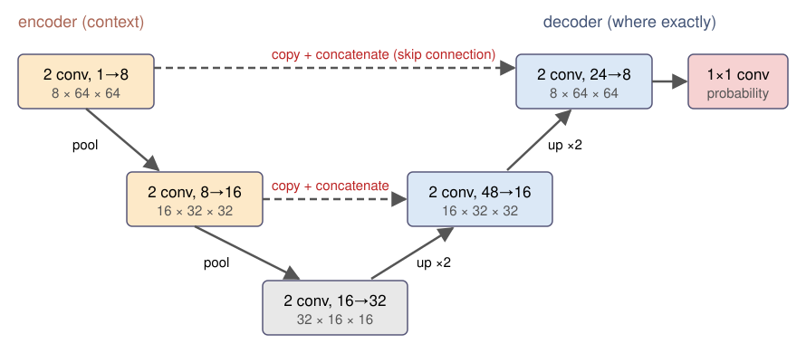

## About this lecture

A classification network says **what** is in an image. For segmentation we want a class for **every pixel**.

- An **encoder–decoder**: shrink the image to gain context, then **upsample** back to full size.
- **Skip connections** (the U-Net) bring the fine detail back.
- Train with a **per-pixel loss**: cross-entropy, or a **Dice loss** when the objects are a small part of the image.
- Judge the result with Dice and IoU, by **looking at the errors**, and on images unlike the training ones.

*Slides titled **The math** give the formulas and proofs; the ideas are complete without them.*

::: notes
Suggested demo tour (unetseg): "a typical image" (Dice 0.986), "U-Net vs Otsu on uneven illumination" (0.987 vs 0.349), click the levels of the architecture to see feature maps; "no skips: small nuclei"; "touching nuclei merge"; "dimmer microscope" (domain shift: Dice 0.269, worse than Otsu). Day 6 owns Dice/IoU and the confusion matrix; recall them in one line. Instance segmentation by networks is day 18.
:::

## From "what" to "which pixels"

- Output: one class probability **per pixel**, an image of the same size as the input.
- Naive way: classify a patch around every pixel with the network of the last unit. Slow (one network run per pixel), and the patch is small, so the context is small.
- Better: a network that is **convolutional all the way**: no dense layer, so it takes any image size and gives a map out.
- The problem: pooling made the maps small ($64 \to 16$ pixels). We need to get back to full resolution.

## Encoder–decoder

{width="72%" fig-align="center"}

- **Encoder** (left): convolutions and pooling, as in the last unit. The maps get smaller and see more context.
- **Decoder** (right): **upsample** (each pixel becomes $2 \times 2$), then convolutions that sharpen the result. Back to $64 \times 64$, one probability per pixel.

::: notes
The figure is the network of the demo: two levels, 8, 16 and 32 channels, about 30,000 weights. Upsampling by nearest neighbour followed by a 3×3 convolution; the alternative is a transposed convolution, next math slide.
:::

## Upsampling by hand

1D signal $(1, 2, 3)$, upsampled by 2:

- **Nearest neighbour**: $(1, 1, 2, 2, 3, 3)$. Blocky; a following convolution smooths it, e.g. with $(\tfrac14, \tfrac12, \tfrac14)$: $(0.75, 1.25, 1.75, 2.25, 2.75, 2.25)$ (zero beyond the ends).
- **Transposed convolution** with stride 2: each input value **stamps** a weighted copy of the kernel into the output, 2 steps apart. With the kernel $(\tfrac12, 1, \tfrac12)$:

$$(0.5,\ 1,\ 1.5,\ 2,\ 2.5,\ 3,\ 1.5)$$

  linear interpolation. With a **learned** kernel the network chooses its own way to upsample.

## The math: transposed convolution {.math}

- A strided convolution is a matrix $A$ (banded, rows $s$ positions apart): $\mathbf y = A\mathbf x$ maps $n$ to about $n/s$ values.
- The **transposed convolution** applies $A^\top$: from $n/s$ values back to $n$. Each input value adds the kernel, scaled by itself, to the output: "stamping".
- Output length $(n - 1)s + k - 2p$: for $n = 3$, $s = 2$, $k = 3$, $p = 0$: 7.
- It is the same operation that backpropagation uses to send gradients back through a strided convolution. $A^\top$ is not the inverse $A^{-1}$: it does not undo the convolution, it only goes back to the larger size.

## Skip connections: the U-Net

A decoder that only gets the bottleneck knows **what** is where, roughly; the **exact** boundaries were lost in pooling.

- **U-Net** (Ronneberger, Fischer and Brox, 2015): copy the encoder's feature maps of each size across to the decoder and **concatenate** them with the upsampled maps.
- Context comes **from below** (deep, coarse maps), detail **from the side** (shallow, sharp maps).
- In the demo network: $32$ upsampled channels + $16$ copied = 48 channels into the decoder at $32 \times 32$; $16 + 8 = 24$ at $64 \times 64$.

## Try it: a U-Net segments nuclei

```{=html}
<link rel="stylesheet" href="../demos/dist/demo.css">
<div data-demo="unetseg" data-preset="otsu"></div>
<script src="../demos/dist/unetseg.js"></script>
```

::: notes
Synthetic 64×64 images, generated with the same code as the training set; "new image" draws a new one. Errors: TP white, FP red, FN blue. "U-Net vs Otsu on uneven illumination": the U-Net Dice 0.987, Otsu 0.349 (the bright right side is all "object"). Click "bottleneck": 32 coarse maps. "no skips: small nuclei": 0.936 against 0.954 with skips (same image). On the training distribution skips help little here (validation Dice 0.968 vs 0.965): these smooth blobs are easy to locate from 16×16 maps. "touching nuclei merge": 7 nuclei, but the mask has 4 connected pieces.
:::

## Per-pixel loss

- **Cross-entropy per pixel**, averaged over all pixels: every pixel is one classification example.
- **Class imbalance**: if nuclei are 5 % of the pixels, "everything is background" is 95 % correct (recall "accuracy lies", thresholding day). Its cross-entropy is not very large either.
- Remedies: **weight** the object pixels more, or use the **Dice loss**: $1 - $ soft Dice, computed from the probabilities so that it has a gradient.
- Recall (thresholding day): Dice $= 2|P \cap G|/(|P| + |G|)$ of a predicted mask $P$ and the truth $G$; IoU $= |P \cap G|/|P \cup G|$.

## The math: soft Dice and its gradient {.math}

With probabilities $p_i \in [0, 1]$ and the true mask $g_i \in \{0, 1\}$:

$$D = \frac{2\sum_i p_ig_i}{\sum_i p_i + \sum_i g_i}, \qquad \mathcal L_\text{Dice} = 1 - D, \qquad \frac{\partial D}{\partial p_j} = \frac{2g_j\left(\sum_i p_i + \sum_i g_i\right) - 2\sum_i p_ig_i}{\left(\sum_i p_i + \sum_i g_i\right)^2}$$

- For hard 0/1 predictions $D$ is the usual Dice. The loss depends only on the object pixels and the predicted object area: the background count does not dilute it.
- Weighted cross-entropy: $-\frac1N\sum_i\big[w_1g_i\log p_i + w_0(1 - g_i)\log(1 - p_i)\big]$, with e.g. $w_c \propto 1/(\text{share of class } c)$.
- (Milletari, Navab and Ahmadi, 2016.)

## Evaluating a segmentation network

- Dice and IoU against the ground truth, on **held-out** images (never seen in training or tuning).
- **Look at the errors**, not only at the number: where are the false positives and negatives? Merged nuclei, missed dim nuclei and boundary pixels are different problems.
- The number hides the **distribution**: a few failed images can disappear in an average over many good ones.
- How to build an honest test set, and object-level scores (matched nuclei, F1): the evaluation day (day 16).

## Data: annotation is the bottleneck

- Every training image needs a **mask drawn by hand**: hours per image for dense nuclei.
- Small networks and **augmentation** (flips, rotations, brightness, noise, elastic deformation) go a long way with tens of annotated images: the original U-Net was trained on 30.
- **Synthetic** images with known truth (as in the demo) are good for teaching and testing, but real images differ: blur, debris, textures the generator never made.
- A network knows only its **training range**: a dimmer microscope, more noise, another stain can break it. The demo's sliders show this; days 16 and 18 come back to it.

## After the mask

- **Touching nuclei** come out as one blob: a semantic mask says "nucleus or not", not "which nucleus". Classic fix: a third class "boundary between nuclei", then labelling or the watershed (days 9–10). Networks that output separate objects directly: day 18.
- The probability map is a perfect **data term** for a graph cut (day 13): $D_p(\ell) = -\log p_\ell$, plus a smoothness term. The two ideas combine.
- The **baseline** to beat: a random forest on the feature stack (day 14) with a few strokes of annotation. Often it is good enough, and it needs much less data.

## Summary

| Idea | In one line |
|---|---|
| Encoder–decoder | shrink for context, upsample back to one probability per pixel |
| Upsampling | nearest + convolution, or transposed convolution ("stamping" the kernel) |
| U-Net | skip connections copy encoder maps to the decoder: context + detail |
| Per-pixel loss | cross-entropy per pixel; Dice loss or class weights against imbalance |
| Evaluation | Dice / IoU on held-out images, and look at the errors |
| Limits | needs annotations; only knows its training range; semantic, not instance masks |

Next: evaluation and statistics (day 16): what makes a test set honest, and how to compare methods.
