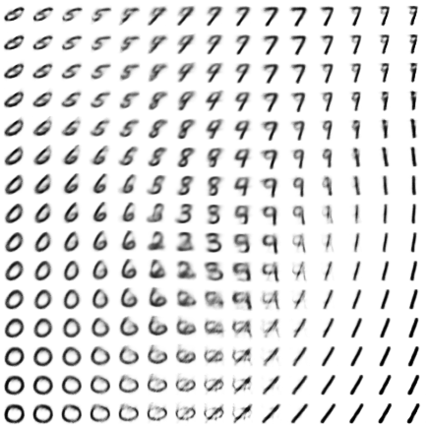
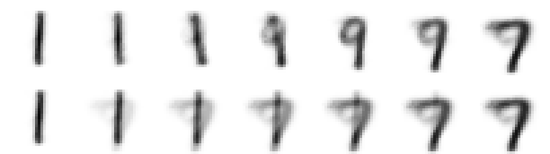
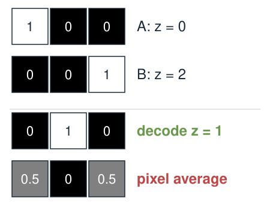
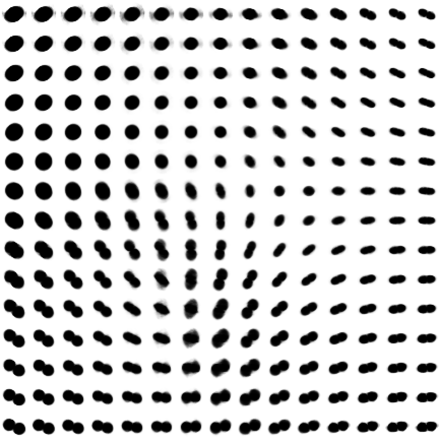
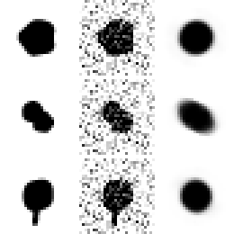
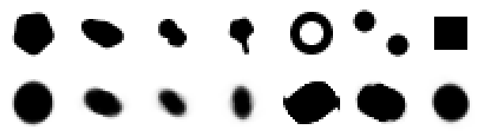
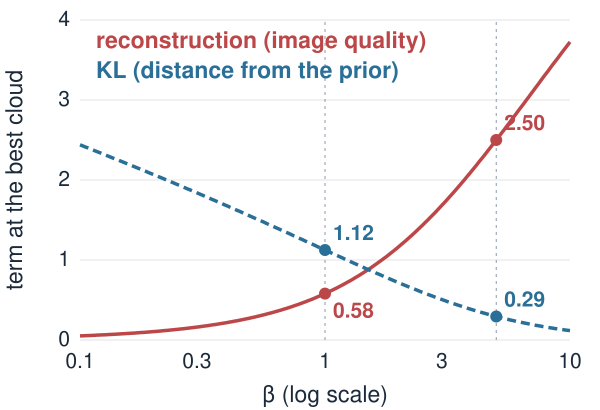
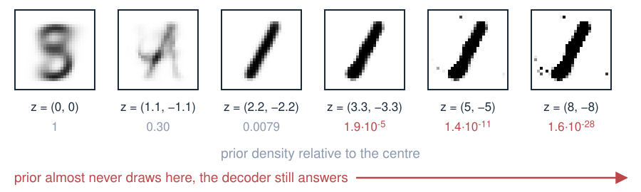
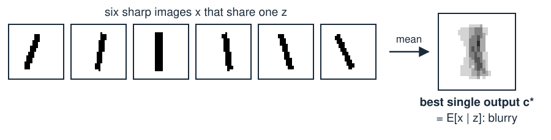

## About this lecture

A trained VAE gives us a decoder from a small latent space to images, and an encoder back. Today we **use** it.

- **Generate**: draw $z$ from the prior, decode.
- **Interpolate**: walk in $z$ from one image to another; the midpoint is not the pixel average.
- **Explore**: what the latent space has learned about digits and about **cell shapes**.
- **Apply**: denoising, anomaly detection, morphology spaces. And the **limits**: blurry images, nonsense far from the data.

*Slides titled **The math** give the formulas and proofs; the ideas are complete without them.*

::: notes
Two trained VAEs, both 784 → 192 → 2 → 192 → 784, both run live in the demo: one on MNIST handwritten digits (adapted from the 3MB00A course), one on synthetic cell masks (four kinds: round, elongated, dividing, with a protrusion). The synthetic masks are honestly labelled as such; a VAE on real nucleus crops is the obvious next step and works the same way.
:::

## Generating: decode a draw from the prior

{fig-alt="A 15 by 15 grid of images decoded from evenly spaced latent points: smoothly changing handwritten digits, with smudges near the bottom middle." width="44%" fig-align="center"}

Decoding a $15 \times 15$ grid of points $z \in [-3, 3]^2$: almost every point gives a digit-like image, and neighbours are similar. Only the bottom middle, where no training digit lies, decodes to smudges. To make a **new** image: draw $z \sim \mathcal N(0, I)$ and decode.

::: notes
This is the classic picture of a 2D VAE. Point out: 0s on the left, 1s on the right and bottom right, 7s at the top, 6 and 5 between 0 and the middle, the crowded middle with 3, 8, 2, 9, 4. Between regions the images morph: a 7 becomes a 9, a 6 becomes a 0. The bottom middle (around z = (0, −2.5)) decodes to smudges: almost no digits are encoded there (1 of the 1000 test digits of the latent map has z₂ < −2 and |z₁| < 1), so the decoder was never trained there. The prior N(0, I) puts 86.5% of its draws inside radius 2 (1 − e^{−2}); the edges of this grid (|z| up to 3) are rarely drawn and decode to exaggerated versions of the outermost shapes.
:::

## Walking through latent space {.smaller}

{fig-alt="Top row: seven images decoded along a straight latent line from a 1 to a 7. Bottom row: the pixel-wise fade between the two end images, a double exposure." width="78%" fig-align="center"}

Top: decode 7 equally spaced points on the line from the centre of the 1s to the centre of the 7s, $z(t) = (1 - t)\,z_A + t\,z_B$.
Bottom: fade the two end images into each other, pixel by pixel, $(1 - t)\,x_A + t\,x_B$.

- The latent walk passes through **plausible shapes** (here via a 9-like stroke).
- The pixel fade is a **double exposure**: a faint 1 and a faint 7 on top of each other.

::: notes
A straight line in latent space is a curve in pixel space, as with the moving spot in the [autoencoder unit](../autoencoder/lec.qmd). The pixel average of two images is almost never an image of the same kind. The centres are the medians of the 1000 test-digit centres per class, as the demo's "walk 1 → 7" preset uses: (2.46, 0.00) and (0.94, 1.21).
:::

## Midpoint vs average, by hand {.smaller}

:::: {.columns}
::: {.column width="56%"}
A decoder that draws a bright bar on a 3-pixel image at position $z$: pixel $i$ gets $\max(0,\ 1 - |z - i|)$, $i = 0, 1, 2$.

| | $z = 0$ | $z = 1$ | $z = 2$ |
|---|---|---|---|
| decoded | $(1, 0, 0)$ | $(0, 1, 0)$ | $(0, 0, 1)$ |

- **Latent midpoint** of $z = 0$ and $z = 2$: $z = 1$, the bar in the middle, $(0, 1, 0)$.
- **Pixel average** of the two images: $(0.5,\ 0,\ 0.5)$, two half-bright bars.

A linear decoder (PCA) would give the average; a curved decoder moves the bar.
:::
::: {.column width="44%"}
{fig-alt="Four 3-pixel images drawn as grey squares with their values: image A (1, 0, 0) at z = 0, image B (0, 0, 1) at z = 2, the latent midpoint z = 1 decoding to (0, 1, 0), and the pixel average (0.5, 0, 0.5) with two half-bright ends." width="100%"}
:::
::::

::: notes
This is the image version of the 3MB00A argument with a transient progenitor gene: the middle pixel is dark at both ends but bright at the midpoint. Ask the class for z = 0.5: (0.5, 0.5, 0): the bar halfway between pixels 0 and 1, smeared over both.
:::

## What the latent space has learned

- **Similar images are neighbours**: in the digit VAE, 4 next to 9, and 3, 5, 8 together in the middle.
- **Two numbers are too few** to keep ten digits apart: a vote among the 15 nearest test digits in $z$ finds the right digit for **68%** of test images.
- **The axes mean nothing by themselves**: the KL penalty looks the same if the latent space is rotated, so "$z_1$" is not "thickness". Read directions from decoded images, not from the axis labels.
- **Distances** are only roughly meaningful, as in any nonlinear map.

::: notes
The 68% is a leave-one-out 15-nearest-neighbour vote among the first 4000 MNIST test digits, computed with the demo's weights. With a larger latent space (10–20 dimensions) the classes separate much better, but then we cannot draw the map. Contrast with PCA, where components are ordered by variance and orthogonal.
:::

## Try it: digits

```{=html}
<link rel="stylesheet" href="../demos/dist/demo.css">
<div data-demo="vaeimages" data-tabs="digits"></div>
<script src="../demos/dist/vaeimages.js"></script>
```

::: notes
Draw a digit and press Encode, or press "example ▸" for real MNIST test digits (20 of them, two of each). The cross is the cloud centre, the orange ellipse its ±2 sd. Drag z. Tick "decoded grid". "walk 1 → 7" shows the latent walk. "sample from the prior" makes 7 new digits. "far outside" (3.3, −3.3) still decodes to a stroke: the decoder always answers, even where the prior almost never draws (density 0.00002 of that at 0).
:::

## Cell shapes: a morphology latent space {.smaller}

:::: {.columns}
::: {.column width="42%"}
{fig-alt="A 15 by 15 grid of decoded cell masks: large round cells on the left, elongated cells at various orientations on the right, dividing cells at the bottom." width="100%"}
:::
::: {.column width="58%"}
The same network trained on **synthetic** cell masks ($28 \times 28$): round, elongated, dividing, with a protrusion, at random sizes and orientations.

- The map organises **size** (large round cells on the left), **elongation and orientation** (right) and **dividing** cells (bottom).
- A walk in $z$ is a smooth **change of shape**; a generated mask is a plausible new cell.
- Thin **protrusions are lost**: two numbers cannot also hold their direction. Their reconstruction error is the highest of the four kinds.

A nonlinear relative of the **point distribution model** (PCA of landmark shapes), learned straight from pixels.
:::
::::

::: notes
Synthetic data, made by the training script with a fixed seed (no external images): wobbly ellipses, dumbbells and discs with a thin bar. Mean squared pixel error of the reconstructions on 2000 test masks: 0.0129 overall; by kind round 0.0071, elongated 0.0113, dividing 0.0116, protrusion 0.0218. Real use: VAEs and related autoencoders on cell and nucleus images give "morphology spaces" in which drug treatments or cell states form regions (e.g. Ruan & Murphy 2019; Zaritsky et al. 2021). Compare the [shape models unit](../shape-models/lec.qmd) of the snakes day: the point distribution model is linear and needs landmarks; the VAE is nonlinear and works on the mask directly.
:::

## Denoising {.smaller}

:::: {.columns}
::: {.column width="34%"}
{fig-alt="Three rows of cell masks: the clean mask, the mask with noise added, and the decoded mask, which is clean again." width="100%"}
:::
::: {.column width="66%"}
Columns: clean mask, with noise added (sd 0.3 per pixel), decoded from the code of the noisy mask.

- The decoder can only draw **cell-like** images, so it cannot draw the noise.
- Mean squared error against the clean mask: noisy input $0.045$, $0.048$, $0.047$; decoded $0.009$, $0.018$, $0.016$.
- But it draws **its own version** of a cell: details the model never learned (a protrusion, a precise outline) are replaced by typical ones.

Denoising by "project onto what the model can draw": the nonlinear cousin of keeping a few PCA components.
:::
::::

::: notes
Rows are test masks 2 (round), 7 (dividing) and 11 (protrusion) of the demo's examples, noise from a fixed seed as in the demo's "noise on input" slider at 0.3. Not every case works: for example 4 (an elongated cell) the noisy code lands in the wrong place and the output error, 0.110, is worse than the noisy input's 0.047. For the digit model the decoded image is usually worse than the noisy input in squared error (its reconstructions are already blurry), although it looks cleaner.
:::

## Anomaly detection {.smaller}

{fig-alt="Top row: four normal cell masks, a ring, two cells and a square. Bottom row: their reconstructions; the ring and the two cells come back as one filled blob each, the square as a round cell." width="74%" fig-align="center"}

Top: input masks. Bottom: their reconstructions. Four normal test cells, then a **ring**, **two cells** and a **square**.

- Normal cells (the 12 test examples of the demo): error 0.004–0.023. On 2000 test masks, 99% have error below **0.045**.
- Ring **0.172**, two cells **0.253**: far above, flagged as unusual. Their codes land far outside the prior's circle.
- Square **0.030**: below the threshold. It is close enough to a round cell to be rebuilt as one. The detector only sees what the model **cannot** draw.

::: notes
Errors are mean squared pixel errors between the mask and the decoded cloud centre, computed with the demo code. Reading: a threshold at the 99th percentile of normal errors flags about 1% of normal cells as false alarms (20 of 2000). In practice: flag unusual cells, out-of-focus images, debris or segmentation failures in a screen. The encoder centres: ring (−6.30, 3.49), two cells (−4.18, −0.36): both outside the plotted square of the demo, far in the prior's tail.
:::

## Try it: cell shapes

```{=html}
<link rel="stylesheet" href="../demos/dist/demo.css">
<div data-demo="vaeimages" data-tabs="shapes"></div>
<script src="../demos/dist/vaeimages.js"></script>
```

::: notes
"example ▸" steps through 12 test masks (three per kind) and then the three anomalies; the error is shown under the encoder input. Draw a filled blob to make your own cell (the brush is wide). Raise "noise on input" to see denoising. "walk round → dividing" morphs a round cell into a dividing one.
:::

## β-VAE: tidier space, blurrier images {.smaller}

:::: {.columns}
::: {.column width="55%"}
Weight the KL more, $\beta > 1$:

- Clouds are pulled harder to the prior: more overlap, a smoother latent space, and often directions that match **one** factor each (size, elongation, …): "disentangled".
- The decoder must serve wider clouds with one image each: **blurrier**, more average images.
- $\beta < 1$: sharper reconstructions, but the gaps of a plain autoencoder start to return.

There is no free lunch: $\beta$ trades **image quality** for **latent-space quality**.
:::
::: {.column width="45%"}
{fig-alt="For the one-pixel VAE of the elbo1d demo, the reconstruction term and the KL term of the best cloud against beta on a log scale from 0.1 to 10: reconstruction rises from 0.58 at beta 1 to 2.50 at beta 5, KL falls from 1.12 to 0.29." width="100%"}
:::
::::

::: notes
The figure is the elbo1d example (x = 1.5, w = 1, pixel noise 0.5): for every β the best cloud is computed in closed form and its two terms plotted. Larger β buys a cloud closer to the prior (smaller KL) at the price of a worse reconstruction.
Higgins et al. (2017), β-VAE: learning basic visual concepts with a constrained variational framework, ICLR. The elbo1d demo shows the same trade-off in one dimension: β = 5 pulls the best cloud from (1.2, 0.447) to (0.667, 0.745) and the reconstruction term rises from 0.58 to 2.5. Our two image VAEs were trained with β = 1.
:::

## Limits

{fig-alt="Decoded images of the digit VAE at z = (0, 0), (1.1, -1.1), (2.2, -2.2), (3.3, -3.3), (5, -5) and (8, -8), with the prior density relative to the centre below each: 1, 0.30, 0.0079, 1.9e-5, 1.4e-11, 1.6e-28; even the far ones decode to a confident stroke." width="58%" fig-align="center"}

- **Blurry outputs**: the decoder outputs the **average** of all images that fit a given $z$ (next slide). Fine detail and sharp edges are smeared.
- **Far from the data the decoder guesses**: it always outputs an image, plausible or not. Generated images are only as good as the training images.
- **Small latent spaces lose detail** (protrusions); large ones are hard to look at.
- Sharper generators: **GANs** (a generator trained against a classifier that tries to tell real from fake) and **diffusion models** (learn to remove noise step by step, then start from pure noise). Both build on the same idea: a learned map from random numbers to images.

::: notes
The figure decodes the digit VAE along the diagonal towards the demo's "far outside" point (3.3, −3.3) and beyond. The prior density relative to the centre is exp(−|z|²/2). At (0, 0) the decoder gives a blurry average-like shape (the crowded middle of the map); far out it draws an ever more confident 1 with stray pixels: nothing tells us the image is invented.
:::

## The math: why VAE images are blurry {.smaller .math}

Suppose several different images $x$ are all encoded near the same $z$. The decoder outputs **one** image $c$ for that $z$, chosen to minimise the expected squared error:

$$\mathbb E\big[\|x - c\|^2\big] = \|c - \mathbb E[x]\|^2 + \mathbb E\big[\|x - \mathbb E[x]\|^2\big] \quad\Rightarrow\quad c^* = \mathbb E[x \mid z].$$

{fig-alt="Six sharp synthetic strokes at slightly different angles and positions, and their pixel-wise mean, a blurry fan-shaped stroke." width="62%" fig-align="center"}

- The best output is the **conditional mean**: an average of sharp images is a blurry image.
- The same holds for cross-entropy on pixel "ink": the best ink probability is the average ink.
- The wider the clouds (larger $\beta$), the more images share each $z$, and the blurrier the mean.

## Summary

| Idea | In one line |
|---|---|
| Generate | $z \sim \mathcal N(0, I)$, decode |
| Interpolate | walk $z(t) = (1-t)z_A + tz_B$; the midpoint is a new shape, not a double exposure |
| Latent structure | similar images nearby; classes overlap in 2D; axes have no fixed meaning |
| Morphology space | a VAE on cell masks orders cells by size, elongation, division |
| Denoising | decode the code of a noisy image: only what the model can draw survives |
| Anomaly | high reconstruction error = unlike the training images (if the model cannot draw it) |
| Limits | blurry (conditional mean), unreliable far from the data; GANs and diffusion go further |
