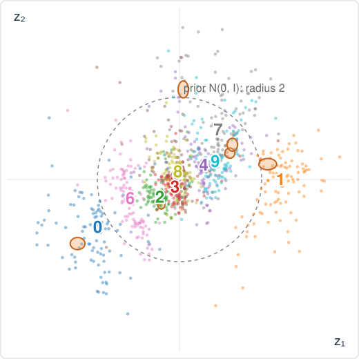
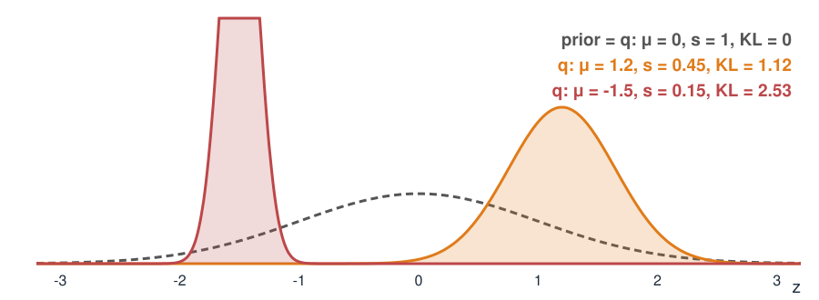

## About this lecture

An autoencoder gives every image a point $z$. A **variational** autoencoder (VAE) gives every image a small **cloud**, and keeps all clouds near one standard bell shape.

- Why: so that **every** point of the latent space decodes to a plausible image, and we can **generate** new ones.
- How: the decoder is trained on **random draws** from each cloud (the **reparameterisation trick**).
- The loss has two parts: **rebuild the image** + **stay close to the standard cloud** (a KL divergence).
- Slides marked *The math* derive the loss (the ELBO); the idea does not depend on them.

::: notes
Concept layer first on every topic, then a "The math" slide that can be skipped. Weaker students should leave with: cloud instead of point, decoder sees random draws, two forces (rebuild vs stay near the prior), and what β does. Reference: D. P. Kingma, M. Welling (2014), Auto-Encoding Variational Bayes, ICLR, arXiv:1312.6114; Rezende, Mohamed & Wierstra (2014) independently.
:::

## What a plain autoencoder lacks

A plain autoencoder only has to rebuild its **training images**. It may place them anywhere in $z$.

- Nothing says what lies **between** two training images: decode a point in a gap and the result can be anything, often a smudge that is no digit at all.
- Nothing says **where** the images are: to generate a new image, which $z$ should we pick?
- Each image is one **point**, with no notion of how sure the encoder is.

We want: similar images **nearby**, no gaps, and a known region to draw new $z$ from.

::: notes
Draw on the board: a 2D latent space with a few dots for 1s and 7s scattered with gaps between; pick a point in a gap; the decoder was never trained there. Then draw what we want: the same dots packed into one round region, 1s and 7s side by side, so the point between a 1 and a 7 decodes to something in between.
:::

## A cloud instead of a point

The encoder outputs, for each image $x$, a **centre** $\mu(x)$ and a **spread** $\sigma(x)$: a Gaussian cloud $q(z \mid x) = \mathcal N\big(\mu(x),\ \sigma(x)^2\big)$.

- During training the decoder is handed **a random point** of the cloud, not the centre, and must still rebuild **this** image.
- So every point **near** an image must decode to something like it: the space around each image gets trained.
- A **penalty** pulls every cloud towards one **standard cloud** $\mathcal N(0, I)$, the **prior**. Clouds overlap, gaps fill.

Two forces: **rebuild well** (small, separate clouds) against **look like the prior** (wide, overlapping clouds near 0).

::: notes
This is the whole idea. The rebuild force alone would shrink each cloud to a point and push them apart: a plain autoencoder. The prior force alone would make every cloud the standard cloud, and the decoder could not tell images apart: every image decoded as the average image. The balance gives a latent space where every region is used and neighbouring points decode to similar images.
:::

## The result on handwritten digits {.smaller}

:::: {.columns}
::: {.column width="52%"}
{width="100%"}
:::
::: {.column width="48%"}
A VAE with a **2D** latent space trained on 60,000 handwritten digits (MNIST). Dots: the cloud centres of 1000 test digits; orange: the clouds (±2 sd) of six test digits.

- Digits of one kind sit together; similar digits (4, 9; 3, 5, 8) are **neighbours**.
- Almost everything lies inside the **prior's** dashed circle: no big gaps.
- The clouds are **small** (sd about 0.07): the image says a lot about $z$.
:::
::::

::: notes
Real network (784 → 192 → 2, decoder 2 → 192 → 784), trained offline with a fixed seed; the same weights run in the demos. The mean encoder sd over the 10,000 test digits is 0.067. 71.5% of the test centres lie inside radius 2; a standard 2D normal has 86.5% there (1 − e^{−2}). MNIST: Y. LeCun, C. Cortes, C. J. C. Burges; CC BY-SA 3.0 as stated in the Keras documentation.
:::

## The reparameterisation trick

How do we draw "a random point of the cloud" and still train by walking downhill?

$$z = \mu + \sigma\,\varepsilon, \qquad \varepsilon \sim \mathcal N(0, 1).$$

- Draw the randomness $\varepsilon$ **first**, from a fixed bell curve; then shift and stretch it.
- Example: $\mu = 1$, $\sigma = 0.5$: $\varepsilon = -1$ gives $z = 0.5$; $\varepsilon = 0.5$ gives $z = 1.25$.
- $z$ is now an ordinary **formula** in $\mu$ and $\sigma$, so the gradient flows back through it to the encoder.

::: notes
If we drew z directly from N(mu, sigma²), the draw would be a black box: how does the result change if mu changes a little? Writing z = mu + sigma·eps answers it: dz/dmu = 1, dz/dsigma = eps. In the demo elbo1d the 20 orange dots are z = mu + s·eps with 20 fixed eps; dragging mu shifts them all, dragging s stretches them around mu.
:::

## How far is a cloud from the prior?

The penalty is the **Kullback–Leibler divergence** $\mathrm{KL}(q \,\|\, p)$: zero when the two distributions are equal, positive otherwise. For a 1D cloud $\mathcal N(\mu, s^2)$ and the prior $\mathcal N(0, 1)$:

$$\mathrm{KL} = \tfrac12\big(\mu^2 + s^2 - 1 - \ln s^2\big)$$

{width="70%" fig-align="center"}

Moving the centre away from 0 costs $\tfrac12\mu^2$; a cloud much narrower (or wider) than 1 costs too.

::: notes
The three cases: the prior itself (KL 0); the best cloud of the demo's default example (mu 1.2, s 0.45: KL 1.12); a narrow cloud away from 0 (mu −1.5, s 0.15: KL 2.53). In 2D (or k dimensions) with independent coordinates, the KLs add. The formula is on this slide so the exercises can use it; the derivation is on the next slide.
:::

## The math: KL of two Gaussians {.smaller}

*Math layer: skip if you only want the idea.*

$\mathrm{KL}(q\,\|\,p) = \mathbb E_{q}\big[\ln q(z) - \ln p(z)\big]$. With $q = \mathcal N(\mu, s^2)$ and $p = \mathcal N(0, 1)$:

$$\ln q(z) = -\tfrac12\ln(2\pi s^2) - \frac{(z-\mu)^2}{2s^2}, \qquad \ln p(z) = -\tfrac12\ln(2\pi) - \frac{z^2}{2}.$$

Use $\mathbb E_q[(z-\mu)^2] = s^2$ and $\mathbb E_q[z^2] = \mu^2 + s^2$:

$$\mathrm{KL} = -\tfrac12\ln s^2 - \tfrac12 + \tfrac12(\mu^2 + s^2) = \tfrac12\big(\mu^2 + s^2 - 1 - \ln s^2\big).$$

- $\ge 0$, with equality only at $\mu = 0$, $s = 1$ (since $s^2 - 1 - \ln s^2 \ge 0$).
- Not symmetric: $\mathrm{KL}(q\|p) \ne \mathrm{KL}(p\|q)$ in general.

## The VAE loss

For every training image $x$, with $z = \mu(x) + \sigma(x)\,\varepsilon$:

$$\text{loss}(x) = \underbrace{\text{reconstruction error of } \text{decode}(z)}_{\text{rebuild this image}} \;+\; \beta\cdot\underbrace{\mathrm{KL}\big(q(z\mid x)\,\|\,\mathcal N(0, I)\big)}_{\text{stay near the prior}}$$

- Reconstruction: squared pixel error (Gaussian pixel noise), or the **cross-entropy** when the decoder outputs an "ink probability" per pixel, as for digits.
- $\beta = 1$ is the standard VAE. Larger $\beta$: tidier latent space, blurrier images. Smaller $\beta$: sharper, but gaps return.
- Encoder and decoder are trained **together**, downhill on the average loss.

::: notes
Concept slide: the two forces of slide 3 written as one number to minimise. The next slide (math layer) shows where it comes from: with beta = 1 and the right reconstruction term, the loss is minus a lower bound on log p(x), the evidence lower bound (ELBO).
:::

## The math: where the loss comes from (ELBO) {.smaller}

*Math layer: skip if you only want the idea.*

Model: $z \sim p(z) = \mathcal N(0, I)$, image $x \sim p(x\mid z)$ (the decoder). We would like to maximise $\ln p(x) = \ln\int p(x\mid z)\,p(z)\,dz$, but the integral is intractable. For any $q(z)$:

$$\ln p(x) = \ln \mathbb E_{q}\!\left[\frac{p(x\mid z)\,p(z)}{q(z)}\right] \;\ge\; \mathbb E_{q}\big[\ln p(x\mid z)\big] - \mathrm{KL}\big(q\,\|\,p\big) \;=:\; \text{ELBO}$$

by Jensen's inequality ($\ln$ is concave). The gap is exactly $\mathrm{KL}\big(q(z)\,\|\,p(z\mid x)\big) \ge 0$.

- Maximising the ELBO over the decoder makes the images **likely**; over $q$ it makes $q$ approach the **posterior** $p(z\mid x)$. The VAE loss is $-\text{ELBO}$ (with $\beta = 1$).
- Gaussian decoder $p(x\mid z) = \mathcal N(\text{decode}(z), \sigma_x^2 I)$: $-\ln p(x\mid z) = \frac{\|x - \text{decode}(z)\|^2}{2\sigma_x^2} + \text{const}$, the squared error.
- "Variational": $q$ is chosen from a family (Gaussians) to make the bound tight; the encoder outputs it in one pass for every $x$ ("amortised").

::: notes
Proof of the gap: ln p(x) − ELBO = E_q[ln q(z) − ln p(z|x)] using p(x|z)p(z) = p(z|x)p(x). So the bound is tight exactly when q is the true posterior. Bayesian reading in one sentence for the concept layer: the standard cloud is the prior, each image's cloud an approximate posterior.
:::

## A VAE you can solve by hand

One grey value $x$ and a 1D latent $z$. Decoder: $\hat x = w z$ with $w = 1$ and pixel noise $\sigma_x = 0.5$. Observed $x = 1.5$.

| cloud $q$ | rebuild | KL | total |
|---|---|---|---|
| $\mu = 0,\ s = 1$ (the prior) | 6.500 | 0 | 6.500 |
| $\mu = 1.5,\ s = 0.05$ (too confident) | 0.005 | 3.622 | 3.627 |
| $\mu = 1.2,\ s = 0.45$ (best) | 0.580 | 1.125 | **1.705** |

Ignoring the image costs reconstruction; being too sure costs KL. The best cloud sits **between** the prior and the image.

::: notes
Rebuild term = ((x − w mu)² + w² s²)/(2 sx²): the expected squared error over the cloud, divided by 2 sx². At the prior: (2.25 + 1)/0.5 = 6.5. Too confident: (0 + 0.0025)/0.5 = 0.005, but KL = ½(2.25 + 0.0025 − 1 − ln 0.0025) = 3.622. Best: mu = 1.2, s² = 0.2. The best cloud is the exact posterior of z given x for this model (math slide after the demo).
:::

## Try it: the two forces

```{=html}
<link rel="stylesheet" href="../demos/dist/demo.css">
<div data-demo="elbo1d"></div>
<script src="../demos/dist/elbo1d.js"></script>
```

::: notes
Start: q = prior, total 6.5. Drag mu towards x: reconstruction falls fast, KL rises slowly. Shrink s: the decoded blue dots gather around x, the reconstruction falls, KL rises. "best cloud" jumps to mu 1.2, s 0.447, total 1.705. Preset "best (β = 5)": mu 0.667, s 0.745: the cloud is pulled towards the prior; the reconstruction term rises to 2.5. The readout also shows the reconstruction estimated from the 20 draws (what training actually uses): at the prior it is 8.52 instead of 6.5, a noisy estimate of the same number.
:::

## The math: the best cloud {.smaller}

*Math layer: skip if you only want the idea.*

$$L(\mu, s) = \frac{(x - w\mu)^2 + w^2 s^2}{2\sigma_x^2} + \frac{\beta}{2}\big(\mu^2 + s^2 - 1 - \ln s^2\big)$$

- $\partial L/\partial\mu = 0$: $\ \mu^* = \dfrac{w\,x}{w^2 + \beta\sigma_x^2}$. $\qquad\partial L/\partial (s^2) = 0$: $\ s^{*2} = \dfrac{\beta\sigma_x^2}{\beta\sigma_x^2 + w^2}$.
- Numbers ($w = 1$, $\sigma_x = 0.5$, $x = 1.5$): $\beta = 1$: $\mu^* = 1.2$, $s^{*2} = 0.2$. $\beta = 5$: $\mu^* = 0.667$, $s^{*2} = 0.556$.
- For $\beta = 1$ this is exactly the Bayesian **posterior** of $z$ given $x$ (a product of two Gaussians): here the bound is tight. Larger $\beta$ pulls $q$ towards the prior.

## Summary

| Idea | In one line |
|---|---|
| Cloud | the encoder gives each image a centre $\mu$ and a spread $\sigma$ |
| Reparameterisation | $z = \mu + \sigma\varepsilon$: randomness first, so gradients flow |
| Prior | one standard cloud $\mathcal N(0, I)$ that all clouds are pulled towards |
| KL | $\tfrac12(\mu^2 + s^2 - 1 - \ln s^2)$ per dimension; 0 only for the prior |
| Loss | reconstruction $+\ \beta\cdot$KL; with $\beta = 1$ it is $-$ELBO |
| Two forces | rebuild well (small, separate clouds) vs. look like the prior (wide, overlapping) |

Next: use the trained decoder to **generate**, **interpolate** and **detect** unusual images.
