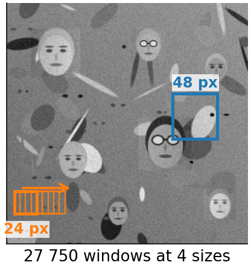
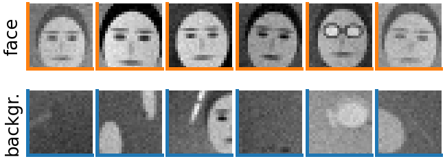
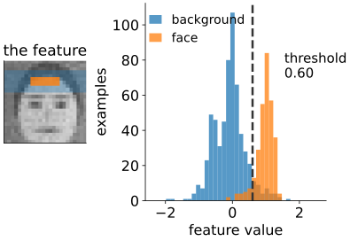
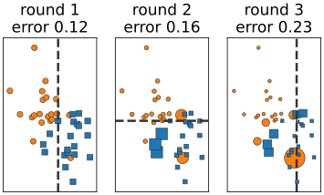
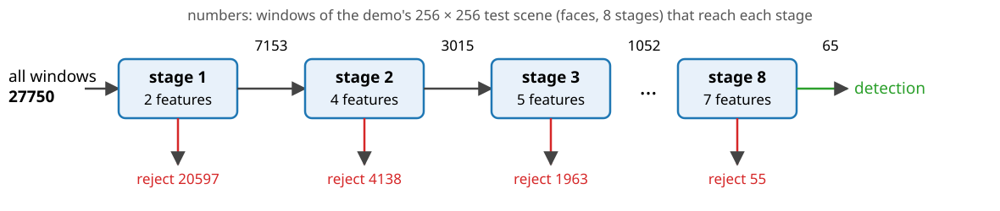
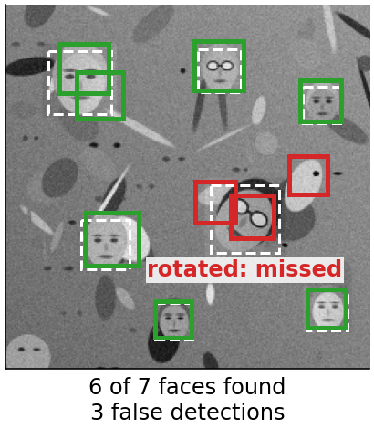

## About this lecture

In 2001, Viola and Jones showed real-time face detection on an ordinary desktop computer. Three ideas, each worth a large factor:

- **Integral image**: every rectangle feature costs a few lookups (units 1–3).
- **Boosting**: out of about 160 000 features, choose a few hundred, one at a time, each time focusing on the examples still classified wrongly.
- **Attentional cascade**: reject almost all background windows after one or two features; spend effort only on the promising ones.

We build such a detector for cartoon faces and for cells.

*Slides titled **The math** give the formulas and proofs; the ideas are complete without them.*

::: notes
This day owns boosting; the random forests day owns trees, forests and classification basics and points here for boosting. The stump is defined in one slide below. Detection metrics (matching detections to the truth, precision–recall, AP) belong to the evaluation day; here only detection rate and false-positive rate.
:::

## The detection task

:::: {.columns}
::: {.column width="64%"}
Slide a $24 \times 24$ **window** over every position and every scale of the image; for each window decide: face or not?

- A $384 \times 288$ image, scales growing by 1.25: about **670 000 windows**.
- Almost all are background; a few dozen overlap the faces.
- So the detector must be **very fast** on background, and its false-positive rate per window must be tiny: 1 in $10^5$ still gives several false detections per image.

**Scales without an image pyramid**: instead of shrinking the image, **enlarge the features**. With the integral image a rectangle of any size costs the same, so every scale costs the same. Each window is normalised by its own standard deviation (two tables, unit 2).
:::
::: {.column width="36%"}
{width="100%" fig-alt="The demo's 256 × 256 test scene of cartoon faces among blobs. A 24-pixel window is shown at several positions along a row (orange), and a 48-pixel window (blue): 27 750 windows at 4 sizes."}
:::
::::

## Recall: classifiers, training and test

From the **random forests day**:

- A **classifier** maps a feature vector to a label (here: face or background).
- It is learnt from a **training set** of labelled examples and judged on a separate **test set**; its **error rate** is the fraction it gets wrong.
- The training error alone is too optimistic (overfitting).

For a detector, two rates matter: the **detection rate** (faces found / faces present) and the **false-positive rate** (background windows called face / background windows).

::: {style="text-align: center"}
{width="58%" fig-align="center" fig-alt="Training examples of the demo, 24 × 24 pixels: six cartoon faces (orange frames, one with glasses) and six background patches (blue frames), some containing blobs or parts of faces."}
:::

## The weak classifier: a decision stump

One feature, one threshold, one direction:

$$h(\text{window}) = \begin{cases} \text{face} & \text{if the feature value is above (or below) the threshold} \\ \text{background} & \text{otherwise} \end{cases}$$

::::: {.columns}
:::: {.column width="55%"}
- It is a **decision tree of depth 1**; the random forests day grows full trees from the same split search.
- The best stump for a feature: sort the examples by feature value and try every threshold between neighbours.
- Alone, a stump is weak: in our demo the first stump chosen has a weighted error of 6.9 %, the tenth 18.7 % (on the reweighted examples). But it is always better than guessing.
::::
:::: {.column width="45%"}
{width="100%" fig-alt="The demo's first stump: a centre − surround feature across the top of the window (hair against forehead). Histogram of its values on 300 faces (orange) and 600 background patches (blue); threshold 0.60: above it, face. 6.9 % of the examples fall on the wrong side."}
::::
:::::

## Boosting: many weak votes

:::: {.columns}
::: {.column width="56%"}
**AdaBoost** (Freund & Schapire, 1997), as a picture:

1. Give every training example the same **weight**.
2. Pick the stump with the smallest **weighted** error.
3. **Increase the weight** of the examples it got wrong, decrease the others. The next stump must focus on them.
4. Repeat. The final classifier is a **weighted vote** of all stumps: good stumps get a larger vote.
:::
::: {.column width="44%"}
{width="100%" fig-alt="AdaBoost on a toy set of two classes (orange circles, blue squares) with stumps on one coordinate. Dot area is the weight. Round 1: equal weights, a vertical split. Rounds 2 and 3: the examples misclassified so far have grown, and the new split goes through them."}

[Toy example: two features, dot area = weight, dashed: the stump of that round.]{style="font-size: 0.7em; color: #666"}
:::
::::

Each round picks one feature: **feature selection** falls out. Of 160 000 features, a few hundred are ever used.

Viola and Jones' first two features on real faces: "the eye region is darker than the cheeks" and "the eyes are darker than the bridge of the nose": the two templates you tried in the last unit.

## Try it: boosting, one stump at a time

```{=html}
<link rel="stylesheet" href="../demos/dist/demo.css">
<div data-demo="boostdetect" data-tab="boost" data-preset="first"></div>
<script src="../demos/dist/boostdetect.js"></script>
```

::: notes
300 cartoon faces (random size, pose, lighting, hair, 30 % with glasses) and 600 background patches; feature pool 2769 (all six templates, stride 3, rectangles 2–8 px). Left: the chosen stump drawn on the mean face; below, the six examples with the largest weight in that round (orange frame: face). Top: training and test error and the bound. Bottom: every training example at its current score; dot area = weight. Tour: "first two stumps": round 1 a centre − surround band at the top of the window (hair against forehead), ε = 0.069; round 2 an edge at the left side of the face. Add stumps one at a time: errors fall (training 0.2 % at 10 rounds, test 1.5 %). "boosting focuses on the hard examples": the big dots sit close to 0 or on the wrong side; the heaviest examples are odd-looking background patches and unusual faces.
:::

## The math: AdaBoost {.math}

Labels $y_i = \pm 1$, weights $w_i = 1/n$. For rounds $t = 1, \dots, T$:

- choose the stump $h_t$ with the smallest weighted error $\varepsilon_t = \sum_i w_i\,[h_t(x_i) \ne y_i]$;
- its vote $\alpha_t = \tfrac12 \ln\frac{1 - \varepsilon_t}{\varepsilon_t}$ (positive whenever $\varepsilon_t < \tfrac12$);
- reweight $w_i \leftarrow w_i\, e^{-\alpha_t y_i h_t(x_i)}$ (wrong: $\times e^{\alpha_t}$, right: $\times e^{-\alpha_t}$), then divide by the sum.

Final classifier: $H(x) = \operatorname{sign}\big(\sum_t \alpha_t h_t(x)\big)$.

After reweighting, the stump just chosen has weighted error exactly $\tfrac12$: the next round cannot pick the same information again.

**Training error bound**: $\frac1n\#\{i : H(x_i) \ne y_i\} \le \prod_t 2\sqrt{\varepsilon_t(1 - \varepsilon_t)}$. Each factor is $< 1$ when $\varepsilon_t < \tfrac12$, so the training error falls exponentially fast.

## The math: the best threshold in one pass {.math}

For one feature, sort the $n$ examples by value. With the threshold below all of them, every example is called positive: the error is the total weight of the negatives, $E_0$. Moving the threshold past example $i$ (in sorted order) changes the error by $+w_i$ if $y_i = +1$ and $-w_i$ if $y_i = -1$:
$$E_k = E_0 + \sum_{j \le k} y_{(j)} w_{(j)}.$$
A **prefix sum** again. The opposite direction has error $1 - E_k$. Sorting is done once per feature; each round costs one pass over $n$ values per feature: $O(\text{features} \times n)$.

Why $\alpha_t$: AdaBoost minimises the exponential loss $\sum_i e^{-y_i F(x_i)}$, $F = \sum_t \alpha_t h_t$, one term at a time; setting the derivative in $\alpha_t$ to zero gives $e^{2\alpha_t} = (1 - \varepsilon_t)/\varepsilon_t$.

## The attentional cascade

{width="100%"}

- A sequence of **stages**, each a small boosted classifier, tuned to keep **almost all faces** (detection about 99.5 %) and reject a fair share of background (about half or more).
- A window is rejected at the **first** stage that says no. Only promising windows reach the expensive later stages.
- Each stage is trained on the background windows that **got through** the earlier stages: harder and harder negatives.
- On average only a few features are evaluated per window.

## The math: cascade rates {.math}

Stage $i$ has detection rate $d_i$ and false-positive rate $f_i$ (on windows that reach it), and uses $n_i$ features. A window must pass every stage, so
$$D = \prod_i d_i, \qquad F = \prod_i f_i.$$
Ten stages with $d_i = 0.99$, $f_i = 0.3$: $D = 0.904$, $F = 5.9 \cdot 10^{-6}$.

Expected features per background window, with $p_j$ the pass rate of stage $j$:
$$\bar n = n_1 + n_2 p_1 + n_3 p_1 p_2 + \dots = \sum_i n_i \prod_{j < i} p_j.$$
The first stages dominate: make them tiny.

## Try it: a cascade

```{=html}
<div data-demo="boostdetect" data-tab="cascade" data-preset="cascade"></div>
<script src="../demos/dist/boostdetect.js"></script>
```

::: notes
The default cascade (8 stages, per-stage detection 0.995 and false positives at most 0.5) is precomputed; "build cascade" retrains with the slider settings (a few seconds). Table: stumps per stage, d and f on the stage's own training set, and the share of random background windows that reach the stage. Bars: windows of the 256 × 256 test scene reaching each stage, log scale. Tour: 27 750 windows; stage 1 (2 features) rejects 20 597; after 8 stages 65 windows remain; 3.94 features per window on average although the cascade holds 37. Try fewer stages, or per-stage detection 0.95: faster but faces get lost.
:::

## Try it: detection

```{=html}
<div data-demo="boostdetect" data-tab="detect" data-preset="mono"></div>
<script src="../demos/dist/boostdetect.js"></script>
```

::: notes
Sliding windows at 4 scales (24, 30, 36, 48 px) over the test scene; features are scaled, not the image. Left: merged detections (green: match a face, red: false), dashed: the true faces. Right: the windows at scale 1, coloured by the stage that rejected them. Preset "one strong classifier vs a cascade": one boosted classifier of 50 stumps evaluates 50 features per window and gives 11 false detections; untick "no cascade": 3.94 features per window, 2 false detections (its later stages were trained on hard background windows). "a rotated face is missed": the face turned by 34° is not found. "training set without glasses": one of the two faces with glasses is missed.
:::

## Why it worked, and what fails

:::: {.columns}
::: {.column width="64%"}
- Three factors: **cheap features** (integral image), **few features** (boosting), **few windows get many features** (cascade). Overlapping detections of the same face are merged.
- **Rotation and profile**: features are axis-aligned; a turned face is a different pattern. Fixes: rotated (45°) features, or separate detectors per pose.
- **Occlusion**: a hand or a scarf breaks the rectangles the stumps rely on.
- **The training set decides who is detected**. Faces unlike those in the training set (other skin tones, glasses, headscarves, ages) are detected less reliably. In our demo: train without glasses, and faces with glasses are missed.
- Matching detections to the truth, precision and recall, average precision: **the evaluation day**.
:::
::: {.column width="36%"}
{width="100%" fig-alt="The demo's test scene with one face turned by 34°. Green: detections that match a face; red: false detections; dashed white: the true faces. The six upright faces are found; the rotated one is missed, with false detections around it."}
:::
::::

## Beyond faces

- The same detector, trained on other patches: **cells, nuclei, mitoses** in microscopy, pedestrians, number plates.
- Modern detectors learn their features with **convolutional networks** (neural networks day, modern deep learning day). They are more accurate, but need much more computation and data.
- The ideas live on: **cascades** (reject the easy cases cheaply), **boosting** (gradient-boosted trees are among the strongest classifiers on tabular data), and **integral images** wherever computation is tiny (cameras, embedded devices).

## Summary

- Detection = classify **hundreds of thousands of windows**; almost all are background.
- A **stump** (one feature, one threshold) is a weak classifier; **AdaBoost** reweights the examples so that each new stump fixes the old mistakes, and adds them as a weighted vote. It selects a few features from a huge pool.
- The **cascade** rejects most windows after a few features: $D = \prod d_i$, $F = \prod f_i$; each stage trains on the background that got through.
- **Scale the features, not the image**; normalise each window by its standard deviation.
- What the training set lacks, the detector misses.
