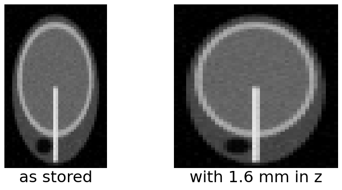
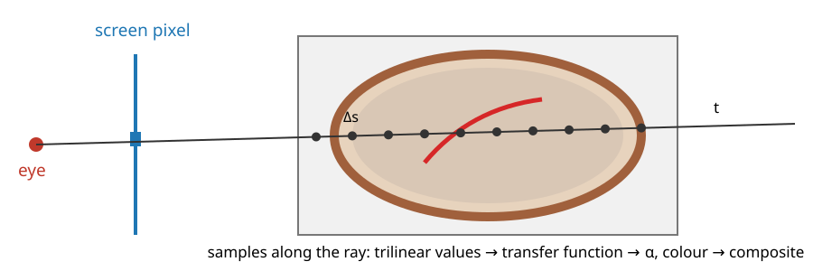
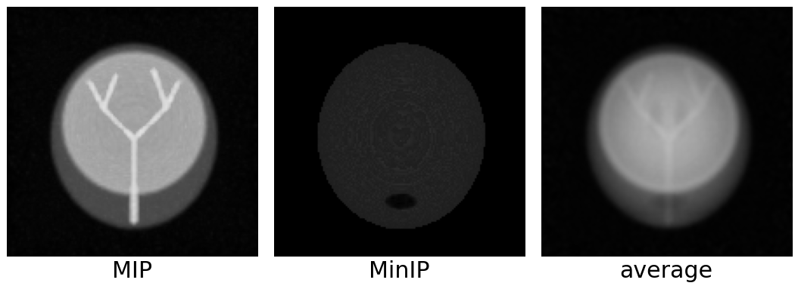
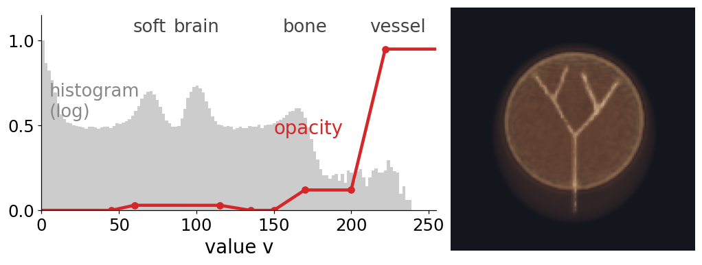
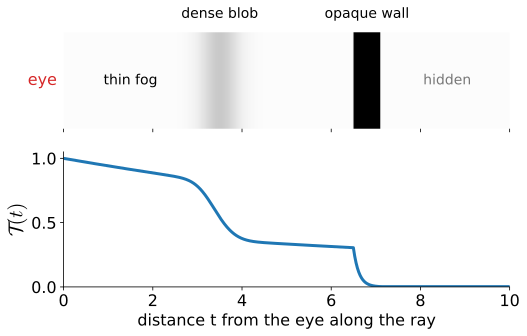
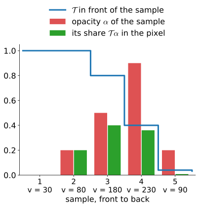
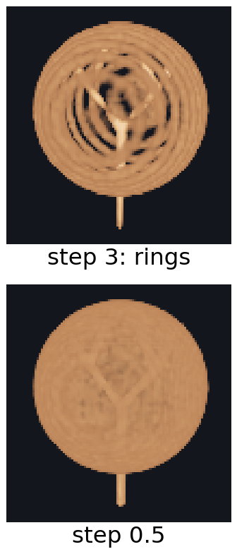
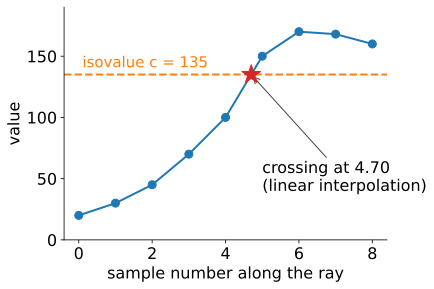

## About this lecture

A CT scan, an MRI or a confocal stack is a **volume**: a 3D array of values. How do we turn it into one picture?

- **Rays** through the volume, one per pixel, sampled in steps.
- **Projections** along the ray: maximum (MIP), minimum (MinIP), average (an X-ray).
- **Direct volume rendering**: a **transfer function** decides what to see; light is emitted and absorbed along the ray; **compositing** front to back.
- Speed and artefacts: early termination, opacity correction, step size.
- **Isosurfaces** two ways (ray casting vs a marching-cubes mesh), and polygons vs voxels.

Slides titled **The math** give the formulas and proofs; the ideas are complete without them.

::: notes
Last unit of the 3D graphics day. It uses the camera matrices of unit 1 (backwards, to make rays) and the "over" compositing of unit 3. Two demos: raycomposite (one ray, by hand) and volview in its "render" mode (the whole image, on the GPU).
:::

## Recall: a volume is an array plus a matrix

From **3D images** (`volumes3d`, the marching-cubes day):

:::: {.columns}
::: {.column width="60%"}
- A volume stores values $I[k, j, i]$ on a grid of voxels with **spacing** $(\Delta x, \Delta y, \Delta z)$, often anisotropic ($\Delta z > \Delta x$).
- A $4\times4$ **voxel → world** matrix $A$ places it in physical space (the spacing on its diagonal, plus an origin and possibly a rotation); world → voxel is $A^{-1}$.
- Values between voxels: **trilinear** interpolation. An oblique slice = inverse mapping + trilinear, and a first **MIP** was shown there.

Today the same inverse mapping is used at every sample of every ray. Our phantom: a synthetic head of $64\times64\times40$ voxels of $1\times1\times1.6$ mm (skull, brain, ventricles, a thin vessel tree, an air cavity).
:::
::: {.column width="40%"}
{fig-alt="A side slice through the synthetic head phantom (x = 32). Left, as stored: 40 by 64 voxels, the head looks squashed. Right, the same voxels placed with their 1.6 mm spacing along z: the head has its true round shape, with the skull ring, the vessel trunk and the dark air cavity." width="100%"}
:::
::::

## One ray per pixel

{width=78%}

- For each pixel, a ray from the eye through the pixel (unit 1, run backwards: $(PV)^{-1}$ applied to the pixel at near and far depth). Orthographic: parallel rays.
- Clip the ray to the volume's box, and **sample** it every $\Delta s$ (in voxels), by trilinear interpolation.
- What we do with the samples defines the image. The step $\Delta s$ must be small enough not to miss thin structures (sampling, *Fourier* unit): about half a voxel.

## Projections: maximum, minimum, average

- **MIP** (maximum-intensity projection): the brightest sample on the ray. Thin bright structures (contrast-filled **vessels**, fluorescent spots) stand out against everything else; standard in angiography and fluorescence microscopy.
- **MinIP**: the darkest sample within the body: air spaces (airways, sinuses).
- **Average** (or sum): like an **X-ray** image. A radiograph measures the attenuation summed along the ray (the Beer–Lambert law, owned by the *Radon* elective); CT reconstructs the volume from many such projections.

All three **lose depth**: a vessel in front and one behind look the same. One reads them by **rotating** (a "spinning MIP") or by combining with slices.

{.nostretch width="900px" fig-align="center" fig-alt="The head phantom seen from the front, rendered three ways. MIP: the bright vessel tree and the skull stand out. MinIP: everything dark grey except the black air cavity near the bottom. Average: a soft, transparent X-ray-like image."}

## Try it: MIP, MinIP and average

```{=html}
<link rel="stylesheet" href="../demos/dist/demo.css">
<div data-demo="volview" data-mode="render" data-preset="mip"></div>
<script src="../demos/dist/volview.js"></script>
```

::: notes
volview in its "render" mode, ray marching on the GPU. "MIP finds the vessels": the vessel tree (value 230) is the brightest structure on almost every ray through it, the skull (170) gives the bright ring. "MIP has no depth: rotate": seen from the side, the left and right branches overlap; drag to rotate and they separate. "MinIP finds the air": the dark cavity below the brain (value 8) inside the head. "average = an X-ray": a soft, transparent-looking image, as in a radiograph.
:::

## Direct volume rendering: the transfer function

Instead of picking one sample, let every sample **contribute**: a semi-transparent, coloured cloud.

- A **transfer function** maps the value of a sample to a **colour** $c(v)$ and an **opacity** $\alpha(v)$. This is where the user chooses **what to see**.
- Opacity 0 for air and soft tissue, high for bone: the skull. Low opacity for soft tissue and high for vessels: a glass head with red vessels.
- It is a **classification** by value only: structures with the same values (contrast-filled vessels and bone in CT) cannot be separated by it.
- The editor in the demos: opacity as a piecewise linear function over the histogram of the volume, colours from a colour map (the colour day).

{.nostretch width="820px" fig-align="center" fig-alt="Left: the histogram of the phantom's values (log scale, grey) with peaks for air, soft tissue, brain and bone, and the opacity curve in red: zero for air, 0.03 for soft tissue and brain, 0.12 for bone, rising to 0.95 for the vessels. Right: the volume rendered with it: a translucent brown head with bright vessels."}

## Light along a ray: emission and absorption

:::: {.columns}
::: {.column width="52%"}
Picture each sample as a thin slab of glowing fog:

- it **emits** light of its colour, in proportion to its opacity;
- it **absorbs** part of the light coming from behind it.

What reaches the eye is the light of each slab, **dimmed by everything in front of it**. The fraction of light from depth $t$ that survives to the eye is the **transmittance** $\mathcal T(t)$: 1 at the eye, falling with every absorbing slab. An opaque wall makes $\mathcal T = 0$ behind it: nothing there is seen.

The absorption alone is the X-ray picture (Beer–Lambert); emission added makes it a rendering.
:::
::: {.column width="48%"}
{fig-alt="Top: a ray from the eye through thin fog, a dense blob and an opaque wall, shaded by how strongly each part absorbs. Bottom: the transmittance along the ray, falling slowly in the fog, steeply in the blob (to about 0.3) and to almost zero in the wall; everything behind the wall is hidden." width="100%"}
:::
::::

## The math: the emission–absorption model {.math}

Along the ray, with $t$ the distance from the eye, extinction $\tau(t)$ (absorption per unit length) and colour $c(t)$, the light $L$ travelling towards the eye obeys a linear first-order ODE:

$$\frac{dL}{ds} = -\tau L + \tau c \qquad (s \text{ pointing towards the eye}).$$

Solving it (an integrating factor), with the **transmittance** $\mathcal T(t) = \exp\!\big(-\int_0^t \tau(t')\,dt'\big)$:

$$L = \int_0^D \mathcal T(t)\,\tau(t)\,c(t)\,dt \;+\; \mathcal T(D)\,L_\text{background}.$$

Each point contributes its emission $\tau c$, attenuated by everything between it and the eye. With $c = 0$ only the background term is left: Beer–Lambert, $L = L_\text{background}\,e^{-\int\tau}$. For a constant slab of thickness $D$: $L = c\,(1 - e^{-\tau D})$ + background $\cdot\,e^{-\tau D}$.

## From the integral to compositing

:::: {.columns}
::: {.column width="57%"}
Cut the ray into steps of length $\Delta s$; sample $i$ has colour $c_i$ and opacity $\alpha_i = 1 - e^{-\tau_i\Delta s}$. Walk **front to back**, starting with $C = 0$ and $\mathcal T = 1$:

$$C \leftarrow C + \mathcal T\,\alpha_i\,c_i, \qquad \mathcal T \leftarrow \mathcal T\,(1 - \alpha_i).$$

- Example, 5 samples with values 30, 80, 180, 230, 90 and opacities 0, 0.2, 0.5, 0.9, 0.2: $\mathcal T$ goes $1 \to 1 \to 0.8 \to 0.4 \to 0.04 \to 0.032$.
- This is the **"over" operator** with premultiplied colours from the texture unit (*How graphics cards store colour*): each sample is drawn **under** what is in front.
- **Back to front** (the painter's order), $C \leftarrow \alpha_i c_i + (1 - \alpha_i)\,C$ from the far end, gives the **same** final colour, but its partial sums differ, and it cannot stop early.
:::
::: {.column width="43%"}
{fig-alt="The five samples of the example. Red bars: opacities 0, 0.2, 0.5, 0.9, 0.2. Blue step line: the transmittance in front of each sample, 1, 1, 0.8, 0.4, 0.04. Green bars: each sample's share of the pixel, transmittance times opacity: 0, 0.2, 0.4, 0.36, 0.008." width="100%"}
:::
::::

## The math: compositing is the discretised integral {.math}

Replace the integral by a sum over the steps, with $\tau$ and $c$ constant within step $i$. The transmittance up to step $i$ is a product, and the step's own emission is $\int_0^{\Delta s} e^{-\tau_i u}\tau_i c_i\,du = (1 - e^{-\tau_i\Delta s})\,c_i = \alpha_i c_i$:

$$L \approx \sum_i \mathcal T_i\,\alpha_i\,c_i, \qquad \mathcal T_i = \prod_{j < i}(1 - \alpha_j).$$

Front to back computes exactly this, keeping the running product $\mathcal T_i$. Back to front computes the nested form $\alpha_1c_1 + (1-\alpha_1)\big(\alpha_2c_2 + (1-\alpha_2)(\dots)\big)$; expanding the brackets gives the same sum.

## Try it: compositing one ray

```{=html}
<link rel="stylesheet" href="../demos/dist/demo.css">
<div data-demo="raycomposite" data-preset="layers"></div>
<script src="../demos/dist/raycomposite.js"></script>
```

::: notes
A sagittal slice of the phantom (x = 32 mm) with one ray (E = the eye side; drag the ends). 67 samples at Δs = 1 mm. Plots: value along the ray (dots in the transfer-function colour), α of each sample (red), the transmittance T (blue, falling at the skull and the vessel), the brightness of the accumulated colour C (green). "next sample" from "start": watch T fall. Switch to "back to front": the same final colour (0.669, 0.273, 0.299), different partial sums. Tick "early termination": the ray could stop at sample 62. "opaque wall hides what is behind": T falls below 0.05 at the first skull crossing, sample 15 of 67; nothing behind it matters. "MIP vs DVR": the MIP value is the maximum, 209.9, the vessel.
:::

## Faster and correct: early termination, opacity correction, step size

:::: {.columns}
::: {.column width="64%"}
- **Early ray termination**: front to back, stop when $\mathcal T < \varepsilon$ (say 0.05): what is behind can change the pixel by less than $\varepsilon$. Rays that hit bone stop at the skull. (In the demo, 345 of 1489 rays stop early and save 45 % of their samples; rays through empty space need **empty-space skipping**, not covered.)
- **Opacity correction**: a transfer-function opacity is defined for a reference step. Halve the step and you take twice as many samples: with the same $\alpha$ the image gets **too opaque**. Correct with $\alpha' = 1 - (1 - \alpha)^{\Delta s/\Delta s_0}$.
- **Step size**: too large a step undersamples thin layers and gives **wood-grain** rings (aliasing: the *Fourier* unit). Rule: $\Delta s \le$ half a voxel.
- **Pre- vs post-classification**: interpolate the values and then apply the transfer function (post, sharper), or classify each voxel and interpolate colours (pre, blurrier).
:::
::: {.column width="36%"}
{fig-alt="The skull rendered with the demo's skull transfer function. Step 3 voxels: concentric rings across the skull, wood grain. Step 0.5 voxel: an even surface." width="52%"}
:::
::::

## The math: opacity correction {.math}

A step of length $\Delta s$ through a material of extinction $\tau$ lets through $e^{-\tau\Delta s}$ of the light. If the table gives $\alpha_0 = 1 - e^{-\tau\Delta s_0}$ for the reference step $\Delta s_0$, then

$$1 - \alpha' = e^{-\tau\Delta s} = \big(e^{-\tau\Delta s_0}\big)^{\Delta s/\Delta s_0} = (1 - \alpha_0)^{\Delta s/\Delta s_0}.$$

Example: $\tau = 0.5$ per voxel. One step $\Delta s = 1$: $\alpha = 1 - e^{-0.5} = 0.393$. Two steps of $0.5$: each $1 - e^{-0.25} = 0.221$, and together $1 - 0.779^2 = 0.393$: the same. Without correction, two samples of $0.393$ give $1 - 0.607^2 = 0.632$.

With the correction, a homogeneous slab of thickness $D$ has opacity $1 - e^{-\tau D}$ for every step size.

## Try it: volume rendering

```{=html}
<link rel="stylesheet" href="../demos/dist/demo.css">
<div data-demo="volview" data-mode="render" data-preset="soft"></div>
<script src="../demos/dist/volview.js"></script>
```

::: notes
"semi-transparent soft tissue": low opacity for soft tissue and brain, a little for bone, nearly opaque vessels. Drag the opacity points in the editor. "only the skull". "step too large: wood grain": step 3 voxels, rings on the skull. "no opacity correction": step 0.25 without correction: the image is much more opaque (mean opacity of the rays 0.334 instead of 0.222); tick the correction. "early termination saves samples": the heat map of samples per pixel; rays through the skull stop early. "ignored z spacing" (side view): the head is squashed to 40/64 of its height. "isosurface by ray casting": c = 135, the outer surface of the skull, shaded with the gradient as normal.
:::

## Isosurfaces two ways

The surface where the volume crosses a value $c$ (the marching-cubes day):

:::: {.columns}
::: {.column width="60%"}
- **Ray casting**: march until a sample crosses $c$, refine the crossing by linear interpolation between the two samples (the same formula as marching squares), shade with the **gradient** as the normal (marching-cubes day). Done per pixel, per frame, on the GPU; gives a picture, no geometry.
- **Extract a mesh** with marching cubes, then draw it with units 1–2. Done once per $c$; gives triangles to **measure** (area, volume), smooth, export or print.
:::
::: {.column width="40%"}
{fig-alt="Values of nine samples along a ray rising from 20 to 170. The isovalue 135 is a dashed line; between sample 4 (value 100) and sample 5 (value 150) the ray crosses it, at 4.70 by linear interpolation, marked with a star." width="100%"}
:::
::::

| | ray casting | extracted mesh |
|---|---|---|
| work | every frame, every pixel | once per isovalue |
| needs | the volume on the GPU | only the mesh |
| gives | an image | geometry to measure |
| changing $c$ | instant | re-extract |

## Polygons or voxels?

| | volume (voxels) | mesh (polygons) |
|---|---|---|
| represents | every point **inside** | only the **surface** |
| memory | $512^3$ voxels × 2 bytes = **256 MiB** | $10^6$ triangles ≈ **24 MB** |
| easy | segmentation, measuring volume and intensities, Boolean operations | rendering, measuring area, smoothing, deforming |
| rendering | ray casting (this unit) | rasterisation (units 1–2) |

Microscopy and medical imaging produce volumes; meshes come from segmenting them (marching cubes) or from surface scanners. Most analysis stays on the voxels; meshes are for looking, measuring surfaces, and modelling.

## Summary

- A **ray per pixel**, sampled every $\Delta s$ with trilinear interpolation.
- **MIP**: vessels and spots; **MinIP**: air; **average**: an X-ray. No depth: rotate.
- **Transfer function**: value → colour and opacity: what to see.
- **Emission–absorption**: $L = \int \mathcal T\,\tau\,c\,dt$; discretised: $C \leftarrow C + \mathcal T\alpha c$, $\mathcal T \leftarrow \mathcal T(1 - \alpha)$ (front to back = back to front).
- **Early termination** ($\mathcal T < \varepsilon$), **opacity correction** $1 - (1 - \alpha)^{\Delta s/\Delta s_0}$, step ≤ half a voxel.
- Isosurfaces by ray casting (a picture) or by marching cubes (a mesh to measure).
