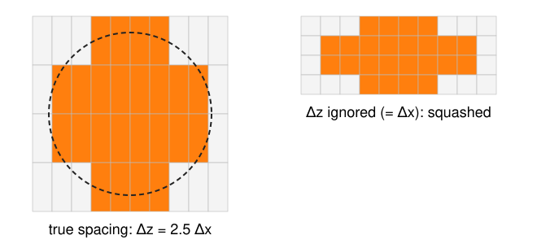
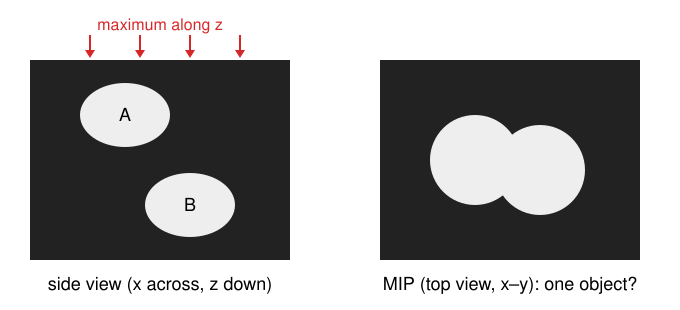

## About this lecture

So far every image was 2D. CT and MRI scanners, confocal and light-sheet microscopes and electron microscopes all deliver **3D images**: stacks of slices.

- A volume is a 3D array **plus its voxel spacing** $(\Delta x, \Delta y, \Delta z)$, often with $\Delta z > \Delta x$.
- **Voxel ↔ world**: one $4 \times 4$ matrix turns an index into a position in µm or mm, and back.
- **Trilinear interpolation**, orthogonal and **oblique slices**, resampling: inverse mapping one dimension up.
- **Anisotropy** in practice: filter sizes and neighbourhoods in physical units.
- A first **maximum-intensity projection**, and what it hides.

*Slides titled **The math** give the formulas and proofs; the ideas are complete without them.*

::: notes
This is the course's unit on 3D images. The rest of this day (marching squares and cubes, measuring surfaces), the 3D-graphics day, and the 3D remarks on the labelling, morphology, skeleton, measurement, FFT-registration and moments days all point back here. Prerequisites: the "Images as arrays" unit (inverse mapping, bilinear interpolation) and a 4 × 4 matrix acting on homogeneous coordinates (one line of linear algebra). Timing: about 45 minutes of lecture, 45 of exercise.
:::

## Where 3D images come from

| Instrument | Typical voxel size | Shape of the voxel |
|---|---|---|
| CT (X-ray tomography) | 0.5 mm | about a cube |
| MRI | 1 mm, slices often 3–5 mm | flat in plane, long across slices |
| Confocal microscope | 0.1 µm in $x, y$, 0.3–0.5 µm in $z$ | elongated along $z$ |
| Light-sheet microscope | 0.3–0.5 µm in $x, y$, 1–2 µm in $z$ | elongated along $z$ |
| Electron microscopy (serial sections) | 5 nm in $x, y$, 30–50 nm in $z$ | elongated along $z$ |

- Microscopes take one 2D image per focus position: the **stack**. The step between images is $\Delta z$.
- Why $\Delta z$ is usually larger: the blur of a microscope is several times longer along the optical axis than across it (the elongated PSF of the image formation day), so finer steps in $z$ would add little detail.

## A volume is an array plus its spacing

:::: {.columns}
::: {.column width="55%"}
{width="100%"}
:::
::: {.column width="45%"}
- Values $I[z, y, x]$: slice $z$, row $y$, column $x$ (as in `images/`: $x$ right, $y$ down, $z$ along the stack).
- **Voxel spacing** $(\Delta x, \Delta y, \Delta z)$ in µm or mm: the distance between neighbouring voxel centres.
- The array alone does not know its spacing. Drawn with $\Delta z = \Delta x$, a round nucleus becomes a flat pancake; its volume and surface come out wrong.
:::
::::

Always carry the spacing with the array, and do every measurement in physical units.

## From a voxel index to a position

Voxel $(i, j, k)$ = column $i$, row $j$, slice $k$. Its centre in the world (in µm):

- step $i$ times along the voxel's $x$ axis (length $\Delta x$), $j$ times along $y$, $k$ times along $z$,
- starting from the position of voxel $(0, 0, 0)$, the **origin** (e.g. the stage position).

Example: spacing $(0.5, 0.5, 2)$ µm, origin $(10, 20, 5)$ µm. Voxel $(2, 3, 1)$ is at

$$(10 + 2 \cdot 0.5,\; 20 + 3 \cdot 0.5,\; 5 + 1 \cdot 2) = (11,\; 21.5,\; 7)\ \text{µm}.$$

Backwards, the world point $(12.125, 21.75, 8.5)$ µm lies at voxel $(4.25, 3.5, 1.75)$: between voxels, so we will need to interpolate.

## The math: the voxel → world matrix {.math}

In homogeneous coordinates one $4 \times 4$ matrix does it:

$$\begin{bmatrix} \mathbf x \\ 1 \end{bmatrix} = A \begin{bmatrix} i \\ j \\ k \\ 1 \end{bmatrix}, \qquad A = \begin{bmatrix} R\,\mathrm{diag}(\Delta x, \Delta y, \Delta z) & \mathbf o \\ \mathbf 0^\top & 1 \end{bmatrix}.$$

- The columns of $A$ are the three voxel axes (scaled by the spacing) and the origin $\mathbf o$. $R$ is a rotation, when the axes of the scanner are tilted against the world (a tilted head in MRI); in a microscope $R = I$.
- Spacing alone: $A = \begin{bmatrix} \Delta x & 0 & 0 & o_x \\ 0 & \Delta y & 0 & o_y \\ 0 & 0 & \Delta z & o_z \\ 0 & 0 & 0 & 1\end{bmatrix}$.
- World → voxel: $A^{-1} = \begin{bmatrix} \mathrm{diag}(1/\Delta)\,R^\top & -\mathrm{diag}(1/\Delta)\,R^\top\mathbf o \\ \mathbf 0^\top & 1 \end{bmatrix}$.
- Medical file formats store this matrix (or its parts) in their header. Warning: their axis conventions differ (which way $x$ and $y$ point, whether $k$ counts up or down), so check with a known landmark.

## Trilinear interpolation

To read the volume between voxels, interpolate in $x$, then in $y$, then in $z$: **trilinear** interpolation, the 3D version of bilinear interpolation from `images/`.

- The point lies in a cube of **8 voxels**. Its fractional position $(f_x, f_y, f_z)$ in that cube sets the weights.
- Example at $(4.25, 3.5, 1.75)$: along $x$ ($f_x = 0.25$) the four pairs $10, 20 \;\to\; 12.5$; $30, 60 \to 37.5$; $50, 50 \to 50$; $90, 70 \to 85$. Along $y$ ($f_y = 0.5$): $25$ and $67.5$. Along $z$ ($f_z = 0.75$): $25 + 0.75 \cdot 42.5 = 56.875$.
- The order ($x$ first or $z$ first) does not matter.

## The math: trilinear weights {.math}

With $f_x, f_y, f_z \in [0, 1]$ the position inside the cube and $I_{abc}$ the corner values ($a, b, c \in \{0, 1\}$):

$$I(f_x, f_y, f_z) = \sum_{a,b,c \in \{0,1\}} I_{abc}\; w_a(f_x)\, w_b(f_y)\, w_c(f_z), \qquad w_0(f) = 1 - f,\; w_1(f) = f.$$

- The 8 weights are $\ge 0$ and sum to 1: a weighted average of the corners.
- It is **linear along every line parallel to an axis**, but not along other lines: on the diagonal $f_x = f_y = f_z = t$ it is a cubic in $t$. (This is why level sets of the interpolant are curved, which matters in the next units.)
- It reproduces exactly every function $a + bx + cy + dz + exy + fyz + gxz + hxyz$.

## Slices: orthogonal and oblique

- **Orthogonal slices** ($xy$, $xz$, $yz$) are array indexing: fix one index. Draw them with their physical aspect ratio ($xz$ is $n_x\Delta x$ wide and $n_z\Delta z$ high).
- An **oblique slice** is a plane at any angle: a centre $\mathbf c$ and two orthogonal unit directions $\mathbf u, \mathbf w$ in the world. For each output pixel $(p, q)$:
  1. world point $\mathbf x = \mathbf c + p\,s\,\mathbf u + q\,s\,\mathbf w$ (pixel size $s$),
  2. voxel position $A^{-1}\mathbf x$,
  3. trilinear interpolation there.
- This is **inverse mapping** from `images/`, one dimension up: loop over the output, ask where it comes from.
- **Resampling to isotropic voxels** is the same loop over a new grid with spacing $(\Delta x, \Delta x, \Delta x)$. It does not add detail along $z$; it only makes later steps simpler.

## Try it: slices of a stack

```{=html}
<link rel="stylesheet" href="../demos/dist/demo.css">
<div data-demo="volview" data-mode="volumes3d" data-preset="slices"></div>
<script src="../demos/dist/volview.js"></script>
```

::: notes
Synthetic nuclei stack: 64 × 64 × 20 voxels of 0.2 × 0.2 × 0.5 µm, origin (10, 20, 4) µm. Nuclei A and B overlap in x–y but sit at z = 2.8 and 7.2 µm; C is an elongated cell tilted 35° in the x–z plane; D is small. Tour: move the z slice and the y slice (j = 31 passes through A and B). Click a voxel in the xy slice and read its world position; check it against the matrix (row 1: 0.2 i + 10). "Ignored z spacing": the header says Δz = 0.2, the box flattens and C's tilt in the xz slice drops from 35° to 15.6°. "Oblique slice through the tilted cell": a plane tilted −35° about y through C's centre shows its full length, 7.2 µm. "Resample to isotropic": 64 × 64 × 50 voxels, the matrix becomes 0.2 on the whole diagonal, and the slices look the same as before.
:::

## Anisotropy in practice

Work in physical units, convert to voxels per axis:

- A Gaussian blur of $\sigma = 0.4$ µm in every direction is $\sigma = 2$ voxels in $x$ and $y$ but $0.8$ voxels in $z$ (spacing $0.2, 0.2, 0.5$ µm). An "isotropic" $\sigma = 2$ voxels would blur 1 µm along $z$.
- **Derivatives** (gradients, Sobel from `kernels/`): divide each difference by its own spacing.
- **Neighbourhoods**: in 3D a voxel has 6 face neighbours, 18 with the edges, 26 with the corners (the 3D connectivities of the labelling day). With $\Delta z \gg \Delta x$ the "neighbour" above is much further away than the one beside.
- **Distances**: the distance transform and every size measure need the spacing.

## The math: per-axis scale {.math}

A physical length $\ell$ along axis $a$ covers $\ell / \Delta a$ voxels, so

$$\sigma_x^{\text{vox}} = \frac{\sigma}{\Delta x},\quad \sigma_y^{\text{vox}} = \frac{\sigma}{\Delta y},\quad \sigma_z^{\text{vox}} = \frac{\sigma}{\Delta z}, \qquad \frac{\partial I}{\partial z} \approx \frac{I[k+1] - I[k-1]}{2\,\Delta z}.$$

- The 3D Gaussian is **separable**: blur along $x$, then $y$, then $z$, each with its own $\sigma^{\text{vox}}$; $3$ passes of length $\sim 6\sigma$ instead of one $(6\sigma)^3$ kernel.
- With the gradient divided by voxels instead of µm, the $z$ component is $\Delta z / \Delta x$ times too large: the direction of $\nabla I$ (and every normal computed from it) tilts.

## A first look: the maximum-intensity projection

:::: {.columns}
::: {.column width="55%"}
{width="100%"}
:::
::: {.column width="45%"}
**MIP**: for every $(x, y)$, the largest value along $z$. One 2D image that shows every bright object, which is why microscopy figures use it.

What it hides:

- **Overlaps**: nuclei at different depths merge into one blob.
- **Sizes**: areas in the MIP are areas of the shadow, not of a section.
- **Depth**: nothing tells you which object is in front.
:::
::::

Rule: **look** at MIPs, **measure** in 3D.

::: notes
In the demo's nuclei stack, thresholding at 100 finds 3 objects in the z-MIP (A and B merged) and 4 in 3D (26-connected labelling). Projections as a rendering method (MIP from any direction, volume rendering) are taught on the 3D-graphics day.
:::

## Slice by slice, or in 3D?

- **2D, slice by slice**: segment each $xy$ image on its own, then link the pieces across slices. Simple, but every slice decides alone: an object can break between slices, and two objects touching in one slice get merged.
- **3D**: filters, thresholds, connected components, watershed and the rest work on the whole volume with 3D neighbourhoods; sizes and shapes are measured in 3D with the spacing.
- With very coarse $z$ (MRI slices of 5 mm), 2D per slice plus linking can be the honest choice: there is little 3D information to use.
- Showing results: slices, projections, or a **surface** around each object. Surfaces are the rest of this day.

## Summary

- A 3D image = an array $I[z, y, x]$ **plus** voxel spacing $(\Delta x, \Delta y, \Delta z)$ and an origin; in microscopy usually $\Delta z > \Delta x$.
- One $4\times4$ matrix maps voxel indices to world positions; its inverse maps back.
- **Trilinear** interpolation: a weighted average of 8 voxels. Oblique slices and resampling are inverse mapping + trilinear.
- Blur, derivatives, neighbourhoods and measurements: in physical units, per axis.
- The **MIP** is for looking, not for measuring: it merges objects at different depths.
