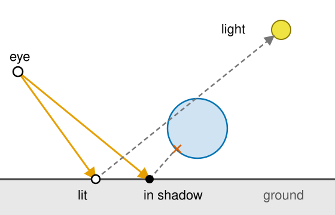
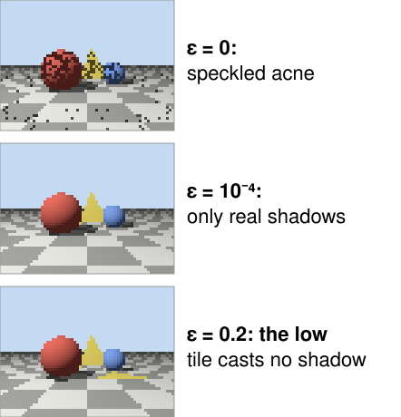
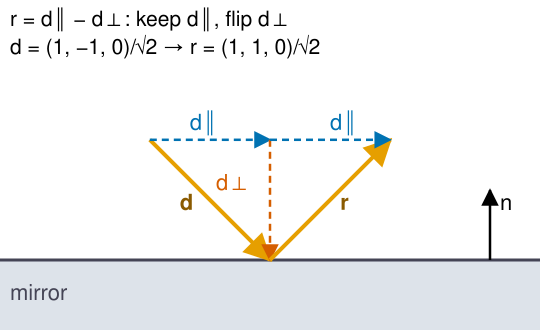
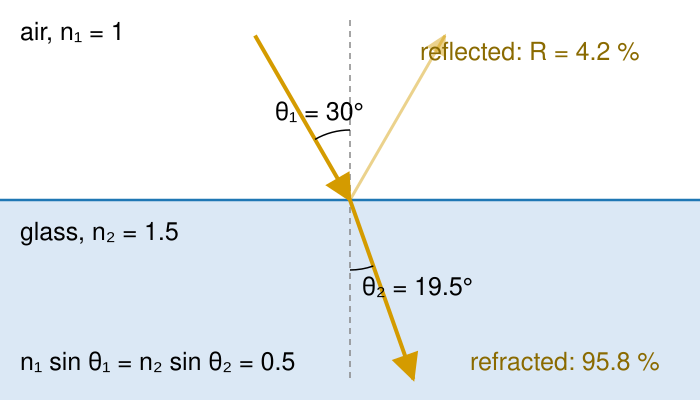
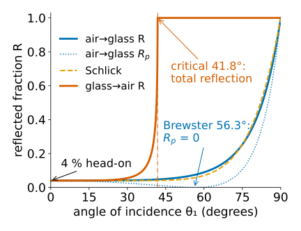
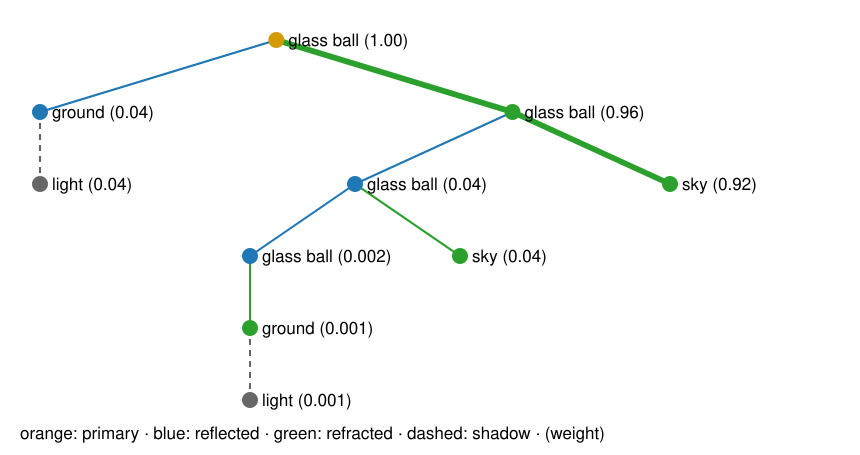
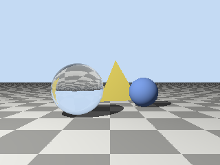
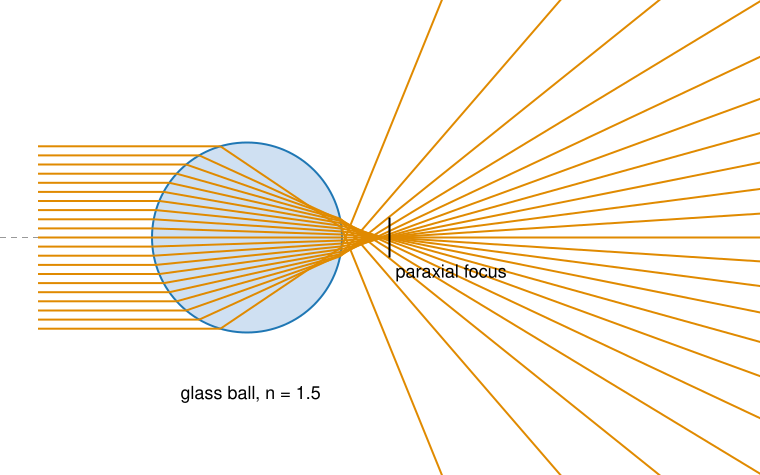

## About this lecture

[Ray casting](../raycast/lec.qmd) finds what each pixel sees. A ray tracer keeps going from the hit point and asks more questions, each answered by another ray (Whitted, 1980).

- **Shadow rays**: can the hit point see the light? And why floating point makes **shadow acne**.
- **Mirrors**: the reflected ray.
- **Glass**: **refraction** and Snell's law, **total internal reflection**, and the **Fresnel** split between reflected and transmitted light.
- **Recursion**: the **ray tree** of one pixel, and a depth limit.
- What this cannot do, and the bridge to lenses and microscopes.

*Slides titled **The math** give the formulas and proofs; the ideas are complete without them.*

::: notes
This unit owns reflection, refraction, Snell's law, total internal reflection and Fresnel for the course (geometric optics is taught here from scratch; wave optics stays with the image formation day). Refractive indices always carry subscripts, n₁ and n₂. Two demos: the 2D sandbox ray2d (everything happens in the plane of incidence, so 2D is exact) and raystep with recursion.
:::

## Shadow rays

:::: {.columns}
::: {.column width="56%"}
From the hit point $\mathbf p$, send one more ray **towards each light**.

- If it hits anything before reaching the light, $\mathbf p$ is **in shadow** for that light: drop that light's direct term (keep the ambient light).
- One extra ray per light per hit; it only needs *any* hit before the light, not the nearest.
- A rasteriser cannot ask this question: it needs a separate pass that renders the scene from the light (a shadow map). A ray tracer just asks.
:::
::: {.column width="44%"}
{width="100%" fig-alt="Side view: two eye rays hit the ground. From the left hit point the shadow ray reaches the light: lit. From the right hit point the shadow ray is blocked by a sphere: in shadow."}
:::
::::

Point lights give **hard** shadows: a point is either lit or not. Soft shadows need lights with an area (unit 4).

## Shadow acne

:::: {.columns}
::: {.column width="60%"}
The shadow ray starts **on** the surface. In floating point, the computed hit point lies a tiny bit above or below the true surface, and the shadow ray can hit its own surface again at $t \approx 10^{-7}$: speckled, wrongly dark pixels.

- Fix: start at $\mathbf p + \varepsilon\mathbf n$ (or ignore hits with $t < \varepsilon$).
- In the demo (64 × 48, hit points stored in float32 as a GPU would): with $\varepsilon = 0$, 100 of the 1328 ground pixels are dark; with $\varepsilon = 10^{-4}$, 46 (the real shadows).
- Too large an $\varepsilon$ makes the shadow ray start **beyond** a thin object close to the surface: light **leaks** under it (in the demo, a tile 0.12 above the floor casts no shadow at all at $\varepsilon = 0.2$).
- Recall [Floating point](../floatingpoint/lec.qmd): floats are spaced proportionally to their size, so a fixed $\varepsilon$ that works near the origin is too small far away.
:::
::: {.column width="40%"}
{width="100%" fig-alt="The demo's scene at 64 × 48 with shadow rays, three times. Epsilon 0: the ground and the spheres are covered in dark speckles. Epsilon 10^-4: only the real shadows remain. Epsilon 0.2 on the scene with a low tile: the tile casts no shadow at all."}
:::
::::

## Mirror reflection

:::: {.columns}
::: {.column width="58%"}
A mirror sends the ray on in the **mirror direction**: angle of reflection = angle of incidence, in the plane of the ray and the normal.

- Trace the reflected ray and add what it sees, times the mirror's reflectance (a tinted mirror: per colour).
- Same formula as the Phong highlight of the 3D graphics day, now for the whole incoming ray.
- Two facing mirrors: the reflected ray hits the other mirror, and again, and again… we need a **depth limit**.
:::
::: {.column width="42%"}
{width="100%" fig-alt="A ray d hits a mirror. Its part along the mirror, d parallel, is kept; its part along the normal, d perpendicular, is flipped. The reflected ray r leaves at the same angle. Example: d = (1, −1, 0)/√2 gives r = (1, 1, 0)/√2."}
:::
::::

## The math: reflection {.math}

Split the (unit) incoming direction into parts along and across the unit normal:

$$\mathbf d = \underbrace{(\mathbf d\cdot\mathbf n)\mathbf n}_{\mathbf d_\perp} + \underbrace{\mathbf d - (\mathbf d\cdot\mathbf n)\mathbf n}_{\mathbf d_\parallel}.$$

A mirror keeps the part along the surface and flips the part along the normal:

$$\mathbf r = \mathbf d_\parallel - \mathbf d_\perp = \mathbf d - 2(\mathbf d\cdot\mathbf n)\,\mathbf n.$$

- $\lVert\mathbf r\rVert^2 = \lVert\mathbf d_\parallel\rVert^2 + \lVert\mathbf d_\perp\rVert^2 = \lVert\mathbf d\rVert^2$: length kept.
- Works whichever way $\mathbf n$ points (the sign of $\mathbf n$ cancels in $(\mathbf d\cdot\mathbf n)\mathbf n$).
- Example: $\mathbf d = (1, -1, 0)/\sqrt2$ onto a floor with $\mathbf n = (0, 1, 0)$: $\mathbf r = (1, 1, 0)/\sqrt2$.

## Refraction: Snell's law

:::: {.columns}
::: {.column width="56%"}
Light travels slower in glass or water than in air, by the factor $n$, the **refractive index**: air 1.00, water 1.33, glass about 1.5, immersion oil 1.518, diamond 2.42.

- At the boundary the ray **bends**. Picture a line of marching soldiers hitting mud at an angle: the side that reaches the mud first slows down first, and the line turns.
- **Snell's law**, with angles measured from the normal:
$$n_1 \sin\theta_1 = n_2 \sin\theta_2.$$
- Into a denser medium ($n_2 > n_1$) the ray bends **towards** the normal; out of it, **away** from the normal.
- Air → glass ($n_2 = 1.5$) at 30°: $\sin\theta_2 = 0.5/1.5$, $\theta_2 = 19.5°$ (the figure).
:::
::: {.column width="44%"}
{width="100%" fig-alt="A ray in air hits glass of index 1.5 at 30 degrees from the normal. 4.2 percent is reflected at 30 degrees; 95.8 percent is refracted towards the normal at 19.5 degrees. n1 sin theta1 = n2 sin theta2 = 0.5."}
:::
::::

## The math: Snell's law in vector form {.math}

With unit $\mathbf d$, $\mathbf n$ facing the incoming ray ($\mathbf d\cdot\mathbf n < 0$), $c_1 = -\mathbf d\cdot\mathbf n = \cos\theta_1$ and $\eta = n_1/n_2$:

$$\mathbf t = \eta\,\mathbf d + \Big(\eta c_1 - \sqrt{1 - \eta^2(1 - c_1^2)}\Big)\,\mathbf n.$$

- The tangential part of the direction is scaled by $\eta$ (that is Snell: $\sin\theta_2 = \eta\sin\theta_1$); the normal part is whatever makes $\lVert\mathbf t\rVert = 1$, and it must point into the second medium.
- The square root is $\cos\theta_2$. If its argument $1 - \eta^2\sin^2\theta_1$ is **negative** there is no refracted ray: **total internal reflection**.
- Why the light bends: **Fermat's principle**, light takes the path of least time; with different speeds on the two sides, the fastest path is bent.

## Total internal reflection

From glass into air, $\sin\theta_2 = 1.5\sin\theta_1$. Beyond the **critical angle** there is no solution:

$$\sin\theta_c = \frac{n_2}{n_1}: \qquad \text{glass} \to \text{air } 41.8°, \qquad \text{water} \to \text{air } 48.8°.$$

- Steeper than $\theta_c$: **all** light is reflected, none escapes. No mirror coating needed.
- **Light guides** and optical fibres keep light inside by bouncing it at grazing angles.
- Looking up from under water, the surface beyond 48.8° from vertical is a silver mirror.
- Microscopy: **TIRF** illuminates only a thin layer above the coverslip with the light that "leaks" just past a totally reflecting interface.

## Fresnel: light splits

:::: {.columns}
::: {.column width="56%"}
A real interface does both: a fraction $R$ is **reflected**, $1 - R$ is **transmitted** (refracted).

- Head-on, $R_0 = \left(\frac{n_1 - n_2}{n_1 + n_2}\right)^2$: air–glass 4 %, air–water 2 %, water–glass 0.4 %, oil–glass ($1.518$ vs $1.52$) 0.00004 %.
- $R$ grows towards **1** at **grazing** angles: a lake is a mirror at sunset; the edges of a glass look bright.
- Matching indices makes an interface invisible (no reflection, no bending): a glass bead in immersion oil disappears. That is why oil immersion works.
- Unpolarised light: $R$ is the average of two polarisations. Practical shortcut: **Schlick's** formula $R \approx R_0 + (1 - R_0)(1 - \cos\theta)^5$ (air–glass: 0.07 at 60° against 0.089 exact; 0.65 at 85° against 0.61).
:::
::: {.column width="44%"}
{width="100%" fig-alt="Reflected fraction R against the angle of incidence. Air to glass: 4 percent head-on, rising to 1 at grazing incidence; the p-polarised part is zero at Brewster's angle 56.3 degrees; Schlick's approximation follows the exact curve closely. Glass to air: R jumps to 1 at the critical angle 41.8 degrees, total internal reflection."}
:::
::::

## The math: Fresnel {.math}

With $\cos\theta_1$, $\cos\theta_2$ from Snell (stated here; the derivation needs Maxwell's equations):

$$R_s = \left(\frac{n_1\cos\theta_1 - n_2\cos\theta_2}{n_1\cos\theta_1 + n_2\cos\theta_2}\right)^2, \qquad R_p = \left(\frac{n_1\cos\theta_2 - n_2\cos\theta_1}{n_1\cos\theta_2 + n_2\cos\theta_1}\right)^2, \qquad R = \frac{R_s + R_p}{2}.$$

- $\theta_1 = 0$: both equal $R_0 = ((n_1 - n_2)/(n_1 + n_2))^2$. $n_1 = n_2$: $R_0 = 0$.
- $\theta_1 \to 90°$: $\cos\theta_1 \to 0$, both $\to 1$.
- **Brewster's angle** $\tan\theta_B = n_2/n_1$ (56.3° air → glass): $R_p = 0$, the reflection is fully polarised (polarising sunglasses cut it).
- Energy: $R + T = 1$ at every split; a ray tracer that keeps both branches conserves light.

## Try it: rays in 2D

```{=html}
<link rel="stylesheet" href="../demos/dist/demo.css">
<div data-demo="ray2d" data-preset="snell"></div>
<script src="../demos/dist/ray2d.js"></script>
```

::: notes
Everything above happens in the plane of incidence, so 2D is exact. Drag the source S and its aim, the objects by their + handles; click a hit point for its angles. Tour: "Snell at a flat surface": θ1 = 30°, θ2 = 19.5°, n1 sin θ1 = n2 sin θ2 = 0.5, R = 4.2 %. "The critical angle": a point source inside glass; rays beyond 41.8° do not get out (12 of the 25 rays here). "A light guide": all rays reach the far end by total internal reflection. "Grazing glass: a mirror": at 78° incidence R = 33 %, and the light bounces back and forth inside the plate. "A ball: aberration": parallel rays near the axis focus 7.5 mm behind the centre (x = 20.5); rays near the rim cross the axis as early as x = 18.2: spherical aberration. "Prism: dispersion": tick dispersion; blue is deviated 40.6°, red 39.5°. "Oil objective, watery sample": the focus moves from the nominal x = 22 to 21.2 (paraxial) and 20.6 (marginal rays): shallower, and smeared.
:::

## Whitted recursion: the ray tree

At every hit, colour = **local shading** (with shadow rays) + $R$ · trace(**reflected**) + $(1 - R)$ · trace(**refracted**).

:::: {.columns}
::: {.column width="50%"}
- Each glass hit **doubles** the rays: one pixel becomes a **tree** of rays.
- Every branch carries a **weight**: the product of the $R$ and $1 - R$ factors along the way.
- Stop at a **depth limit**, and when the weight is tiny. Depth 0 is plain ray casting.
- The example: one pixel through a glass ball (depth 5): 10 rays.
:::
::: {.column width="50%"}
{width="100%"}
:::
::::

## The math: the size of the ray tree {.math}

- If every hit splits in two (glass everywhere), a tree of depth $D$ has $1 + 2 + \dots + 2^D = 2^{D+1} - 1$ rays, plus the shadow rays: 15 for $D = 3$, 2047 for $D = 10$.
- With a **weight cut-off**: each reflection keeps $R \approx 0.04$, each refraction $0.96$. A branch with $a$ reflections and $b$ refractions has weight $0.04^a\,0.96^b$; with a cut-off of $10^{-3}$, at most two reflections survive ($0.04^2 = 0.0016$). The number of rays up to depth $D$ is then at most $\sum_{L \le D}\big[1 + L + \binom L2\big]$: 41 instead of 63 for $D = 5$, 231 instead of 2047 for $D = 10$: polynomial instead of exponential.
- Mirrors facing each other do not split, so the tree is a chain of length $D$; only the depth limit stops it.

## Try it: ray trees

```{=html}
<link rel="stylesheet" href="../demos/dist/demo.css">
<div data-demo="raystep" data-depth="3" data-preset="glass"></div>
<script src="../demos/dist/raystep.js"></script>
```

::: notes
The same demo as in unit 1 with recursion. The inspected pixel shows its ray tree in the top view (orange primary, blue reflected, green refracted, grey dashed shadow rays) and as a list with weights. Tour: "glass ball" (depth 5): pixel (22, 26) has 10 rays; the primary ray enters the ball (weight 0.96), most of it leaves to the sky behind (0.92), 4 % reflects off the front onto the ground. The image shows the scene upside down in the ball, and a black shadow behind it: no light gets through glass in Whitted's model. "Depth 0 vs 5": at depth 0 the glass ball is black: all its colour comes from the rays it would send on. "Two facing mirrors" (depth 6): 4.6 rays per pixel on average; lower the depth and the far reflections turn black. "Shadow acne (ε = 0)": speckles on the floor; raise ε. "Light leaks": the low tile (0.12 above the floor) casts no shadow at ε = 0.2 (17 shadow pixels at ε = 10⁻⁴). "Fresnel on a glass floor": with Fresnel the floor reflects the spheres at grazing angles; without it, all light goes through to the lower floor.
:::

## What Whitted ray tracing cannot do

{width="26%" fig-align="right"}

It follows only the mirror and refraction directions, and point lights.

- **Soft shadows**: a lamp with an area gives a half-shadow; one shadow ray to one point cannot see it.
- **Colour bleeding**: a white wall next to a red one turns pinkish, because light bounces off the red wall in **all** directions.
- **Caustics**: light focused *through* glass onto a diffuse floor. Whitted's shadow ray from the floor hits the glass ball and gives up: the shadow behind a glass ball is **black**.
- **Glossy** surfaces, between mirror and matte.

All of these need light arriving from *every* direction at a point: an integral over directions, unit 4 ([Path tracing](../pathtrace/lec.qmd)).

## Lenses: rays through glass

{width="48%" fig-align="center"}

- A glass ball focuses parallel light, but **not to one point**: rays far from the axis cross it earlier (**spherical aberration**). In the demo: paraxial focus 7.5 mm behind the centre of a 5-mm ball, rim rays 2.3 mm earlier.
- A lens is two refractions; different colours bend differently (**dispersion**, chromatic aberration).
- **Refractive-index mismatch** in a microscope: an oil objective focused into a watery sample. The rays bend at the coverslip, so the focus lies **shallower** than nominal (in the demo 6.5 → 5.7 for paraxial rays, 5.1 for the marginal ones) and smeared along the axis. Distances in $z$ are then wrong.
- Rays tell you **where** the light goes; how small the focus can be is set by diffraction: [Image formation](../psf/lec.qmd).

## Summary

- **Shadow ray** to each light: lit or not. Start it a little off the surface ($\varepsilon$): too small gives **acne**, too large **leaks**.
- **Mirror**: $\mathbf r = \mathbf d - 2(\mathbf d\cdot\mathbf n)\mathbf n$.
- **Refraction**: $n_1\sin\theta_1 = n_2\sin\theta_2$; towards the normal into the denser medium. **Total internal reflection** beyond $\sin\theta_c = n_2/n_1$.
- **Fresnel**: $R$ reflected, $1 - R$ transmitted; 4 % head-on for glass, $\to 1$ at grazing angles; 0 for matched indices.
- **Whitted**: local shading + $R$ · reflected + $(1 - R)$ · refracted, recursively; a **ray tree** per pixel, cut by depth and weight.
- Missing: soft shadows, colour bleeding, caustics: unit 4.
