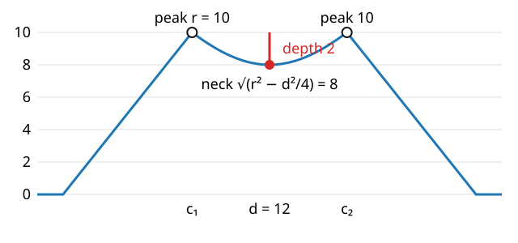

## About this lecture

Thresholding nuclei gives one blob for two touching nuclei, and the gradient cannot help: there is no edge between them. The **shape** of the blob can: two round objects make a blob with a **neck**.

- The **distance transform** turns the mask into a landscape with one **peak per object** and a **saddle** at each neck.
- Watershed of $-\mathrm{DT}$ inside the mask: the cut goes through the neck.
- **When** are two discs split? Peaks $r$, neck $\sqrt{r^2 - d^2/4}$: split if the neck is deeper than $h$.
- Failure modes: elongated cells (oversplitting), strong overlap (undersplitting), holes, the wrong metric.

*Slides titled **The math** give the formulas and proofs; the ideas are complete without them.*

## The classic problem

- Fluorescent nuclei, thresholded (the thresholding day), labelled (the labelling day): nuclei that touch become **one** component.
- The intensity inside the pair is nearly constant: no edge, so no ridge in the gradient (previous unit). Flooding the gradient from h-minima keeps the pair as one region.
- But the outline of the pair is not round: it has two bulges and a **neck** where they meet. The idea: measure, for every pixel of the mask, how far it is from the outside.

## Recall: the distance transform (the morphology day)

$$\mathrm{DT}(p) = \min_{q \notin A} \|p - q\| \qquad (0 \text{ on the background})$$

- A mountain over each object: low at the outline, highest in the middle, with ridges along the centre lines.
- Metrics: city-block, chessboard, chamfer 3-4, exact Euclidean; two raster passes for the chamfer ones (the morphology day).
- A disc of radius $r$: a cone with its peak $r$ at the centre.
- Two touching discs: two cones, and between them a **saddle** at the neck, lower than both peaks.

## Flood the inverted distance transform

- Landscape: $-\mathrm{DT}$, restricted to the mask. The peaks become **minima** (one per object), the neck becomes a **pass**.
- Markers: the regional maxima of $\mathrm{DT}$, or better its **h-maxima** (peaks that rise more than $h$ above the saddle to a higher peak).
- Flooding from the markers inside the mask: the dam sits on the saddle line, across the neck.
- Result: one label per object, even where objects touch. Count, measure, compare (the measurements day).

## Try it: two discs

```{=html}
<link rel="stylesheet" href="../demos/dist/demo.css">
<div data-demo="distws" data-preset="split"></div>
<script src="../demos/dist/distws.js"></script>
```

::: notes
Panels: the mask (drag the orange centre handle to move a disc, the white rim handle to resize it), the Euclidean DT (colour, iso-lines, white dots = h-maxima = markers), and the watershed of −DT. Below: the DT along the line through the two centres, with the two peaks, the neck (red), the depth (red bar) and h (orange tick). "two discs: split": r = 30, d = 40, h = 2: peaks 30.0, neck 23.0, depth 7.02 (the formula gives 7.64), 2 objects. Raise h: still 2 objects at h = 7, one at h = 7.5. Then drag one disc towards the other.
:::

## When are two discs split?

{width=58%}

Discs of radius $r$, centres $d$ apart ($d < 2r$): peaks of height $r$; the neck at the midpoint has height $\sqrt{r^2 - d^2/4}$. With h-maxima markers they are split if and only if the **neck depth**
$$r - \sqrt{r^2 - d^2/4} > h .$$
Example: $r = 10$, $d = 12$: neck 8, depth 2. Split for $h < 2$, merged for $h \ge 2$.

## The math: the neck {.math}

Place the centres at $(\pm d/2, 0)$. The background is outside both discs.

- The two circles cross at $(0, \pm y_c)$ with $y_c = \sqrt{r^2 - d^2/4}$ (Pythagoras on the triangle centre, midpoint, crossing).
- At the midpoint $(0, 0)$ the nearest background points are these two corners, so $\mathrm{DT}(0, 0) = y_c$. Moving towards a centre along the line, the distance to the corners grows while the distance to the far side of that disc's circle, $r - |x \mp d/2|$, takes over: the profile rises to $r$ at each centre.
- Depth $\delta(d) = r - \sqrt{r^2 - d^2/4}$, increasing in $d$: from 0 (one disc, $d = 0$) to $r$ (tangent discs, $d = 2r$).
- Split condition $\delta(d) > h \iff d > 2\sqrt{r^2 - (r - h)^2} = 2\sqrt{2rh - h^2}$. For $r = 10$, $h = 1$: $d > 8.72$.
- On a pixel grid the peak and the neck are known only to about one pixel: the demo's measured depths differ from the formula by up to about 0.9.

## Try it: move them together

```{=html}
<link rel="stylesheet" href="../demos/dist/demo.css">
<div data-demo="distws" data-preset="merge"></div>
<script src="../demos/dist/distws.js"></script>
```

::: notes
"move them together until they merge": r = 30, d = 34, h = 3: depth 5.02 (formula 5.28), split. Drag the right disc to the left. With the left disc fixed, the measured depth falls in steps of one pixel: 4.02 at d = 30–33, 3.02 at d = 28–29, 2.02 at d = 27: there they merge (depth ≤ h). The formula predicts the merge at d = 26.15; the grid moves it by about a pixel. Then lower h and pull them further together.
:::

## The metric matters

On the same two discs ($r = 30$, $d = 40$):

| metric | peaks | neck | depth | objects ($h = 2$) |
|---|---|---|---|---|
| Euclidean | 30.0 | 23.0 | 7.0 | 2 |
| city-block | 31 | 23 | 8 | 2 |
| chamfer 3-4 | 29.3 | 23.0 | 6.3 | 2 |
| chessboard | 23 | 23 | 0 | 1 |

- **Chessboard** distance reaches the outline fastest along the diagonals, so a disc's peak is only about $r/\sqrt 2$, no higher than the neck: the pair is not split until roughly $d > \sqrt 2\, r$ (here 42; on the pixel grid from $d = 44$).
- **City-block** reaches it fastest along the axes; it happens to work here because the neck lies along an axis. Chamfer and Euclidean are nearly direction-independent: the safe choice.

## Failure modes

- **Elongated or bean-shaped cells**: the DT has a long ridge with small bumps; each bump is a regional maximum. An ellipse with semi-axes 55 and 22 gives 13 objects at $h = 0$ (Euclidean): **oversplitting**. A small $h$ (0.5) fixes it.
- **Strong overlap**: the neck is barely lower than the peaks (small $d$): **undersplitting**. No $h$ can separate them; their shape no longer says "two".
- **Holes** in the mask (a dark nucleolus, a threshold too high inside the nucleus): the DT drops to 0 at the hole, and peaks appear all around it. Fill holes first (the morphology day).
- **Rough outlines** (noise at the threshold): small bumps in the DT, again more peaks: smooth the mask or raise $h$.

## Try it: an ellipse, holes, three in a row

```{=html}
<link rel="stylesheet" href="../demos/dist/demo.css">
<div data-demo="distws" data-preset="ellipse"></div>
<script src="../demos/dist/distws.js"></script>
```

::: notes
"an ellipse is oversplit": semi-axes 55 and 22, h = 0: 13 objects along the ridge. h = 0.5: 1. Metrics at h = 0: city-block 1, chamfer 3-4 7, chessboard 5 (and still 5 at h = 0.5, 1 at h = 1). "noisy mask with holes": two discs with 21 hole pixels: 24 objects at h = 0, 3 at h = 3, 2 from h = 5; tick "fill holes first": 2 at any h. "three in a row": r = 24, spacing 40: depth 10.7 by the formula; 3 objects up to h = 10, then all three merge at once (h = 10.5), because both necks have the same depth.
:::

## Combining landscapes

- The DT knows the **shape**, the gradient knows the **edges**. Use each for what it is good at:
  - markers from the **peaks of the DT** (one per object, robust to intensity variations);
  - flooding on the **gradient** of the intensity image, inside the mask (the boundary between two touching nuclei follows any faint edge there is).
- Other marker sources: h-maxima of the smoothed intensity (bright nuclei), blob detection with the Laplacian of Gaussian (the edges day).
- The distance transform can be weighted by intensity, or replaced by any "how deep inside" map; deep learning methods learn such a map (next slide).

## Try it: a nuclei image

```{=html}
<link rel="stylesheet" href="../demos/dist/demo.css">
<div data-demo="distws" data-preset="nuclei"></div>
<script src="../demos/dist/distws.js"></script>
```

::: notes
"nuclei image": 15 synthetic nuclei (seeded), several touching; threshold 115. The mask has 9 components: labelling alone counts 9. Watershed of −DT with h = 2: 15 objects, exactly one per nucleus. h = 0: 18 (three nuclei split in two by bumps of their DT); h = 1: 15; h = 3: 12 (three touching pairs merged); h = 6: 9 (back to the components). "flood gradient, markers from DT": the same numbers (the markers decide how many), with boundaries that follow the intensity between touching nuclei. Change the threshold: at 90 or 140 there are 15 objects only at h = 1 (14 at h = 2).
:::

## Where this goes next

- **Deep learning** (the modern deep learning day): networks for instance segmentation often predict a distance-like map, a boundary class, or a flow field towards each object's centre, and then split the objects with a watershed-like step. The "how deep inside" idea of this unit, with a learned landscape.
- **Counting correct splits** (the evaluation day): object-level evaluation matches predicted objects to true ones; oversplitting and undersplitting become false positives and false negatives.
- **Measurements** (the next day): once every object has its own label, its area, shape and intensity can be measured.

## Summary

- Touching objects of the same intensity have no edge between them, but their union has a **neck**.
- **Distance transform**: one peak per object, a saddle at each neck. Watershed of $-\mathrm{DT}$ inside the mask, markers from the **h-maxima** of $\mathrm{DT}$: cut through the necks.
- Two discs: neck depth $r - \sqrt{r^2 - d^2/4}$; split iff depth $> h$. $r = 10$, $d = 12$: depth 2.
- Use a near-Euclidean **metric**; **fill holes**; choose $h$ above the bumps of elongated or rough objects and below the necks of real pairs.
- Combine: markers from the DT, boundaries from the gradient.
