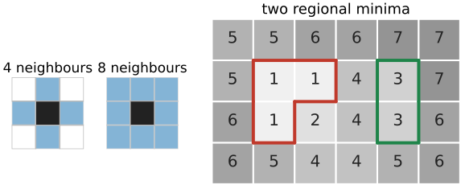
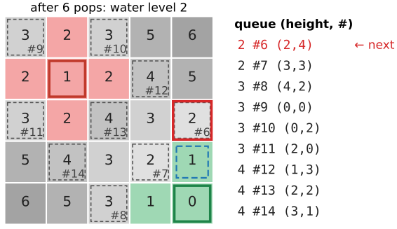
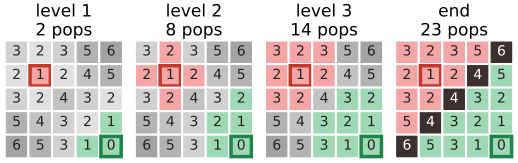
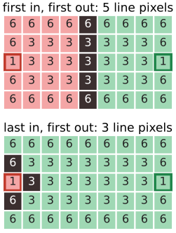
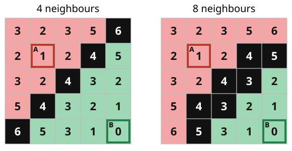
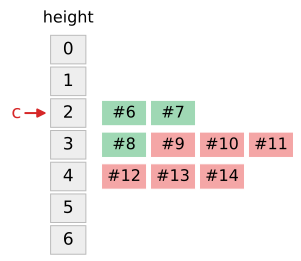

## About this lecture

[Last unit](../ws-landscape/lec.qmd): flooding a landscape, in pictures. Now the algorithm that does it on a pixel grid, small enough to run by hand (Meyer, 1994).

- Pixels, neighbours, **plateaus**, **markers**.
- **Priority-queue flooding**: always flood the lowest pixel on the shoreline next.
- Ties on **plateaus**: first in, first out puts the dam in the middle.
- Two outputs: a one-pixel **watershed line**, or **every pixel labelled**; 4- vs 8-neighbours.
- **Cost**: $O(n \log n)$ with a heap, $O(n)$ with one bucket per grey level.

*Slides titled **The math** give the formulas and proofs; the ideas are complete without them.*

## From 1D to a pixel grid

:::: {.columns}
::: {.column width="55%"}
- Neighbours: **4** (up, left, right, down) or **8** (also the diagonals).
- A **plateau**: a connected set of pixels with the same value. A **regional minimum**: a plateau whose neighbours are all higher. Finding them = connected components of plateaus (the [labelling day](../label-connectivity/lec.qmd)), keeping those with no lower neighbour.
- **Markers**: labelled seed pixels, by default one label per regional minimum. They may also be clicks, a threshold, or the h-minima ([previous unit](../ws-landscape/lec.qmd)).
- The flooding must decide, for every other pixel, which marker's water reaches it first, or whether it is on a dam.
:::
::: {.column width="45%"}
{width=100%}
:::
::::

## Meyer's algorithm

:::: {.columns}
::: {.column width="50%"}
Keep a **priority queue** of pixels, ordered by height $f(p)$; among equal heights, first in, first out.

1. Every unlabelled neighbour of a marker enters the queue with priority $f(p)$.
2. **Pop** the lowest pixel $p$.
3. If all **labelled** neighbours of $p$ carry the same label, give $p$ that label. If they carry different labels, $p$ is on the **watershed line**.
4. Push the unlabelled neighbours of $p$ that are not yet in the queue (a line pixel pushes nothing). Repeat until the queue is empty.

Each pixel enters the queue once and leaves it once. Neighbours are pushed in reading order (up, left, right, down); the **arrival number** #k records the order.
:::
::: {.column width="50%"}
{width=100%}
:::
::::

## Example: the first pops

The $5 \times 5$ grid of the exercise, markers A (height 1, row 1, column 1) and B (height 0, corner), 4 neighbours:

| pop | pixel | height, # | labelled neighbours | → |
|---|---|---|---|---|
| start | | | queue: (3,4) 1 #4, (4,3) 1 #5, (0,1) 2 #0, (1,0) 2 #1, (1,2) 2 #2, (2,1) 2 #3 | |
| 1 | (3,4) | 1, #4 | B | B |
| 2 | (4,3) | 1, #5 | B | B |
| 3 | (0,1) | 2, #0 | A | A |
| 4 | (1,0) | 2, #1 | A | A |
| … | | | | |
| 15 | (1,3) | 4, #12 | A and B | line |

Height first, then arrival number: B's two height-1 pixels go before A's height-2 pixels, although A queued its pixels first.

## Try it: step through the queue

```{=html}
<link rel="stylesheet" href="../demos/dist/demo.css">
<div data-demo="floodgrid" data-preset="hand"></div>
<script src="../demos/dist/floodgrid.js"></script>
```

::: notes
Grid: heights (darker = higher); coloured frames = markers; #k = arrival number of queued pixels. The table on the right is the queue in pop order; the next pixel to pop is in red, the ones just pushed are highlighted. Step: the popped pixel gets a red frame, its labelled neighbours dashed blue, and the decision is written out. Tour on "5 × 5 (exercise)": pops 1–2 are B's height-1 pixels; pops 3–6 A's height-2 pixels; pop 15 is (1,3), height 4, with A and B as neighbours: the first line pixel. Run to end: 23 pops, 5 line pixels on the anti-diagonal. Tick "8 neighbours": 7 line pixels (the line must be thicker). "next level" jumps one water level at a time (levels 1 to 6).
:::

## Why this floods correctly

- The queue always releases the **lowest pixel on the shoreline**. So the water rises **evenly in all basins at once**, exactly like the lake in the flooding picture.
- A pixel lower than the current water level (an unmarked puddle reached over a pass) pops at once: the puddle is **drowned** by the marker that reached it.
- A pixel is labelled only from a labelled neighbour, so every region is **connected** and contains exactly **one marker**.
- A dam pixel appears where two different lakes touch the same pixel before it is flooded.

{width=78%}

## The math: flooding is a shortest-path search {.math}

Give a path from a marker to $p$ the cost "its highest point" (excluding the marker), and let $d(p)$ be the smallest such cost: the **minimax** (bottleneck) distance from the markers.

- Meyer's flooding is **Dijkstra's algorithm** with $\max$ in place of $+$: pushing $p$ from $q$ offers the path cost $\max(d(q), f(p))$. Popping by $f(p)$ alone gives the same order, because a pixel with $f(p) <$ current level pops before anything else.
- Invariant: the water level $\ell$ (the largest height popped so far) never decreases, and every popped pixel has $d(p) = \ell$ at the moment it pops. So pixels are flooded in order of $d$, and each gets the label of a marker that achieves $d(p)$ (ties: the order of arrival).
- Graph view: the labels form a **minimum spanning forest** rooted at the markers, with edge weights $\max(f_p, f_q)$; the flooding is Prim's algorithm grown from all markers at once. The [graph-based segmentation day](../ws-msf/lec.qmd) (day 29) develops this view and puts the watershed next to graph cuts and the random walker on the same seeds.

## Plateaus: why first in, first out

:::: {.columns}
::: {.column width="60%"}
- On a plateau all pixels have the same height, so the queue order alone decides who gets there first.
- **First in, first out**: pixels are flooded in order of arrival, so each lake spreads over the plateau as a **wavefront**, one ring per step. Two lakes entering from opposite sides meet **in the middle**.
- **Last in, first out**: the newest pixel goes first, so one lake runs across the plateau in a thin snake before the other moves. The dam ends up next to the other lake's entry point.

1D: $0\,5\,5\,5\,5\,5\,0$ with markers A, B at the ends. FIFO: $A\,A\,A\,|\,B\,B\,B$. LIFO: $A\,|\,B\,B\,B\,B\,B$.
:::
::: {.column width="40%"}
{width=72%}
:::
::::

## Try it: a plateau between two markers

```{=html}
<link rel="stylesheet" href="../demos/dist/demo.css">
<div data-demo="floodgrid" data-preset="plateau"></div>
<script src="../demos/dist/floodgrid.js"></script>
```

::: notes
"plateau between two markers": a 5 × 9 grid, a plateau of 3s between markers A (left) and B (right) of height 1. Run to end with FIFO: the line is the middle column (5 line pixels). Watch the queue: arrival numbers of A's and B's pixels alternate, the two fronts advance one column per round. Tick "LIFO ties" and run again: B's water snakes across the plateau first; A keeps only its marker, with 3 line pixels next to it. Untick "watershed line" to see the version where every pixel is labelled.
:::

## Two outputs, two neighbourhoods

{width=62%}

- **Watershed line**: line pixels belong to no region. **Every pixel labelled**: a would-be line pixel takes the label of the neighbour that queued it. Many libraries return the second by default; the boundaries are then between pixels.
- With **4 neighbours** a diagonal line of single pixels separates the regions (regions can only touch diagonally, which does not count). With **8 neighbours** the regions must not touch even diagonally, so the line has to be **4-connected**: here 7 line pixels instead of 5. Regions and line always use complementary connectivities (as object and background do on the [labelling day](../label-connectivity/lec.qmd)).

## The cost

:::: {.columns}
::: {.column width="57%"}
- Each of the $n$ pixels is pushed once and popped once; each pixel looks at 4 or 8 neighbours.
- **Binary heap**: push and pop cost $O(\log n)$: total $O(n \log n)$. For a $1024 \times 1024$ image: about $2 \cdot 10^7$ elementary steps ($n \log_2 n$, $\log_2 n = 20$).
- **Bucket queue** for integer heights (8-bit: 256 buckets, one first-in-first-out list per grey level): push and pop in $O(1)$, total $O(n + 256)$: about $10^6$ steps for the same image.
- In practice: a $256 \times 256$ image floods in a few milliseconds; the markers (h-minima) usually cost more than the flooding.
:::
::: {.column width="43%"}
{width=80%}
:::
::::

## The math: why a bucket queue is linear {.math}

Bucket queue: an array of $L$ FIFO lists, list $v$ holds the queued pixels of height $v$, and a pointer $c$ to the lowest non-empty list.

- push($p$): append to list $f(p)$, set $c \leftarrow \min(c, f(p))$: $O(1)$.
- pop: while list $c$ is empty, $c \leftarrow c + 1$; then take its first element.
- $c$ only moves down when a pixel below the water level is pushed, and that pixel is popped next; between such events $c$ only moves up. Charging each downward move to its push, the total pointer movement is at most $L$ plus the number of pushes: $O(n + L)$ for the whole flooding.
- FIFO inside each list gives exactly the "first in, first out among equal heights" order of the heap version, so both produce the same labels.

## A second algorithm: sort, then flood level by level

Vincent and Soille (1991), the first fast watershed:

- **Sort** all pixels by height (counting sort for 8-bit: linear).
- Process the levels $v = 0, 1, 2, \ldots$: the pixels of height $v$ next to an existing basin are flooded breadth-first (a FIFO queue) from the basins; pixels of height $v$ that no basin reaches start **new** basins (new minima).
- Same picture, different bookkeeping: Meyer floods from markers with one priority queue; Vincent–Soille discovers the minima on the way. Both are linear for integer images.

## Try it: every minimum is a marker

```{=html}
<link rel="stylesheet" href="../demos/dist/demo.css">
<div data-demo="floodgrid" data-preset="minima"></div>
<script src="../demos/dist/floodgrid.js"></script>
```

::: notes
"every minimum is a marker": an 8 × 8 noisy grid, 8 neighbours, all 5 regional minima are markers A–E. Run to end: 59 pops, 20 line pixels: oversegmentation in miniature (the grid is noise, there is no object). Untick "8 neighbours" and press "all regional minima as markers": with 4 neighbours there are 7 minima (two more pixels are minima, since their diagonal neighbours no longer count). "a marker that is not a minimum": B sits on a slope at height 6; its first pop is (2,6) at height 4, and pops 4–6 run down to the right-hand minimum at water level 4: the minimum is drowned and the result is the same as with B on the minimum ("two basins").
:::

## Summary

- **Meyer's flooding**: a priority queue by height, first in, first out among ties; pop the lowest shoreline pixel, label it from its labelled neighbours (or make it a line pixel), push its unlabelled neighbours.
- The water rises evenly; puddles without markers are **drowned**; every region is **connected** with **one marker**.
- **FIFO** on plateaus puts the dam in the middle.
- Output: a **watershed line** (1 pixel, of the complementary connectivity) or **every pixel labelled**.
- Cost $O(n \log n)$ (heap) or $O(n)$ (bucket queue, integer heights).
- Next: flooding the **gradient** of a real image, and fighting oversegmentation.
