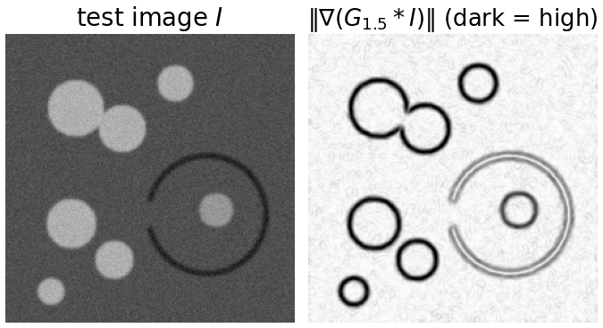
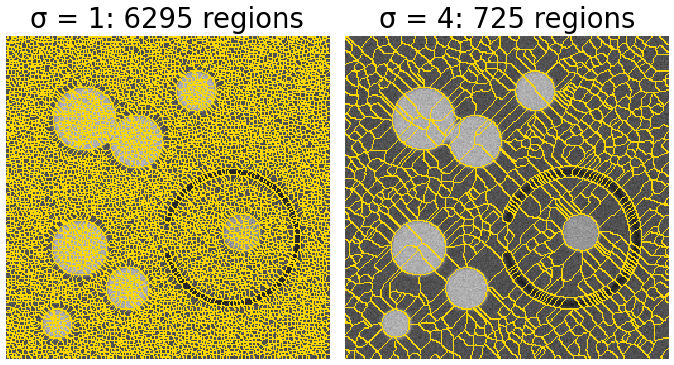
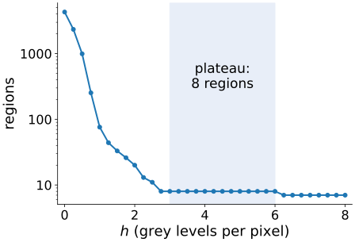
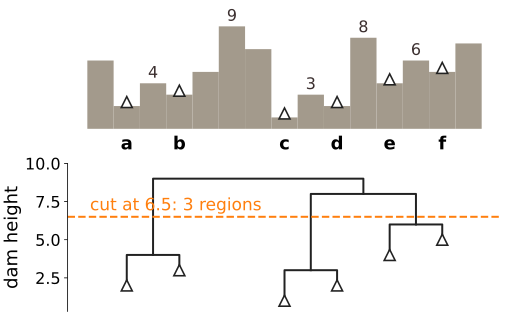

## About this lecture

We have the picture (flood a landscape) and the algorithm (a priority queue). Now a real image: flood the **gradient magnitude**, so the dams fall on edges.

- On the raw gradient every speck of noise is a minimum: **thousands of regions**.
- Three cures, each with its price: **smooth more**, **h-minima**, **markers**.
- Region merging: the watershed as a **hierarchy** of basins.
- Where the watershed fails: **leakage** through a gap in an edge.

*Slides titled **The math** give the formulas and proofs; the ideas are complete without them.*

## The landscape: gradient magnitude

:::: {.columns}
::: {.column width="52%"}
$$g = \big\|\nabla (G_\sigma * I)\big\|$$

- Smooth with a Gaussian of width $\sigma$, take the derivatives in $x$ and $y$, combine: the gradient of a Gaussian (the [kernels unit](../kernels/lec.qmd); Gaussian derivatives at scale $\sigma$: the [edges day](../canny/lec.qmd)).
- Inside a region of nearly constant grey level, $g$ is small: a **valley**. On an edge, $g$ is large: a **ridge**.
- Flooding $g$ puts one basin in every region and the dams on the edges between them. The objects do not need to be darker or brighter than the background, only **different**.
:::
::: {.column width="48%"}
{width=100%}
:::
::::

## Try it: the raw gradient

```{=html}
<link rel="stylesheet" href="../demos/dist/demo.css">
<div data-demo="watershed" data-preset="raw"></div>
<script src="../demos/dist/watershed.js"></script>
```

::: notes
Synthetic test image (256 × 256, seeded): bright blobs on a grey background, one touching pair, and a cell with a dark outline that has a gap on its left. Noise sd 8. Panels: input, landscape (gradient, dark = high; red = markers), result. "raw gradient": σ = 1, every regional minimum is a marker: 6295 minima, 6295 regions. Every region is a tiny basin of noise. Move the flood-level slider down to replay the flooding: the basins grow from thousands of seeds at once.
:::

## Cure 1: smooth more

Larger $\sigma$ averages the noise away before the derivative:

| $\sigma$ | 1 | 1.5 | 2 | 3 | 4 | 6 |
|---|---|---|---|---|---|---|
| regional minima (test image) | 6295 | 4299 | 2819 | 1324 | 725 | 318 |

:::: {.columns}
::: {.column width="55%"}
- Far fewer minima, but **never few enough**: any noise at all leaves tiny dips in a flat region; smoothing makes them shallower, not absent.
- The price: edges get wider and weaker, nearby edges merge, thin structures and small objects blur away, and corners round off. The dams move.
:::
::: {.column width="45%"}
{width=100%}
:::
::::

## The math: edge and noise after smoothing {.math}

A step of height $J$, already blurred by the optics ($\sigma_0$), and white noise of standard deviation $s$:

- Edge: the gradient of the Gaussian-blurred step peaks at $J / \big(\sqrt{2\pi}\, \sigma_{\text{tot}}\big)$ with $\sigma_{\text{tot}} = \sqrt{\sigma_0^2 + \sigma^2}$ (Gaussians add their variances).
- Noise: each derivative component has variance $s^2 \sum_k (\partial_x G_\sigma)_k^2 \approx s^2 / (8\pi\sigma^4)$, so its standard deviation falls like $1/\sigma^2$.
- Test image ($J = 95$, $\sigma_0 = 1.2$, $s = 8$): $\sigma = 1.5$: edge 19.7, noise about 0.9 (mean of $\|\nabla\|$); $\sigma = 4$: edge 9.1, noise 0.13. The ratio grows from 22 to 73, but the noise dips never reach depth 0.
- So: smoothing sets the **scale** of the edges; the **depth** of the noise basins must be dealt with separately.

## Cure 2: h-minima

Fill every basin by $h$ first (the [morphology day](../morph-reconstruct/lec.qmd)'s $\mathrm{HMIN}_h$); only minima **deeper than $h$** become markers.

| $h$ ($\sigma = 1.5$) | 0 | 0.5 | 1 | 1.5 | 2 | 2.5 | 3 to 6 |
|---|---|---|---|---|---|---|---|
| regions | 4299 | 993 | 76 | 33 | 20 | 11 | 8 |

:::: {.columns}
::: {.column width="57%"}
- One parameter with a clear meaning: "a region must be separated from its neighbours by an edge at least $h$ higher than its inside". Units: those of the landscape (here grey levels per pixel).
- The plateau from $h = 3$ to $6$ is the sign of a good $h$: noise basins are shallower than 3, real regions deeper than 6.
- The price: a real region with a weak edge (depth $\le h$) is merged with its neighbour.
:::
::: {.column width="43%"}
{width=100%}
:::
::::

## The math: what h removes {.math}

Depth (dynamic) of a regional minimum $m$: $\mathrm{dyn}(m) = \min_{\text{paths } m \to \text{deeper minimum}} \max_{\text{path}} g \; - \; g(m)$: how far the water must rise in $m$'s basin before it overflows into a deeper one.

- The regional minima of $\mathrm{HMIN}_h(g)$ are exactly the minima of $g$ with $\mathrm{dyn} > h$ (morphology day); the deepest minimum always survives.
- Scaling: $\mathrm{dyn}$ is a difference of heights, so it scales with the landscape: multiply $g$ by $c$ and the right $h$ becomes $ch$. A strictly increasing transform of $g$ leaves the flooding unchanged but **not** the h-minima.
- Ordering all minima by dynamic and removing them one by one gives a nested family of segmentations: the hierarchy on the region-merging slide.

## Try it: h-minima

```{=html}
<link rel="stylesheet" href="../demos/dist/demo.css">
<div data-demo="watershed" data-preset="hmin"></div>
<script src="../demos/dist/watershed.js"></script>
```

::: notes
"h-minima": σ = 1.5, h = 2.5: 11 regions; the marker regions (red, translucent) are the filled basins of HMIN. Raise h to 3: 8 regions, stable up to h = 6. Look at what the 8 are: the background together with the inside of the ring cell (the gap!), the touching pair of blobs as ONE region (same intensity, no edge between them: the gradient cannot split them; that is the next unit), four separate blobs, the nucleus in the ring cell, and the dark ring itself. Raise the noise to 16: 25 regions at h = 2.5; h must grow with the noise.
:::

## Cure 3: marker-controlled watershed

Decide the markers **first**, then flood from them only.

- One marker per object (and one for the background): the markers decide **how many** regions; the flooding decides **where** the boundaries go.
- Markers from: user clicks, a threshold of the image, the peaks of another image (the distance transform, [next unit](../ws-distance/lec.qmd)), detections.
- Equivalent formulation: **minima imposition** (the [morphology day](../morph-reconstruct/lec.qmd)) makes the markers the only minima of $g$ and fills every other basin up to its pass; flooding that image from its minima gives the same boundaries.
- This is the usual way the watershed is used in practice: markers from a robust, coarse step; boundaries from the watershed.

## The math: imposition and flooding from markers agree {.math}

Let $M$ be the markers and $g^M$ the imposed landscape: $g^M = R^\varepsilon_{\min(g + 1, f_M)}(f_M)$, with $f_M = 0$ on $M$ and $\max g + 1$ elsewhere (the [morphology day](../morph-reconstruct/lec.qmd)).

- For every pixel $p \notin M$: $g^M(p) = 1 + d(p)$, where $d(p) = \min_{\text{paths } M \to p} \max_{\text{path}} g$ is the minimax distance from the markers (reconstruction by erosion computes exactly such minimax values).
- Flooding $g$ from $M$ pops the pixels in order of $d$ ([previous unit](../ws-flooding/lec.qmd)). Flooding $g^M$ from its minima ($= M$): along the best path to $p$ every pixel $q$ has $d(q) \le d(p)$, so the minimax distance in $g^M$ is $1 + d(p)$: the same order.
- Hence the same labels (up to ties). Imposition is useful when a later step needs the landscape itself; the flooding never needs it.

## Try it: one marker per object

```{=html}
<link rel="stylesheet" href="../demos/dist/demo.css">
<div data-demo="watershed" data-preset="clicks"></div>
<script src="../demos/dist/watershed.js"></script>
```

::: notes
"one click per object": 8 clicked markers on the test image: one in each of the six blobs (including both blobs of the touching pair), one in the ring cell, one background marker (grey) in a corner. 8 regions. The touching pair is now split, because each blob has its own marker; the boundary follows the weak dip in the gradient between them. Click on the input to add markers ("new object" each click, "same object" to add to the last, "background" brush); "clear" removes all. The ring cell's region leaks through the gap: next slides.
:::

## Region merging: a hierarchy

:::: {.columns}
::: {.column width="52%"}
Start from the oversegmentation (every minimum a region), then **merge** neighbouring regions across their **lowest** dam, one at a time.

- Each merge removes the least significant boundary. The sequence of merges is a tree (a dendrogram) of regions: a **hierarchical watershed**.
- Cutting the tree at a dam height $t$ gives a segmentation; cutting it by **dynamics** gives exactly the h-minima result. Other criteria (area, volume of the basin) give other cuts of the same tree.
- One flooding, many segmentations: the user (or a learned criterion) chooses the level afterwards. In depth: [hierarchical segmentation and merge trees](../merge-trees/lec.qmd) and [watershed as a minimum spanning forest](../ws-msf/lec.qmd) (day 29).
:::
::: {.column width="48%"}
{width=100%}
:::
::::

## Leakage: a gap in an edge

:::: {.columns}
::: {.column width="55%"}
- A dam is only as strong as the **lowest point** on the ridge around a basin. If the edge has a gap, the lowest pass is in the gap, and two regions merge or meet there at a low level.
- With markers on both sides, the boundary across the gap is wherever the two lakes happen to meet: anywhere inside the gap, or far from it, since both lakes flood the flat insides at the same low level.
- Typical in microscopy: a faint membrane, a touching cell with the same intensity.
- What helps: closing the gap first (closing, the [morphology day](../morph-openclose/lec.qmd)), a better landscape, more markers; or a method that penalises **long** boundaries: graph cuts (the [graph-cut day](../graphcut-seg/lec.qmd); "markers" here, "seeds" there) or [level sets](../geodesic/lec.qmd). Why the watershed leaks and the others do not, on the same seeds: [day 29](../ws-msf/lec.qmd).
:::
::: {.column width="45%"}
{width=100%}
:::
::::

## Try it: leakage

```{=html}
<link rel="stylesheet" href="../demos/dist/demo.css">
<div data-demo="watershed" data-preset="leak"></div>
<script src="../demos/dist/watershed.js"></script>
```

::: notes
"edge with a gap": a marker inside the ring cell (below the nucleus) and a background marker in the top-right corner. The ring is closed except for a gap on its left. The background water comes in through the gap: of the 7521 pixels inside the ring, 3972 (53 %) are labelled background; the cell keeps 3610 pixels, all inside. Move the cell marker or add a second background click near the gap: the boundary inside the cell moves; it is decided by where the lakes meet, not by any edge. The micrograph preset ("nucleus + background clicks") shows the same on a real image: the boundary follows the nuclear envelope on the left and leaks at the bottom and top right.
:::

## Choosing the landscape

| landscape | valleys | use when |
|---|---|---|
| gradient magnitude | flat regions | regions differ in grey level; boundaries are edges |
| intensity | dark parts | dark objects, separated by brighter lines |
| inverted intensity | bright parts | bright objects; every basin also gets the background around its object (restrict with a mask) |
| $-$distance transform | centres of objects | touching objects of the same intensity ([next unit](../ws-distance/lec.qmd)) |

Combinations are common: markers from one image, flooding on another.

## Summary

- Flood $\|\nabla (G_\sigma * I)\|$: one basin per region of nearly constant grey level, dams on edges.
- Raw: thousands of noise minima, **oversegmentation**.
- **Smoothing** reduces the minima but never removes them, and moves edges. **h-minima** keep minima deeper than $h$: one interpretable parameter. **Markers** fix the number of regions; the flooding places the boundaries.
- Merging regions across low dams gives a **hierarchy**; h-minima is one cut of it.
- The watershed **leaks** through gaps in edges; touching objects of equal intensity have no edge between them: the [next unit](../ws-distance/lec.qmd) uses the distance transform.
