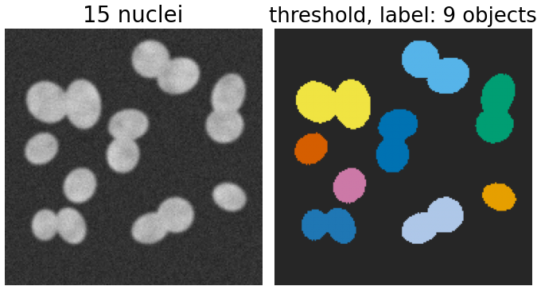
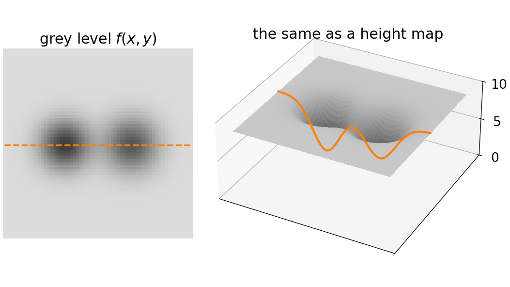
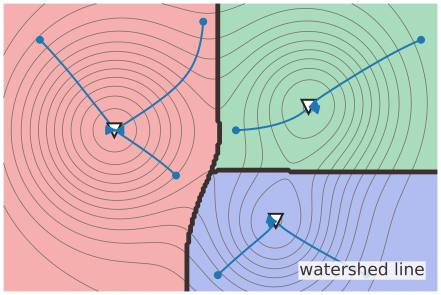
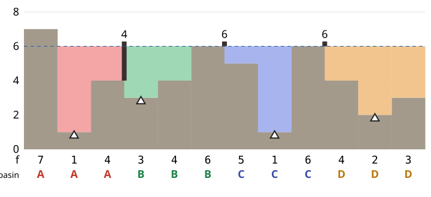
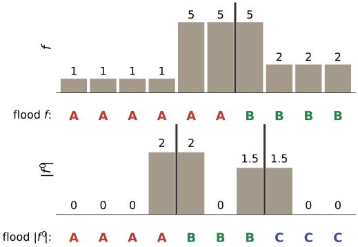
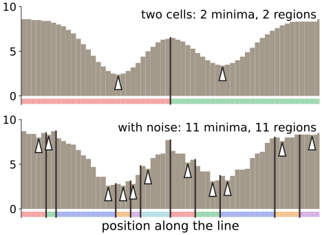
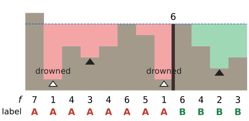

## About this lecture

Thresholding and labelling turn an image into objects, but two touching cells come out as **one** object. The watershed splits them, using one picture: **the image is a landscape, and we flood it with water**.

- Read a grey-level image as a **height map**: dark = low, bright = high.
- **Regional minima**, **catchment basins** (where a drop of water ends up) and **watershed lines** (where it could go either way).
- **Flooding**: water rises from every minimum; where two lakes would meet, build a **dam**. The dams are the boundaries.
- What to flood: the **intensity**, or the **gradient magnitude** (dams on the edges).
- The main problem of the day: every minimum makes a region, so **noise makes many regions**.

*Slides titled **The math** give the formulas and proofs; the ideas are complete without them.*

## Where thresholding and labelling stop

:::: {.columns}
::: {.column width="56%"}
- Threshold → binary mask (the thresholding day); connected components → one label per object (the labelling day).
- **Touching cells** share pixels above the threshold: one component, one label. The labelling day ended on exactly this case.
- **Uneven brightness**: no single threshold fits the whole image (local thresholds: the thresholding day, `local-threshold`).
- What is missing: a way to put a boundary **between** two bright blobs that touch, where the intensity dips only a little. That dip is what the watershed looks for.
:::
::: {.column width="44%"}
{width=100%}
:::
::::

## An image is a landscape

:::: {.columns}
::: {.column width="46%"}
Read the grey level $f(x, y)$ as a **height**.

- Dark nuclei on a bright background are **valleys**; the bright background is a high plain.
- Two touching nuclei: two valleys separated by a low **ridge** (or a **pass**).
- Rain falling on the landscape collects in the valleys. Every valley is one object.

Everything that follows is about finding the valleys and the ridges between them. Bright objects on a dark background? Flood the **inverted** image $-f$ (or $255 - f$).
:::
::: {.column width="54%"}
{width=100%}
:::
::::

## Minima, basins and watershed lines

:::: {.columns}
::: {.column width="54%"}
- **Regional minimum**: a connected plateau of equal height whose neighbours are all **higher**. A single pixel lower than its neighbours is the simplest case.
- **Catchment basin** of a minimum: all points from which a drop of water, always running downhill along the steepest slope, ends up in that minimum.
- **Watershed line**: the points where the drop could go either way: ridges and saddles.

The basins tile the image: one region per regional minimum, separated by watershed lines. The name comes from geography: the line between two river systems.
:::
::: {.column width="46%"}
{width=100%}
:::
::::

## The math: steepest descent {.math}

A drop follows the gradient flow $\dot{\mathbf x}(t) = -\nabla f(\mathbf x(t))$: downhill, along the steepest slope.

- **Catchment basin** of a minimum $m$: $\mathrm{CB}(m) = \{\mathbf x_0 : \mathbf x(t) \to m \text{ as } t \to \infty\}$.
- **Watershed** = the complement of the union of all basins: points whose flow ends at a saddle (or other critical point that is not a minimum).
- Example: $f(x, y) = (x^2 - 1)^2 + y^2$ has minima at $(\pm 1, 0)$ and a saddle at $(0, 0)$. Since $\dot x = -4x(x^2 - 1)$, the sign of $x$ never changes along the flow: the basins are the half-planes $x < 0$ and $x > 0$, and the watershed line is $x = 0$, through the saddle.
- On a pixel grid there is no gradient flow, only neighbours; the flooding view (next slide) gives a definition that works on grids.

## Flooding

Pierce a hole at the bottom of every regional minimum and lower the landscape slowly into a lake.

- Water enters through the holes; each basin fills with its own colour, **all at the same water level**.
- Where water from two basins would meet, build a **dam**.
- When the whole landscape is under water, only the dams stick out: they are the **watershed lines**, and every basin is one region.
- A dam's height is the height of the **pass** between the two basins: the lowest point at which they can overflow into each other.

For the cases in this course, flooding and the drop of water give the same basins; flooding is what the algorithm (next unit) implements.

## Example: 12 samples

{width=70%}

$f = 7\,1\,4\,3\,4\,6\,5\,1\,6\,4\,2\,3$: regional minima at samples 1, 3, 7 and 10. Level 1: basins A and C start; level 2: D; level 3: B. At level 4, A and B meet over sample 2: first dam (height 4). At level 6, B–C and C–D meet: dams of height 6. Result: $A\,A\,A\,B\,B\,B\,C\,C\,C\,D\,D\,D$.

## Try it: flooding a profile

```{=html}
<link rel="stylesheet" href="../demos/dist/demo.css">
<div data-demo="flood1d" data-preset="twelve" data-level="3"></div>
<script src="../demos/dist/flood1d.js"></script>
```

::: notes
Grey: the landscape; coloured water per basin; ▲ = sources (regional minima); dark bars = dams with their heights; the strip under the plot is the final segmentation. Tour: "12 samples": raise the level from 3: at 4 the first dam (A|B, height 4), at 6 the other two. "two cells": a line across two dark nuclei: 2 minima, one dam of height 6.5 at the bright gap between them. "noisy": the same profile with noise: 11 minima, 11 basins. "plateau": a flat ridge of 10 samples at height 6 between two basins: the dam goes in its middle (between samples 17 and 18). Drag on the plot to redraw the profile.
:::

## The math: dams are minimax passes {.math}

Two minima $a$ and $b$ meet at the water level

$$\text{pass}(a, b) = \min_{\text{paths } a \to b} \ \max_{\mathbf x \text{ on the path}} f(\mathbf x),$$

the lowest possible "highest point" on a way from $a$ to $b$. (In 1D there is only one path: the pass is the highest sample between them.)

- Below that level the two lakes are disconnected; at it they touch: that is where and when the dam is built.
- A **basin's depth** (its *dynamic*): its bottom's height subtracted from the lowest pass to a deeper basin. The same minimax structure gives h-minima (morphology day): a basin of depth $\le h$ overflows when filled by $h$.
- Pixel version: a pixel $p$ gets label $a$ if it can be reached from marker $a$ by a path whose highest point is lower than on any path from another marker (with ties broken by the flooding order).

## What to flood: intensity or gradient

:::: {.columns}
::: {.column width="56%"}
- **Intensity**: works when the objects are themselves valleys (dark nuclei, or bright ones inverted). The dams fall on the brightest line between them.
- **Gradient magnitude** $\|\nabla f\|$ (Sobel, the kernels day; Gaussian derivatives, the edges day): flat regions have a **small** gradient, so they are valleys; edges have a **large** gradient, so they are ridges. The dams fall on the edges.

1D: the step profile $f = 1\,1\,1\,1\,5\,5\,5\,2\,2\,2$ has $|f'| = 0\,0\,0\,2\,2\,0\,1.5\,1.5\,0\,0$ (central differences): three valleys (the three flat parts), ridges at the two edges. Flooding $|f'|$ gives three regions with dams on the edges; flooding $f$ itself gives only two (it has two minima: the 1-plateau and the 2-plateau) and splits the bright middle part between them.
:::
::: {.column width="44%"}
{width=100%}
:::
::::

## Try it: flood the derivative

```{=html}
<link rel="stylesheet" href="../demos/dist/demo.css">
<div data-demo="flood1d" data-preset="edges"></div>
<script src="../demos/dist/flood1d.js"></script>
```

::: notes
"edges: flood the derivative": top, the input f (three flat levels with two edges, slightly noisy), coloured by the basins of |f′|; bottom, |f′| flooded. With h = 0.3 there are 3 basins and the dams sit on the edges (heights 1.5 and 0.8). Set h = 0: the noise in the flat parts makes 15 minima of |f′|, so 15 regions; h = 0.1 leaves 7, h = 0.2 already 3. Untick "flood |f′|" to flood f itself instead: the dams then sit on the bright parts, not the edges.
:::

## Every minimum makes a region

:::: {.columns}
::: {.column width="55%"}
- Each regional minimum starts its own basin, so the number of regions = the number of minima.
- Noise adds tiny dips everywhere: on a real image, the raw gradient has **thousands** of regional minima, and the watershed cuts the image into thousands of pieces. This is **oversegmentation**, the main problem of the watershed.
- The "two cells" profile has 2 minima; with a little noise (preset "noisy") it has 11.

Two cures, both from the morphology day:

- **h-minima**: fill every basin by $h$ first; basins shallower than $h$ overflow and merge. One parameter in grey levels.
- **Markers**: choose the sources yourself (one per object). Other minima are just puddles that get **drowned** when the water from a marker reaches them.
:::
::: {.column width="45%"}
{width=100%}
:::
::::

## Recall: h-minima (the morphology day)

```{=html}
<link rel="stylesheet" href="../demos/dist/demo.css">
<div data-demo="recon1d" data-mode="hmin" data-preset="twelve" data-frame="end"></div>
<script src="../demos/dist/recon1d.js"></script>
```

::: notes
The morphology day's demo in h-minima mode, with today's 12 samples: blue = water poured into every basin, up to h above its bottom (reconstruction by erosion of f + h). With h = 2: 3 iterations, the regional minima go from 4 to 3; the basin at sample 3 (bottom 3, passes 4 on both sides, depth 1) is filled and disappears. Its samples then belong to the neighbouring basin. Step back to the start to show the iterations if the morphology day is long ago.
:::

## Markers

:::: {.columns}
::: {.column width="54%"}
- A **marker** is a set of pixels that must belong to one region; each marker gets its own label.
- Flooding starts **only** from the markers. A minimum without a marker is not a source: when the rising water of a marker spills into it, the whole puddle takes that marker's colour.
- Result: exactly one region per marker. The number of regions is decided by the markers; the flooding only decides **where** the boundaries go.
- Where markers come from: clicks, a threshold, the peaks of another image (the distance transform in the last unit of the day).
:::
::: {.column width="46%"}
{width=100%}

The 12 samples with markers only at samples 3 and 10: the minima at samples 1 and 7 are drowned; the result is $A\,A\,A\,A\,A\,A\,A\,A\,B\,B\,B\,B$ (the dam on sample 8, height 6).
:::
::::

## Summary

- An image is a **landscape**: grey level = height. Regional **minima**, catchment **basins**, **watershed lines** on ridges and saddles.
- **Flooding**: water rises from every minimum at the same level; dams where lakes meet. Dam height = the **pass** between two basins.
- Flood the **intensity** when objects are valleys, the **gradient magnitude** when the boundaries are edges.
- One region per regional minimum: noise causes **oversegmentation**. Cures: **h-minima** (fill shallow basins) and **markers** (choose the sources).
- Next: the flooding algorithm on a pixel grid, by hand.
