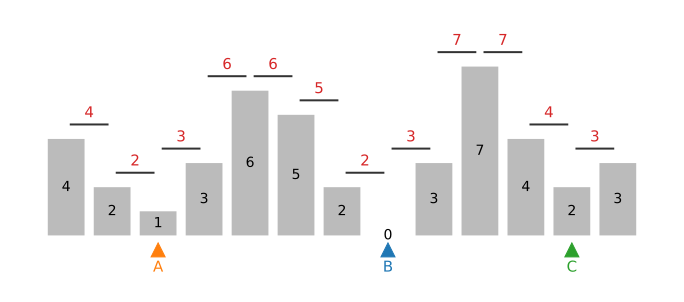
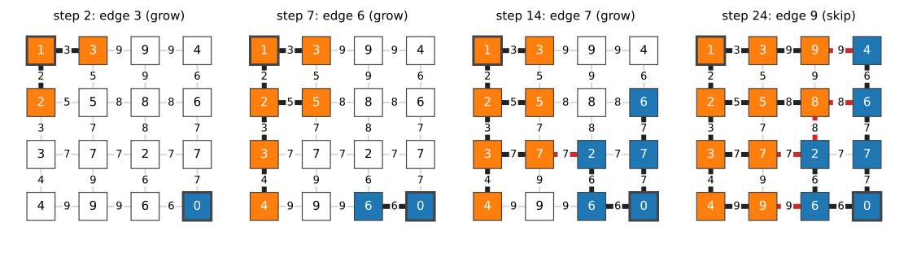
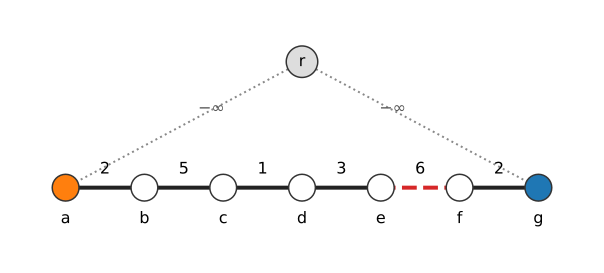
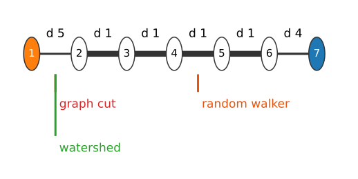
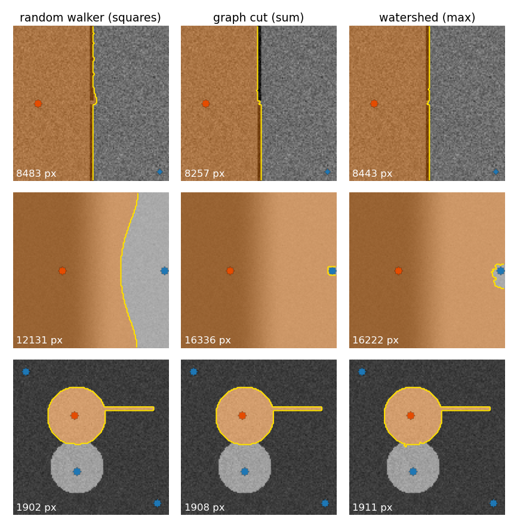
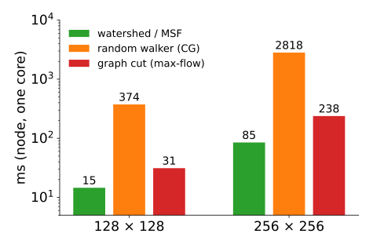

## About this lecture

The watershed day flooded a landscape from markers with a priority queue. The [last unit](../mst-seg/lec.qmd) built spanning trees with Kruskal. Today they turn out to be the **same algorithm**.

- Flooding on **edges**: Meyer's flooding = **Prim's algorithm** from all markers at once.
- The result is a **minimum spanning forest**; each pixel goes to the marker it reaches over the **lowest highest pass**.
- Why the watershed **leaks** and why it does **not shrink**.
- **Seeded segmentation three ways**: graph cut (**sum**), random walker (**squares**), watershed (**maximum**); the power watershed as a family.

*Slides titled **The math** give the formulas and proofs; the ideas are complete without them.*

::: notes
Weights in this unit are altitudes or dissimilarities: d_pq = max(f_p, f_q) for a landscape f (e.g. the gradient magnitude), or |I_p − I_q| when comparing with the graph cut and the walker on the same image.
:::

## Recall: flooding from markers

[Meyer's flooding](../ws-flooding/lec.qmd): put the neighbours of every marker in a **priority queue** keyed by their height; repeatedly take the **lowest** pixel, give it the label of the neighbour that queued it, and queue its unlabelled neighbours. Equal heights leave in first-in, first-out order.

- The water rises from all markers at once; where floods from two markers meet, there is a watershed line.
- The math slide of that unit called it a **shortest-path search** in which the cost of a path is its **highest point** instead of its length.

Today we re-read it with the heights on the **edges**.

## Flooding on edges

:::: {.columns}
::: {.column width="46%"}
Give each edge the height of the **pass** between its two pixels, $d_{pq} = \max(f_p, f_q)$ (red numbers, right).

Now flooding is: **always add the cheapest edge leaving the labelled set**, and give its new pixel the label of the old one.

That is **Prim's algorithm**, started from **all markers at once** (A, B, C, right). The trees grown from the markers form a **minimum spanning forest** (MSF): the cheapest set of edges in which every pixel is connected to exactly one marker.

The edges that are never added because they would join two different trees are the **watershed cut**.
:::
::: {.column width="54%"}
{fig-alt="A 1D landscape of 13 bars with heights 4, 2, 1, 3, 6, 5, 2, 0, 3, 7, 4, 2, 3. Above each pair of neighbouring bars a short line at the height of the higher of the two, labelled in red: 4, 2, 3, 6, 6, 5, 2, 3, 7, 7, 4, 3. Three markers A, B and C sit under the minima 1, 0 and 2." width="100%"}
:::
::::

## Prim from two markers

{fig-alt="Four frames on a 4 by 4 grid of heights with edge altitudes max of the two heights. Marker A (orange) is the top-left cell, marker B (blue) the bottom-right cell. Step 2: A has taken the two cells next to it (edges 2 and 3). Step 7: A has grown down the left column and into the 5; B has taken the 6 to its left (edge 6). Step 14: both trees have grown; the first cut edge (red, dashed) lies where they meet at altitude 7. Step 24: all cells labelled: A owns the left two columns and the top row up to the 9, B the bottom-right block and the right column; red dashed edges between them are the watershed cut." width="100%" fig-align="center"}

Each step takes the cheapest queued edge (ties: first in, first out). Orange grows first because its edges are lower; blue starts only when the queue reaches altitude 6. An edge whose two ends already have **different** labels is a **cut** edge (red).

## Try it: Prim from markers

```{=html}
<link rel="stylesheet" href="../demos/dist/demo.css">
<div data-demo="graphgrid" data-preset="prim"></div>
<script src="../demos/dist/graphgrid.js"></script>
```

::: notes
The list on the right is now the queue: the edges leaving the labelled cells, cheapest first. Step through: "joins tree A/B", "skip" (both ends already in the same tree: Prim never closes a cycle), "cut" (two different trees meet: a watershed edge). Click cells in marker mode to add a third marker. "a plateau: ties": two markers on a flat plateau of 5s; FIFO decides; the boundary falls in the middle because both floods advance one ring per round.
:::

## The virtual root, and Kruskal again

:::: {.columns}
::: {.column width="45%"}
Add one extra node $r$, joined to every marker by an edge of weight $-\infty$. Run **Kruskal** (sort, join unless same component). Then delete $r$.

- The $-\infty$ edges are taken first: all markers hang from $r$.
- Every other edge is taken iff it joins a tree to a still unlabelled piece; an edge between two trees would close a cycle through $r$: **skipped**, a cut edge.
- Deleting $r$ leaves **one tree per marker**: the same forest as Prim's.

Right: the chain a–g, markers at a and g; the 6-edge (red) is the cut.
:::
::: {.column width="55%"}
{fig-alt="A chain of seven nodes a to g with edge weights 2, 5, 1, 3, 6, 2; a is orange (marker A), g blue (marker B). An extra node r above is joined to a and g by dotted edges labelled minus infinity. The edge of weight 6 between e and f is drawn red and dashed: it is the cut." width="100%"}
:::
::::

## The math: seeded MSF {.math}

- **Construction.** Graph $G$ with markers $m_1, \dots, m_K$. Add a node $r$ and edges $(r, m_i)$ of weight $-\infty$. Any minimum spanning tree $T$ of the extended graph contains all $(r, m_i)$ (they are the cheapest edges across any split separating $r$ from $m_i$, cut property). Removing $r$ splits $T$ into exactly $K$ trees, one per marker: a **spanning forest rooted at the markers**. Its weight is minimal among all such forests (any rooted forest plus the $K$ root edges is a spanning tree of the extended graph).
- **Prim from $r$** first takes the $K$ root edges (in marker order), then always the cheapest edge leaving the labelled set: this is exactly Meyer's flooding with edge altitudes. Equal weights: FIFO gives one particular MSF among several.
- The **cut edges** are the edges of $G$ between different trees.

## Minimax paths, again

:::: {.columns}
::: {.column width="48%"}
From the [last unit](../mst-seg/lec.qmd): the path in a minimum spanning tree between two pixels has the **lowest highest edge** of all paths: the **minimax distance**.

So in the seeded MSF, **each pixel goes to the marker it can reach with the lowest highest pass**. That is the flooding picture: the water of that marker reaches it first.

On the chain a–g (weights $2, 5, 1, 3, 6, 2$; markers at a and g): pixel d reaches A over passes $2, 5, 1$ (highest 5), B over $3, 6, 2$ (highest 6). $5 < 6$: d belongs to A. The cut is the 6-edge.

**Ties** (plateaus, equal passes) are decided by the queue order (FIFO): the watershed day's plateau rule.
:::
::: {.column width="52%"}
{fig-alt="The 7-node chain of the random-walker unit with weights w = 0.2, 1, 1, 1, 1, 0.25 (dissimilarities d = 5, 1, 1, 1, 1, 4), object seed at node 1 and background seed at node 7. Three marks: the random walker's boundary between nodes 3 and 4; the graph cut on the first edge; the watershed also on the first edge." width="100%"}
:::
::::

## The math: minimax assignment and watershed cuts {.math}

- **Minimax assignment.** In a seeded MSF, every node $p$ lies in the tree of a marker $m$ with $\pi(p, m) = \min_{m'}\pi(p, m')$, where $\pi(p, m) = \min_{\text{paths } p \to m}\max_{e} d_e$ (ties aside). *Proof*: apply the minimax property of MSTs to the extended graph with the virtual root: the tree path from $p$ to $r$ minimises the highest edge among all paths to $r$, i.e. to any marker.
- **Watershed cuts** (Cousty, Bertrand, Najman & Couprie, 2009). On an edge-weighted graph, a set of edges is a **watershed cut** if a drop of water falling on either side of each of its edges, flowing downhill along edges, reaches different regional minima (the **drop-of-water principle**). Theorem: the watershed cuts are exactly the cuts of the minimum spanning forests rooted at the regional minima.
- **Only the order matters.** Any increasing transformation of the weights ($d \mapsto d^2$, $d + c$, $\log d$) leaves the sorted order, hence Prim's and Kruskal's choices, hence the MSF and the watershed, unchanged.

## Drop of water: the unseeded watershed

Without markers, put one marker on every **regional minimum** of the edge altitudes: the seeded MSF becomes the classic watershed (one region per basin).

- Watershed cuts obey the **drop-of-water principle**: a drop placed on either side of a cut edge slides down along ever-lower edges into **different** minima.
- That is the intuition of the [landscape unit](../ws-landscape/lec.qmd), now as a theorem on graphs, with no "watershed line" pixels: the boundary consists of **edges** between pixels.
- Over-segmentation (one basin per noise minimum) is the same problem as on the watershed day; its cure (markers, h-minima, merging basins) leads to the [hierarchies unit](../merge-trees/lec.qmd).

## Why the watershed leaks, and why it does not shrink

- **Leaks.** The cost of a path is its **maximum** edge: only the single lowest pass on the way matters. One low spot in a ridge (a gap in a boundary) is enough for a whole region to be flooded from the wrong marker. That is the leakage of the [gradient watershed](../ws-gradient/lec.qmd), now explained.
- Noise makes it worse: where the image is flat but noisy, the highest pass on every path is set by noise, and the boundary between two floods wanders.
- **No shrinking.** Nothing in the result depends on the **length** of the boundary or the size of a seed: a thin protrusion with a high rim stays with its marker, a tiny seed is not "cut off cheaply". (Contrast the graph cut.)
- **Fast**: a sort or a bucket queue and one pass, near-linear in the number of pixels.

## Seeded segmentation three ways

| | graph cut | random walker | watershed (MSF) |
|---|---|---|---|
| combines the weights by | **sum** of cut weights | **sum of squares** of differences | **maximum** along a path |
| labels | hard | soft (probabilities) | hard |
| boundary length | penalised: **shrinks** | spread over weak links | ignored |
| leaks through a narrow gap | rarely (gap = short cut) | partly (bulges) | **yes** (one low pass) |
| decided by seed position | small seeds get cut off | **yes** (resistance) | only through passes |
| cost | max-flow | linear system | sort + one pass |

One weight per edge, the same seeds: three ways of adding up.

## The three methods on the same seeds

:::: {.columns}
::: {.column width="56%"}
{fig-alt="A 3 by 3 grid: columns random walker, graph cut, watershed; rows three synthetic scenes with the same seeds per row. Row 1, a dark wall with a 3-pixel gap and strong noise (seeds far left and bottom right): graph cut 8257 pixels with the boundary straight through the gap; walker 8483 with a small bulge through the gap; watershed 8443 with a ragged bulge. Row 2, a smooth ramp without edges, object seed at x = 40 and a small background seed at the right border: walker 12 131 pixels, boundary near x = 87; graph cut 16 336 and watershed 16 222: almost everything object, the background seed nearly cut off. Row 3, two touching discs: all three about 1900 pixels." width="74%"}
:::
::: {.column width="44%"}
Same seeds, same edges ($\sigma = 20$; dissimilarity $|\Delta I|$ for the watershed). Object pixels:

- **gap in a wall** (noise 16): graph cut 8257 (closes the gap), walker 8483 (bulges), watershed 8443 (bulges, ragged);
- **no edge, small background seed**: walker 12 131 (boundary halfway in resistance), graph cut 16 336 (cuts a tiny circle around the background seed: shrinking), watershed 16 222 (noise passes decide);
- **weak boundary between two discs**: 1902, 1908, 1911: all three agree.

The differences show up where the image does not decide.
:::
::::

## Try it: three methods side by side

```{=html}
<link rel="stylesheet" href="../demos/dist/demo.css">
<div data-demo="randwalk" data-mode="compare" data-preset="gap"></div>
<script src="../demos/dist/randwalk.js"></script>
```

::: notes
Large panel: random walker (paint seeds here); right: graph cut with seeds only (no data term) and the seeded watershed (MSF on |ΔI|). Tour: "agree" (clean edges: all three identical, 3378 pixels). "gap in a wall, strong noise": the cut goes straight through the gap; the walker bulges; the watershed's boundary is ragged. Lower the noise to 8: the watershed closes the gap too. "no edge, a small seed": the graph cut keeps only a tiny circle as background. "two discs": weak boundary, all three similar. Paint a larger background stroke in the smallseed preset: the graph cut recovers.
:::

## The power watershed: one family

Couprie, Grady, Najman & Talbot (2011): minimise
$$\sum_{(p,q)} w_{pq}^{\,\alpha}\,|x_p - x_q|^{\,\beta}$$
with seeds fixed (affinities $w$; exponents written α, β here).

- $\beta = 1$ (finite α): a **graph cut**; $\beta = 2$: the **random walker**.
- As $\alpha \to \infty$, only the **order** of the weights matters: the minimiser becomes a cut of a **maximum spanning forest** of the affinities (= minimum spanning forest of the dissimilarities): a **watershed**.
- With $\beta = 2$ and $\alpha \to \infty$, the random walker decides the **ties** on plateaus, where plain flooding uses arrival order: the **power watershed**.

(The paper gives the full table of limits, including shortest-path forests; we use only these three corners.)

## Speed

:::: {.columns}
::: {.column width="50%"}
Measured in node on one core, two point seeds:

- **MSF / watershed**: a sort and one pass, $\approx 15$ ms at $128^2$, 85 ms at $256^2$ (including building the edge list).
- **graph cut**: one max-flow, 31 and 238 ms.
- **random walker**: conjugate gradients to $10^{-5}$, about 0.4 s and 2.8 s (a better preconditioner would help a lot).

This is why the watershed is the default first step on large 3D data, often on a boundary map predicted by a network.
:::
::: {.column width="50%"}
{fig-alt="Bar chart with a log scale of milliseconds: at 128 by 128 the watershed takes 15, the random walker 374 and the graph cut 31 ms; at 256 by 256 they take 85, 2818 and 238 ms." width="100%"}
:::
::::

## Prim and Dijkstra

- **Prim** adds the cheapest **edge** leaving the labelled set: the cost of reaching a pixel is the **highest** edge on the way.
- **Dijkstra** (the [live-wire unit](../livewire/lec.qmd) of the dynamic-programming elective) adds the pixel with the cheapest **path sum**.
- Replace the sum by a max and Dijkstra becomes the watershed: this is the "shortest path with a different length" of the [flooding unit](../ws-flooding/lec.qmd).

The same priority queue, three different ways of adding up costs.

## Summary

- With edge altitudes $d_{pq} = \max(f_p, f_q)$, **Meyer's flooding is Prim's algorithm from all markers**; the result is a **minimum spanning forest**, its cut edges are the **watershed**.
- Equivalently: **Kruskal** with a virtual root joined to all markers.
- Each pixel goes to the marker with the **lowest highest pass** (minimax); only the **order** of the weights matters.
- Watershed cuts satisfy the **drop-of-water** principle (Cousty et al.).
- It **leaks** (one low pass is enough) but does **not shrink** (no length term), and it is the fastest.
- Graph cut = **sum**, random walker = **squares**, watershed = **max**; the power watershed connects them.

## Where this leads

- [Hierarchical segmentation](../merge-trees/lec.qmd): flood without stopping, record when basins merge: a tree of all watersheds.
- [Superpixels](../superpixels/lec.qmd): a watershed from a grid of markers gives compact superpixels.
- Instance segmentation ([modern deep learning](../instances/lec.qmd)): a network predicts boundaries or distances, the watershed turns them into objects.
