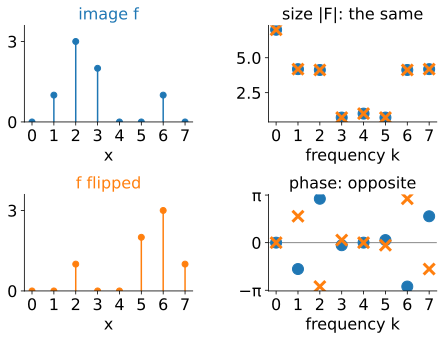
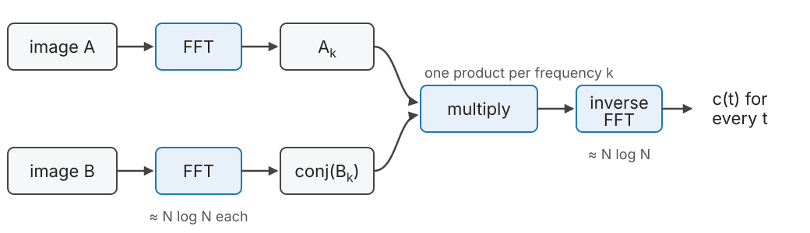
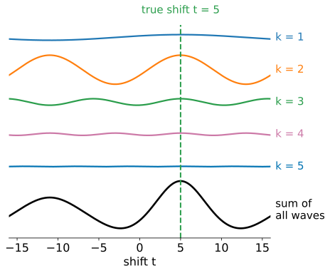
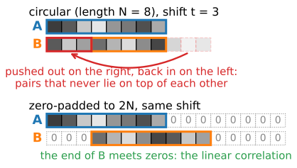
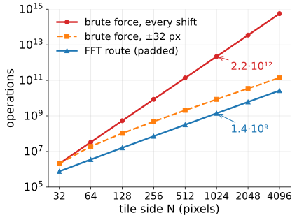
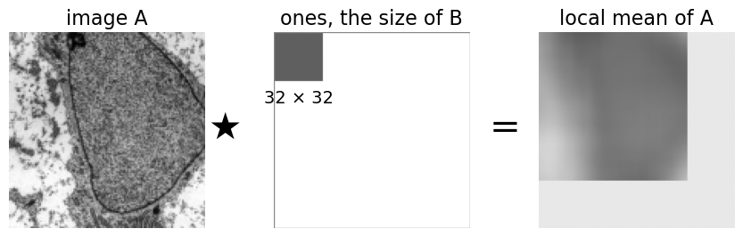

## About this lecture

Last unit: slide image B over image A and score every shift; the cross-correlation $c(t) = \sum_x A(x+t)\,B(x)$ for all shifts costs about $N^2$ operations for $N$ pixels. Today: **all shifts at once** with three FFTs.

- Correlation is a **convolution with a flipped image**; flipping a real image **conjugates** its spectrum.
- So: FFT both, multiply one spectrum by the conjugate of the other, inverse FFT.
- Why it works, in pictures: every **wave** votes for the shifts at which it agrees.
- The FFT assumes the images **repeat**: circular vs linear correlation, **zero-padding**.
- The cost, worked out, and when brute force still wins. NCC with the FFT.

Recall: complex numbers $z = |z|e^{i\varphi}$, $\bar z = |z|e^{-i\varphi}$, $z\bar z = |z|^2$.

*Slides titled **The math** give the formulas and proofs; the ideas are complete without them.*

## Three facts from earlier units

:::: {.columns}
::: {.column width="52%"}
- **Correlation vs convolution** (the kernels unit): correlation multiplies the pixels under the kernel as they are; convolution flips the kernel first. Correlating with B is convolving with B flipped.
- **The convolution theorem** (the Fourier unit): convolution in the image is a product of the spectra, one multiplication per frequency.
- **The FFT** (the Fourier unit): the DFT of $N$ samples in about $N \log_2 N$ steps instead of $N^2$.

One more fact, new today: for a **real** image, flipping it in space (reading it backwards) gives the **complex conjugate** of its spectrum: same sizes, opposite phases.
:::
::: {.column width="48%"}
{fig-alt="Left: an 8-sample signal f and the same signal read backwards. Right: the sizes of their spectra lie on top of each other at every frequency, while the phases are mirrored about zero." width="100%"}
:::
::::

::: notes
The figure flips circularly, f(−x mod 8), which is what the DFT sees: then the spectrum is exactly conjugated. Frequency 0 is the sum of the samples (7).
:::

## All shifts at once

{width="90%" fig-align="center"}

- $c(t)$ for every shift $t$ = inverse FFT of $A_k \cdot \overline{B_k}$.
- Two forward FFTs, one product per frequency, one inverse FFT.
- The correlation is a convolution of A with B flipped, and flipping B conjugates its spectrum.

## The math: the correlation theorem {.math}

Signals of length $N$, indices modulo $N$, DFT $F_k = \sum_x f(x)\,e^{-2\pi i kx/N}$. The circular cross-correlation
$$c(t) = \sum_x f(x+t)\,g(x)$$
has the DFT
$$\hat c_k = \sum_t e^{-2\pi i kt/N} \sum_x f(x+t)\,g(x) = \sum_x g(x)\,e^{2\pi i kx/N} \sum_t f(x+t)\,e^{-2\pi i k(x+t)/N} = \overline{G_k}\;F_k,$$
substituting $u = x + t$ in the inner sum, and using that $g$ is real, so $\sum_x g(x)e^{2\pi i kx/N} = \overline{G_k}$.

Equivalently: $c = f * g^-$ with $g^-(x) = g(-x)$, and $\widehat{g^-} = \overline{G}$ for real $g$; then the convolution theorem. The same holds in 2D with $kx \to k_x x + k_y y$ and $N \to$ each side.

## Why the product works: waves vote

:::: {.columns}
::: {.column width="55%"}
Write both images as sums of waves (the Fourier unit). Look at **one** frequency $k$:

- The wave in A and the wave in B have the same frequency, but each has its own **position** (phase). $A_k \overline{B_k}$ records **how far B's wave is shifted relative to A's** (the phase difference) and **how strong** the wave is in both.
- The inverse FFT adds all the waves back up. At a shift $t$, each wave's contribution is largest if moving by $t$ makes its two copies line up.
- At the true shift **all** waves line up: their votes add up to the peak. Elsewhere they partly cancel.

Strong waves (usually the slow ones) get big votes. Next unit: give every wave the same vote.
:::
::: {.column width="45%"}
{fig-alt="The contribution of each of the frequencies k = 1 to 5 plotted against the shift t: waves of different lengths and strengths, each with a crest at the true shift t = 5. At the bottom their sum over all frequencies, with its peak at t = 5." width="100%"}
:::
::::

::: notes
The figure: a signal of 32 samples (four bumps) and a circularly shifted copy, true shift 5; each curve is one term of the inverse DFT of A_k conj(B_k) (frequencies k and −k together), drawn to the same scale except the sum.
:::

## Try it: FFT vs brute force

```{=html}
<link rel="stylesheet" href="../demos/dist/demo.css">
<div data-demo="xcorr1d" data-mode="fft" data-preset="agree" data-presets="agree,wrap,pad,waves,hand4" data-controls="shift t,true,zero"></div>
<script src="../demos/dist/xcorr1d.js"></script>
```

::: notes
Top left: A and B (32 samples). Top right: c(t), the dots computed directly for every shift, the green line from the FFT; the readout says they agree to about 1e-11. Bottom left: one arrow per frequency k = 1..12, the contribution of that wave at the current shift t; green = pointing right (agrees). Move "shift t" to the true shift 5 and watch the arrows turn right. "waves line up" (N = 16, t = 3) shows it with fewer arrows. "wrap-around fools it": the circular correlation peaks at −3 (11314) instead of 9 (9966). "padding fixes it": with zero-padding to 64 the peak is at 9 and the dots (linear, direct) and the line agree again. "by hand: length 4" is the example on the next slide. Bottom right: the cost of the three routes for two n × n images.
:::

## By hand: a length-4 example

$A = (0, 1, 2, 0)$ and $B = (1, 2, 0, 0)$: B's pattern sits one step to the left, so B belongs at $t = 1$ on A.

**Directly:** $c(t) = \sum_x A(x+t)B(x)$ with wrap-around: $c = (2, 5, 2, 0)$ for $t = 0, 1, 2, 3$. Peak at $t = 1$.

**Via the DFT** (powers of $-i$, the Fourier unit):

| $k$ | 0 | 1 | 2 | 3 |
|---|---|---|---|---|
| $A_k$ | 3 | $-2 - i$ | 1 | $-2 + i$ |
| $B_k$ | 3 | $1 - 2i$ | $-1$ | $1 + 2i$ |
| $A_k\overline{B_k}$ | 9 | $-5i$ | $-1$ | $5i$ |

Inverse DFT, $c(t) = \tfrac14\sum_k (A_k\overline{B_k})\, i^{kt}$: $c(0) = \tfrac14(9 - 5i - 1 + 5i) = 2$, $c(1) = \tfrac14(9 + 5 + 1 + 5) = 5$, and so on: the same $(2, 5, 2, 0)$.

## Circular or linear?

:::: {.columns}
::: {.column width="55%"}
The DFT treats each image as **one period of a repeating pattern**. Shifting B pushes it out on one side and **back in on the other**: the FFT gives the **circular** correlation (the "wrap" border rule of the kernels unit).

- Two tiles that only partly overlap are **not** periodic: the wrapped-around part compares pixels that never lie on top of each other.
- The circular peak can be wrong, and a shift $t$ cannot be told from $t - N$.
- **Zero-pad**: put each image into an array of at least $2N - 1$ (in practice $2N$) filled with zeros. Shifted parts now fall on zeros instead of wrapping: the **linear** correlation, exactly what sliding computes.

Padding costs FFTs four times as large in 2D. Stitching tools often skip it and test the candidate shifts instead (the stitching unit).
:::
::: {.column width="45%"}
{fig-alt="Top: A and B of length 8 with B shifted by 3; the last three samples of B, pushed out on the right, come back in on the left, under the first three samples of A. Bottom: both zero-padded to length 16; the same shift moves the end of B onto zeros." width="100%"}
:::
::::

## Try it: wrap-around and padding

```{=html}
<link rel="stylesheet" href="../demos/dist/demo.css">
<div data-demo="xcorr1d" data-mode="fft" data-preset="wrap" data-presets="wrap,pad" data-controls="shift t,zero,subtract"></div>
<script src="../demos/dist/xcorr1d.js"></script>
```

::: notes
Seed 1, 32 samples, true shift 9 (dotted green line). Circular: the peak is at −3, where the wrapped-around end of B happens to fit (11314 against 9966 at the truth). Tick "zero-pad to 2N": the transform length becomes 64, the shifts run from −31 to 31, and the peak moves to 9 (14735). The dots are now the direct linear correlation, and the FFT line still lies on them. Untick "subtract the means" to see how the mean adds a large triangle (more overlap = larger sum) on top of the correlation.
:::

## What it costs

:::: {.columns}
::: {.column width="56%"}
Two $1024 \times 1024$ tiles, padded to $2048 \times 2048$ ($M \approx 4.2 \cdot 10^6$ samples):

- One complex FFT: about $5M\log_2 M \approx 4.6 \cdot 10^8$ operations. Three FFTs: $1.4 \cdot 10^9$.
- Brute force, every shift: $1024^4$ multiply-adds $\approx 2.2 \cdot 10^{12}$ operations.
- **About 1600 times fewer** operations: under a second instead of 18 minutes at the same speed (tuned FFTs are faster still).

But with a small search window, brute force is competitive:

- $\pm 32$ pixels: $4.3 \cdot 10^9$ multiply-adds, $8.6 \cdot 10^9$ operations: only 6 times more than the FFT.
- Up to about $\pm 12$ pixels, brute force needs **fewer** operations.

The FFT wins when the shift is **unknown** or large.
:::
::: {.column width="44%"}
{fig-alt="Log-log plot of operations against the tile side N from 32 to 4096: brute force over every shift grows like N to the fourth (2.2 times ten to the 12 at N = 1024), brute force within ±32 pixels like N squared, and the padded FFT route stays lowest (1.4 times ten to the 9 at N = 1024)." width="100%"}
:::
::::

## The math: counting operations {.math}

With $N \times N$ images padded to $M = (2N)^2$ samples, and $\approx 5M\log_2 M$ real operations per complex FFT:
$$\text{FFT route} \approx 3 \cdot 5M\log_2 M + 6M, \qquad \text{brute force} \approx 2 \sum_{t}(N - |t_x|)(N - |t_y|) = 2N^4.$$
For $N = 1024$: $1.4 \cdot 10^9$ against $2.2 \cdot 10^{12}$. The ratio grows like $N^2/\log N$.

A window $|t_x|, |t_y| \le w$ costs $2\big((2w + 1)N - w(w+1)\big)^2 \approx 2(2w+1)^2N^2$; this equals the FFT route at $(2w+1)^2 \approx 30\log_2(4N^2)$, i.e. $w \approx 12$ for $N = 1024$.

## NCC with the FFT

NCC at shift $t$ needs, over the overlap: the sum of products, the sums of A and B, and the sums of their squares.

- **Sum of products**: a cross-correlation, one FFT product.
- **Local sums** of A and $A^2$ (and of B, $B^2$): the sum of the pixels of A that lie under B at shift $t$ is A correlated with a block of ones the size of B. Also a correlation: FFT again.
- Then NCC for every shift from these sums, pixel by pixel.

The local sums are box filters; the integral-images elective computes them even faster with summed-area tables. Template matching in the last unit's demo works this way.

{fig-alt="A crop of the micrograph, correlated with a 32 by 32 block of ones, gives the local mean of the crop under the block at every shift: a blurred copy of the crop, blank where the block would stick out." width="55%" fig-align="center"}

::: notes
Micrograph: transmission electron micrograph of a mesenchymal stem cell, Robert M. Hunt, CC BY 3.0, via Wikimedia Commons. The local sums are divided by 1024 for display (the local mean).
:::

## The math: NCC from correlations {.math}

With the overlap mask $M_B$ (ones where B has pixels), all sums over the overlap $\Omega_t$ are correlations:
$$S_{AB}(t) = \sum f(x+t)g(x), \quad S_A(t) = \sum f(x+t)M_B(x), \quad S_{AA}(t) = \sum f(x+t)^2 M_B(x), \quad n(t) = \sum M_A(x+t)M_B(x),$$
and likewise $S_B$, $S_{BB}$ with $M_A$. Then
$$\mathrm{NCC}(t) = \frac{S_{AB} - S_A S_B/n}{\sqrt{\big(S_{AA} - S_A^2/n\big)\big(S_{BB} - S_B^2/n\big)}}.$$
Six correlations (all zero-padded), each one product of FFTs: still $\mathcal O(M\log M)$. For a template that always lies inside A, $n$, $S_B$ and $S_{BB}$ are constants.

## Summary

- Cross-correlation for **all shifts** = inverse FFT of $A_k\overline{B_k}$: two FFTs, a product, an inverse FFT.
- Each frequency **votes** with its phase difference and its strength; at the true shift all votes agree.
- The FFT gives the **circular** correlation; for partly overlapping images **zero-pad** to $2N$ to get the linear one.
- About $N\log N$ instead of $N^2$ operations: thousands of times faster for megapixel tiles, but a small search window can be cheaper by brute force.
- NCC also goes through FFTs: the products and the local sums are all correlations.
