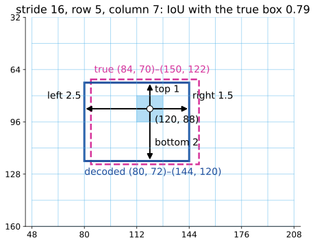
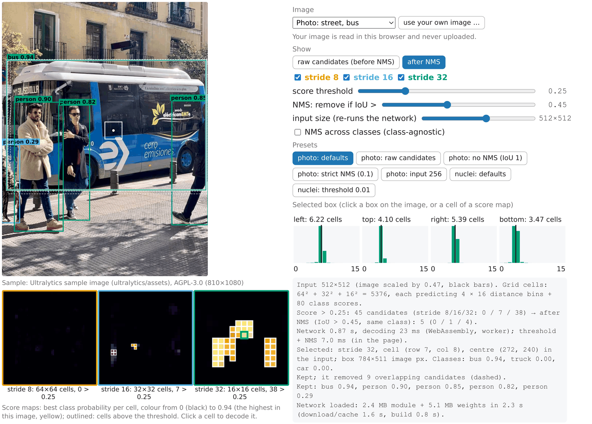
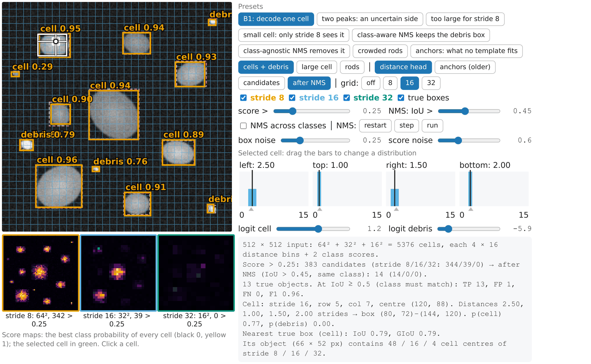

## Goal

By the end of this exercise you should be able to:

- decode one output cell of a single-shot detector into a box in pixels, and say which strides can describe an object of a given size,
- compute the mean of a distance distribution and say what a wide or two-peaked distribution means,
- run greedy NMS by hand with classes, **class-aware** and **class-agnostic**, and predict the effect of the score and NMS thresholds,
- decide whether an object can be learned by a set of **anchors**, and find the peaks of a **centre heat map**,
- explain from the training data why a photo detector finds no cells, and what a cell detector would need,
- *(math)* derive the minimiser of the distribution loss, compute GIoU, and show that class-agnostic NMS is not a subset of class-aware NMS.

Do the pen-and-paper part first, then the demos. Questions marked *(math)* are for those who want the derivations; the concept questions do not depend on them.

## Background

| Idea | What it means |
|---|---|
| Grid, stride | the output is a grid of cells of $s = 8, 16, 32$ pixels; a 512 × 512 input has $64^2 + 32^2 + 16^2 = 5376$ cells |
| One cell's output | four distances (left, top, right, bottom) in strides, each as 16 probabilities over 0…15 (the distance is their mean), and one probability per class |
| Decoding | cell in row $i$, column $j$: centre $(s(j + \frac12), s(i + \frac12))$; box = centre $-$ left/top, centre $+$ right/bottom (times $s$) |
| Candidate | a (cell, class) pair whose probability is above the **score threshold** |
| NMS | greedy: keep the best candidate, remove all with IoU $> t$ with it, repeat; **class-aware**: only within a class; **class-agnostic**: across classes |
| Anchor | an older head: a template box per cell, the network predicts a correction; it learns an object only if IoU $\ge 0.5$ |
| Centre heat map | a bump at every object centre; objects = local maxima above a threshold |
| Scoring | the [evaluation day](../object-eval/lec.qmd): matching at IoU $\ge 0.5$, TP/FP/FN, F1 |

{fig-alt="A stride-16 grid; the cell in row 5, column 7 shaded, its centre (120, 88) and four arrows: left 2.5, top 1, right 1.5, bottom 2 strides. The decoded box (80, 72)–(144, 120) in blue, the true box (84, 70)–(150, 122) dashed; IoU 0.79." width=55%}

## By hand

**B1.** Decode one cell. Stride 16, row 5, column 7 of the grid (rows and columns counted from 0). The four distributions are: left, half on 2 and half on 3; top, all on 1; right, half on 1 and half on 2; bottom, all on 2.
(a) Where is the cell centre in pixels?
(b) What are the four distances, in strides and in pixels?
(c) Give the box $(x_1, y_1)$–$(x_2, y_2)$.
(d) The true box is (84, 70)–(150, 122). Compute the IoU. Is this a TP at IoU $\ge 0.5$?
(e) The class logit for "cell" is 1.2. What is the probability? Is the cell a candidate at the default threshold 0.25? With logit $-3$?
(f) The right distribution changes to 0.6 on 2 and 0.4 on 9. New right distance? What does such a distribution say about the right edge of the object?

**B2.** Grid sizes.
(a) How many output cells has an input of 256 × 256, 512 × 512, 640 × 640? How many numbers per cell and in total with 80 classes?
(b) A side can be at most 15 strides from the cell centre. How far is that in pixels at each stride?
(c) A box 400 px wide is centred on a cell. Which strides can describe it? And a box 600 px wide?
(d) Why do the four distances not have to be equal, and why does the cell not have to be at the centre of the box?

**B3.** NMS with classes. Boxes (x1, y1, x2, y2), score, class:

| box | corners | score | class |
|---|---|---|---|
| b1 | (10, 10)–(50, 50) | 0.90 | cell |
| b2 | (14, 12)–(54, 52) | 0.80 | cell |
| b3 | (40, 10)–(80, 50) | 0.75 | cell |
| b4 | (12, 10)–(52, 50) | 0.60 | debris |
| b5 | (44, 14)–(84, 54) | 0.50 | cell |
| b6 | (100, 100)–(120, 120) | 0.20 | cell |

Score threshold 0.25, NMS threshold 0.5. IoUs: b1–b2 0.75, b1–b4 0.90, b2–b4 0.82, b3–b5 0.68, b1–b3 0.14, all others below 0.2.
(a) Run class-aware NMS. Which boxes are kept, and which box removes which?
(b) Run class-agnostic NMS.
(c) Which answer is right? Discuss for the case "debris and cells are different objects" and for "the network is unsure whether this object is a cell or debris".
(d) Run both again with NMS threshold 0.2. Why is the result the same? (Hint: b2–b3 is 0.199.)

**B4.** Anchors (older heads).
(a) A $10 \times 10$ anchor and a $4 \times 4$ cell with the same centre: compute the IoU. Is the cell learned by this anchor at the matching threshold 0.5?
(b) For which side lengths $s$ does a square anchor with the same centre match the $4 \times 4$ cell?
(c) A thin rod $40 \times 4$ (axis-aligned) and a $20 \times 20$ anchor, same centre: IoU? A $2{:}1$ anchor of the same area ($28.3 \times 14.1$)? What kind of anchor would match the rod?

**B5.** A $5 \times 5$ centre heat map:

$$\begin{bmatrix} 1 & 2 & 1 & 0 & 0 \\ 2 & 5 & 2 & 0 & 3 \\ 1 & 2 & 1 & 0 & 0 \\ 0 & 0 & 0 & 4 & 1 \\ 3 & 0 & 2 & 0 & 2 \end{bmatrix}$$

(a) Find the local maxima in a $3 \times 3$ window (pixels outside the image are ignored).
(b) Which of them remain with a threshold of 3.5? With a $5 \times 5$ window and no threshold?
(c) Which choice would you make if the objects are about 4 pixels apart? If the map is noisy?

**B6.** Predict. Two small cells, each 8 × 8 px, lie side by side with their centres 6 px apart. In the current head a cell of the grid can answer for an object only if its centre lies inside the object's box, and each grid cell answers for one object.
(a) At stride 8, how many grid-cell centres fall inside each 8-px box? Can both cells be reported? When not?
(b) At stride 32?
(c) What does this say about the smallest objects and the closest neighbours a detector can report, and about the input size?

::: {.callout-note collapse="true" title="Solutions"}
**B1.** (a) $(7.5 \cdot 16, 5.5 \cdot 16) = (120, 88)$. (b) Means: left $0.5 \cdot 2 + 0.5 \cdot 3 = 2.5$, top 1, right 1.5, bottom 2 strides = 40, 16, 24, 32 px. (c) $x_1 = 120 - 40 = 80$, $y_1 = 88 - 16 = 72$, $x_2 = 120 + 24 = 144$, $y_2 = 88 + 32 = 120$: (80, 72)–(144, 120). (d) Intersection $x$ 84–144 (60), $y$ 72–120 (48): 2880. Areas $64 \times 48 = 3072$ and $66 \times 52 = 3432$; union $3072 + 3432 - 2880 = 3624$; IoU $= 0.79$: a TP. (e) $\sigma(1.2) = 1/(1 + e^{-1.2}) = 0.77$: a candidate. $\sigma(-3) = 0.05$: not. (f) $0.6 \cdot 2 + 0.4 \cdot 9 = 4.8$ strides (77 px): the box grows to $x_2 = 197$, IoU with the truth 0.54. The network has two incompatible guesses for that edge (e.g. an occluded or blurred side, or a neighbour that may or may not belong to the object); the mean lies where neither guess is. A wide or two-peaked distribution is a built-in measure of uncertainty for each side.

**B2.** (a) 256: $32^2 + 16^2 + 8^2 = 1344$; 512: 5376; 640: $80^2 + 40^2 + 20^2 = 8400$. Per cell $4 \times 16 + 80 = 144$ numbers; at 512: $5376 \times 144 = 774\,144$. (b) $15s$: 120, 240, 480 px. (c) 200 px per side: strides 16 (240) and 32 (480), not 8. 600 px wide: 300 per side: only stride 32. (d) The distances are measured from the cell centre, which can be anywhere inside the box: the four sides are predicted independently. Any cell whose centre lies in the box may answer (in training, the central ones are preferred).

**B3.** (a) Class-aware: b6 is below 0.25. Cells in order b1, b2, b3, b5: keep b1, it removes b2 (0.75); keep b3 (0.14 with b1); b3 removes b5 (0.68). Debris: only b4, kept. Result **b1, b3, b4**. (b) Agnostic: keep b1; it removes b2 (0.75) and b4 (0.90); keep b3; it removes b5. Result **b1, b3**. (c) If debris and cells are separate things that can overlap (a speck lying on a cell), class-aware is right: both objects exist. If b1 and b4 are the network's two guesses for the **same** object (one object, two classes), class-agnostic is right: one object, the more likely class. Detectors trained on photos use class-aware NMS by default, which is why "bus" and "truck" boxes on the same vehicle both survive. (d) At 0.2 the same boxes are removed: b1 removes b2 (0.75) and, if agnostic, b4 (0.90); b3 removes b5 (0.68). The only IoU near 0.2 is b2–b3 (0.199 < 0.2), and b2 is already gone when b3 is reached. A threshold matters only for the pairs of boxes still alive when they are compared.

**B4.** (a) Intersection 16, union 100, IoU 0.16: not matched; the cell is never learned by this anchor. (b) $s \ge 4$: IoU $= 16/s^2 \ge 0.5$ gives $s \le 5.66$. $s \le 4$: IoU $= s^2/16 \ge 0.5$ gives $s \ge 2.83$. So $2.83 \le s \le 5.66$. (c) Square: intersection $20 \times 4 = 80$, union $400 + 160 - 80 = 480$, IoU 0.17. $2{:}1$: intersection $28.3 \times 4 = 113$, union $400 + 160 - 113 = 447$, IoU 0.25. Neither matches; it would need an elongated anchor of about $40 \times 4$ (aspect ratio 10:1) in the right orientation. The current head has no templates: any cell whose centre lies inside the rod's box may answer.

**B5.** (a) Four maxima: 5 (row 2, column 2), 3 (row 2, column 5), 4 (row 4, column 4), 3 (row 5, column 1). (b) Threshold 3.5: the 5 and the 4. $5 \times 5$ window: the 5 and the 3 in the bottom-left corner (the 4 and the 3 at the right edge have the 5 or the 4 in their larger window). (c) Objects about 4 pixels apart: a $3 \times 3$ window (a $5 \times 5$ window would suppress true neighbours). Noisy map: a threshold and a larger window, accepting that close objects merge.

**B6.** (a) An 8-px box contains exactly one stride-8 centre in $x$ and one in $y$ (except exactly on a boundary): one grid cell each. The two boxes overlap by 2 px; when the shared grid cell's centre falls in that overlap (2 of 8 possible offsets, 25 %), both objects need the same grid cell and only one can be reported. Counted over all grid offsets: both reportable 72 %, one 26 %, none 2 % (boundary cases). (b) Stride-32 centres are 32 px apart: the two boxes together (14 × 8 px) contain a centre only for some offsets, and then only one: in our count none 90 %, one 10 %, never both. (c) An object needs a cell centre inside its box at a stride whose cells answer for small objects: objects smaller than the finest stride (8 px of the **network input**) are missed or merged with a neighbour. Shrinking the input (e.g. 256 instead of 512) halves every object in pixels: small objects drop below the stride. For tiny cells, run at a larger input or on tiles.
:::

### Math questions

**B7.** *(math)* The distribution loss for a true distance $y \in [k, k+1]$ is $L(p) = -\big((k + 1 - y)\log p_k + (y - k)\log p_{k+1}\big)$. Show that, over distributions with mass only on $k$ and $k + 1$, its minimiser is $p_k = k + 1 - y$, $p_{k+1} = y - k$, and that the mean of this distribution is exactly $y$ (for $y = 2.3$: 0.7 and 0.3). Why would a one-hot target on the nearest bin bias the distances?

**B8.** *(math)* $A = [0,4]^2$, $B = [6,10] \times [0,4]$. Compute IoU and GIoU $= \mathrm{IoU} - |C \setminus (A \cup B)|/|C|$ ($C$ = the smallest enclosing box). Then let $B = [x, x + 4] \times [0, 4]$ for $x \ge 4$: show that GIoU $= -\frac{x - 4}{x + 4}$, which increases as $B$ moves towards $A$, while $1 - \mathrm{IoU}$ stays 1. Compute it for $x = 5$.

**B9.** *(math)* Box widths relative to an anchor are predicted as $t_w = \log(w/w_a)$. Show that predicting $2w$ and $w/2$ give the same squared error in $t_w$, and that a small error $\delta$ in $t_w$ is a relative error of about $\delta$ in $w$. Why would $w - w_a$ be a worse target?

**B10.** *(math)* Is every box kept by class-agnostic NMS also kept by class-aware NMS (same threshold)? Prove it or give a counterexample. (Try three boxes in a row: c debris 0.9 (0, 0)–(40, 40), a cell 0.8 (10, 0)–(50, 40), b cell 0.7 (20, 0)–(60, 40), $t = 0.5$.) And the other direction?

::: {.callout-note collapse="true" title="Solutions (math)"}
**B7.** With $q = p_k$, $p_{k+1} = 1 - q$: $L(q) = -(a\log q + b\log(1 - q))$ with $a = k + 1 - y$, $b = y - k$, $a + b = 1$. $L'(q) = -a/q + b/(1 - q) = 0$ gives $q = a$; $L'' > 0$, so it is the minimum. Mean: $k\,a + (k + 1)\,b = k(a + b) + b = k + y - k = y$. For $y = 2.3$: 0.7 on 2, 0.3 on 3, mean 2.3. A one-hot target on the nearest bin teaches the distance $\mathrm{round}(y)$: every distance would be rounded to whole strides, an error up to half a stride (4 px at stride 8, 16 px at stride 32), systematically.

**B8.** No overlap: IoU 0. $C = [0, 10] \times [0, 4]$, area 40; $|A \cup B| = 32$; GIoU $= 0 - 8/40 = -0.2$. General $x \ge 4$: $|C| = 4(x + 4)$, $|A \cup B| = 32$, GIoU $= -\frac{4(x + 4) - 32}{4(x + 4)} = -\frac{x - 4}{x + 4}$, increasing as $x$ decreases (derivative $-8/(x + 4)^2 < 0$ in $x$); $x = 5$: $-1/9 = -0.11$; $x = 4$ (touching): 0. Meanwhile IoU $= 0$ and $1 - \mathrm{IoU} = 1$ for every $x \ge 4$: no gradient. The loss $1 - \mathrm{GIoU}$ has a gradient pulling $B$ towards $A$.

**B9.** $\log(2w/w_a) - \log(w/w_a) = \log 2$ and $\log((w/2)/w_a) - \log(w/w_a) = -\log 2$: the same squared error $(\log 2)^2$. $w = w_a e^{t_w}$, so $w(t_w + \delta) = w e^{\delta} \approx w(1 + \delta)$: relative error $\delta$. With $w - w_a$ the same error of 5 pixels would be negligible for a large object and huge for a small one, the target range would depend on the object size, and nothing would keep the predicted width positive.

**B10.** No. IoUs: c–a $= 30 \cdot 40/(2 \cdot 1600 - 1200) = 0.6$, a–b $= 0.6$, c–b $= 20 \cdot 40/(3200 - 800) = 0.33$. Class-aware: debris {c} → c; cells {a, b}: keep a, a removes b (0.6). Kept **c, a**. Agnostic: keep c, c removes a (0.6); b survives (0.33 with c). Kept **c, b**. So b is kept by agnostic NMS but not by class-aware NMS: a box removed early (a) can no longer remove others. The other direction fails too: a is kept by class-aware, not by agnostic. Greedy NMS is a rule, not the optimum of a criterion, and its results for different comparison sets are not nested.
:::

## Explore: the real network {#explore}

The demo runs the smallest network of the family, trained on 80 classes of everyday photos, in your browser (WebAssembly in a background thread; about 0.85 s per 512 × 512 input on one CPU core, 0.22 s at 256). The module and the 5 MB of weights load once and are cached. **Show** switches between the raw candidates (before NMS) and the kept boxes; the checkboxes switch each stride on or off (orange 8, blue 16, green 32). Below the image, one **score map** per stride (the best class probability of each cell). Click a box or a cell of a score map: its grid cell is outlined and its four distance distributions are shown. You can also load your own image; it is read in the browser and never uploaded. **Predict first, then run.** If the page is opened as a local file the network cannot load; the figure shows the demo on the street photo.

{fig-alt="Screenshot of the real-network demo: the bus photo with five kept boxes coloured by stride, three score maps (stride 8 dark, stride 16 with a few cells, stride 32 with three bright blobs), and the controls with the four distance distributions of the selected bus box. Photo: Ultralytics sample image, AGPL-3.0." width=80%}

```{=html}
<link rel="stylesheet" href="../demos/dist/demo.css">
<div data-demo="yolonet" data-preset="default"></div>
<script src="../demos/dist/yolonet.js"></script>
```

**E1.** *Street photo*, defaults. Count the boxes. Then preset **photo: raw candidates** (threshold 0.1): predict how many raw candidates each object has, then read the readout. Which stride finds the bus, which the people? Use the score maps.

**E2.** Click a box: read its grid cell (stride, row, column) and its four distributions. Find the box with the widest distribution and say which side is uncertain and why.

**E3.** Preset **photo: no NMS (IoU 1)**: how many boxes? Then the *two people* photo with the defaults, with **NMS across classes** on and off, and the preset **photo: strict NMS (0.1)**. What do you gain and lose? Recall the [boxes unit](../detection/lec.qmd) (duplicates vs lost neighbours).

**E4.** Preset **photo: input 256** (two people), then the street photo at input 256. Predict which objects change and why (stride vs object size). How long does the network take now?

**E5.** Street photo at 512: switch off one stride at a time. Predict first which objects each stride carries.

**E6.** Preset **nuclei: defaults** (nothing), then **nuclei: threshold 0.01**. Which classes does it assign, and where? What do the score maps look like, and what is the highest score in the image? Explain "there is no class cell". What would a fine-tuned cell detector need?

**E7.** Your own photo, then the same photo rotated by 90°. What changes? (We tried the street photo rotated: see the solution.)

::: {.callout-note collapse="true" title="Solutions"}
Measured with the demo's own code; the times depend on your computer.

**E1.** Five boxes: bus 0.94, person 0.90, person 0.85, person 0.82 (all stride 32) and person 0.29 (stride 16), the person cut by the left border. At threshold 0.25 there are 45 candidates (7 at stride 16, 38 at stride 32, none at stride 8). Raw view at 0.1: 54 candidates (16 / 38). Each of the four large objects has about 10 candidates (its kept box removed 9 to 11 others); the partly visible person has fewer. The bus and the three people come from stride 32 (green): they are 450 to 800 px in the photo, about 210 to 370 px at input 512, best described by the coarse grid; the person at the border comes from stride 16. Stride 8 has nothing: the photo has no small objects.

**E2.** The bus box: stride 32, row 7, column 8, distances 6.2, 4.1, 5.4, 3.5 cells, all four distributions sharp (spread about half a bin). The widest distribution belongs to the partly visible person at the left border (0.29, stride 16): its top side has a spread of about one bin, twice the others. The top of that person is hidden behind the person in front and cut by the image border: the network is unsure where the box should end.

**E3.** No NMS: all 45 candidates stay: duplicates on every object. *Two people*, defaults: person 0.90, person 0.86 and a tie 0.40 (24 candidates). Across classes: the same 3 boxes (the tie box does not overlap a person box by more than 0.45). **Strict NMS (0.1, across classes)**: only 2 boxes: one person and the tie; the second person is removed because its box overlaps the first one by more than 0.1. A low threshold removes duplicates and true neighbours alike; a high one keeps duplicates.

**E4.** *Two people* at 256: 0.22 s instead of about 0.85 s (4 times fewer pixels). The two people stay (0.83, 0.79), a third person box (0.32, stride 16) appears at the right edge, and the tie (a small object) is gone. The street photo at 256: the people are now found at stride 16 (0.81, 0.67, 0.56) instead of 32, the bus score drops to 0.46, and a "truck" box (0.40) appears on the same vehicle; class-aware NMS keeps both (the two boxes overlap almost completely), class-agnostic NMS would remove the truck. Halving the input halves every object in network pixels: each object moves to the next finer stride, and small objects drop out.

**E5.** (The checkboxes hide the kept boxes of a stride; NMS itself is unchanged.) Stride 32 off: only the person at the left border (stride 16) remains: the bus and the three people are lost. Stride 16 off: that person is lost. Stride 8 off: nothing changes. The grids are complementary, not redundant: an object is found by the stride whose cells answer for its size.

**E6.** Defaults: nothing; the highest class probability anywhere in the image is 0.045 ("person"). At 0.01: 43 candidates → 10 boxes, mostly "person" (0.01 to 0.05) on nuclei cut by the bottom border, two "sports ball" (0.01) and one "bus" (0.02) around the whole image. The score maps are almost black. The network was trained to answer 80 photo classes; nuclei look like none of them, so every class probability stays low; the few weak answers are on unusual shapes (nuclei cut by the border). A cell detector needs training images of cells with **a box around every cell** (a few hundred annotated images; boxes can be derived from existing instance masks) and a class "cell" (or "nucleus"); then fine-tuning from these photo weights.

**E7.** On the street photo rotated by 90° we got a single box: "truck" 0.50 on the bus; the people are gone (5 candidates). The network was trained on upright photos: it is not rotation invariant, and an upright-photo prior (people stand, buses are wide) is part of what it learned. Your photo will show something similar: some objects lost, others with the wrong class or lower scores. (The two-people photo rotated still gave a person, 0.88, and a "skateboard" 0.45.) For microscopy, where orientation carries no meaning, training uses rotated and mirrored copies of every image.
:::

## Explore: anchors and heat maps {#explore-nmsboxes}

The [boxes unit's demo](../detection/exercise.qmd#explore), in its anchor and heat-map modes: a synthetic cell image, a grid of anchors (stride, size, 1–3 shapes) with each object's best anchor and its IoU (red below 0.5), or a simulated centre heat map with its local maxima.

```{=html}
<link rel="stylesheet" href="../demos/dist/demo.css">
<div data-demo="nmsboxes" data-preset="anchor"></div>
<script src="../demos/dist/nmsboxes.js"></script>
```

**E8.** (a) Preset **small cell: no anchor matches** (stride 16, anchor size 20, one shape). Which objects can be learned? Try three shapes, then stride 8, then anchor size 8. Can one anchor setting match all five objects?
(b) Presets **heat-map peaks = objects** and **noisy heat map: two peaks in one cell**. Count peaks, TP, FP, FN. Then set the window to $7 \times 7$ and compare. What is the price of the larger window?

::: {.callout-note collapse="true" title="Solutions"}
**E8.** (a) One shape: only the large lower-right cell (IoU 0.67) is matched; the rod (0.17), the small cell (0.10) and the two other cells (0.39, 0.28) are not, because their centres fall between anchor centres or their size differs. Three shapes: still 1 of 5 (the elongated anchors fit no object here). Stride 8: 3 of 5 (0.76, 0.57, 0.67 for the three ordinary cells; rod and small cell still fail). Anchor size 8 with stride 8: only the small cell (0.64). No single setting matches all five: one needs several sizes, finer strides and elongated anchors in the right orientation; the current head avoids the problem by dropping the templates.
(b) **Heat-map peaks** (crowded palisades, bump width 3, no noise): 12 peaks for 12 cells, TP 12, F1 1.00. **Noisy heat map** (sparse image, bump width 5, noise 0.2, $3 \times 3$ window): 14 peaks for 9 cells, TP 9, FP 5, F1 0.78: some cells have two peaks. With a $7 \times 7$ window: 10 peaks, FP 1, F1 0.95. The price: two true objects closer than about 3 pixels from each other's centre window would also be merged into one peak.
:::

## Explore: decoding on a simulated network {#explore-yolodecode}

A 512 × 512 synthetic scene with its true boxes (dashed magenta) and a **simulated** network: every cell's output is computed from the true boxes the way the network is trained (a cell whose centre lies in a box answers for it, more confidently near the centre and at the stride that suits the object's size; distances = the true ones plus noise), so every number can be checked by hand. **Grid** shows one stride; click a cell (or, with the grid off, a box) to inspect it: its four distributions (drag a bar to change it; the magenta triangle marks the true distance), its class logits (sliders), the decoded box and its IoU with the nearest true box. **candidates** / **after NMS**, **step** through NMS, and the readout scores the kept boxes with the [evaluation day](../object-eval/lec.qmd)'s matching (IoU $\ge 0.5$, the class must match). **anchors (older)** switches to a head with one square template per cell (4 strides wide).

{fig-alt="Screenshot of the analytic demo: a synthetic image of cells and debris with kept boxes labelled cell or debris and their scores, a stride-16 grid, the selected cell (row 5, column 7) with arrows to its box; three score maps; four bar charts left 2.50, top 1.00, right 1.50, bottom 2.00; the readout with IoU 0.79." width=80%}

```{=html}
<link rel="stylesheet" href="../demos/dist/demo.css">
<div data-demo="yolodecode" data-preset="b1"></div>
<script src="../demos/dist/yolodecode.js"></script>
```

**E9.** Preset **B1: decode one cell**: check your answers to B1 (a)–(e). Then preset **two peaks**: check B1 (f). Drag the right distribution yourself: put all of it on bin 15. How far can the box reach?

**E10.** Preset **too large for stride 8**: read the true distances of the selected stride-8 cell and its decoded distances. Which box does the readout give, and its IoU? Which stride finds the large cell? Untick stride 32, then also stride 16: predict, then check. Preset **small cell: only stride 8 sees it**: how many cell centres of each stride lie in the small cell's box? Untick stride 8: what is lost?

**E11.** Presets **class-aware NMS keeps the debris box** and **class-agnostic NMS removes it**: compare boxes, FP and F1, and look at the object labelled with two classes. Then preset **crowded rods**: step through NMS (**restart**, **step**). Find the NMS thresholds at which no rod is lost and no duplicate survives.

**E12.** Preset **anchors: what no template fits**. Which objects are never learned and why? Compare FN with the distance head on the same scene. Then, back in the distance head, raise **box noise** to 1 and, separately, **score noise** to 2: what happens to the number of kept boxes and to F1, and why?

::: {.callout-note collapse="true" title="Solutions"}
Numbers from the demo (seeded: everyone sees the same).

**E9.** Distances 2.50, 1.00, 1.50, 2.00 strides; box (80, 72)–(144, 120); p(cell) 0.77; IoU 0.79 with the true box (84, 70)–(150, 122). Two peaks: right 4.80, box to $x = 197$, IoU 0.54 (GIoU 0.51). All on bin 15: right distance 15 strides = 240 px at stride 16; no side can reach further than 15 strides from its cell centre.

**E10.** The large cell is 460 × 300 px. Its stride-8 centre cell needs 29.3, 18.8, 28.3 and 18.8 strides; the bins stop at 15, the decoded distances are 14.7 each: a 236 × 236 box, IoU 0.40, not a match. This cell's score is 0.01 (in training, stride 8 does not answer for objects this large). The kept box comes from stride 32 (distances 7.4, 4.8, 6.7, 3.8; score 0.83), and TP 3 of 3. Without stride 32: one stride-16 candidate still finds it (F1 1.00). Without strides 32 and 16: the large cell is lost (FN 1, F1 0.80). The small cell (12 × 12 px) contains 4 stride-8 centres and none of stride 16 or 32. Without stride 8 the small cell is lost, and with it most of the scene: only 4 of 13 objects are left (the large cells that stride 16 also answers for), F1 0.47.

**E11.** Class-aware: 14 boxes, TP 13, FP 1, F1 0.96: the "debris that looks like a cell" (28 × 23 px) gets a debris box (0.77) and a cell box (0.67); both survive because NMS compares only boxes of the same class, and the cell box is a false positive. Class-agnostic: 13 boxes, FP 0, F1 1.00. Crowded rods: the boxes of neighbouring rods overlap by about 0.46. At NMS 0.45 one rod is removed by its neighbour (8 boxes, FN 1); 0.3: 5 boxes, 4 rods lost; 0.5 to 0.7: all 9 objects, no duplicate (F1 1.00); 0.8: 14 boxes, 5 duplicates; 0.9: 75 boxes. Here a window 0.5–0.7 works because the simulated duplicates mostly overlap their object's best box by more than 0.7; in a real crowd the two ranges overlap (the [boxes unit](../detection/lec.qmd)).

**E12.** With one square template 4 strides wide per cell (32, 64, 128 px), the small cell (12 × 12, best anchor IoU 0.14) and the three debris pieces (0.19, 0.14, 0.25) never overlap an anchor with IoU $\ge 0.5$: in training they are background everywhere, so the network never learns them: FN 4, F1 0.78 (distance head: FN 0, F1 0.96). On the "large cell" scene the large cell (best anchor IoU 0.12) is never learned either. Box noise 1 (a stride of jitter per side): the candidate boxes of one object disagree so much that their IoU falls below the NMS threshold: 39 boxes kept, 29 FP, and some small objects get no box with IoU ≥ 0.5 (F1 0.38). Score noise 2: background cells reach the threshold and many cells near objects get unreliable scores: 69 boxes, 56 FP, F1 0.32. Both kinds of errors of a real network feed straight into the decoded list; the decoding cannot repair them.
:::

## Where this leads

A **mask head** inside each box turns the detector into a one-pass instance segmenter; detections in every frame of a movie, linked over time, are **tracking by detection** (the [tracking day](../track-linking/lec.qmd)). Boxes from a detector can also be the **prompts** of a promptable segmenter ([the next unit](../sam/lec.qmd)). Whether any of these networks beats a classical pipeline on your images is measured, not assumed, in the [last unit of this day](../cellnets-compare/lec.qmd).
