## About this lecture

*How does one pass of a network turn an image into a list of 3 or 300 boxes?* The family of single-shot detectors called YOLO ("you only look once"; Redmon et al., 2016) answers it with a **grid of guesses**.

- The **grid**: the image is cut into cells at three sizes; every cell makes one guess.
- What a cell predicts: **four distances** to the box sides, each as a **distribution**, and a **score per class**.
- **Decoding**: threshold the scores, turn cells into boxes, **NMS** (per class or across classes).
- Where the guesses used to come from (**anchors**, **centre heat maps**), how the network is trained, why it is fast.
- **Boxes for cells**: what a photo-trained detector does on a micrograph.

*Slides titled **The math** give the formulas and proofs; the ideas are complete without them.*

::: notes
This unit follows ["Finding objects as boxes"](../detection/lec.qmd) (detection/, the modern deep learning day), which owns boxes, IoU and greedy NMS; here they are used. Anchors and centre heat maps moved here from that unit. The real network in the demos is the smallest ("nano") version of the current YOLO family, trained on the 80 classes of a photo dataset (COCO), running in the browser. The family name changes with every version; nothing here depends on a version. Software packages with the same name implement this family; nothing here depends on them.
:::

## Recall: many boxes per object

:::: {.columns}
::: {.column width="52%"}
From "Finding objects as boxes":

- A box = 4 numbers + a class + a **score**; overlap measured by **IoU**.
- Every object gets **many** candidate boxes; **greedy NMS** keeps the best and removes boxes that overlap it by more than $t$.

Left open there: *where do the candidates come from*, and how can a network with a **fixed** output size describe **any number** of objects?

On the right: the real network's candidates on a street photo before NMS: 54 boxes above a score of 0.1, for 5 objects.

[Photo: Ultralytics sample image, AGPL-3.0.]{style="font-size: 0.6em; color: #666"}
:::
::: {.column width="48%"}
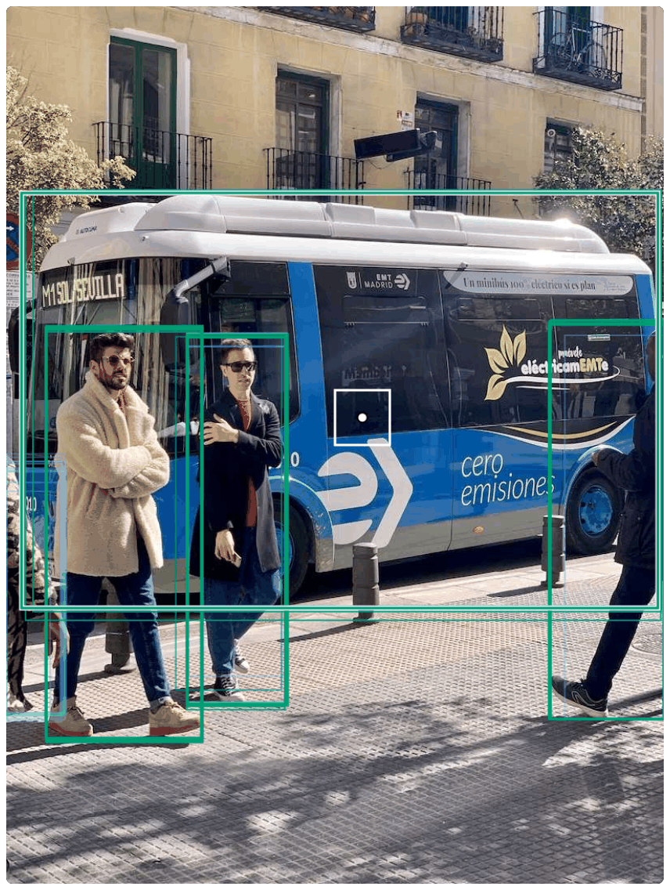{fig-alt="A street photo with a bus and four people. Many overlapping boxes per object before non-maximum suppression, coloured by the grid that produced them (blue: stride 16, green: stride 32): 54 candidates above score 0.1 for 5 objects. Photo: Ultralytics sample image, AGPL-3.0." width="78%" fig-align="center"}
:::
::::

## The grid: one guess per cell

The network's last layers are **coarse grids**: the image cut into cells of 8, 16 and 32 pixels (the **stride**).

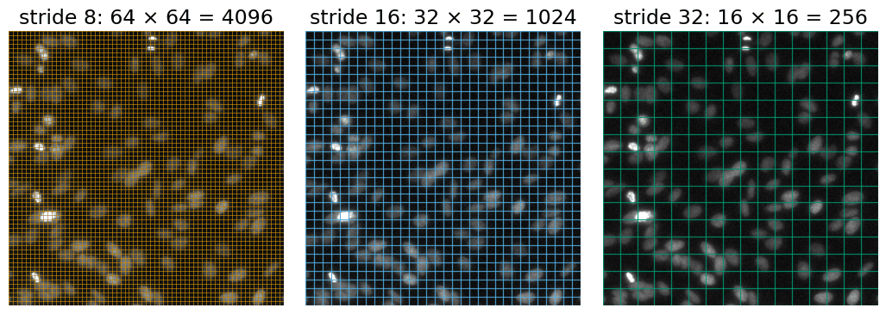{fig-alt="The same 512 × 512 nuclei image three times with a grid: stride 8 gives 64 × 64 = 4096 cells, stride 16 gives 32 × 32 = 1024, stride 32 gives 16 × 16 = 256; 5376 cells in total. Image: StarDist test image, BSD-3-Clause." width="72%" fig-align="center" .nostretch}

[Image: StarDist test image (fluorescent nuclei from the 2018 Data Science Bowl data), BSD-3-Clause.]{style="font-size: 0.6em; color: #666"}

- A 512 × 512 input: $64^2 + 32^2 + 16^2 = 5376$ cells (640 × 640: 8400). Every cell makes **one guess**: "is there an object whose box contains my centre, and where are its sides?"
- A **fixed** number of guesses, most of them "nothing": that is how a fixed-size output describes any number of objects.

## What one cell predicts

:::: {.columns}
::: {.column width="50%"}
Per cell: four **distances** from the cell centre to the left, top, right and bottom side of the box (in strides), and a **score per class** (80 for the photo model).

Worked example: stride 16, row 5, column 7.

- Cell centre: $(7.5 \cdot 16,\ 5.5 \cdot 16) = (120, 88)$ px.
- Distances 2.5, 1, 1.5, 2 strides = 40, 16, 24, 32 px.
- Box: $x$ from $120 - 40 = 80$ to $120 + 24 = 144$, $y$ from $88 - 16 = 72$ to $88 + 32 = 120$.
- True box (84, 70)–(150, 122): IoU **0.79**.

The cell does not have to sit at the box centre; it only has to lie **inside** the box.
:::
::: {.column width="50%"}
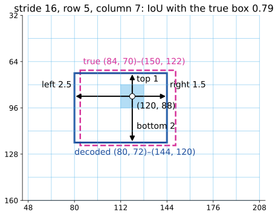{fig-alt="A stride-16 grid; the cell in row 5, column 7 shaded, its centre (120, 88) and four arrows: left 2.5, top 1, right 1.5, bottom 2 strides. The decoded box (80, 72)–(144, 120) in blue, the true box (84, 70)–(150, 122) dashed in magenta; IoU 0.79." width="100%"}
:::
::::

## The math: decoding a cell {.math}

Cell in row $i$, column $j$ of the grid with stride $s$; distances $d_l, d_t, d_r, d_b$ in strides:

$$(x_1, y_1, x_2, y_2) = s\,\big(j + \tfrac12 - d_l,\ \ i + \tfrac12 - d_t,\ \ j + \tfrac12 + d_r,\ \ i + \tfrac12 + d_b\big).$$

Each distance is the **mean** of a distribution over the bins $0, 1, \dots, 15$:

$$d = \sum_{k=0}^{15} k\, p_k, \qquad p = \mathrm{softmax}(z), \quad p_k = \frac{e^{z_k}}{\sum_m e^{z_m}},$$

from 16 numbers $z_0, \dots, z_{15}$ per side. Class $c$: an independent probability $\sigma(z_c) = 1/(1 + e^{-z_c})$, not a softmax over classes: a box may score high for two classes, or for none.

Per cell: $4 \times 16 + C$ numbers; $C = 80$: 144.

## Distances as distributions

:::: {.columns}
::: {.column width="45%"}
Each distance comes as **16 probabilities** over 0, 1, …, 15 strides; the decoded distance is their **mean**.

- Half on 2, half on 3: 2.5.
- All on 1: 1, a **sharp**, confident edge.
- 0.6 on 2 and 0.4 on 9: 4.8, a side where **neither** guess is: an uncertain edge (blurry, occluded, cut by the image border).

**Consequence**: a side can be at most 15 strides from the cell centre: 120 px at stride 8, 240 at stride 16, 480 at stride 32. Large objects must come from the coarse grids.
:::
::: {.column width="55%"}
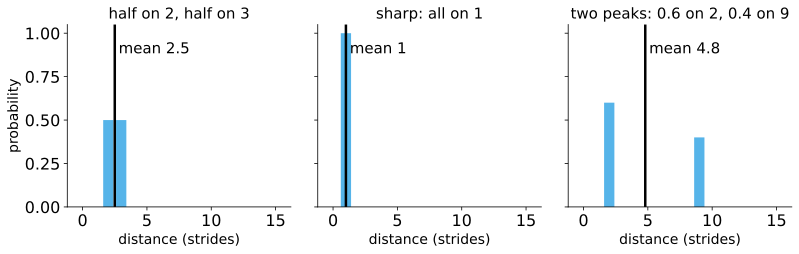{fig-alt="Three bar charts over the bins 0 to 15 with the mean as a vertical line: half on 2 and half on 3, mean 2.5; all on 1, mean 1; 0.6 on 2 and 0.4 on 9, mean 4.8, between the two peaks." width="100%"}
:::
::::

## The math: the distribution loss {.math}

:::: {.columns}
::: {.column width="58%"}
Training target: a true distance $y$ between the bins $k$ and $k + 1$. Loss on the side's distribution $p$:

$$L = -\big((k + 1 - y)\log p_k + (y - k)\log p_{k+1}\big).$$

Minimise over $p_k + p_{k+1} = 1$: $\;p_k = k + 1 - y$, $\;p_{k+1} = y - k$, whose mean is

$$k(k + 1 - y) + (k + 1)(y - k) = y \quad\text{exactly.}$$

Target 2.3: 0.7 on 2, 0.3 on 3. A one-hot target on the nearest bin (2) would teach a distance that is off by up to half a stride (4 px at stride 8, 16 px at stride 32).
:::
::: {.column width="42%"}
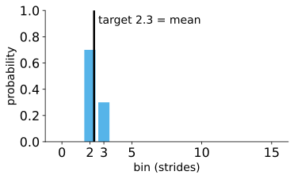{fig-alt="Bar chart: 0.7 on bin 2 and 0.3 on bin 3; their mean 2.3 equals the target distance (vertical line)." width="100%"}
:::
::::

## Scores and classes

Per class an independent probability from one number (the **logit**) through the S-shaped sigmoid:

| logit | 1.2 | −0.5 | −3 |
|---|---|---|---|
| probability | 0.77 | 0.38 | 0.05 |

- A **candidate** is a (cell, class) pair whose probability is above the **score threshold** (0.25 by default).
- Neighbouring cells, and cells of other strides, all see the same object: several candidates per object, with slightly different boxes.
- In the bus photo at threshold 0.25: 45 of 5376 cells × 80 classes pass (7 at stride 16, 38 at stride 32, none at stride 8).
- The **score maps** (one per stride, the best class probability of every cell) show where the network thinks objects are: next slide.

## Three scales: a feature pyramid

:::: {.columns}
::: {.column width="55%"}
- **Fine grid** (stride 8) for small objects: many cells, short reach (120 px).
- **Coarse grid** (stride 32) for large objects: few cells, long reach (480 px), and each cell sees a large part of the image.
- The coarse maps are upsampled and merged into the fine ones, so the small-object guesses also see **context** (feature pyramid; Lin et al., 2017).

In the bus photo (input 512): the bus and three people come from **stride 32** (green), the person cut by the left border from **stride 16** (blue). Stride 8 has nothing to do here: no small objects.
:::
::: {.column width="45%"}
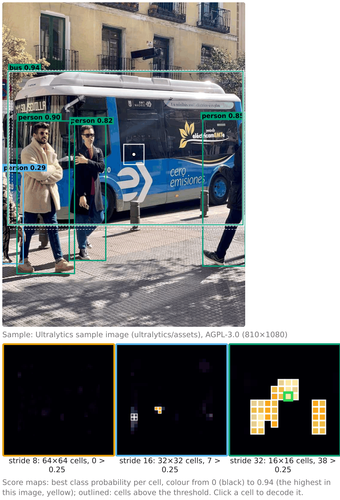{fig-alt="The bus photo after NMS: bus 0.94 and persons 0.90, 0.85, 0.82 in green (stride 32), a person 0.29 at the left border in blue (stride 16). Below: the three score maps; stride 8 is dark, stride 16 has 7 cells above 0.25, stride 32 has 38 in three blobs (the bus and the people). Photo: Ultralytics sample image, AGPL-3.0." width="70%" fig-align="center"}
:::
::::

## Decoding: from candidates to a list

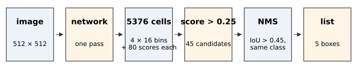{fig-alt="Pipeline: image 512 × 512 → network, one pass → 5376 cells with 4 × 16 bins and 80 scores each → score > 0.25: 45 candidates → NMS (IoU > 0.45, same class) → a list of 5 boxes (the bus photo)." width="95%" fig-align="center" .nostretch}

- **Threshold** the scores: thousands of cells become tens of candidates.
- **Decode** each candidate's box from its four distributions.
- **Greedy NMS** (recall): the best box removes the others that overlap it by more than $t$ (0.45 by default). In the bus photo the four large boxes removed 9 or 10 others each.
- The result is the **list**: as long as the image needs.

## NMS per class or across classes

:::: {.columns}
::: {.column width="44%"}
**Class-aware** NMS compares only boxes of the **same** class; **class-agnostic** NMS compares all.

Six boxes, two classes (exercise B3): b1 cell 0.90, b2 cell 0.80, b3 cell 0.75, b4 debris 0.60 (almost on b1), b5 cell 0.50, b6 cell 0.20.

- Class-aware: b1, b3, **b4**: the debris box survives on top of the cell.
- Agnostic: b1, b3: b4 is removed by b1 (IoU 0.90).

Which is right depends on the question: can one object be both? In the photo model at input 256, a "bus" (0.46) and a "truck" (0.40) box on the same vehicle are both kept by class-aware NMS.
:::
::: {.column width="56%"}
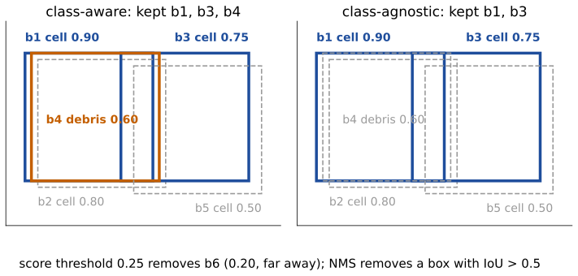{fig-alt="The boxes b1 to b5 twice. Left, class-aware: kept b1 and b3 (cells) and b4 (debris, orange), b2 and b5 removed (grey dashed). Right, class-agnostic: kept b1 and b3, b4 removed too." width="100%"}
:::
::::

## The math: output size and the cost of decoding {.math}

Input $S \times S$, strides $s \in \{8, 16, 32\}$, $C$ classes:

$$A = \sum_s (S/s)^2 \ \text{cells}, \qquad A \times (4 \cdot 16 + C) \ \text{numbers}.$$

$S = 512$, $C = 80$: $5376 \times 144 = 774\,144$ numbers; $S = 256$: 1344 cells; $S = 640$: 8400.

Decoding is cheap: one softmax and one mean per side, $O(A(64 + C))$; NMS on $m$ candidates costs at most $O(m^2)$ IoUs, and $m$ is small after the threshold ($m = 45$ in the photo).

Class-aware NMS = NMS run separately on each class. The two variants are **not** nested: a box removed early by class-agnostic NMS can no longer remove others, so agnostic NMS can keep a box that class-aware NMS removes (exercise B10).

## Try it: decode by hand, then the whole grid

```{=html}
<link rel="stylesheet" href="../demos/dist/demo.css">
<div data-demo="yolodecode" data-preset="b1"></div>
<script src="../demos/dist/yolodecode.js"></script>
```

::: notes
Analytic demo: the "network" is simulated from the true boxes the way it is trained (a cell inside a box answers for it, more confidently near the centre and at the stride that suits the object's size), so every number can be checked. Static view: fig-yolodecode.png. Tour: "B1: decode one cell": stride-16 grid, the cell (row 5, column 7), its four distributions (left 2.50, top 1.00, right 1.50, bottom 2.00), box (80, 72)–(144, 120), IoU 0.79 with the true box, p(cell) 0.77. Drag a bar in "right" to bin 9: the box grows. "two peaks": right side 0.6 on 2, 0.4 on 9 → 4.80, IoU drops to 0.54. "too large for stride 8": a 460 × 300 cell; the stride-8 cell at its centre needs 29 strides to the left, the bins stop at 15, its box covers IoU 0.40; the kept box comes from stride 32. Switch "candidates": 111 candidates. "small cell": a 12 × 12 cell contains the centres of 4 stride-8 cells and none of stride 16 or 32; untick stride 8 and it is lost. "class-aware NMS keeps the debris box": 14 boxes, FP 1 (a "cell" box on debris that looks like a cell); "agnostic": 13, F1 1.00. "crowded rods": NMS 0.45 deletes one rod of the palisade (FN 1), 0.5 keeps all. "anchors": the small cell and the three debris pieces have no anchor with IoU ≥ 0.5: never learned, FN 4.
:::

## Before: anchors and centre heat maps

:::: {.columns}
::: {.column width="55%"}
The grid of guesses is older than the distance head:

- **Anchors**: each cell owned a few **template boxes** (sizes and shapes chosen in advance) and predicted a **correction** to them. An object was learned only by anchors overlapping it with IoU ≥ 0.5: objects much smaller, larger or longer than every template were **never learned**.
- **Centre heat maps**: a map with a bump at every object centre; objects = **local maxima** (the [Hough day](../hough-lines/lec.qmd)'s peak picking); close objects merge, noise gives double peaks.
- Current single-shot heads keep the grid and drop the templates: "my centre is inside the box" decides who answers.
:::
::: {.column width="45%"}
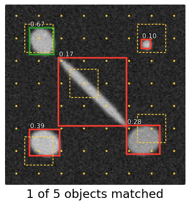{fig-alt="Anchor grid (stride 16) with one 20 × 20 anchor shape on a synthetic scene: for each object the best anchor and its IoU: 0.67 for one round cell (learnable); 0.39, 0.28, 0.17 for two other cells and the diagonal rod, and 0.10 for the small cell (never learned)." width="100%"}
:::
::::

## The math: boxes relative to an anchor {.math}

Anchor centre $(x_a, y_a)$, size $(w_a, h_a)$; the network predicts

$$t_x = \frac{x - x_a}{w_a}, \quad t_y = \frac{y - y_a}{h_a}, \quad t_w = \log\frac{w}{w_a}, \quad t_h = \log\frac{h}{h_a}.$$

- Dividing by the anchor size makes the targets the same for small and large objects.
- The **log**: twice too wide and half as wide are equally wrong ($\pm\log 2$); $w = w_a e^{t_w}$ is always positive; an error in $t_w$ is a **relative** error in $w$.
- Centre heat map instead: target $Y(p) = \max_k \exp(-\|p - c_k\|^2 / 2\sigma^2)$; objects are the $p$ with $Y(p) = \max_{q \in W(p)} Y(q)$ and $Y(p) \ge \theta$.
- Either way, most positions are background: easy negatives are down-weighted by a factor $(1 - p)^\gamma$ in the cross-entropy (the **focal loss**; Lin et al., 2017).

## Training in one slide

:::: {.columns}
::: {.column width="48%"}
- **Who answers for an object?** Cells whose centre lies inside its box, preferring central cells and the stride whose cells predict it best (the "assignment"). All other cells are taught "nothing here".
- **Losses** for the responsible cells: an IoU-type loss on the box, the distribution loss on each side, a classification loss on the scores.
- Most cells are background: easy negatives are down-weighted, as in the focal loss.
- Fine-tuning on a new kind of object needs **a box around every object** in a few hundred images.
:::
::: {.column width="52%"}
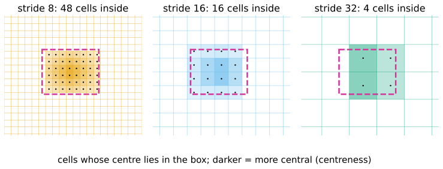{fig-alt="The true box (84, 70)–(150, 122) on grids of stride 8, 16 and 32: 48, 16 and 4 cells have their centre inside the box; their shading is darker the more central the cell (centreness)." width="100%"}
:::
::::

## The math: a box loss with a gradient everywhere {.math}

:::: {.columns}
::: {.column width="50%"}
$1 - \mathrm{IoU}$ is flat (= 1) for disjoint boxes: **no gradient** (recall the [boxes unit](../detection/lec.qmd)). **Generalised IoU** (Rezatofighi et al., 2019), with $C$ the smallest box enclosing $A$ and $B$:

$$\mathrm{GIoU} = \mathrm{IoU} - \frac{|C \setminus (A \cup B)|}{|C|} \in (-1, 1].$$

$A = [0,4]^2$, $B = [6,10] \times [0,4]$: IoU 0, $C = [0,10] \times [0,4]$, gap $40 - 32 = 8$: GIoU $= -0.2$. Move $B$ one to the left: $-4/36 = -0.11$. The loss $1 - \mathrm{GIoU}$ falls as the boxes approach.

Current heads use a variant with a centre-distance and an aspect-ratio term (CIoU).
:::
::: {.column width="50%"}
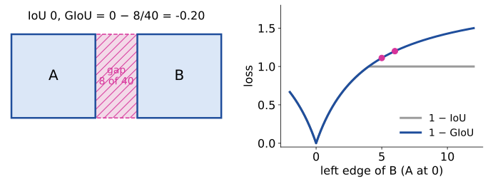{fig-alt="Left: boxes A and B four units apart horizontally with a gap of 8 of the enclosing box's 40 hatched: IoU 0, GIoU −0.2. Right: 1 − IoU and 1 − GIoU against the position of B: 1 − IoU is flat at 1 once the boxes are disjoint, 1 − GIoU keeps rising, with the points −0.2 and −0.11 marked." width="100%"}
:::
::::

## Speed: one look

- One pass of the network for the whole image, then thresholding and NMS on a few dozen candidates: no per-object network runs.
- The smallest model of the family has about **2.6 million** weights. In the browser (WebAssembly, one CPU core), measured in the demo: about **0.85 s** for a 512 × 512 input, **0.22 s** for 256 × 256; decoding and NMS take milliseconds.
- On a graphics card the same network runs in a few milliseconds: hence its use for **video** and **live microscopy** (tracking by detection: the [tracking day](../track-linking/lec.qmd)).
- Smaller input = faster, but small objects fall below the finest stride (exercise E4).

## Boxes for cells?

:::: {.columns}
::: {.column width="48%"}
- Boxes are good for **counting**, **tracking**, **cropping** each cell for a second step.
- Poor for touching, long or diagonal cells: a 45° rod fills 16&nbsp;% of its box, and boxes of neighbours overlap a lot (recall the [boxes unit](../detection/lec.qmd)).
- The photo model on fluorescent nuclei: **nothing** at the default threshold; its best score anywhere is 0.045. At 0.01: "person", "sports ball", a "bus" around the whole image. **There is no class "cell"**: the strongest out-of-domain failure of the day.
- A cell detector needs **fine-tuning** on annotated cells (a box per cell).
:::
::: {.column width="52%"}
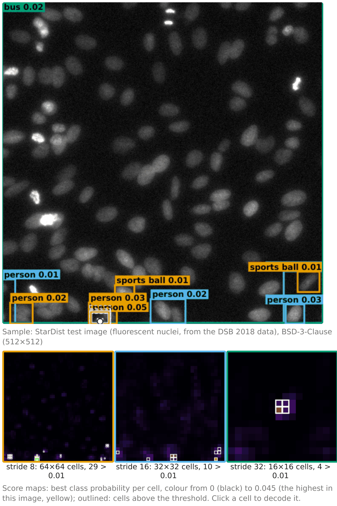{fig-alt="The photo detector on a fluorescence image of nuclei at score threshold 0.01: a few boxes labelled person (0.01 to 0.05), sports ball (0.01) and one bus box (0.02) around the whole image; the score maps are nearly black (highest 0.045). Image: StarDist test image, BSD-3-Clause." width="52%" fig-align="center"}
:::
::::

## Try it: the real network

```{=html}
<link rel="stylesheet" href="../demos/dist/demo.css">
<div data-demo="yolonet" data-preset="raw"></div>
<script src="../demos/dist/yolonet.js"></script>
```

::: notes
The network (module + 5 MB of weights) loads once and is cached; then it runs about 0.85 s per 512 × 512 input in a worker. Opened as a local file, the demo explains why it cannot run; static view: fig-yolonet.png. Tour: preset "photo: raw candidates" (threshold 0.1): 54 candidates, 16 at stride 16 and 38 at stride 32. "after NMS": 5 boxes; click the bus box: its cell (stride 32), its four distributions, "Kept; it removed 9 overlapping candidates". Click the person at the left border (0.29, stride 16): the top distribution is the widest (spread about one stride). "photo: no NMS (IoU 1)": all 45. "photo: input 256" (two people): 0.22 s; the two people stay, a third person box (0.32) appears at the right edge and the tie (0.40 at 512) is gone. Then "nuclei: defaults": nothing; "nuclei: threshold 0.01": person 0.05, sports ball, bus. Untick strides to see which grid carries which object.
:::

## Summary

- A single-shot detector covers the image with **grids** (strides 8, 16, 32) and lets **every cell guess**: a fixed number of guesses describes any number of objects.
- A cell predicts **four distances** (each a distribution over 16 bins; the mean is the distance) and **a probability per class**.
- **Decoding**: score threshold → candidates → boxes → **NMS** (per class or across classes) → the list.
- Reach of 15 strides and cell size tie object size to the **stride**: large objects need coarse grids, small ones fine grids.
- Older heads: **anchors** (objects unlike every template are never learned) and **centre heat maps**.
- Fast (one pass), boxes only, and only the classes it was trained on: on cells, a photo model finds **nothing**.

## Where this leads

- A **mask head** inside each box: instance segmentation in one pass (the masks of the [instances unit](../instances/lec.qmd), per box).
- **Tracking by detection**: detect in every frame, then link the boxes (the [tracking day](../track-linking/lec.qmd)).
- Prompts for a promptable segmenter: boxes from a detector → masks ([next unit: promptable segmentation](../sam/lec.qmd)).
- The comparison of cell networks and classical pipelines on the same images: the [last unit of this day](../cellnets-compare/lec.qmd).
