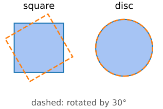
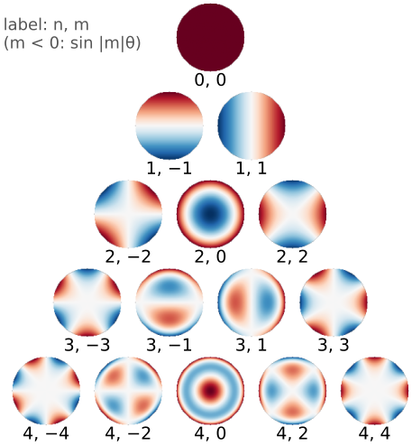
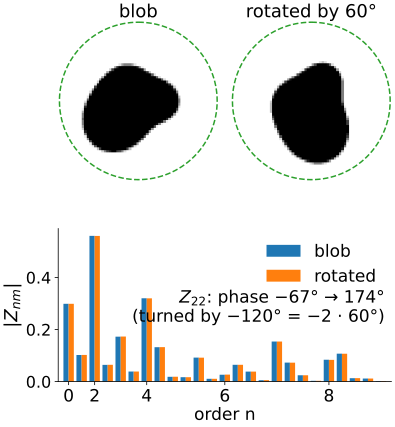
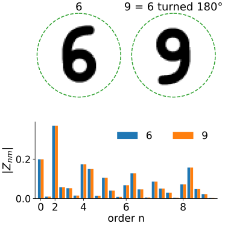
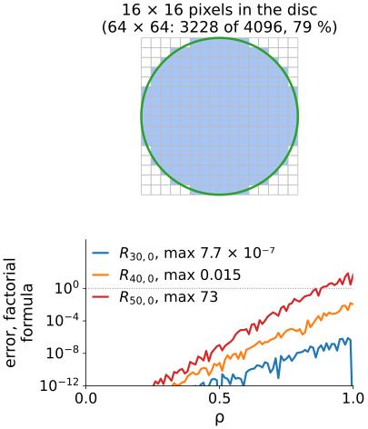
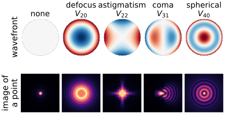

## About this lecture

Legendre moments fixed the conditioning, but they live on a square, and a square does not turn into itself under rotation. Move to a **disc**:

- **Zernike polynomials**: a Fourier series in the angle times a polynomial in the radius, orthogonal on the unit disc.
- **Zernike moments** $Z_{nm}$; reconstruction as in the previous unit.
- **Rotation** only turns the phase of $Z_{nm}$: the magnitudes $|Z_{nm}|$ are rotation invariant, for free.
- What they lose (6 and 9), how pixels and arithmetic spoil them, and where they come from (optics).

*Slides titled **The math** give the formulas and proofs; the ideas are complete without them.*

::: notes
Fourth unit of the moments elective. Assumed: complex moments and invariants (moment-invariants/), orthogonal projection and reconstruction (orthogonal-moments/), polar coordinates and e^{iθ} from calculus and the Fourier unit. θ is measured counter-clockwise on the screen (y up), so a counter-clockwise rotation is a positive angle.
:::

## Why a disc?

:::: {.columns}
::: {.column width="60%"}
- Rotation is natural in **polar coordinates** $(\rho, \theta)$: turning the image by $\alpha$ is the shift $\theta \to \theta + \alpha$.
- A function of $\theta$ on a circle has a **Fourier series** $\sum_m c_m e^{im\theta}$; a shift multiplies each term by a phase $e^{im\alpha}$ and leaves its size alone (the shift theorem of the Fourier unit).
- A square is not rotation symmetric: rotating the image moves its corners in and out of the square, and Legendre moments of a rotated image are complicated mixtures of the original ones.

So: build a basis on the **unit disc** whose angular part is $e^{im\theta}$.
:::
::: {.column width="40%"}
{fig-alt="A square and the same square rotated by 30 degrees (dashed): the corners stick out of the original square. A disc and the disc rotated by 30 degrees: the same set." width="100%"}
:::
::::

## Zernike polynomials

$$V_{nm}(\rho, \theta) = R_{nm}(\rho)\, e^{im\theta}, \qquad n \ge 0,\ |m| \le n,\ n - |m| \text{ even}.$$

:::: {.columns}
::: {.column width="60%"}
- $m$: how many times the pattern repeats around the circle (the angular frequency).
- $n$: the degree of the radial polynomial; $R_{nm}$ has $(n - |m|)/2$ zeros inside the disc.
- Small ones: $R_{00} = 1$, $R_{11} = \rho$, $R_{20} = 2\rho^2 - 1$, $R_{22} = \rho^2$, $R_{31} = 3\rho^3 - 2\rho$, $R_{33} = \rho^3$, $R_{40} = 6\rho^4 - 6\rho^2 + 1$.
- Real versions: $R_{nm}\cos m\theta$ and $R_{nm}\sin m\theta$.
:::
::: {.column width="40%"}
{fig-alt="The Zernike polynomials for n = 0 to 4 as a pyramid of images on the unit disc, red positive and blue negative, labelled n, m: the angular frequency m grows outwards in each row, the radial degree n downwards, with more rings for larger n." width="88%"}
:::
::::

## The math: Zernike polynomials are orthogonal {.math}

$$\iint_{\rho \le 1} \overline{V_{nm}}\, V_{n'm'}\, \rho\,d\rho\,d\theta = \frac{\pi}{n + 1}\,\delta_{nn'}\delta_{mm'}.$$

- Angular part: $\int_0^{2\pi} e^{i(m' - m)\theta}\,d\theta = 2\pi\,\delta_{mm'}$ (the Fourier basis).
- Radial part, same $m$: $\int_0^1 R_{nm} R_{n'm}\,\rho\,d\rho = \frac{1}{2(n+1)}\delta_{nn'}$, orthogonal with the **weight $\rho$** (the area element of polar coordinates). Example: $\int_0^1 (2\rho^2 - 1)\cdot 1 \cdot \rho\,d\rho = \tfrac12 - \tfrac12 = 0$.
- General formula: $R_{nm}(\rho) = \sum_{k=0}^{(n-|m|)/2} \frac{(-1)^k (n-k)!}{k!\,\left(\frac{n+|m|}{2} - k\right)!\,\left(\frac{n-|m|}{2} - k\right)!}\,\rho^{n - 2k}$.
- $R_{nm}(1) = 1$ for all $n, m$.

## Try it: the Zernike polynomials

```{=html}
<link rel="stylesheet" href="../demos/dist/demo.css">
<div data-demo="zernikebasis" data-preset="defocus" data-presets="defocus,astig"></div>
<script src="../demos/dist/zernikebasis.js"></script>
```

::: notes
Pyramid of V_nm for n ≤ 8 (cos mθ for m ≥ 0, sin |m|θ for m < 0), diverging colours, red positive. Click a tile for the large view and the radial profile. Tour: (0, 0) piston; (1, ±1) tilts (one sign change across the disc); (2, 0) defocus: R = 2ρ² − 1, one zero at ρ = 0.707; (2, ±2) astigmatism; (3, ±1) coma; (4, 0) spherical aberration: two zeros. Switch to |V| = |R(ρ)|: rings only; the angular part has magnitude 1. Higher n: rings crowd towards the edge.
:::

## Zernike moments

The coefficients of an image in this basis, on the disc:

$$Z_{nm} = \frac{n + 1}{\pi} \iint_{\rho \le 1} I(\rho, \theta)\, \overline{V_{nm}(\rho, \theta)}\,\rho\,d\rho\,d\theta.$$

- Complex numbers; for a real image $Z_{n,-m} = \overline{Z_{nm}}$, so only $m \ge 0$ is needed: up to order $N$ there are $(N+2)^2/4$ of them for even $N$ (9 at $N = 4$, 121 at $N = 20$), the same $(N+1)(N+2)/2$ **real** numbers as before.
- **Reconstruction** exactly as with Legendre: $\hat I_N = \sum_{n \le N}\sum_m Z_{nm} V_{nm}$, the orthogonal projection onto the polynomials of degree $\le N$ on the disc.
- The image must be centred on the disc: put the disc's centre at the **centroid** and choose its radius from $m_{00}$ or the farthest object pixel. That makes the moments translation and scale invariant.

## Rotation: only the phase turns

:::: {.columns}
::: {.column width="58%"}
Rotate the image by $\alpha$ (counter-clockwise). Every pixel moves from angle $\theta$ to $\theta + \alpha$, and

$$Z_{nm} \;\to\; Z_{nm}\, e^{-im\alpha}.$$

- $|Z_{nm}|$ does **not** change: a rotation-invariant feature for every $(n, m)$.
- The phase turns by $-m\alpha$: $m$ times as fast as the image. $Z_{n0}$ is real and does not turn at all.
- The same story as the complex moments $c_{pq}$ of the invariants unit: each $Z_{nm}$ is a combination of the $c_{pq}$ with $|p - q| = m$. Zernike moments are those invariants written in an **orthogonal** basis, so each one carries new information.
:::
::: {.column width="42%"}
{fig-alt="A blob and the blob rotated by 60 degrees inside the dashed unit disc; below, the bars of |Z_nm| for n up to 8 of both, which coincide (largest difference 1.5 per cent). The phase of Z22 turns from −67 to 174 degrees, by −120 degrees = −2 · 60 degrees." width="100%"}
:::
::::

## The math: rotation and the link to complex moments {.math}

Let $I'(\rho, \theta) = I(\rho, \theta - \alpha)$. Substituting $\theta = \theta' + \alpha$:

$$Z'_{nm} = \frac{n+1}{\pi}\iint I(\rho, \theta - \alpha) R_{nm}(\rho) e^{-im\theta}\rho\,d\rho\,d\theta = e^{-im\alpha} Z_{nm}.$$

**Complex moments.** $\rho^{n-2k}e^{-im\theta} = (x - iy)^{(n-2k+m)/2}(x + iy)^{(n-2k-m)/2}$, so

$$Z_{nm} = \frac{n+1}{\pi}\sum_k \beta_{nmk}\; c_{\frac{n-2k-m}{2},\,\frac{n-2k+m}{2}},$$

with $\beta_{nmk}$ the coefficients of $R_{nm}$. Example: $Z_{11} = \frac2\pi c_{01} = \frac2\pi(m_{10} - i\,m_{01})$: proportional to the centroid's offset from the disc centre.

## Try it: rotate, and compare $|Z_{nm}|$

```{=html}
<link rel="stylesheet" href="../demos/dist/demo.css">
<div data-demo="zernikebasis" data-preset="rotate" data-presets="rotate,six,mirror"></div>
<script src="../demos/dist/zernikebasis.js"></script>
```

::: notes
A 64 × 64 test image and a copy rotated by α (rasterised anti-aliased after rotating the outline), the bars of |Z_nm| (n ≤ 8, m ≥ 0) of both, and the phase of one Z_nm before and after. Tour: "rotate: magnitudes stay" (blob, 60°): the largest relative difference of the magnitudes is 1.5 %; Z22 turns by −120° = −2 · 60°. Change α: 15° gives 1.9 %, 45° 3.0 % (pixels). "6 vs 9": the 6 rotated by 180° is a 9: the bars are identical (0.0 %); Z11 turns by −180°, Z22 by 0. "same |Z|, different shape": an F and its mirror image, identical magnitudes; the phase of Z31 goes from 41° to 139°.
:::

## What the magnitudes lose

:::: {.columns}
::: {.column width="60%"}
- **The phase**: a shape and its rotated copy have the same $|Z_{nm}|$. So do **6 and 9**, M and W, a b and a q.
- **Mirror images**: a reflection conjugates every $Z_{nm}$ (up to a sign $(-1)^m$ for a left–right mirror), so the magnitudes are the same: b and d too.
- Choose the invariance the task needs, not the most: to tell 6 from 9, keep a phase (e.g. relative to the phase of a reference moment).
- **Low orders** are robust and coarse; **high orders** describe detail and are sensitive to noise. Orthogonality means each moment adds new information (Teh & Chin, 1988, compare the noise sensitivity of the moment families).
:::
::: {.column width="40%"}
{fig-alt="A handwritten-style 6 and the same 6 turned by 180 degrees, which is a 9, each in the unit disc; below, their |Z_nm| for n up to 8: the bars are identical." width="100%"}
:::
::::

## Discretisation and arithmetic

:::: {.columns}
::: {.column width="60%"}
- **Square pixels on a round domain.** The inscribed disc of a $64 \times 64$ image holds 3228 of the 4096 pixels (79 %): the corners are ignored. A circumscribed disc covers everything but contains empty regions; either way the boundary is a staircase.
- **Sampling vs integrating**, as for Legendre: the sampled $V_{nm}$ are only nearly orthogonal; the error grows with the order.
- **Arithmetic.** The factorial formula sums terms of alternating sign that are huge compared with the result ($|R_{nm}| \le 1$): for $R_{40,0}$ the largest term is $5 \times 10^{13}$. Computed that way, $R_{40,0}$ is off by up to 0.015, $R_{50,0}$ by 73. A **recurrence** in $n$ (Kintner; Prata & Rusch 1989) avoids the cancellation.
:::
::: {.column width="40%"}
{fig-alt="Top: a 16 × 16 pixel grid with the pixels whose centres lie in the inscribed disc shaded, a staircase along the circle; at 64 × 64 the disc holds 3228 of the 4096 pixels. Bottom: the error of the factorial formula against rho on a log scale, growing towards the rim: at most 7.7 × 10^−7 for R30,0, 0.015 for R40,0 and 73 for R50,0." width="100%"}
:::
::::

## Try it: the disc and the noise

```{=html}
<link rel="stylesheet" href="../demos/dist/demo.css">
<div data-demo="momentrecon" data-preset="outside" data-presets="outside,noise"></div>
<script src="../demos/dist/momentrecon.js"></script>
```

::: notes
Same demo as in the previous unit; look at the Zernike panel. "Zernike outside the disc" (micrograph crop, N = 20): the Zernike reconstruction is 0 outside the dashed disc, so its error over the whole square is 0.552, against 0.160 (Legendre) and 0.139 (Fourier); inside the disc alone it is 0.158. "noise in high orders" (nucleus, σ = 0.3, N = 40): Zernike error 0.421 (best 0.257 at N = 18), higher than Legendre (0.340) and Fourier (0.318): the high radial orders crowd towards the rim and pick up noise there.
:::

## Where Zernike polynomials come from

:::: {.columns}
::: {.column width="50%"}
Frits Zernike introduced them in 1934 to analyse the knife-edge test of mirrors, on the way to **phase-contrast microscopy** (Nobel prize 1953).

Today they are the standard language for **wavefront aberrations** of lenses: the deviation of a wavefront over the round pupil is written as $\sum a_{nm} V_{nm}$.

- $V_{20}$: **defocus**; $V_{2,\pm 2}$: **astigmatism**; $V_{3,\pm 1}$: **coma**; $V_{3,\pm3}$: trefoil; $V_{40}$: **spherical aberration**.
- Adaptive optics and objective-lens corrections are specified in these terms (the image-formation day's pupil function).
:::
::: {.column width="50%"}
{fig-alt="Top row: a flat wavefront over the round pupil and wavefronts of 0.6 waves of defocus, astigmatism, coma and spherical aberration. Bottom row: the image of a point for each: a small Airy spot, a wide ring, a cross, a comet-shaped flare, and a spot with rings." width="100%"}

Simulated: pupil wavefront $0.6\,V_{nm}$ (in waves), image of a point $= |\text{Fourier transform of the pupil}|^2$.
:::
::::

## Summary

- **Zernike polynomials** $V_{nm} = R_{nm}(\rho) e^{im\theta}$: angular Fourier series times radial polynomials, orthogonal on the unit disc (weight $\rho$).
- **Zernike moments** $Z_{nm}$: projections onto $V_{nm}$; $Z_{n,-m} = \overline{Z_{nm}}$; reconstruction by summing, as with Legendre.
- **Rotation** multiplies $Z_{nm}$ by $e^{-im\alpha}$: $|Z_{nm}|$ is rotation invariant (and mirror invariant), but loses the difference between 6 and 9.
- Centre the disc on the centroid; expect errors from **square pixels** on the round domain, **sampling**, and **cancellation** in the factorial formula (use a recurrence).
